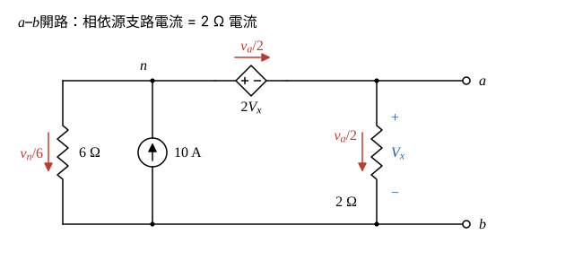
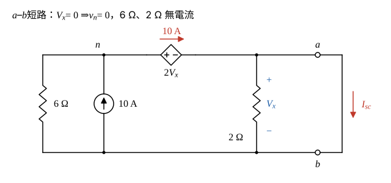
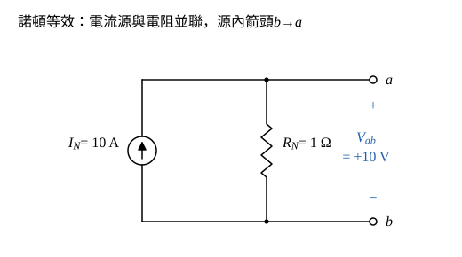

# 114 年電路學第 2 題｜諾頓等效

## 已知與所求

取 \(b\) 為參考點。左上節點 \(n\) 接 6 Ω 至 \(b\) 及 10 A 電流源（箭頭向上流入 \(n\)）；相依電壓源 \(2V_x\) 正端接 \(n\)、負端接 \(a\)；2 Ω 跨接 \(a\)–\(b\)，\(V_x=v_a\)（上正）。求 \(a\)–\(b\) 的諾頓等效電路。

## 考場標準作答

### 步驟 1：相依源約束

電路含相依源，不能把源歸零後直接串並聯求 \(R_N\)，故用 \(R_N=V_{oc}/I_{sc}\)。取 \(b\) 為參考點，\(V_x=v_a\)（上正下負）。

相依源正端接 \(n\)、負端接 \(a\)，其電壓為 \(2V_x\)：
\[
v_n-v_a=2V_x,\qquad V_x=v_a
\]
\[
v_n=v_a+2v_a=3v_a
\]

### 步驟 2：開路電壓 \(V_{oc}\)

\(a\)、\(b\) 開路時 \(a\) 端無外接電流，流過相依源（\(n\to a\)）的電流全部經 2 Ω 回到 \(b\)，即 \(v_a/2\)。節點 \(n\) 的 KCL（10 A 流入 = 6 Ω 與相依源支路流出）：
\[
10=\frac{v_n}{6}+\frac{v_a}{2}
\]
代入 \(v_n=3v_a\)：
\[
10=\frac{3v_a}{6}+\frac{v_a}{2}=\frac{v_a}{2}+\frac{v_a}{2}=v_a
\]
\[
V_{oc}=v_a=10\ \mathrm V
\]

### 步驟 3：短路電流 \(I_{sc}\)

\(a\)–\(b\) 短路使 \(v_a=0\)，故 \(V_x=0\)、相依源電壓 \(2V_x=0\)：
\[
v_n=3v_a=3\times0=0
\]
6 Ω 與 2 Ω 兩端電壓皆為零，電流 \(v_n/6=0\)、\(v_a/2=0\)。節點 \(n\) 的 KCL：10 A 全部經相依源流向 \(a\)；節點 \(a\) 的 KCL：
\[
I_{sc}=10-\frac{v_a}{2}=10-0
\]
\(I_{sc}=10\ \mathrm A\)，在外部短路線中由 \(a\to b\)。

### 諾頓等效電路（20 分）

\[
I_N=I_{sc}=10\ \mathrm A
\]
\[
R_N=\frac{V_{oc}}{I_{sc}}=\frac{10}{10}=1\ \Omega
\]
\[
\boxed{I_N=10\ \mathrm A},\qquad \boxed{R_N=1\ \Omega}
\]
畫法：\(a\)、\(b\) 兩端**並聯** 10 A 理想電流源與 1 Ω 電阻；電流源箭頭由 \(b\to a\)，使開路時電流全經 1 Ω 由上往下流，\(V_{ab}=I_NR_N=10\times1\)，即 \(V_{ab}=+10\,\mathrm V\)，與 \(V_{oc}\) 一致。

## 驗算

測試源法：關閉 10 A（開路）、保留相依源，在 \(a\) 加 \(V_t\)，則 \(v_n=3V_t\)，\(i_t=\frac{V_t}{2}+\frac{3V_t}{6}=V_t\Rightarrow R_N=1\ \Omega\)，與 \(V_{oc}/I_{sc}\) 一致。

## 失分點

- 求 \(R_N\) 時把相依源歸零會得 \(6\parallel2=1.5\ \Omega\)；相依源必須保留。
- \(V_x\) 極性看反（\(V_x=-v_a\)）會得 \(v_n=-v_a\)、\(V_{oc}=30\ \mathrm V\)。
- 把外部短路電流 \(a\to b\) 當成電流源本體箭頭；源內箭頭應為 \(b\to a\)。
