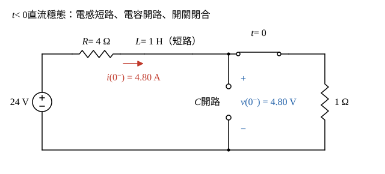
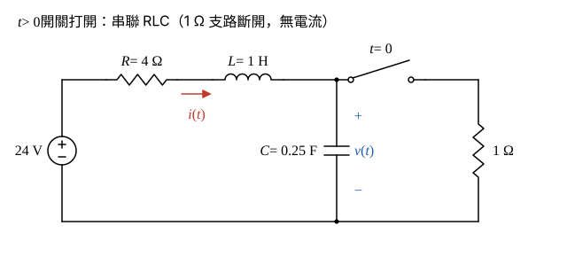

# 114 年電路學第 3 題｜二階 RLC 暫態

## 已知與所求

24 V 電源串 4 Ω、1 H（電流 \(i\) 向右）後接 0.25 F 電容（電壓 \(v\) 上正下負）；1 Ω 經開關與電容並聯。\(t<0\) 開關閉合且已穩態，\(t=0\) 打開。求（一）\(v(0)\)、\(i(0)\)（10 分）；（二）\(v(t>0)\)（10 分）。

## 考場標準作答

**解題邏輯**：電感電流與電容電壓不能瞬間改變，所以 \(t=0\) 的 \(i\)、\(v\) 就等於 \(t<0\) 直流穩態的值（電感短路、電容開路）。開關打開後 1 Ω 支路斷開、不再有電流，電路成為 24 V–4 Ω–1 H–0.25 F 串聯 RLC；以 \(v\) 為未知列二階微分方程 → 由特徵根判斷阻尼型態 → 全解 = 終值 + 自然響應 → 用 \(v(0)\) 與 \(\dot v(0)=i(0)/C\) 兩個初值定係數。開關視為理想開關。

### （一）開關打開瞬間（10 分）

**邏輯**：\(t<0\) 已達直流穩態，電感短路、電容開路，24 V 只推動 4 Ω 與 1 Ω 串聯的電流；再由電感電流、電容電壓的連續性得到 \(t=0\) 的值。

電感短路、電容開路後，迴路只剩 24 V、4 Ω、1 Ω 串聯：
\[
i(0^-)=\frac{24}{4+1}
\]
\[
i(0^-)=\frac{24}{5}=4.80\ \mathrm A
\]
電容（開路）與 1 Ω 並聯，電容電壓等於 1 Ω 的電壓：
\[
v(0^-)=1\times i(0^-)
\]
\[
v(0^-)=1\times4.80=4.80\ \mathrm V
\]
電感電流、電容電壓連續：\(i(0)=i(0^-)\)、\(v(0)=v(0^-)\)。
\[
\boxed{v(0)=4.80\ \mathrm V},\qquad \boxed{i(0)=4.80\ \mathrm A}
\]

### （二）\(v(t>0)\)（10 分）

**邏輯**：開關打開後為串聯 RLC，電容電流就是迴路電流 \(i=C\dot v\)；KVL 化成 \(v\) 的二階方程，特徵根決定響應形式，終值與兩個初值決定係數。

迴路 KVL（\(i\) 順時針，\(v\) 上正下負）：
\[
24=4i+L\frac{di}{dt}+v
\]
電容電流即迴路電流：
\[
i=C\frac{dv}{dt}=0.25\,\dot v,\qquad \frac{di}{dt}=0.25\,\ddot v
\]
代入 KVL（\(L=1\ \mathrm H\)）：
\[
24=4(0.25\,\dot v)+1\times(0.25\,\ddot v)+v=\dot v+0.25\,\ddot v+v
\]
兩邊乘 4：
\[
\ddot v+4\dot v+4v=96
\]
特徵方程：
\[
s^2+4s+4=0\ \Rightarrow\ (s+2)^2=0\ \Rightarrow\ s_1=s_2=-2\ \mathrm{s^{-1}}
\]
重根，臨界阻尼（亦即 \(\alpha=\dfrac{R}{2L}=\dfrac{4}{2\times1}=2=\omega_0=\dfrac{1}{\sqrt{LC}}=\dfrac{1}{\sqrt{1\times0.25}}\)）。

終值：\(t\to\infty\) 電容開路、\(i=0\)，4 Ω 與 1 H 無壓降：
\[
v(\infty)=24\ \mathrm V\qquad(\text{亦即 }4v=96)
\]
全解形式：
\[
v(t)=24+(A+Bt)e^{-2t}
\]
初值一：\(v(0)=24+A=4.80\)
\[
A=4.80-24=-19.20
\]
初值二：微分得 \(\dot v(t)=\bigl[B-2(A+Bt)\bigr]e^{-2t}\)，故 \(\dot v(0)=B-2A\)；又電容電流 \(i(0)=C\dot v(0)\)：
\[
\dot v(0)=\frac{i(0)}{C}=\frac{4.80}{0.25}=19.20\ \mathrm{V/s}
\]
\[
B-2A=19.20\ \Rightarrow\ B=19.20+2(-19.20)=-19.20
\]
\[
\boxed{v(t)=24-19.20(1+t)e^{-2t}\ \mathrm V,\quad t>0}
\]

## 驗算

由答案求 \(i=0.25\dot v=4.80(1+2t)e^{-2t}\)、\(\dfrac{di}{dt}=-19.20te^{-2t}\)，代回 KVL：
\[
4i+\frac{di}{dt}+v=19.20(1+2t)e^{-2t}-19.20te^{-2t}+24-19.20(1+t)e^{-2t}=24\ \mathrm V
\]
且 \(i(0)=4.80\ \mathrm A\)、\(i(\infty)=0\)，與初值及電容開路終值一致。

## 失分點

- 只用 \(v(0)=4.80\) 而漏用 \(\dot v(0)=i(0)/C=19.20\ \mathrm V/\mathrm s\)，重根解的 \(B\) 無法決定。
- 開關打開後仍把 1 Ω 留在電路，會誤得 \(s^2+8s+20=0\) 的欠阻尼解且 \(v(\infty)=4.80\ \mathrm V\)。
- 寫成 \(\dot v=iC\)（\(=1.20\)）而非 \(i/C\)。
