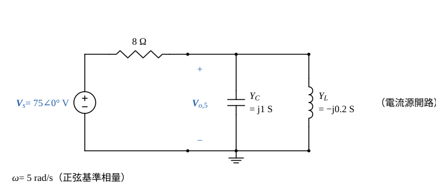
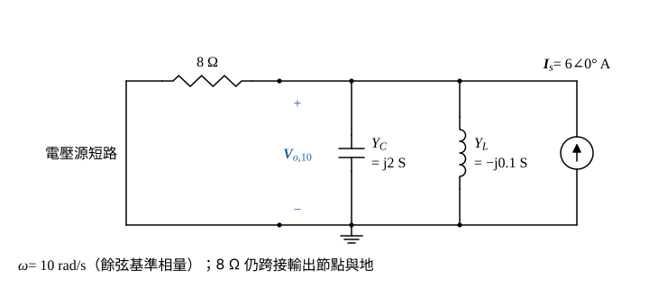

# 114 年電路學第 4 題｜不同頻率的重疊定理

## 已知與所求

\(75\sin(5t)\ \mathrm V\) 電壓源串 8 Ω 至輸出節點；輸出節點對地並接 0.2 F、1 H 與 \(6\cos(10t)\ \mathrm A\) 電流源（箭頭向上注入輸出節點）。以重疊定理求 \(v_o(t)\)（20 分）。

## 考場標準作答

### 步驟 1：輸出節點的 \(L\)、\(C\) 並聯導納

電路為線性，兩電源頻率不同（5 與 10 rad/s），用重疊定理：每次只留一個電源（關閉電壓源＝短路、關閉電流源＝開路），以該頻率的相量求 \(v_o\) 的穩態分量，回到時域相加，不同頻率的相量不可直接相加。電壓源 \(75\sin(5t)\) 取正弦基準峰值相量，電流源 \(6\cos(10t)\) 取餘弦基準峰值相量，最後統一寫成正弦。

\[
Y_C=j\omega C,\qquad Y_L=\frac{1}{j\omega L}=-\frac{j}{\omega L}
\]
\[
Y(j\omega)=Y_C+Y_L=j\left(0.2\omega-\frac1\omega\right)\ \mathrm S
\]

### 步驟 2：5 rad/s 分量（電流源開路）

畫法：電流源開路；\(\mathbf V_s=75\angle0^\circ\ \mathrm V\)（正弦基準）經 8 Ω 接到輸出節點，節點對地為 \(Y_C\parallel Y_L\)。

\[
Y_C=j(5)(0.2)=j1\ \mathrm S,\qquad Y_L=\frac{1}{j(5)(1)}=-j0.2\ \mathrm S
\]
\[
Y_5=Y_C+Y_L=j1-j0.2=j0.8\ \mathrm S
\]

輸出節點 KCL（流出 8 Ω 支路與 \(Y_5\) 支路，和為零）：
\[
\frac{\mathbf V_{o,5}-\mathbf V_s}{8}+Y_5\mathbf V_{o,5}=0
\]
同乘 8 並移項：
\[
\mathbf V_{o,5}(1+8Y_5)=\mathbf V_s\ \Rightarrow\ \mathbf V_{o,5}=\frac{\mathbf V_s}{1+8Y_5}
\]
分母：
\[
1+8Y_5=1+8(j0.8)=1+j6.4
\]
\[
|1+j6.4|=\sqrt{1^2+6.4^2}=\sqrt{41.96}=6.478
\]
\[
\angle(1+j6.4)=\tan^{-1}\frac{6.4}{1}=81.12^\circ
\]
相除：
\[
\mathbf V_{o,5}=\frac{75\angle0^\circ}{6.478\angle81.12^\circ}\ \mathrm V
\]
\[
|\mathbf V_{o,5}|=\frac{75}{6.478}=11.58\ \mathrm V,\qquad \angle\mathbf V_{o,5}=0^\circ-81.12^\circ=-81.12^\circ
\]
正弦基準回時域：
\[
v_{o,5}(t)=11.58\sin(5t-81.12^\circ)\ \mathrm V
\]

### 步驟 3：10 rad/s 分量（電壓源短路）

畫法：電壓源短路後，8 Ω 的左端接地，8 Ω 仍跨在輸出節點與地之間，與 \(Y_C\)、\(Y_L\) 三者並聯，由 \(\mathbf I_s=6\angle0^\circ\ \mathrm A\)（餘弦基準，箭頭向上注入輸出節點）驅動。

\[
Y_C=j(10)(0.2)=j2\ \mathrm S,\qquad Y_L=\frac{1}{j(10)(1)}=-j0.1\ \mathrm S
\]
\[
Y_{10}=Y_C+Y_L=j2-j0.1=j1.9\ \mathrm S
\]

加上 8 Ω 的電導 \(1/8=0.125\ \mathrm S\)：
\[
Y_{\mathrm{total}}=\frac18+j1.9\ \mathrm S
\]
\[
|Y_{\mathrm{total}}|=\sqrt{0.125^2+1.9^2}=\sqrt{0.015625+3.61}=\sqrt{3.625625}=1.904\ \mathrm S
\]
\[
\angle Y_{\mathrm{total}}=\tan^{-1}\frac{1.9}{0.125}=\tan^{-1}15.2=86.24^\circ
\]
輸出節點 KCL（注入 \(\mathbf I_s\)＝流出 \(Y_{\mathrm{total}}\mathbf V_{o,10}\)）：
\[
\mathbf V_{o,10}=\frac{\mathbf I_s}{Y_{\mathrm{total}}}=\frac6{1/8+j1.9}=\frac{6\angle0^\circ}{1.904\angle86.24^\circ}\ \mathrm V
\]
\[
|\mathbf V_{o,10}|=\frac{6}{1.904}=3.151\ \mathrm V,\qquad \angle\mathbf V_{o,10}=0^\circ-86.24^\circ=-86.24^\circ
\]
餘弦基準回時域：
\[
v_{o,10}(t)=3.151\cos(10t-86.24^\circ)\ \mathrm V
\]
改寫成正弦（\(\cos\theta=\sin(\theta+90^\circ)\)）：
\[
v_{o,10}(t)=3.151\sin(10t-86.24^\circ+90^\circ)=3.151\sin(10t+3.76^\circ)\ \mathrm V
\]

### 輸出響應 \(v_o(t)\)（20 分）

\[
v_o(t)=v_{o,5}(t)+v_{o,10}(t)
\]
\[
\boxed{v_o(t)=11.58\sin(5t-81.12^\circ)+3.15\sin(10t+3.76^\circ)\ \mathrm V}
\]

## 驗算

改用阻抗分壓／分流。5 rad/s：\(Z_C=-j1\ \Omega\)、\(Z_L=j5\ \Omega\)，\(Z_p=\dfrac{(-j1)(j5)}{-j1+j5}=\dfrac{5}{j4}=-j1.25\ \Omega\)；\(|\mathbf V_{o,5}|=\dfrac{75\times1.25}{\sqrt{8^2+1.25^2}}=\dfrac{93.75}{8.097}=11.58\ \mathrm V\)，相角 \(-90^\circ+\tan^{-1}\frac{1.25}{8}=-90^\circ+8.88^\circ=-81.12^\circ\)。
10 rad/s：\(Z_C=-j0.5\ \Omega\)、\(Z_L=j10\ \Omega\)，\(Z_p=\dfrac{(-j0.5)(j10)}{j9.5}=-j0.5263\ \Omega\)，再並 8 Ω：\(|Z|=\dfrac{8\times0.5263}{\sqrt{64+0.2770}}=\dfrac{4.210}{8.017}=0.5252\ \Omega\)，\(6\times0.5252=3.151\ \mathrm V\)，相角 \(-90^\circ+\tan^{-1}\frac{0.5263}{8}=-90^\circ+3.76^\circ=-86.24^\circ\)。直角座標 \(\mathbf V_{o,10}=0.2069-j3.144\ \mathrm V\)，模 \(3.151\ \mathrm V\)，一致。

## 失分點

- 短路電壓源時連 8 Ω 一起刪除，誤得 \(6/(j1.9)=3.16\angle-90^\circ\ \mathrm V\)。
- 把 5 rad/s 與 10 rad/s 的相量直接相加。
- 10 rad/s 分量用餘弦求得後，改寫成正弦時漏加 \(90^\circ\)。
