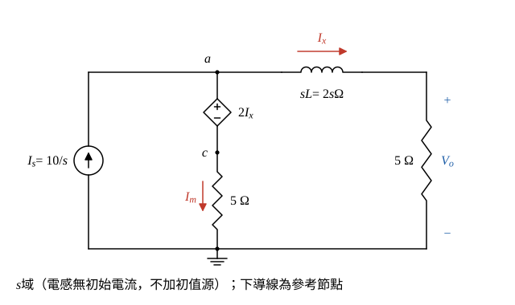

# 114 年電路學第 5 題｜拉氏轉換與含相依源電路

## 已知與所求

\(i_s=10u(t)\ \mathrm A\) 向上注入上方節點 \(a\)；中間支路為相依電壓源 \(2I_x\)（上正）串 5 Ω 接地，兩者之間節點記為 \(c\)；2 H 電感（\(I_x\) 向右，初始無儲能）串右側 5 Ω 接地，\(v_o\) 為右側 5 Ω 電壓。以拉氏轉換求 \(v_o(t>0)\)（20 分）。

## 考場標準作答

### 步驟 1：\(s\) 域電路

取電感電流 \(I_x\) 為唯一未知量；下導線為參考節點。

畫法：

- \(i_s=10u(t)\ \mathrm A\Rightarrow I_s(s)=\dfrac{10}{s}\)，向上注入節點 \(a\)。
- 電感 \(L=2\ \mathrm H\)：\(sL=2s\ \Omega\)；初始電流為零，不加初值源。
- \(I_x\)：由節點 \(a\) 經電感流向右側 5 Ω（題給方向）；\(I_m\)：中間支路由節點 \(a\) 向下流經相依源與 5 Ω 的電流（參考方向向下）。
- 相依源 \(2I_x\) 上正下負，其下端節點記為 \(c\)；\(V_o\) 為右側 5 Ω 上正下負的電壓。

### 步驟 2：右支路與中間支路以 \(I_x\) 表示

右側 5 Ω（歐姆定律）：
\[
V_o=5I_x
\]
右支路 KVL（電感與 5 Ω 串聯）：
\[
V_a=(sL+5)I_x=(2s+5)I_x
\]
相依源上正下負，節點 \(c\) 比節點 \(a\) 低 \(2I_x\)：
\[
V_c=V_a-2I_x=(2s+5)I_x-2I_x=(2s+3)I_x
\]
中間支路 5 Ω（向下）：
\[
I_m=\frac{V_c}{5}=\frac{(2s+3)I_x}{5}
\]

### 步驟 3：節點 \(a\) 的 KCL 求 \(I_x(s)\)

注入的 \(I_s\) 等於流出的 \(I_x\) 與 \(I_m\)：
\[
I_s=I_x+I_m
\]
代入：
\[
\frac{10}{s}=I_x+\frac{(2s+3)I_x}{5}
\]
右邊通分：
\[
I_x+\frac{(2s+3)I_x}{5}=\frac{5+2s+3}{5}I_x=\frac{2s+8}{5}I_x
\]
解 \(I_x\)：
\[
I_x=\frac{10}{s}\cdot\frac{5}{2s+8}=\frac{50}{s(2s+8)}
\]
分母提出 2：
\[
I_x=\frac{50}{2s(s+4)}=\frac{25}{s(s+4)}
\]

### 輸出電壓 \(v_o(t>0)\)（20 分）

\[
V_o(s)=5I_x=5\times\frac{25}{s(s+4)}=\frac{125}{s(s+4)}
\]
部分分式設 \(V_o(s)=\dfrac{A}{s}+\dfrac{B}{s+4}\)：
\[
A=\left.sV_o(s)\right|_{s=0}=\left.\frac{125}{s+4}\right|_{s=0}=\frac{125}{4}=31.25\ \mathrm V
\]
\[
B=\left.(s+4)V_o(s)\right|_{s=-4}=\left.\frac{125}{s}\right|_{s=-4}=\frac{125}{-4}=-31.25\ \mathrm V
\]
\[
V_o(s)=\frac{31.25}{s}-\frac{31.25}{s+4}
\]
逐項反拉氏轉換：
\[
v_o(t)=31.25-31.25e^{-4t}\ \mathrm V
\]
\[
\boxed{v_o(t)=31.25(1-e^{-4t})\ \mathrm V,\quad t>0}
\]

## 驗算

時域直接列式。\(i_x=v_o/5\)，電感 \(v_a=v_o+2\dot i_x=v_o+\frac25\dot v_o\)，故 \(v_c=v_a-2i_x=\frac35v_o+\frac25\dot v_o\)。節點 \(a\)：\(i_x+v_c/5=10\)，即
\[
\frac{v_o}{5}+\frac{3v_o}{25}+\frac{2\dot v_o}{25}=10\;\Longleftrightarrow\;\dot v_o+4v_o=125
\]
答案代入：\(125e^{-4t}+125(1-e^{-4t})=125\)，且 \(v_o(0^+)=0\ \mathrm V\)（電感電流為零）、\(v_o(\infty)=31.25\ \mathrm V\)。

## 失分點

- 相依源極性寫反（\(V_c=V_a+2I_x\)）會得 \(I_x=25/[s(s+6)]\)、終值 \(20.83\ \mathrm V\)。
- 把零初始電感當直流短路只求終值，漏掉 \(e^{-4t}\) 暫態項。
- 部分分式係數 \(B\) 的符號（\(125/(-4)\)）算錯，會得 \(31.25(1+e^{-4t})\)，與 \(v_o(0^+)=0\) 矛盾。
