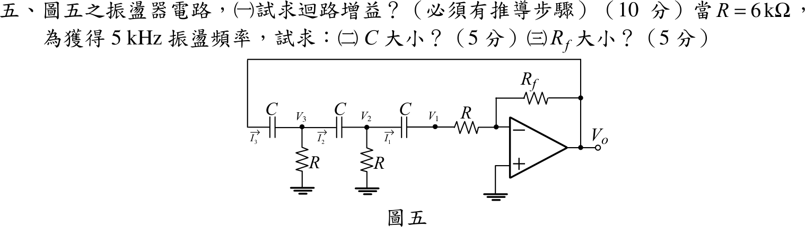

# 104 年電機工程技師｜電子學（包括電力電子學）逐題詳解

> 本頁由題級 canonical 筆記組合；每題保留官方裁切圖、校驗狀態與可追溯的推導。

## 題目導覽
- [[#一、104 年電子學（含電力電子）第 1 題｜PMOS 共源極偏壓與源極退化頻率響應|第 1 題：PMOS 共源極偏壓與源極退化頻率響應]]
- [[#二、104 年電子學（含電力電子）第 2 題｜BJT 共基極偏壓與中頻增益|第 2 題：BJT 共基極偏壓與中頻增益]]
- [[#三、104 年電子學（含電力電子）第 3 題｜三相六脈波二極體整流器|第 3 題：三相六脈波二極體整流器]]
- [[#四、104 年電子學（含電力電子）第 4 題｜單相全橋逆變器 RL 負載暫態|第 4 題：單相全橋逆變器 RL 負載暫態]]
- [[#五、104 年電子學（含電力電子）第 5 題｜三階 RC 移相振盪器|第 5 題：三階 RC 移相振盪器]]

---

## 一、104 年電子學（含電力電子）第 1 題｜PMOS 共源極偏壓與源極退化頻率響應

> 題級識別：EE-104-02-1
> canonical 來源：[[canonical/EE-104-02-1.md]]
> 題級校驗狀態：needs_manual_review
> [!WARNING] 本題仍有官方資料缺口或事件定義歧義；請以 canonical 條件式解答為準。

### 已知與所求

PMOS：$K_P=0.1\text{ mA/V}^2$、$V_{TP}=-0.8\text{ V}$、$\lambda=0$；$I_{DQ}=0.4\text{ mA}$、$V_{SDQ}=4\text{ V}$。依圖：$+5\text{ V}$ 經 $R_S$ 接源極，閘極接 $v_i$（經 $200\text{ k}\Omega$ 到地，無直流電流，$V_G=0$），汲極接 $R_D$ 到 $-5\text{ V}$，輸出 $v_o$ 取自汲極並接 $C_L=10\text{ pF}$ 到地；$R_S$ 沒有旁路電容。

求（一）$R_S$（4 分）；（二）$R_D$（4 分）；（三）$v_o(s)/v_i(s)$（8 分）；（四）轉角頻率（4 分）。

題目的符號（$K_P$、$V_{TP}$、$I_{DQ}$、$V_{SDQ}$）沿用導通參數定義 $I_D=K_P(V_{SG}+V_{TP})^2$；另一種慣例的結果見文末「條件與疑義」。

### 考場標準作答

#### 步驟 1：$V_{SG}$ 與源極電壓

**導通參數平方律**（飽和區）：
\[
I_{DQ}=K_P(V_{SG}-|V_{TP}|)^2
\]
\[
(V_{SG}-0.8)^2=\frac{I_{DQ}}{K_P}=\frac{0.4}{0.1}=4
\]
\[
V_{SG}-0.8=2\quad(\text{取正根：導通須 }V_{SG}>|V_{TP}|)
\]
\[
V_{SG}=0.8+2=2.80\text{ V}
\]
閘極無直流電流，$V_G=0$：
\[
V_S=V_G+V_{SG}=0+2.80=2.80\text{ V}
\]

#### （一）$R_S$（4 分）

$I_{DQ}$ 由 $+5\text{ V}$ 經 $R_S$ 流入源極：

\[
R_S=\frac{5-V_S}{I_{DQ}}=\frac{5-2.80}{0.4\text{ mA}}=\frac{2.20\text{ V}}{0.4\text{ mA}}
\]
\[
\boxed{R_S=5.50\text{ k}\Omega}
\]

#### （二）$R_D$（4 分）

同一個 $I_{DQ}$ 由汲極經 $R_D$ 流到 $-5\text{ V}$：

\[
V_D=V_S-V_{SDQ}=2.80-4=-1.20\text{ V}
\]
\[
R_D=\frac{V_D-(-5)}{I_{DQ}}=\frac{-1.20+5}{0.4\text{ mA}}=\frac{3.80\text{ V}}{0.4\text{ mA}}
\]
\[
\boxed{R_D=9.50\text{ k}\Omega}
\]
飽和區檢查：$V_{SDQ}=4\text{ V}\ge V_{SG}-|V_{TP}|=2.80-0.8=2\text{ V}$，成立。

#### （三）轉移函數（8 分）

設小訊號線性化、$\lambda=0$（無 $r_o$），$\pm5\text{ V}$ 為交流地；$R_S$ 未旁路（源極退化）。

轉導（導通參數慣例 $g_m=\partial I_D/\partial V_{SG}$）：
\[
g_m=2K_P(V_{SG}-|V_{TP}|)=2\times0.1\times2=0.40\text{ mA/V}
\]

畫法：閘極接 $v_i$（$200\text{ k}\Omega$ 與理想電壓源並聯，不改變 $v_g=v_i$，可略）；源極 $S$ 經 $R_S$ 到交流地；$S\to D$ 為受控電流源 $i_d=g_mv_{sg}$；汲極 $D$ 經 $R_D$、$C_L$ 到地。

源極節點 KCL（$R_S$ 由地流入 $S$ 的電流 $=$ 流出 $S$ 的 $i_d$）：
\[
\frac{0-v_s}{R_S}=i_d,\qquad i_d=g_mv_{sg}=g_m(v_s-v_i)
\]
由第一式 $v_s=-i_dR_S$，代入第二式：
\[
i_d=g_m(-i_dR_S-v_i)
\]
\[
i_d(1+g_mR_S)=-g_mv_i
\]
\[
i_d=-\frac{g_mv_i}{1+g_mR_S}
\]
汲極節點：$i_d$ 流入 $D$，經 $R_D\parallel C_L$ 流到地：
\[
Z_D(s)=R_D\parallel\frac1{sC_L}=\frac{R_D}{1+sR_DC_L}
\]
\[
v_o=i_dZ_D(s)=-\frac{g_mR_D}{(1+g_mR_S)(1+sR_DC_L)}\,v_i
\]
代入數值：
\[
g_mR_S=0.40\times5.50=2.20,\qquad 1+g_mR_S=3.20
\]
\[
g_mR_D=0.40\times9.50=3.80
\]
\[
A_{v0}=-\frac{g_mR_D}{1+g_mR_S}=-\frac{3.80}{3.20}=-1.1875
\]
\[
R_DC_L=(9.50\ \mathrm{k\Omega})(10\ \mathrm{pF})=95\ \mathrm{ns}=9.50\times10^{-8}\text{ s}
\]
\[
\boxed{\frac{v_o(s)}{v_i(s)}=-\frac{g_mR_D}{(1+g_mR_S)(1+sR_DC_L)}=-\frac{1.19}{1+9.50\times10^{-8}s}}
\]

#### （四）轉角頻率（4 分）

（三）分母唯一極點 $s=-1/(R_DC_L)$，只由 $R_D$、$C_L$ 決定，與 $R_S$ 無關：

\[
\omega_c=\frac1{R_DC_L}=\frac1{95\text{ ns}}=1.053\times10^{7}\text{ rad/s}
\]
\[
f_c=\frac{1}{2\pi R_DC_L}=\frac{1}{2\pi\times0.095\ \mu\text{s}}=\frac{1}{0.5969\ \mu\text{s}}=1.675\text{ MHz}
\]
\[
\boxed{f_c=1.68\text{ MHz}}
\]

### 驗算

- 偏壓 KVL（$+5\text{ V}\to R_S\to$ 源汲 $\to R_D\to-5\text{ V}$）：$5-0.4\times5.50-4-0.4\times9.50+5=5-2.20-4-3.80+5=0$。
- 轉導另算：$g_m=2\sqrt{K_PI_{DQ}}=2\sqrt{0.1\times0.4}=2\times0.2=0.40\text{ mA/V}$。
- 小訊號回代：$i_d/v_i=-0.40/3.20=-0.125\text{ mA/V}$；$v_s=-i_dR_S=0.125\times5.50\,v_i=0.6875\,v_i$；$v_{sg}=v_s-v_i=-0.3125\,v_i$；$g_mv_{sg}=0.40\times(-0.3125)\,v_i=-0.125\,v_i$（mA），與 $i_d$ 相同；$|A_{v0}|=0.125\times9.50=1.1875$。

### 失分點

- 圖中 $R_S$ 沒有旁路電容，中頻增益要除以 $1+g_mR_S=3.20$；用 $-g_mR_D=-3.80$ 會大三倍多。
- 源極 $V_S=V_G+V_{SG}=2.80\text{ V}$，不是 0；$R_S$ 用 $5-V_S$、$R_D$ 用 $V_D-(-5)$。
- 轉角頻率只由 $R_DC_L$ 決定，與 $R_S$ 退化無關。

### 條件與疑義

題幹只給「$K_P=0.1\text{ mA/V}^2$」而未寫平方律公式。上列採導通參數寫法（記號 $K_P,V_{TP},I_{DQ},V_{SDQ}$ 的教科書慣例，且 $R_S,R_D$ 得整齊數值 $5.50/9.50\text{ k}\Omega$）。若採 ½$K_P$ 慣例 $I_D=\tfrac12K_P(V_{SG}-|V_{TP}|)^2$：

$$
V_{SG}=0.8+\sqrt8=3.628\text{ V},\quad R_S=\frac{5-3.628}{0.4}=3.43\text{ k}\Omega,\quad R_D=\frac{3.628-4+5}{0.4}=11.57\text{ k}\Omega,\quad g_m=K_P\sqrt8=282.84\ \mu\text{A/V}
$$
$$
\frac{v_o(s)}{v_i(s)}=-\frac{g_mR_D}{(1+g_mR_S)(1+sR_DC_L)}=-\frac{1.66}{1+1.157\times10^{-7}s},\ \ A_{v0}=-\frac{3.273}{1.970}=-1.66,\ \ f_c=1.38\text{ MHz}
$$
兩種慣例只改數值，結構 $-\dfrac{g_mR_D}{1+g_mR_S}\cdot\dfrac1{1+sR_DC_L}$ 相同；以官方公布解答的 $R_S$ 為準選擇其一。

---

## 二、104 年電子學（含電力電子）第 2 題｜BJT 共基極偏壓與中頻增益

> 題級識別：EE-104-02-2
> canonical 來源：[[canonical/EE-104-02-2.md]]
> 題級校驗狀態：verified

### 已知與所求

NPN，$\beta=100$、$V_A=\infty$；$+5\text{ V}$ 經電流源 $I_{CC}=0.5\text{ mA}$ 注入集極節點，$R_B=100\text{ k}\Omega$ 接在集極節點與基極之間，基極經 $C_B$ 交流接地；$R_E=1\text{ k}\Omega$ 接地，信號 $V_s$ 經 $R_s=50\ \Omega$、$C_{C1}$ 進射極，集極經 $C_{C2}$ 接 $R_L=1.5\text{ k}\Omega$。題目未給 $V_{BE}$ 與 $V_T$，取 $V_{BE}=0.7\text{ V}$、$V_T=25\text{ mV}$（假設）。

求（一）$V_B,V_C,V_E$（6 分）；（二）輸入電阻 $R_i$（8 分）；（三）$A_v=V_o/V_s$（6 分）。

### 考場標準作答

#### （一）直流電位（6 分）

設 BJT 工作於主動區（$V_{BE}=0.7\text{ V}$、$I_C=\beta I_B$），直流時電容開路。

集極節點 KCL（$C_B$ 開路，$R_B$ 的電流全部進基極，即 $I_B$）：
\[
I_{CC}=I_C+I_B
\]
射極電流：
\[
I_E=I_C+I_B=I_{CC}=0.5\text{ mA}
\]
\[
I_B=\frac{I_E}{\beta+1}=\frac{0.5\text{ mA}}{101}=4.9505\ \mu\text{A}
\]
\[
I_C=\beta I_B=100\times4.9505\ \mu\text{A}=495.05\ \mu\text{A}
\]
射極、基極、集極電位：
\[
V_E=I_ER_E=0.5\text{ mA}\times1\text{ k}\Omega
\]
\[
\boxed{V_E=0.50\text{ V}}
\]
\[
V_B=V_E+V_{BE}=0.50+0.7
\]
\[
\boxed{V_B=1.20\text{ V}}
\]
\[
I_BR_B=4.9505\ \mu\text{A}\times100\text{ k}\Omega=0.49505\text{ V}
\]
\[
V_C=V_B+I_BR_B=1.20+0.49505=1.69505\text{ V}
\]
\[
\boxed{V_C=1.70\text{ V}}
\]
主動區檢查：$V_{CB}=V_C-V_B=0.49505\text{ V}>0$（集基接面逆偏）、$V_{BE}=0.7\text{ V}$（基射接面順偏），假設成立。

#### 步驟 2：小訊號參數與交流等效電路

中頻小訊號分析，$V_A=\infty$（無 $r_o$）。$r_e$（由射極看入的小訊號電阻）與 $g_m$：
\[
r_e=\frac{V_T}{I_E}=\frac{25\text{ mV}}{0.5\text{ mA}}=50\ \Omega
\]
\[
g_m=\frac{I_C}{V_T}=\frac{495.05\ \mu\text{A}}{25\text{ mV}}=19.802\text{ mA/V}
\]

畫法：$C_{C1}$、$C_{C2}$、$C_B$ 短路，$+5\text{ V}$ 為交流地、理想電流源 $I_{CC}$ 交流開路；基極 $B$ 接地，射極 $E$ 經 $r_e$ 到 $B$（地），集極受控源 $g_mv_{be}$ 由 $C$ 流向 $B$（地）；$R_B$ 原接在集極與基極之間，基極接地後變成集極對地。

#### （二）輸入電阻 $R_i$（8 分）

$R_i$ 由 $C_{C1}$ 往右看入射極節點；受控源接在集極與地之間，不從射極節點取電流，故 $R_E$ 與 $r_e$ 並聯：

\[
R_i=R_E\parallel r_e=\frac{R_Er_e}{R_E+r_e}=\frac{1000\times50}{1000+50}=\frac{50000}{1050}
\]
\[
\boxed{R_i=47.62\ \Omega}
\]

#### （三）電壓增益 $A_v$（6 分）

交流負載（基極交流接地，$R_B$ 跨在集極與地之間）：
\[
R_{L,ac}=R_L\parallel R_B=\frac{1.5\times100}{1.5+100}=\frac{150}{101.5}=1.47783\text{ k}\Omega
\]
輸入分壓（以 $R_i=\tfrac{1000}{21}\ \Omega$ 精確值）：
\[
\frac{v_e}{v_s}=\frac{R_i}{R_s+R_i}=\frac{1000/21}{50+1000/21}=\frac{1000}{2050}=\frac{20}{41}=0.4878
\]
集極輸出：
\[
v_o=-(g_mv_{be})R_{L,ac}=-g_m(0-v_e)R_{L,ac}=g_mR_{L,ac}\,v_e
\]
\[
g_mR_{L,ac}=19.802\text{ mA/V}\times1.47783\text{ k}\Omega=29.264
\]
\[
A_v=\frac{v_o}{v_s}=\frac{R_i}{R_s+R_i}\,g_mR_{L,ac}=\frac{20}{41}\times29.264=\frac{585.28}{41}
\]
\[
\boxed{A_v=14.28\text{ V/V}}
\]

### 驗算

- 直流守恆：$I_C+I_B=495.05+4.9505=500.00\ \mu\text{A}=I_{CC}$；$V_C-V_B=I_BR_B=0.49505\text{ V}$。
- hybrid-$\pi$ 另解 $R_i$：$r_\pi=\beta/g_m=100/19.802=5.050\text{ k}\Omega$，射極節點看入 $1/(1/R_E+1/r_\pi+g_m)=1/(1+0.1980+19.802)\text{ mS}=1/21.00\text{ mS}=47.62\ \Omega$，與 $R_E\parallel r_e$ 相同（因 $r_\pi\parallel\tfrac1{g_m}=\tfrac{\alpha}{g_m}=r_e$）。
- 節點方程數值解（verify 腳本）：$A_v=14.275$，四捨五入 $14.28$。

### 失分點

- 電流源接在集極節點而 $R_B$ 把基極也接到該節點，$I_{CC}$ 必須分給集極與基極：$I_E=I_{CC}=0.5\text{ mA}$，不是 $I_C=I_{CC}$、$I_E=505\ \mu\text{A}$。
- 增益不能只看 $R_L$：基極交流接地使 $R_B$ 跨在集極與地之間，$R_{L,ac}=R_L\parallel R_B$。
- $R_i$ 是看入 $C_{C1}$ 右側，不含 $R_s$；$A_v$ 才要乘 $R_i/(R_s+R_i)$ 的分壓。

---

## 三、104 年電子學（含電力電子）第 3 題｜三相六脈波二極體整流器

> 題級識別：EE-104-02-3
> canonical 來源：[[canonical/EE-104-02-3.md]]
> 題級校驗狀態：verified

### 已知與所求

三相電源 $380\ \mathrm V_{\mathrm{rms}}$（線對線），$D_1,D_3,D_5$ 為上臂（陽極分別接 $a,b,c$），$D_4,D_6,D_2$ 為下臂（陰極分別接 $a,b,c$），負載 $R=30\ \Omega$ 純電阻，二極體理想。求（一）$V_o$（4 分）；（二）$I_o$（4 分）；（三）二極體平均電流（3 分）；（四）二極體 rms 電流（3 分）；（五）電源 rms 電流（3 分）；（六）電源視在功率（3 分）。

### 考場標準作答

#### 步驟 1：導通順序與波形

設理想二極體、三相平衡、相序 $abc$、換相瞬間完成；上臂接電位最高相、下臂接電位最低相。以 $v_{an}$ 正向過零為 $\theta=0^\circ$，每 $60^\circ$ 由最高相與最低相決定導通對（圖 1）：

| $\theta$ | $30^\circ$–$90^\circ$ | $90^\circ$–$150^\circ$ | $150^\circ$–$210^\circ$ | $210^\circ$–$270^\circ$ | $270^\circ$–$330^\circ$ | $330^\circ$–$390^\circ$ |
|---|---|---|---|---|---|---|
| 導通 | $D_1,D_6$ | $D_1,D_2$ | $D_3,D_2$ | $D_3,D_4$ | $D_5,D_4$ | $D_5,D_6$ |
| $v_o$ | $v_{ab}$ | $v_{ac}$ | $v_{bc}$ | $v_{ba}$ | $v_{ca}$ | $v_{cb}$ |

- 每顆二極體導通 $120^\circ$（連續兩個脈波），一週期 6 個相同的脈波。
- a 相線電流 $i_a$：$30^\circ$–$150^\circ$ 經 $D_1$ 流出為 $+i_o$，$210^\circ$–$330^\circ$ 經 $D_4$ 流回為 $-i_o$，其餘 $0$。

#### 步驟 2：線電壓峰值與單一脈波

\[
V_m=\sqrt2\,V_{LL}=\sqrt2\times380=537.40\ \mathrm V
\]
以脈波中心（線電壓峰值）為 $\phi=0$，一個脈波為
\[
v_o=V_m\cos\phi,\qquad -\frac{\pi}{6}\le\phi\le\frac{\pi}{6}
\]

#### 步驟 3：負載 rms 電流 $I_{o,\mathrm{rms}}$（（四）（五）（六）共用）

純電阻 $i_o=v_o/R$，6 個脈波相同，一個脈波（寬 $\pi/3$）的均方即全週期均方：
\[
I_{o,\mathrm{rms}}^2=\frac{1}{\pi/3}\int_{-\pi/6}^{\pi/6}\left(\frac{V_m\cos\phi}{R}\right)^2d\phi
=\frac{V_m^2}{R^2}\frac3\pi\int_{-\pi/6}^{\pi/6}\cos^2\phi\,d\phi
\]
積分：
\[
\int_{-\pi/6}^{\pi/6}\cos^2\phi\,d\phi=\left[\frac{\phi}{2}+\frac{\sin2\phi}{4}\right]_{-\pi/6}^{\pi/6}=\frac\pi6+\frac{\sqrt3}{4}
\]
\[
\frac\pi6+\frac{\sqrt3}{4}=0.5236+0.4330=0.9566
\]
\[
\frac3\pi\left(\frac\pi6+\frac{\sqrt3}{4}\right)=0.9549\times0.9566=0.9135
\]
\[
\frac{V_m}{R}=\frac{537.40}{30}=17.91\ \mathrm A
\]
\[
\sqrt{0.9135}=0.9558
\]
\[
I_{o,\mathrm{rms}}=\frac{V_m}{R}\sqrt{0.9135}=17.91\times0.9558=17.12\ \mathrm A
\]

#### （一）負載平均電壓 $V_o$（4 分）

$v_o$ 由 6 個相同脈波組成，取一個 $60^\circ$（$\pi/3$）脈波平均：

\[
V_o=\frac{1}{\pi/3}\int_{-\pi/6}^{\pi/6}V_m\cos\phi\,d\phi=\frac{3V_m}{\pi}\Big[\sin\phi\Big]_{-\pi/6}^{\pi/6}=\frac{3V_m}{\pi}\left(\frac12+\frac12\right)=\frac{3V_m}{\pi}
\]
\[
V_o=\frac{3\times537.40}{\pi}=\frac{1612.2}{\pi}
\]
\[
\boxed{V_o=513.18\ \mathrm V}
\]

#### （二）負載平均電流 $I_o$（4 分）

純電阻 $i_o=v_o/R$：

\[
I_o=\frac{V_o}{R}=\frac{513.18}{30}
\]
\[
\boxed{I_o=17.11\ \mathrm A}
\]

#### （三）二極體平均電流（3 分）

每顆二極體在 6 個脈波中導通 2 個，導通時電流即 $i_o$：

\[
I_{D,\mathrm{avg}}=\frac{I_o}{3}=\frac{17.11}{3}
\]
\[
\boxed{I_{D,\mathrm{avg}}=5.70\ \mathrm A}
\]

#### （四）二極體 rms 電流（3 分）

三顆上橋二極體輪流承擔全部正向負載電流，每顆的均方值是負載的 $1/3$，須用步驟 3 的 $I_{o,\mathrm{rms}}$，不能用平均值 $I_o$：

\[
I_{D,\mathrm{rms}}^2=\frac{I_{o,\mathrm{rms}}^2}{3}\ \Rightarrow\ I_{D,\mathrm{rms}}=\frac{I_{o,\mathrm{rms}}}{\sqrt3}=\frac{17.12}{1.732}
\]
\[
\boxed{I_{D,\mathrm{rms}}=9.88\ \mathrm A}
\]

#### （五）電源 rms 電流（3 分）

一條相線另有對稱的正、負兩段：$i_a$ 經 $D_1$ 送出 $+i_o$、經 $D_4$ 收回 $-i_o$，各 $120^\circ$，平方後均為 $i_o^2$（圖 1 下）：

\[
I_{s,\mathrm{rms}}^2=\frac23I_{o,\mathrm{rms}}^2\ \Rightarrow\ I_{s,\mathrm{rms}}=I_{o,\mathrm{rms}}\sqrt{\frac23}=17.12\times0.8165
\]
\[
\boxed{I_{s,\mathrm{rms}}=13.98\ \mathrm A}
\]

#### （六）電源視在功率（3 分）

電流取（五）含諧波的 rms 值：

\[
S=\sqrt3\,V_{LL}I_{s,\mathrm{rms}}=\sqrt3\times380\times13.98
\]
\[
\sqrt3\times380=658.2\ \mathrm V
\]
\[
S=658.2\times13.98=9201.6\ \mathrm{VA}
\]
\[
\boxed{S=9.20\ \mathrm{kVA}}
\]

### 驗算

- 功率守恆：負載實功 $P=I_{o,\mathrm{rms}}^2R=17.12^2\times30=8793\ \mathrm W$（完整精度 $8794\ \mathrm W$）；以完整精度 $S=9201\ \mathrm{VA}$，$P/S=8794/9201=0.9558$，等於電阻負載六脈波輸入功因 $\sqrt{\tfrac12+\tfrac{3\sqrt3}{4\pi}}=\sqrt{0.9135}=0.9558$，且 $\le1$。
- 以一週期取樣、依「最高相接上臂、最低相接下臂」的導通表直接計算，得 $V_o=513.18\ \mathrm V$、$I_{D,\mathrm{rms}}=9.88\ \mathrm A$、$I_{s,\mathrm{rms}}=13.98\ \mathrm A$。此處不能僅憑導通時間比例把脈動電流當定值：本題六脈波漣波小，$I_o=17.11\ \mathrm A$ 與 $I_{o,\mathrm{rms}}=17.12\ \mathrm A$ 只差 $0.01\ \mathrm A$，數值碰巧接近，但 rms 必須由步驟 3 的脈波積分求得。

### 失分點

- 把 $380\ \mathrm V$ 當相電壓，或平均電壓公式誤用相電壓峰值。
- 直接令 $I_{o,\mathrm{rms}}=I_o$；本題是電阻負載，不是大電感平滑的定電流負載。
- 視在功率漏乘 $\sqrt3$，或把 VA 寫成 W。

---

## 四、104 年電子學（含電力電子）第 4 題｜單相全橋逆變器 RL 負載暫態

> 題級識別：EE-104-02-4
> canonical 來源：[[canonical/EE-104-02-4.md]]
> 題級校驗狀態：verified

### 已知與所求

單相全橋變頻器（$S_1,S_2$ 與 $S_3,S_4$ 兩對輪流導通）在負載端產生方波 $v_o=\pm V_{dc}$；切換頻率 $f=100\text{ Hz}$、$V_{dc}=100\text{ V}$，負載為 $R=10\ \Omega$ 串聯 $L=20\text{ mH}$。求週期穩態負載電流 $i_o(t)$（題目記為 $I_o(t)$，20 分）。取 $0\le t<5\text{ ms}$ 為 $S_1,S_2$ 導通、$v_o=+V_{dc}$（起點定義，假設）；$i_o$ 參考方向依題圖由 $S_1,S_4$ 中點流向 $S_3,S_2$ 中點。

### 考場標準作答

#### 步驟 1：週期與時間常數

\[
T=\frac{1}{f}=\frac{1}{100}=10\text{ ms},\qquad \frac T2=5\text{ ms}
\]
\[
\tau=\frac{L}{R}=\frac{20\ \mathrm{mH}}{10\ \Omega}=2\text{ ms},\qquad \frac1\tau=500\ \mathrm{s^{-1}}
\]
\[
\frac{V_{dc}}{R}=\frac{100}{10}=10\text{ A}
\]

#### 步驟 2：正半週的一階解

設理想開關（各含反並聯二極體，$v_o$ 為與電流方向無關的理想 $\pm V_{dc}$ 方波），求週期穩態。$0\le t\le T/2$ 時 $v_o=+V_{dc}$，負載迴路 KVL：
\[
L\frac{di_o}{dt}+Ri_o=V_{dc}
\]
一階電路解 = 穩態值 $+$（初值 $-$ 穩態值）$\times e^{-t/\tau}$，穩態值 $V_{dc}/R=10\text{ A}$。週期穩態的起點電流記為 $i_o(0)=-I_{max}$（圖 1(b)）：
\[
i_o(t)=\frac{V_{dc}}{R}+\left(i_o(0)-\frac{V_{dc}}{R}\right)e^{-t/\tau}
\]
\[
i_o(t)=10+(-I_{max}-10)e^{-500t}=10-(10+I_{max})e^{-500t}\ \text{A}
\]

#### 步驟 3：半波對稱邊界條件求 $I_{max}$

$v_o$ 後半週是前半週的負值，週期穩態電流同樣滿足 $i_o(t+T/2)=-i_o(t)$；因此半週末的電流必須是起點的負值：
\[
i_o\!\left(\tfrac T2\right)=+I_{max}
\]
指數因子：
\[
e^{-(T/2)/\tau}=e^{-5/2}=e^{-2.5}=0.08208
\]
代入步驟 2 的式子：
\[
I_{max}=10-(10+I_{max})(0.08208)
\]
移項：
\[
I_{max}(1+0.08208)=10(1-0.08208)
\]
\[
1.08208\,I_{max}=9.1792
\]
\[
I_{max}=\frac{9.1792}{1.08208}=8.4829\text{ A}
\]
\[
\boxed{I_{max}=8.48\text{ A}}
\]

#### 負載電流 $i_o(t)$（20 分）

負半週以 $t=T/2$ 為時間原點，套用同一個一階解。

正半週指數項係數：
\[
10+I_{max}=10+8.4829=18.4829\approx18.48\text{ A}
\]
負半週（$T/2\le t\le T$，$v_o=-V_{dc}$，穩態值 $-10\text{ A}$，初值 $i_o(T/2)=+I_{max}$）：
\[
i_o(t)=-\frac{V_{dc}}{R}+\left(I_{max}+\frac{V_{dc}}{R}\right)e^{-(t-T/2)/\tau}=-10+18.48\,e^{-500(t-0.005)}\ \text{A}
\]
合併（$t$ 以秒計）：
\[
\boxed{i_o(t)=\begin{cases}
10-18.48\,e^{-500t}\ \text{A}, & 0\le t\le5\text{ ms}\\[2pt]
-10+18.48\,e^{-500(t-0.005)}\ \text{A}, & 5\text{ ms}\le t\le10\text{ ms}
\end{cases}}
\]
之後每週期 $T=10\text{ ms}$ 重複；電流在 $\pm8.48\text{ A}$ 之間擺動。

### 驗算

- 週期封閉：$i_o(10\text{ ms})=-10+18.4829\times0.08208=-10+1.5171=-8.4829\text{ A}=-I_{max}$，回到起點，且在 $t=0,5,10\text{ ms}$ 電流連續（電感電流不能跳變）。
- 對 $L\,di_o/dt=v_o-Ri_o$ 由 $i_o(0)=0$ 起以四階 Runge–Kutta 連續積分 60 個週期（遠大於 $\tau$），最後一週期電流在 $-8.48\sim+8.48\text{ A}$，與上式最大差異小於 $1\text{ mA}$。

### 失分點

- 從 $i_o(0)=0$ 起算只是開機暫態，不是週期穩態；必須用 $i_o(0)=-I_{max}$、$i_o(T/2)=+I_{max}$ 的對稱邊界條件。
- 負半週的指數時間原點要平移到 $t=5\text{ ms}$（$e^{-500(t-0.005)}$），否則末端電流錯。
- 把 $e^{-2.5}$ 取兩位 $0.08$ 再往下算，$I_{max}$ 會變成 $8.52\text{ A}$。

---

## 五、104 年電子學（含電力電子）第 5 題｜三階 RC 移相振盪器

> 題級識別：EE-104-02-5
> canonical 來源：[[canonical/EE-104-02-5.md]]
> 題級校驗狀態：verified

### 已知與所求

理想運算放大器；輸出 $V_o\to C\to V_3\ (R\text{ 接地})\to C\to V_2\ (R\text{ 接地})\to C\to V_1\to R\to$ 反相端，$R_f$ 由輸出接回反相端，非反相端接地；題圖電流 $I_3,I_2,I_1$ 依序由左向右流過三顆 $C$。求（一）迴路增益（10 分）；$R=6\text{ k}\Omega$、$f_0=5\text{ kHz}$ 時，（二）$C$（5 分）；（三）$R_f$（5 分）。

### 考場標準作答

#### 步驟 1：RC 網路轉移函數 $\beta$（由末端往回推）

設理想運算放大器（反相端虛接地、輸入不取電流），在運算放大器輸出端斷開迴路（圖 1）。令 $x=sRC$（$1/(sC)=R/x$）。最後一個 $R$ 接虛接地（0 V），$I_1$ 全部流過它：
\[
I_1R=V_1
\]
第三顆 $C$ 兩端：$V_2=V_1+I_1\cdot\dfrac{R}{x}$：
\[
V_2=V_1+\frac{V_1}{x}=V_1\,\frac{x+1}{x}
\]
節點 $V_2$ 的 KCL（$I_2$ 流入 = 流向 $I_1$ + 流經對地 $R$）：
\[
I_2R=I_1R+V_2=V_1+V_1\frac{x+1}{x}=V_1\,\frac{2x+1}{x}
\]
第二顆 $C$ 兩端：
\[
V_3=V_2+I_2\frac{R}{x}=V_1\left[\frac{x+1}{x}+\frac{2x+1}{x^2}\right]=V_1\,\frac{x^2+3x+1}{x^2}
\]
節點 $V_3$ 的 KCL：
\[
I_3R=I_2R+V_3=V_1\left[\frac{2x+1}{x}+\frac{x^2+3x+1}{x^2}\right]=V_1\,\frac{3x^2+4x+1}{x^2}
\]
第一顆 $C$ 兩端：
\[
V_o=V_3+I_3\frac{R}{x}=V_1\left[\frac{x^2+3x+1}{x^2}+\frac{3x^2+4x+1}{x^3}\right]=V_1\,\frac{x^3+6x^2+5x+1}{x^3}
\]
\[
\beta(s)=\frac{V_1}{V_o}=\frac{x^3}{x^3+6x^2+5x+1},\qquad x=sRC
\]

#### （一）迴路增益（10 分）

最後一個 $R$ 同時是反相放大器的輸入電阻；迴路增益為斷開點繞一圈回來的比值 $V_o'/V_o$。

\[
A=\frac{V_o'}{V_1}=-\frac{R_f}{R}
\]
\[
L(s)=\frac{V_o'}{V_o}=A\beta=-\frac{R_f}{R}\cdot\frac{x^3}{x^3+6x^2+5x+1}
\]
\[
\boxed{L(s)=-\frac{R_f}{R}\cdot\frac{s^3R^3C^3}{s^3R^3C^3+6s^2R^2C^2+5sRC+1}}
\]

#### （二）$C$（5 分）

由 Barkhausen 條件 $L(j\omega_0)=1$：反相級已提供 $-1$，故 $\beta(j\omega_0)$ 須為負實數，即 $\beta^{-1}$ 虛部為零。

令 $s=j\omega$、$a=\omega RC$，則 $x=ja$，$\dfrac1x=-\dfrac{j}{a}$、$\dfrac1{x^2}=-\dfrac1{a^2}$、$\dfrac1{x^3}=\dfrac{j}{a^3}$：
\[
\beta^{-1}=1+\frac6x+\frac5{x^2}+\frac1{x^3}=1-\frac{6j}{a}-\frac{5}{a^2}+\frac{j}{a^3}
\]
\[
\beta^{-1}=\left(1-\frac{5}{a^2}\right)-j\left(\frac6a-\frac1{a^3}\right)
\]
虛部為零：
\[
\frac6a-\frac1{a^3}=0\ \Rightarrow\ a^2=\frac16\ \Rightarrow\ \omega_0RC=\frac{1}{\sqrt6}
\]
\[
\omega_0=\frac{1}{\sqrt6\,RC}\ \Rightarrow\ C=\frac{1}{2\pi\sqrt6\,Rf_0}
\]
代入（$R=6000\ \Omega$、$f_0=5000\text{ Hz}$）：
\[
2\pi\sqrt6=6.2832\times2.4495=15.391
\]
\[
Rf_0=6000\times5000=3\times10^{7}\ \Omega/\mathrm s
\]
\[
2\pi\sqrt6\,Rf_0=15.391\times3\times10^{7}=4.6173\times10^{8}\ \mathrm{F^{-1}}
\]
\[
C=\frac{1}{4.6173\times10^{8}}=2.1658\times10^{-9}\text{ F}
\]
\[
\boxed{C=2.17\text{ nF}}
\]

#### （三）$R_f$（5 分）

$\omega_0$ 時 $\beta$ 為實數，由幅值條件 $A\beta=1$ 求 $R_f$。

$a^2=1/6$ 代入 $\beta^{-1}$ 的實部：
\[
\frac{5}{a^2}=5\times6=30
\]
\[
\beta^{-1}(j\omega_0)=1-30=-29\ \Rightarrow\ \beta(j\omega_0)=-\frac1{29}
\]
振盪條件：
\[
L(j\omega_0)=A\beta=\left(-\frac{R_f}{R}\right)\left(-\frac1{29}\right)=\frac{R_f}{29R}=1
\]
\[
R_f=29R=29\times6\text{ k}\Omega
\]
\[
\boxed{R_f=174\text{ k}\Omega}
\]
（實務上取 $R_f$ 略大於 $29R$ 以確保起振。）

### 驗算

- 以符號節點分析（三個節點方程聯立）另解 $\beta$，同為 $x^3/(x^3+6x^2+5x+1)$；$\beta(j\omega_0)=-1/29$，$A\beta=+R_f/(29R)$ 為正實數，相位條件成立。
- 數值回代：$\omega_0=\dfrac{1}{\sqrt6\times6000\times2.1658\times10^{-9}}=\dfrac{1}{3.1831\times10^{-5}}=3.1416\times10^{4}\text{ rad/s}$，$f_0=\omega_0/(2\pi)=5.00\text{ kHz}$。

### 失分點

- $\beta$ 的分母係數是 $x^3+6x^2+5x+1$（$x^2$ 係數 6、$x$ 係數 5），對調會使 $\omega_0$ 與增益 29 都錯。
- 迴路增益含反相級的負號：$L=A\beta=-(R_f/R)\beta$；$\beta(j\omega_0)<0$ 才使 $L$ 為正，不是 $L=\beta R_f/R$ 單看大小。
- 最末的 $R$ 接在虛接地，等同第三個對地電阻，不可另把它當作放大器輸入阻抗忽略。

---
