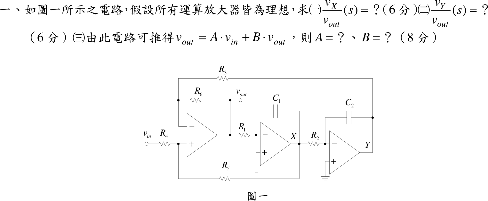
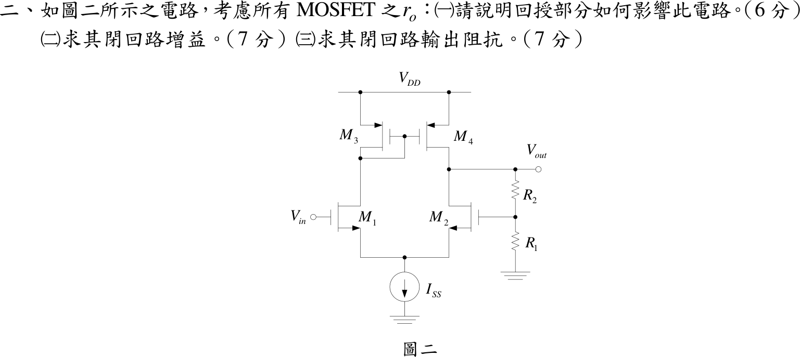
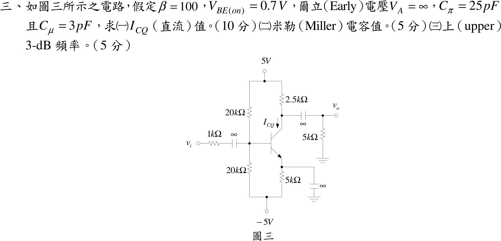
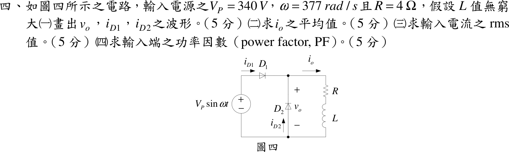
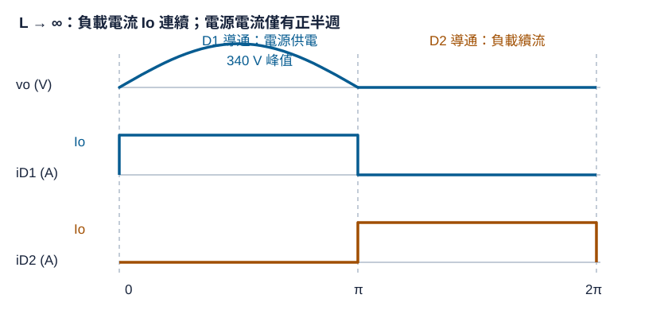
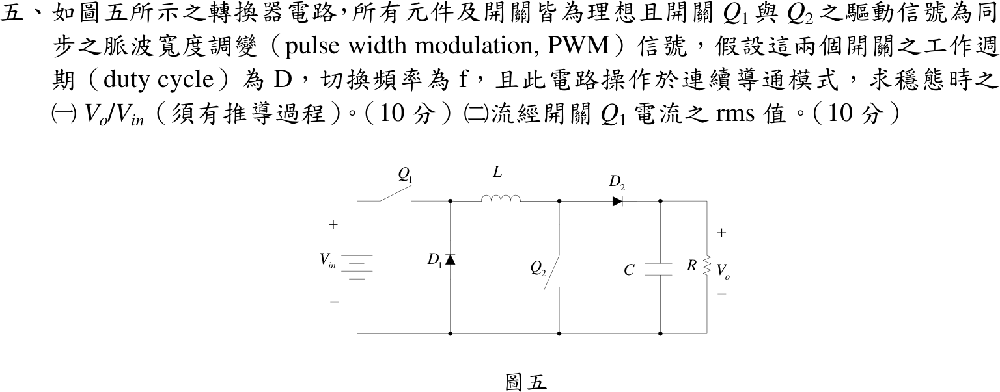

# 106 年電機工程技師｜電子學（包括電力電子學）逐題詳解

> 本頁由題級 canonical 筆記組合；每題保留官方裁切圖、校驗狀態與可追溯的推導。

## 題目導覽
- [[#一、106 年電子學（含電力電子）第 1 題｜雙積分器狀態變數濾波器|第 1 題：雙積分器狀態變數濾波器]]
- [[#二、106 年電子學_含電力電子第 2 題|第 2 題：106 年電子學_含電力電子第 2 題]]
- [[#三、106 年電子學_含電力電子第 3 題|第 3 題：106 年電子學_含電力電子第 3 題]]
- [[#四、106 年電子學（含電力電子）第 4 題｜單相半波整流器與續流二極體|第 4 題：單相半波整流器與續流二極體]]
- [[#五、106 年電子學（含電力電子）第 5 題｜非反相升壓型轉換器（同步開關）|第 5 題：非反相升壓型轉換器（同步開關）]]

---

## 一、106 年電子學（含電力電子）第 1 題｜雙積分器狀態變數濾波器

> 題級識別：EE-106-02-1
> canonical 來源：[[canonical/EE-106-02-1.md]]
> 題級校驗狀態：verified

### 已知與所求

三顆運放皆理想。左運放 $A_1$：$+$ 輸入點 $M$ 由 $v_{in}$ 經 $R_4$、由 $X$ 經 $R_5$ 供電；$-$ 輸入點 $N$ 由輸出 $v_{out}$ 經 $R_6$、由 $Y$ 經 $R_3$ 供電；輸出為 $v_{out}$。中運放 $A_2$：$v_{out}$ 經 $R_1$ 入 $-$，$C_1$ 跨接輸出 $X$ 與 $-$，$+$ 接地。右運放 $A_3$：$X$ 經 $R_2$ 入 $-$，$C_2$ 跨接輸出 $Y$ 與 $-$，$+$ 接地。求（一）$v_X/v_{out}$（6 分）、（二）$v_Y/v_{out}$（6 分）、（三）$v_{out}=A\,v_{in}+B\,v_{out}$ 中的 $A$、$B$（8 分）。$A$ 為係數，與運放名稱 $A_1,A_2,A_3$ 無關。

### 考場標準作答

**解題邏輯**：前提為三顆理想運放（輸入不取電流、線性區虛短路）。$A_2$、$A_3$ 的 $+$ 端接地，$-$ 端為虛接地，各是一個 $R$ 輸入、$C$ 回授的反相積分器：在虛接地節點寫 KCL 得（一），再把兩級積分器級聯得（二）。$A_1$ 的兩個輸入節點各是兩電阻的加權分壓（圖 1），令 $v_M=v_N$ 解出 $v_{out}$，$v_{in}$ 項係數即 $A$，其餘 $v_X,v_Y$ 項用（一）（二）換成 $v_{out}$ 的倍數即 $B$。

#### （一）$v_X/v_{out}$（6 分）

**邏輯**：$A_2$ 的 $-$ 端為虛接地（0 V），流經 $R_1$ 的電流全部流進 $C_1$（運放不取電流），KCL 只剩兩項。

虛接地節點 KCL（流入 $-$ 端的電流和為 0）：
\[
\frac{v_{out}-0}{R_1}+\frac{v_X-0}{1/(sC_1)}=0
\]
\[
\frac{v_{out}}{R_1}+sC_1v_X=0\ \Rightarrow\ v_X=-\frac{v_{out}}{sR_1C_1}
\]
\[
\boxed{\frac{v_X}{v_{out}}(s) = -\frac{1}{sR_1C_1}}
\]

#### （二）$v_Y/v_{out}$（6 分）

**邏輯**：$A_3$ 是同型的反相積分器，輸入為 $v_X$；先得 $v_Y/v_X$，再與（一）相乘（兩級負號相消）。

$A_3$ 虛接地節點 KCL：
\[
\frac{v_X}{R_2}+sC_2v_Y=0\ \Rightarrow\ \frac{v_Y}{v_X}=-\frac{1}{sR_2C_2}
\]
級聯：
\[
\frac{v_Y}{v_{out}}=\frac{v_Y}{v_X}\cdot\frac{v_X}{v_{out}}=\left(-\frac{1}{sR_2C_2}\right)\left(-\frac{1}{sR_1C_1}\right)
\]
\[
\boxed{\frac{v_Y}{v_{out}}(s)=\frac{1}{s^2R_1R_2C_1C_2}}
\]

#### （三）$A$、$B$（8 分）

**邏輯**：$A_1$ 輸入不取電流，$M$、$N$ 兩點各由兩個電阻的 KCL 決定電壓；虛短 $v_M=v_N$ 把兩式接起來，解出 $v_{out}$ 後依「$v_{in}$ 項」與「正比於 $v_{out}$ 的項」分組。

節點 $M$ 的 KCL（$v_{in}$ 經 $R_4$、$v_X$ 經 $R_5$ 流入，運放不取電流）：
\[
\frac{v_{in}-v_M}{R_4}+\frac{v_X-v_M}{R_5}=0
\]
兩邊乘 $R_4R_5$：
\[
R_5(v_{in}-v_M)+R_4(v_X-v_M)=0\ \Rightarrow\ v_M=\frac{R_5v_{in}+R_4v_X}{R_4+R_5}
\]
節點 $N$ 同理（$v_{out}$ 經 $R_6$、$v_Y$ 經 $R_3$）：
\[
\frac{v_{out}-v_N}{R_6}+\frac{v_Y-v_N}{R_3}=0\ \Rightarrow\ v_N=\frac{R_3v_{out}+R_6v_Y}{R_3+R_6}
\]
虛短 $v_N=v_M$：
\[
\frac{R_3v_{out}+R_6v_Y}{R_3+R_6}=\frac{R_5v_{in}+R_4v_X}{R_4+R_5}
\]
兩邊乘 $(R_3+R_6)/R_3$，移項解 $v_{out}$：
\[
v_{out}=\frac{R_3+R_6}{R_3}\cdot\frac{R_5v_{in}+R_4v_X}{R_4+R_5}-\frac{R_6}{R_3}v_Y
\]
展開成三項：
\[
v_{out}=\frac{R_5(R_3+R_6)}{R_3(R_4+R_5)}v_{in}+\frac{R_4(R_3+R_6)}{R_3(R_4+R_5)}v_X-\frac{R_6}{R_3}v_Y
\]
$v_{in}$ 項的係數就是 $A$：
\[
\boxed{A=\frac{R_5 (R_3 + R_6)}{R_3 (R_4 + R_5)}}
\]
其餘兩項代入（一）$v_X=-\dfrac{v_{out}}{sR_1C_1}$、（二）$v_Y=\dfrac{v_{out}}{s^2R_1R_2C_1C_2}$：
\[
\frac{R_4(R_3+R_6)}{R_3(R_4+R_5)}v_X=-\frac{R_4(R_3+R_6)}{R_3(R_4+R_5)}\cdot\frac{1}{sR_1C_1}\,v_{out}
\]
\[
-\frac{R_6}{R_3}v_Y=-\frac{R_6}{R_3}\cdot\frac{1}{s^2R_1R_2C_1C_2}\,v_{out}
\]
兩項合併為 $B\,v_{out}$：
\[
\boxed{B=-\frac{R_4(R_3+R_6)}{R_3(R_4+R_5)}\cdot\frac{1}{sR_1C_1}-\frac{R_6}{R_3}\cdot\frac{1}{s^2R_1R_2C_1C_2}}
\]
$B$ 是 $s$ 的函數（回授項）；整理得 $\dfrac{v_{out}}{v_{in}}=\dfrac{A}{1-B}$。

### 驗算

令 $R_1\sim R_6=1\,\mathrm{k\Omega}$、$C_1=C_2=1\,\mu\mathrm F$、$\omega=1000\ \mathrm{rad/s}$（$sRC=j$）：$A=1$、$B=-\dfrac1j-\dfrac{1}{j^2}=1+j$，故 $v_{out}/v_{in}=1/(1-B)=j$。直接檢查：$v_X=-v_{out}/j=jv_{out}$、$v_Y=-v_{out}$，故 $v_N=(v_{out}+v_Y)/2=0$；虛短得 $v_M=(v_{in}+v_X)/2=0$，即 $v_X=-v_{in}$、$v_{out}=jv_{in}$，一致。另外令 $v_X=v_Y=0$ 時 $A_1$ 為非反相放大器，增益 $(1+R_6/R_3)\cdot R_5/(R_4+R_5)=A$。

### 失分點

- $v_Y/v_{out}$ 經兩級反相積分器，符號為正（$+1/(s^2R_1R_2C_1C_2)$），不是負。
- $N$ 點是 $v_{out}$ 經 $R_6$、$v_Y$ 經 $R_3$ 的分壓：$v_{out}$ 的權重是 $R_3/(R_3+R_6)$，$v_Y$ 的權重是 $R_6/(R_3+R_6)$；對調權重會使 $A$ 變成 $R_5(R_3+R_6)/(R_6(R_4+R_5))$。
- $M$ 點 $v_{in}$ 的權重是 $R_5/(R_4+R_5)$（遠端電阻在分子），不是 $R_4/(R_4+R_5)$。

---

## 二、106 年電子學_含電力電子第 2 題

> 題級識別：EE-106-02-2
> canonical 來源：[[canonical/EE-106-02-2.md]]
> 題級校驗狀態：needs_manual_review
> [!WARNING] 本題仍有官方資料缺口或事件定義歧義；請以 canonical 條件式解答為準。

### 已知與所求

$M_1$、$M_2$ 為 NMOS 差動對（尾端理想電流源 $I_{SS}$），$M_3$（閘汲短接）、$M_4$ 為 PMOS 電流鏡負載；$V_{in}$ 加在 $M_1$ 閘極，輸出 $V_{out}$ 取自 $M_2$、$M_4$ 汲極，經 $R_2$、$R_1$ 分壓接到 $M_2$ 閘極。考慮所有 MOSFET 的 $r_o$。題圖無元件數值，答案為符號式；參考書（非官方答案）採對稱模型 $r_{ON}=r_{OP}=r_o$，$g_{mN}=g_{m1}=g_{m2}$，$\beta=R_1/(R_1+R_2)$。求（一）回授的影響（6 分）；（二）閉迴路增益（7 分）；（三）閉迴路輸出阻抗（7 分）。

### 考場標準作答

**解題邏輯**：前提為小訊號線性分析，四顆 MOSFET 都在飽和區（主動區），尾端為理想電流源，電流鏡理想（$g_{mP}r_o\gg1$，$M_4$ 複製 $M_1$ 的小訊號電流），忽略基體效應（$M_1$、$M_2$ 源極接共源節點，$g_{mb}$ 原則上不為零），且採參考書的對稱模型 $r_{ON}=r_{OP}=r_o$。先判斷回授型態（電壓取樣、串聯混合）與極性（一）；再把放大器化成輸出端的諾頓模型：短路電流 $g_{mN}v_d$、輸出電阻 $\approx r_o/2$，並計入回授網路在輸出端的負載 $R_1+R_2$ 得開迴路增益 $A$（步驟 1、2）；最後用 $V_{out}=Av_d$、$v_d=V_{in}-\beta V_{out}$ 解 $A_f$（二），以測試電壓源求 $R_{out,f}$（三）。

#### （一）回授的影響（6 分）

**邏輯**：看回授網路在輸出端怎麼取樣（並接 → 取樣電壓）、在輸入端怎麼混合（接到 $M_2$ 閘極，與 $V_{in}$ 在差動對中相減 → 串聯），再用「輸出上升時回授把輸出拉回」確認是負回授。

- 取樣：$R_2$、$R_1$ 串聯後並接在輸出端與地之間，取樣的是輸出電壓 $V_{out}$。
- 混合：分壓點 $v_f=\beta V_{out}$（$\beta=R_1/(R_1+R_2)$）接 $M_2$ 閘極，差動對放大的是 $v_d=V_{in}-v_f$，回授訊號與輸入以電壓相減（串聯）。
- 極性：$V_{in}$ 上升 → $M_1$ 電流增加 → 經 $M_3$、$M_4$ 鏡射推高 $V_{out}$，故 $M_1$ 閘極是非反相輸入、$M_2$ 閘極是反相輸入；$V_{out}$ 上升 → $v_f$ 上升 → $M_2$ 電流增加，把輸出拉低，為負回授。

\[
\boxed{\text{串聯-並聯（電壓串聯）負回授}}
\]
影響：閉迴路增益 $A_f=A/(1+A\beta)$，$A\beta\gg1$ 時趨近 $1/\beta=1+R_2/R_1$，對 $g_m,r_o$ 變動不敏感；輸出阻抗降為開迴路的 $1/(1+A\beta)$；頻寬增加、非線性失真降低；串聯混合使輸入阻抗增大，閘極輸入阻抗本就近無限大。

#### 步驟 1：差動對＋電流鏡的短路電流與輸出電阻

輸出端交流短路（$V_{out}=0$）時，理想尾電流源使 $M_1$、$M_2$ 小訊號電流大小相等、方向相反，各分到 $v_d$ 的一半：
\[
i_{d1}=g_{mN}\frac{v_d}{2},\qquad i_{d2}=-g_{mN}\frac{v_d}{2}
\]
$M_3$ 吸收 $i_{d1}$，$M_4$ 把它鏡射成流入輸出節點的電流 $i_{d1}$；$M_2$ 的汲極電流 $i_{d2}$ 由輸出節點流出。輸出節點流入的短路電流：
\[
i_{sc}=i_{d1}-i_{d2}=g_{mN}\frac{v_d}{2}+g_{mN}\frac{v_d}{2}=g_{mN}v_d
\]
$v_d=0$（兩閘極交流接地）時由輸出節點看入的電阻：$M_2$ 的源極接在共源節點，尾電流源交流開路，該節點並未交流接地，所以不能把 $r_{o2}$ 直接當成接地電阻。在輸出端加測試電壓 $v_x$，電流分兩路（對稱模型 $r_{o2}=r_{o4}=r_o$）：
- 經 $M_2$ 進入差動對：尾端交流開路，流進 $M_2$ 的電流必須全部由 $M_1$ 流出，路徑上 $r_{o2}$、$r_{o1}$ 串聯（兩管的 $g_{mN}$ 項互相抵消），電流約 $v_x/(2r_o)$；它流過 $M_3$，再由 $M_4$ 鏡射，從輸出節點多抽一份約 $v_x/(2r_o)$，兩者合計約 $v_x/r_o$。
- 經 $r_{o4}$ 直接到交流地（$V_{DD}$）：$v_x/r_o$。

總測試電流約 $2v_x/r_o$（鏡射完整需 $g_{mP}r_o\gg1$）：
\[
\frac{v_x}{i_x}\approx\frac{v_x}{2v_x/r_o}=\frac{r_o}{2}\quad(=r_{o2}\parallel r_{o4})
\]
完整節點解為 $\dfrac{r_o(2g_{mP}r_o+3)}{4(g_{mP}r_o+1)}$，$g_{mP}r_o\gg1$ 時趨近 $r_o/2$；驗算中完整解與本解 $0.84\%$ 的差異即來自這個近似。

#### 步驟 2：計入回授網路負載的開迴路增益 $A$

$M_2$ 閘極不取電流，所以回授網路在輸入端不造成負載；在輸出端，分壓器從輸出端到地是一條串聯支路，**輸出端負載為 $R_1+R_2$**，與 $r_o/2$ 並聯：
\[
R_o=\frac{r_o}{2}\parallel(R_1+R_2)=\frac{\dfrac{r_o}{2}(R_1+R_2)}{\dfrac{r_o}{2}+R_1+R_2}
\]
開迴路（$v_d\to V_{out}$）增益：諾頓電流 $i_{sc}$ 全部流過 $R_o$，
\[
V_{out}=i_{sc}R_o=g_{mN}v_dR_o
\]
\[
A=\frac{V_{out}}{v_d}=g_{mN}R_o=g_{mN}\left[\frac{r_o}{2}\parallel(R_1+R_2)\right]
\]

#### （二）閉迴路增益（7 分）

**邏輯**：開迴路關係 $V_{out}=Av_d$ 與混合關係 $v_d=V_{in}-\beta V_{out}$ 聯立，消去 $v_d$ 即得 $A_f$。

\[
V_{out}=Av_d=A(V_{in}-\beta V_{out})
\]
\[
V_{out}(1+A\beta)=AV_{in}
\]
\[
\boxed{A_f=\frac{V_{out}}{V_{in}}=\frac{A}{1+A\beta}},\qquad A=g_{mN}\left[\frac{r_o}{2}\parallel(R_1+R_2)\right],\quad \beta=\frac{R_1}{R_1+R_2}
\]
$R_1+R_2\gg r_o/2$ 時 $A\to\tfrac12g_{mN}r_o$，即參考書採用的 $A$；$A\beta\gg1$ 時 $A_f\to1/\beta=1+R_2/R_1$。

#### （三）閉迴路輸出阻抗（7 分）

**邏輯**：令 $V_{in}=0$，在輸出端加測試電壓 $v_x$，回授使 $v_d=-\beta v_x$，受控源從輸出節點多抽走 $g_{mN}\beta v_x$；$R_{out,f}=v_x/i_x$。

輸出節點 KCL：測試電流 $i_x$ 加上受控源注入的 $g_{mN}v_d$，等於經 $R_o$ 流到地的電流：
\[
i_x+g_{mN}v_d=\frac{v_x}{R_o}\ \Rightarrow\ i_x=\frac{v_x}{R_o}-g_{mN}v_d,\qquad v_d=0-\beta v_x=-\beta v_x
\]
\[
i_x=\frac{v_x}{R_o}+g_{mN}\beta v_x=\frac{v_x}{R_o}\,(1+g_{mN}R_o\beta)=\frac{v_x}{R_o}\,(1+A\beta)
\]
\[
\boxed{R_{out,f}=\frac{v_x}{i_x}=\frac{R_o}{1+A\beta}=\frac{\dfrac{r_o}{2}\parallel(R_1+R_2)}{1+A\beta}}
\]
分子與參考書的 $(R_1+R_2)\parallel(r_o/2)$ 相同；參考書分母的 $A$ 取 $\tfrac12g_{mN}r_o$（未含負載），$R_{out,f}$ 因此差約 28%，見條件與疑義。

### 驗算

對四顆電晶體做完整小訊號節點解（含 $g_{m3},g_{m4}$、各 $r_o$，尾端理想電流源），代入 $g_{mN}=g_{mP}=1\,\mathrm{mS}$、$r_o=100\,\mathrm{k\Omega}$、$R_1=10\,\mathrm{k\Omega}$、$R_2=90\,\mathrm{k\Omega}$：$A_f=7.68$，上式（含負載的 $A$）給 $7.69$，相差 0.14%；$R_{out,f}$ 精確 $7757\,\Omega$，上式 $7692\,\Omega$（0.84%）。令 $g_{mP}\to\infty$ 兩式嚴格相等。

### 失分點

- 把分壓器負載寫成 $R_1\parallel R_2$；從輸出端看，$R_1$、$R_2$ 是串聯到地，負載是 $R_1+R_2$。
- 以為 $A_f$ 恆等於 $1+R_2/R_1$；只有 $A\beta\gg1$ 才成立，有限 $A$ 時是 $A/(1+A\beta)$。
- 只說「降低輸出阻抗」而不寫 $1/(1+A\beta)$，且忘記要乘上 $r_o/2$ 與 $R_1+R_2$ 的並聯開迴路值。

### 條件與疑義

參考書的開迴路增益 $A=\tfrac12g_{mN}r_o$ 未計入分壓器負載 $R_1+R_2$，但其 $R_{out,f}$ 分子卻含 $(R_1+R_2)\parallel(r_o/2)$，兩處對負載的處理不一致。以上述數值（完整節點解 $A_f=7.68$、$R_{out,f}=7757\,\Omega$）比較：

| 項目 | 完整節點解 | 含負載的 $A$ | 參考書未含負載的 $A=\tfrac12g_{mN}r_o$ |
|---|---|---|---|
| $A_f$ | 7.68 | 7.69 | 8.33（高 8.5%） |
| $R_{out,f}$ | 7757 $\Omega$ | 7692 $\Omega$ | 5556 $\Omega$（低 28%） |

兩者僅在 $R_1+R_2\gg r_o/2$ 時一致。官方題面未給數值，也無標準答案；本解以含負載的 $A$ 為主解，參考書形式視為該極限。

---

## 三、106 年電子學_含電力電子第 3 題

> 題級識別：EE-106-02-3
> canonical 來源：[[canonical/EE-106-02-3.md]]
> 題級校驗狀態：verified

### 已知與所求

供電 $\pm5\,\mathrm V$；基極分壓 $20\,\mathrm{k\Omega}$（接 $+5\,\mathrm V$）與 $20\,\mathrm{k\Omega}$（接 $-5\,\mathrm V$）；$R_C=2.5\,\mathrm{k\Omega}$、射極 $R_E=5\,\mathrm{k\Omega}$ 接 $-5\,\mathrm V$ 並以無限大電容旁路；輸入為 $R_s=1\,\mathrm{k\Omega}$ 串耦合電容（無限大）、輸出經耦合電容接 $R_L=5\,\mathrm{k\Omega}$。$\beta=100$、$V_{BE(on)}=0.7\,\mathrm V$、$V_A=\infty$、$C_\pi=25\,\mathrm{pF}$、$C_\mu=3\,\mathrm{pF}$。求（一）$I_{CQ}$（10 分）、（二）Miller 電容（5 分）、（三）上 3-dB 頻率（5 分）。

題目未給，本解採用 $V_T=25\,\mathrm{mV}$（假設）。

### 考場標準作答

**解題邏輯**：直流假設 BJT 在**主動區**（$I_C=\beta I_B$，（一）末以 $V_{CE}>V_{CE(sat)}$ 確認），基極分壓化成戴維寧等效後寫基–射迴路 KVL 求 $I_{CQ}$。高頻分析採**小訊號混合 $\pi$ 模型**：耦合與旁路電容（無限大）全短路，射極交流接地，只剩 $C_\pi$、$C_\mu$；以 **Miller 近似**（基極到集極增益取中頻值 $K=-g_mR_L'$，忽略 $C_\mu$ 的前饋電流）把跨接的 $C_\mu$ 拆成輸入側 $C_M$，輸入節點的 $R_{in}'$ 與 $C_\pi+C_M$ 形成**主導極點**，即上 3-dB 頻率；輸出極點遠高於它而略去。

#### （一）$I_{CQ}$（10 分）

**邏輯**：分壓網路的戴維寧等效把基極電路化成單一迴路；射極電流 $(\beta+1)I_B$ 流過 $R_E$，迴路 KVL 只剩一個未知數 $I_B$。

基極戴維寧等效（分壓於 $+5$ 與 $-5\,\mathrm V$ 之間）：
\[
V_{TH}=-5+\bigl(5-(-5)\bigr)\frac{20}{20+20}=-5+10\times0.5=0\ \mathrm V
\]
\[
R_{TH}=20\,\mathrm k\parallel20\,\mathrm k=\frac{20\times20}{20+20}=10\ \mathrm{k\Omega}
\]
基–射迴路 KVL（$V_{TH}\to R_{TH}\to V_{BE}\to R_E\to-5\,\mathrm V$）：
\[
V_{TH}-I_BR_{TH}-V_{BE(on)}-(\beta+1)I_BR_E=-5
\]
\[
I_B=\frac{V_{TH}-V_{BE(on)}-(-5)}{R_{TH}+(\beta+1)R_E}
\]
\[
R_{TH}+(\beta+1)R_E=10\ \mathrm{k\Omega}+101\times5\ \mathrm{k\Omega}=515\ \mathrm{k\Omega}
\]
\[
I_B=\frac{0-0.7+5}{515\ \mathrm{k\Omega}}=\frac{4.3\ \mathrm V}{515\ \mathrm{k\Omega}}=8.3495\ \mu\mathrm A
\]
\[
I_{CQ}=\beta I_B=100\times8.3495\ \mu\mathrm A
\]
\[
\boxed{I_{CQ}=834.95\ \mu\mathrm A}
\]
主動區檢查（$I_E=(\beta+1)I_B$）：
\[
I_E=101\times8.3495\ \mu\mathrm A=843.30\ \mu\mathrm A,\qquad V_E=-5+I_ER_E=-5+843.30\ \mu\mathrm A\times5\ \mathrm{k\Omega}=-5+4.2165=-0.7835\ \mathrm V
\]
\[
V_C=5-I_{CQ}R_C=5-834.95\ \mu\mathrm A\times2.5\ \mathrm{k\Omega}=5-2.0874=2.9126\ \mathrm V
\]
\[
V_{CE}=V_C-V_E=2.9126-(-0.7835)=3.6961\ \mathrm V>V_{CE(sat)}=0.3\ \mathrm V
\]
主動區假設成立。

#### 步驟 2：小訊號參數與高頻等效電路

\[
g_m=\frac{I_{CQ}}{V_T}=\frac{834.95\ \mu\mathrm A}{25\ \mathrm{mV}}=33.398\ \mathrm{mS}
\]
\[
r_\pi=\frac{\beta}{g_m}=\frac{100}{33.398\ \mathrm{mS}}=2.9942\ \mathrm{k\Omega}
\]

畫法：$\pm5\,\mathrm V$ 為交流地，兩個 $20\,\mathrm{k\Omega}$ 變成基極對地並聯的 $R_{TH}=10\,\mathrm{k\Omega}$；射極旁路故 $E$ 接地；$R_C$ 與 $R_L$ 在集極對地並聯；$C_\mu$ 跨接 $B$–$C$（圖 1a）。Miller 分解後輸入節點只剩 $R_s$、$R_{TH}$、$r_\pi$、$C_\pi$、$C_M$（圖 1b）。

#### （二）Miller 電容（5 分）

**邏輯**：$C_\mu$ 兩端電壓為 $v_b-v_c=v_b(1-K)$，從基極看進去的電流是同值電容的 $(1-K)$ 倍，故輸入側等效 $C_M=C_\mu(1-K)$；$K$ 用交流負載 $R_L'=R_C\parallel R_L$ 的中頻增益。

交流負載：
\[
R_L'=R_C\parallel R_L=\frac{2.5\times5}{2.5+5}=\frac{12.5}{7.5}=1.6667\ \mathrm{k\Omega}
\]
射極交流接地，圖 1(a) 的基射電壓就是基極電壓：
\[
v_\pi=v_b
\]
集極節點（Miller 近似忽略 $C_\mu$ 前饋電流）：受控電流 $g_mv_\pi$ 由 $C$ 流向地，只能由 $R_L'$ 供給：
\[
v_c=-g_mv_\pi R_L'=-g_mR_L'v_b
\]
基極到集極增益：
\[
K=\frac{v_c}{v_b}=-g_mR_L'=-33.398\ \mathrm{mS}\times1.6667\ \mathrm{k\Omega}=-55.664
\]
\[
C_M=C_\mu(1-K)=3\ \mathrm{pF}\times(1+55.664)=3\ \mathrm{pF}\times56.664
\]
\[
\boxed{C_M=169.99\ \mathrm{pF}}
\]

#### （三）上 3-dB 頻率（5 分）

**邏輯**：圖 1b 的輸入節點是單一 RC：電容 $C_\pi+C_M$ 看到的電阻是把 $v_i$ 短路後的 $R_s\parallel R_{TH}\parallel r_\pi$，極點頻率 $1/(2\pi R_{in}'C_{in})$ 即 $f_H$。

信號源與偏壓分壓的並聯：
\[
R_s\parallel R_{TH}=\frac{1\times10}{1+10}=\frac{10}{11}\ \mathrm{k\Omega}=909.09\ \Omega
\]
再並 $r_\pi$：
\[
R_{in}'=\frac{0.90909\times2.9942}{0.90909+2.9942}\ \mathrm{k\Omega}=\frac{2.7220}{3.9033}\ \mathrm{k\Omega}=0.69736\ \mathrm{k\Omega}=697.36\ \Omega
\]
總輸入電容：
\[
C_{in}=C_\pi+C_M=25+169.99=194.99\ \mathrm{pF}
\]
時間常數與頻率：
\[
\tau=R_{in}'C_{in}=697.36\ \Omega\times194.99\ \mathrm{pF}=135.98\ \mathrm{ns}
\]
\[
f_H=\frac1{2\pi\tau}=\frac1{2\pi\times135.98\ \mathrm{ns}}=\frac{1}{854.39\ \mathrm{ns}}=1.1704\ \mathrm{MHz}
\]
\[
\boxed{f_H=1.17\ \mathrm{MHz}}
\]
輸出側主導性檢查：輸出 Miller 電容 $C_\mu(1-1/K)=3\times(1+1/55.664)=3.054\ \mathrm{pF}$，輸出極點 $\dfrac1{2\pi R_L'\times3.054\ \mathrm{pF}}=\dfrac1{2\pi\times1666.7\times3.054\times10^{-12}}=31.27\ \mathrm{MHz}\gg f_H$，輸入極點主導。

### 驗算

偏壓：$I_E=(\beta+1)I_B=101\times8.3495=843.30\ \mu\mathrm A$，$V_E=-5+I_ER_E=-5+4.2165=-0.7835\ \mathrm V$，$V_B=V_{TH}-I_BR_{TH}=-0.0835\ \mathrm V$，$V_B-V_E=0.70\ \mathrm V$ 吻合 $V_{BE(on)}$；$V_C=5-I_{CQ}R_C=5-2.0874=2.9126\ \mathrm V$，$V_{CE}=2.9126-(-0.7835)=3.70\ \mathrm V>0.3\ \mathrm V$，主動區成立。高頻：以 $C_\mu$ 跨接基極與集極的完整兩節點方程數值求 $|v_o/v_i|$ 下降 3 dB，得 $1.13\ \mathrm{MHz}$，與 Miller 近似 $1.17\ \mathrm{MHz}$ 差約 3%（Miller 近似忽略 $C_\mu$ 前饋與輸出極點的交互作用）。

### 失分點

- 射極電阻反射到基極要乘 $(\beta+1)=101$，分母是 $R_{TH}+101R_E$，不是 $R_{TH}+\beta R_E$ 或只有 $R_E$。
- Miller 增益用 $R_C\parallel R_L=1.6667\ \mathrm{k\Omega}$（交流負載），不是只用 $R_C$ 或 $R_L$。
- $R_{in}'$ 漏掉基極偏壓分壓 $10\,\mathrm{k\Omega}$ 時，$R_{in}'=749.64\ \Omega$，$f_H$ 偏低為 $1.09\ \mathrm{MHz}$。

---

## 四、106 年電子學（含電力電子）第 4 題｜單相半波整流器與續流二極體

> 題級識別：EE-106-02-4
> canonical 來源：[[canonical/EE-106-02-4.md]]
> 題級校驗狀態：verified

### 已知與所求

$v_s=V_P\sin\omega t$，$V_P=340\,\mathrm V$、$\omega=377\,\mathrm{rad/s}$，$D_1$ 串在電源與負載之間，$D_2$ 跨在負載兩端（陰極接 $v_o$ 的 $+$ 端），負載 $R=4\,\Omega$ 串 $L\to\infty$。求（一）$v_o,i_{D1},i_{D2}$ 波形；（二）$i_o$ 平均值；（三）輸入電流 rms；（四）功率因數。

### 考場標準作答

**解題邏輯**：理想二極體；$L\to\infty$ 使負載電流為無漣波的常數 $I_o$，兩顆二極體必有一顆導通。正半週 $D_1$ 導通、負半週 $D_2$ 續流，由此畫出 $v_o$、$i_{D1}$、$i_{D2}$。穩態電感平均電壓為零，$I_o=V_{o,avg}/R$；輸入電流只在正半週等於 $I_o$，其 rms 用定義積分；功率因數用 $P/S$，$P$ 全部消耗在 $R$。

#### 步驟 1：兩個半週的等效電路

- **正半週（$0<\theta<\pi$，$\theta=\omega t$）**：$v_s>0$，$D_1$ 順偏導通，$v_o=v_s>0$ 使 $D_2$ 逆偏截止；電源供給 $I_o$。
- **負半週（$\pi<\theta<2\pi$）**：$v_s<0$ 欲使 $v_o$ 變負，但電感電流 $I_o$ 不能中斷，迫使 $D_2$ 導通把 $v_o$ 箝在 0，$D_1$ 承受逆壓截止；電源電流為零。

#### （一）$v_o$、$i_{D1}$、$i_{D2}$ 波形（5 分）

**邏輯**：直接寫出步驟 1 兩段的 $v_o$ 與二極體電流，畫在同一時間軸。

\[
v_o=\begin{cases}340\sin\theta,&0<\theta<\pi\\0,&\pi<\theta<2\pi\end{cases},\quad
i_{D1}=\begin{cases}I_o,&0<\theta<\pi\\0,&\pi<\theta<2\pi\end{cases},\quad
i_{D2}=\begin{cases}0,&0<\theta<\pi\\I_o,&\pi<\theta<2\pi\end{cases}
\]
\[
\boxed{D_1:\ 0\sim\pi\ \text{導通},\qquad D_2:\ \pi\sim2\pi\ \text{續流}}
\]

#### （二）$i_o$ 平均值（5 分）

**邏輯**：穩態電感一週期平均電壓為零，$v_o$ 的平均值全部落在 $R$ 上，$I_o=V_{o,avg}/R$。

$v_o$ 只在正半週為半個正弦（半波整流輸出），平均值：
\[
V_{o,avg}=\frac1{2\pi}\int_0^\pi V_P\sin\theta\,d\theta=\frac{V_P}{2\pi}\Big[-\cos\theta\Big]_0^\pi=\frac{V_P}{2\pi}\times2=\frac{V_P}{\pi}
\]
\[
V_{o,avg}=\frac{340}{\pi}=108.23\ \mathrm V
\]
\[
\boxed{I_o = \frac{V_{o,avg}}{R}=\frac{340/\pi}{4}=27.06\ \mathrm A}
\]

#### （三）輸入電流 rms 值（5 分）

**邏輯**：電源只在 $D_1$ 導通的正半週供電，輸入電流就是 $i_{D1}$（正半週為定值 $I_o$，負半週為 0；$D_2$ 的續流不經電源），依 rms 定義積分。

\[
I_{s,rms}=\sqrt{\frac1{2\pi}\int_0^{2\pi}i_{D1}^2\,d\theta}=\sqrt{\frac1{2\pi}\int_0^\pi I_o^2\,d\theta}
\]
積分得 $\pi I_o^2$，除以 $2\pi$ 後開根號：
\[
I_{s,rms}=\sqrt{\frac{\pi I_o^2}{2\pi}}=\frac{I_o}{\sqrt2}=\frac{27.06}{\sqrt2}
\]
\[
\boxed{I_{s,rms}=19.13\ \mathrm A}
\]

#### （四）輸入端功率因數（5 分）

**邏輯**：非弦波下 $PF=P/S$：實功 $P$ 全部消耗在 $R$（電感與理想二極體無損），視在功率 $S$ 為電源 rms 電壓乘輸入電流 rms。為避免捨入誤差，$P$、$S$ 都保留 $V_P/\pi$ 的精確式。

實功率：
\[
P=I_o^2R=\Big(\frac{340}{4\pi}\Big)^2\times4=\frac{340^2}{4\pi^2}=\frac{115600}{4\pi^2}=2928.18\ \mathrm W
\]
電源 rms 電壓：
\[
V_{s,rms}=\frac{V_P}{\sqrt2}=\frac{340}{\sqrt2}=240.42\ \mathrm V
\]
視在功率（$I_{s,rms}=\dfrac{340}{4\pi\sqrt2}$）：
\[
S=V_{s,rms}I_{s,rms}=\frac{340}{\sqrt2}\times\frac{340}{4\pi\sqrt2}=\frac{340^2}{8\pi}=\frac{115600}{8\pi}=4599.58\ \mathrm{VA}
\]
\[
PF=\frac PS=\frac{2928.18}{4599.58}=\frac{115600/(4\pi^2)}{115600/(8\pi)}=\frac{8\pi}{4\pi^2}
\]
\[
\boxed{PF = \frac{2}{\pi}=63.66\%}
\]
電流基本波與電壓同相，PF 偏低完全來自電流波形失真。

### 驗算

以傅立葉基本波檢查：輸入電流為 $0\sim\pi$ 的方波 $I_o$，基本波正弦分量振幅 $2I_o/\pi$、餘弦分量為 0，故基本波與電壓同相（位移因數 1），基本波 rms $=\sqrt2I_o/\pi$。畸變因數 $=\dfrac{\sqrt2I_o/\pi}{I_o/\sqrt2}=\dfrac2\pi$，PF $=1\times2/\pi$，與 $P/S$ 相同。電源實功率 $\frac1{2\pi}\int_0^\pi V_P\sin\theta\,I_o\,d\theta=V_PI_o/\pi=2928.18\ \mathrm W=RI_o^2$。

### 失分點

- 把輸入電流算成負載電流（$I_o$）或含 $D_2$ 續流段；$D_2$ 的電流不經電源，輸入 rms 只有 $I_o/\sqrt2$。
- 套用純電阻半波整流的 $I_{s,rms}=V_P/(2R)=42.50\ \mathrm A$；本題 $L\to\infty$ 使電流為定值 $27.06\ \mathrm A$。
- 把功率因數當成位移因數 $\cos\phi=1$；輸入電流是方波，畸變使 PF $=2/\pi$。

---

## 五、106 年電子學（含電力電子）第 5 題｜非反相升壓型轉換器（同步開關）

> 題級識別：EE-106-02-5
> canonical 來源：[[canonical/EE-106-02-5.md]]
> 題級校驗狀態：verified

### 已知與所求

理想元件；$Q_1$ 串於 $V_{in}$ 與 $L$ 之間，$D_1$ 自地接到 $Q_1$–$L$ 節點，$Q_2$ 自 $L$–$D_2$ 節點接地，$D_2$ 接輸出電容 $C$ 與 $R$。$Q_1,Q_2$ 同步 PWM、工作週期 $D$、頻率 $f$，CCM 穩態。題目無數值，答案為符號式。求（一）$V_o/V_{in}$（須推導）；（二）$Q_1$ 電流 rms。

### 考場標準作答

**解題邏輯**：理想元件、CCM 穩態，輸出電容夠大使 $V_o$ 視為定值。$Q_1,Q_2$ 同時切換，一週期只有兩種狀態，先畫兩段等效電路得 $v_L$。（一）用電感伏秒平衡得 $V_o/V_{in}$；（二）$Q_1$ 只在導通段承載 $i_L$，先以輸出電荷平衡求平均電感電流 $I_L$、以導通段斜率求漣波 $\Delta I_L$，再對導通段的三角形電感電流取均方值、乘 $D$ 開根號。

#### 步驟 1：兩段等效電路

- **導通（$0<t<DT_s$）**：$Q_1$ 把 $L$ 左端接到 $V_{in}$，$Q_2$ 把 $L$ 右端接地，$v_L=V_{in}$，$i_L$ 上升；$D_1$ 陰極在 $V_{in}$、$D_2$ 陽極在地，皆逆偏截止，$C$ 單獨供給負載。
- **截止（$DT_s<t<T_s$）**：$i_L$ 不能突變，經 $D_1$（由地流入 $L$ 左端）與 $D_2$（送往輸出）續流；$L$ 左端為 0、右端為 $V_o$，$v_L=-V_o$，$i_L$ 下降。

#### （一）電壓比 $V_o/V_{in}$（10 分）

**邏輯**：穩態下 $i_L$ 一週期淨變化為零，$v_L$ 的一週期平均（伏秒和）必為零。

\[
V_{in}DT_s+(-V_o)(1-D)T_s=0
\]
\[
V_{in}D=V_o(1-D)\ \Longrightarrow\ \frac{V_o}{V_{in}}=\frac{D}{1-D}
\]
\[
\boxed{\frac{V_o}{V_{in}} = \frac{D}{1 - D}}
\]

#### 步驟 2：平均電感電流與漣波

輸出電荷平衡：$C$ 平均電流為零，負載電流 $I_o$ 全由 $D_2$ 供給，而 $D_2$ 只在 $(1-D)T_s$ 內送出 $i_L$：
\[
I_o=(1-D)I_L,\qquad I_o=\frac{V_o}{R}
\]
\[
I_L=\frac{I_o}{1-D}=\frac{V_o}{(1-D)R}
\]
電感漣波（導通段 $v_L=V_{in}$、歷時 $DT_s=D/f$）：
\[
\Delta I_L=\frac{V_{in}DT_s}{L}=\frac{V_{in}D}{Lf}
\]

#### （二）$Q_1$ 電流 rms 值（10 分）

**邏輯**：rms 是一週期電流平方的平均再開根號；$Q_1$ 只在 $DT_s$ 內承載 $i_L$（圖 2 陰影），截止段為零，所以先求導通段 $i_L^2$ 的平均，再乘 $D$。

導通段為三角形電感電流的上升斜坡，以 $I_L$ 為中心、峰峰值 $\Delta I_L$：
\[
i_L(t)=I_L+u(t),\qquad u\ \text{由}\ -\frac{\Delta I_L}{2}\ \text{線性升到}\ +\frac{\Delta I_L}{2}
\]
平方後取平均（$u$ 均勻分布，平均值為零，交叉項 $2I_Lu$ 平均為零）：
\[
\overline{u^2}=\frac{1}{\Delta I_L}\int_{-\Delta I_L/2}^{\Delta I_L/2}u^2\,du=\frac{1}{\Delta I_L}\cdot\frac{2}{3}\Big(\frac{\Delta I_L}{2}\Big)^3=\frac{(\Delta I_L)^2}{12}
\]
即三角波對平均值的均方偏差為峰峰值平方的 $\frac{1}{12}$，故導通段均方值：
\[
\overline{i_L^2}=I_L^2+\frac{(\Delta I_L)^2}{12}
\]
$Q_1$ 只在 $D$ 比例的時間導通，一週期均方值：
\[
I_{Q1,rms}^2=\frac{1}{T_s}\int_0^{DT_s}i_L^2\,dt=D\,\overline{i_L^2}=D\left[I_L^2+\frac{(\Delta I_L)^2}{12}\right]
\]
代入步驟 2 的 $I_L$、$\Delta I_L$，開根號：
\[
\boxed{I_{Q1,rms}=\sqrt{D\left[\left(\frac{V_o}{(1-D)R}\right)^2+\frac{(\Delta I_L)^2}{12}\right]},\quad \Delta I_L=\frac{V_{in}D}{Lf}}
\]
僅在小漣波近似（$\Delta I_L\ll I_L$）下才簡化為 $I_{Q1,rms}\approx I_L\sqrt D=\dfrac{V_o\sqrt D}{(1-D)R}=\dfrac{D^{1.5}V_{in}}{(1-D)^2R}$。

### 驗算

功率守恆：輸入電流只在導通段等於 $i_L$，平均值 $DI_L$；$P_{in}=V_{in}DI_L=V_{in}D\cdot\dfrac{V_{in}D}{(1-D)^2R}=\dfrac{1}{R}\Big(\dfrac{V_{in}D}{1-D}\Big)^2=\dfrac{V_o^2}{R}$，與（一）相容。取假想數值（非題目給定）$V_{in}=12\,\mathrm V$、$D=0.40$、$R=10\,\Omega$、$L=100\,\mu\mathrm H$、$f=25\,\mathrm{kHz}$：$V_o=12\times0.40/0.60=8\,\mathrm V$，$I_L=8/(0.60\times10)=1.333\,\mathrm A$，$\Delta I_L=12\times0.40/(100\times10^{-6}\times25\times10^3)=1.92\,\mathrm A$；$I_L^2=1.778$、$(\Delta I_L)^2/12=0.3072$，$I_{Q1,rms}=\sqrt{0.40\times(1.778+0.3072)}=\sqrt{0.8341}=0.9133\,\mathrm A$，與時域兩段斜坡積分一致（小漣波近似 $1.333\times\sqrt{0.40}=0.8431\,\mathrm A$，偏低）。

### 失分點

- 把此同步雙開關拓撲當成普通 Boost，寫成 $V_o/V_{in}=1/(1-D)$；本圖導通時 $L$ 兩端是 $V_{in}$，關斷時是 $-V_o$，比值為 $D/(1-D)$。
- $I_L=I_o/(1-D)$，漏除 $(1-D)$ 會低估 $Q_1$ 電流。
- rms 要除以整個週期 $T_s$（乘 $D$ 再開根號），並保留 $\Delta I_L^2/12$；未註明小漣波近似就刪掉此項是不完整的。

---
