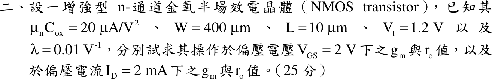

# 107 年電機工程技師｜電子學（包括電力電子學）逐題詳解

> 本頁由題級 canonical 筆記組合；每題保留官方裁切圖、校驗狀態與可追溯的推導。

## 題目導覽
- [[#一、107 年電子學（含電力電子）第 1 題｜PN 接面|第 1 題：PN 接面]]
- [[#二、107 年電子學（含電力電子）第 2 題｜NMOS 小訊號參數|第 2 題：NMOS 小訊號參數]]
- [[#三、107 年電子學（含電力電子）第 3 題｜降升壓型轉換器|第 3 題：降升壓型轉換器]]
- [[#四、107 年電子學（含電力電子）第 4 題｜Ćuk 轉換器|第 4 題：Ćuk 轉換器]]

---

## 一、107 年電子學（含電力電子）第 1 題｜PN 接面

> 題級識別：EE-107-02-1
> canonical 來源：[[canonical/EE-107-02-1.md]]
> 題級校驗狀態：verified

### 已知與所求

矽 pn 接面（平衡、無外加偏壓）：$N_A=5\times10^{16}\ \mathrm{cm^{-3}}$、$N_D=2\times10^{16}\ \mathrm{cm^{-3}}$、$n_i=2\times10^{10}\ \mathrm{cm^{-3}}$、$T=300\,\mathrm K$。求 $V_0$、$W_{dep}$、$x_p$、$x_n$。

題目未給、本解採用的常數（假設）：$V_T=kT/q=25.85\ \mathrm{mV}$（300 K 常用值），$q=1.602\times10^{-19}\ \mathrm C$，$\varepsilon_{Si}=11.7\varepsilon_0=1.036\times10^{-12}\ \mathrm{F/cm}$。

### 考場標準作答

#### 內建電壓 $V_0$

設平衡、無外加偏壓之突變接面，採空乏區近似（空乏區內載子全空、外側為中性）；$W_{dep}$ 答到 nm 小數兩位，中間值保留 5 位有效數字。

\[
V_0=V_T\ln\frac{N_AN_D}{n_i^2}
\]
先求濃度比：
\[
\frac{N_AN_D}{n_i^2}=\frac{(5\times10^{16})(2\times10^{16})}{(2\times10^{10})^2}=\frac{10^{33}}{4\times10^{20}}=2.5\times10^{12}
\]
\[
\ln(2.5\times10^{12})=28.547
\]
\[
V_0=0.025850\times28.547=0.73794\ \mathrm V
\]
\[
\boxed{V_0=0.74\ \mathrm V}
\]

#### 空乏區寬度 $W_{dep}$

由電荷中性 $N_Ax_p=N_Dx_n$ 與三角形電場面積 $\tfrac12E_{max}W_{dep}=V_0$ 消去 $E_{max}$（圖 1）：

\[
W_{dep}=\sqrt{\frac{2\varepsilon_{Si}V_0}{q}\left(\frac1{N_A}+\frac1{N_D}\right)}
\]
各因子：
\[
\frac{2\varepsilon_{Si}}{q}=\frac{2\times1.036\times10^{-12}}{1.602\times10^{-19}}=1.2934\times10^{7}\ \mathrm{(V\cdot cm)^{-1}}
\]
\[
\frac1{N_A}+\frac1{N_D}=\frac1{5\times10^{16}}+\frac1{2\times10^{16}}=2\times10^{-17}+5\times10^{-17}=7\times10^{-17}\ \mathrm{cm^3}
\]
相乘（$V_0$ 用 $0.73794\ \mathrm V$）：
\[
(1.2934\times10^{7})(7\times10^{-17})=9.0538\times10^{-10}
\]
\[
W_{dep}^2=9.0538\times10^{-10}\times0.73794=6.6812\times10^{-10}\ \mathrm{cm^2}
\]
\[
W_{dep}=\sqrt{6.6812\times10^{-10}}=2.5848\times10^{-5}\ \mathrm{cm}
\]
換成 nm（$1\ \mathrm{cm}=10^7\ \mathrm{nm}$）：
\[
\boxed{W_{dep}=258.48\ \mathrm{nm}}
\]

#### p 側與 n 側延伸寬度

聯立消去 $x_n$：
\[
N_Ax_p=N_D(W_{dep}-x_p)\ \Rightarrow\ x_p=W_{dep}\frac{N_D}{N_A+N_D},\qquad x_n=W_{dep}\frac{N_A}{N_A+N_D}
\]
代入（$N_D/(N_A+N_D)=2/7$，$N_A/(N_A+N_D)=5/7$）：
\[
x_p=258.48\times\frac27=\frac{516.96}{7}=73.851\ \mathrm{nm}
\]
\[
x_n=258.48\times\frac57=\frac{1292.4}{7}=184.63\ \mathrm{nm}
\]
\[
\boxed{x_p=73.85\ \mathrm{nm}},\qquad
\boxed{x_n=184.63\ \mathrm{nm}}
\]
空乏區向濃度較低的 n 側延伸較多。

### 驗算

以峰值電場檢查：n 側 $E_{max}=\dfrac{qN_Dx_n}{\varepsilon_{Si}}=\dfrac{(1.602\times10^{-19})(2\times10^{16})(1.8463\times10^{-5})}{1.036\times10^{-12}}=5.7100\times10^{4}\ \mathrm{V/cm}$；p 側 $\dfrac{qN_Ax_p}{\varepsilon_{Si}}=\dfrac{(1.602\times10^{-19})(5\times10^{16})(7.3851\times10^{-6})}{1.036\times10^{-12}}=5.7099\times10^{4}\ \mathrm{V/cm}$，兩側相同（末位差來自捨入）。三角形電場面積 $\tfrac12E_{max}W_{dep}=\tfrac12\times5.7100\times10^4\times2.5848\times10^{-5}=0.7380\ \mathrm V$，與 $V_0=0.73794\ \mathrm V$ 相符。

### 失分點

- $x_n$ 與 $x_p$ 對調：$x_p=W\,N_D/(N_A+N_D)$（輕摻雜的 n 側 $x_n$ 較大）。
- $W_{dep}$ 公式漏掉 2（寫成 $\varepsilon V_0/q$）會得約 $182.77\ \mathrm{nm}$；濃度以 $\mathrm{cm^{-3}}$、$\varepsilon$ 以 $\mathrm{F/cm}$ 時結果單位是 cm，需換成 nm（$1\ \mathrm{cm}=10^7\ \mathrm{nm}$）。
- $V_0$ 的對數是自然對數 $\ln$，不是 $\log_{10}$。

---

## 二、107 年電子學（含電力電子）第 2 題｜NMOS 小訊號參數

> 題級識別：EE-107-02-2
> canonical 來源：[[canonical/EE-107-02-2.md]]
> 題級校驗狀態：verified

### 已知與所求

增強型 NMOS：$\mu_nC_{ox}=20\ \mu\mathrm A/\mathrm V^2$、$W=400\ \mu\mathrm m$、$L=10\ \mu\mathrm m$、$V_t=1.2\ \mathrm V$、$\lambda=0.01\ \mathrm V^{-1}$。求（一）$V_{GS}=2\ \mathrm V$、（二）$I_D=2\ \mathrm{mA}$ 兩種偏壓下的 $g_m$ 與 $r_o$（共 25 分）。

$V_{DS}$ 未給，故取 $r_o=1/(\lambda I_D)$（略去 $1+\lambda V_{DS}$）。

### 考場標準作答

#### 步驟 1：元件轉導參數 $k_n$

設 MOSFET 工作於飽和區（$V_{DS}$ 未給，視為 $V_{DS}\ge V_{OV}$），$I_D=\tfrac12k_nV_{OV}^2$，忽略 $1+\lambda V_{DS}$ 修正。
\[
k_n=\mu_nC_{ox}\frac WL=20\ \mu\mathrm A/\mathrm V^2\times\frac{400}{10}=20\ \mu\mathrm A/\mathrm V^2\times40=800\ \mu\mathrm A/\mathrm V^2=0.80\ \mathrm{mA/V^2}
\]

#### （一）$V_{GS}=2\ \mathrm V$

過驅電壓：
\[
V_{OV}=V_{GS}-V_t=2-1.2=0.80\ \mathrm V
\]
汲極電流：
\[
I_D=\tfrac12k_nV_{OV}^2=\tfrac12\times0.80\ \mathrm{mA/V^2}\times(0.80\ \mathrm V)^2=0.40\times0.64=0.256\ \mathrm{mA}
\]
轉導：
\[
\boxed{g_m=k_nV_{OV}=0.80\times0.80=0.64\text{ mA/V}}
\]
輸出電阻：
\[
\lambda I_D=0.01\ \mathrm V^{-1}\times0.256\ \mathrm{mA}=2.56\ \mu\mathrm S
\]
\[
\boxed{r_o=\frac1{\lambda I_D}=\frac1{2.56\ \mu\mathrm S}=390.63\text{ k}\Omega}
\]

#### （二）$I_D=2\ \mathrm{mA}$

消去 $V_{OV}$：由 $I_D=\tfrac12k_nV_{OV}^2$ 得 $V_{OV}=\sqrt{2I_D/k_n}$，代入 $g_m=k_nV_{OV}$：
\[
g_m=k_n\sqrt{\frac{2I_D}{k_n}}=\sqrt{2k_nI_D}
\]
\[
2k_nI_D=2\times0.80\ \mathrm{mA/V^2}\times2\ \mathrm{mA}=3.20\ \mathrm{(mA/V)^2}
\]
\[
g_m=\sqrt{3.20}\ \mathrm{mA/V}=1.7889\ \mathrm{mA/V}
\]
\[
\boxed{g_m=1.79\ \mathrm{mA/V}}
\]
輸出電阻：
\[
\lambda I_D=0.01\ \mathrm V^{-1}\times2\ \mathrm{mA}=20\ \mu\mathrm S
\]
\[
\boxed{r_o=\frac1{\lambda I_D}=\frac1{20\ \mu\mathrm S}=50\ \mathrm{k}\Omega}
\]

### 驗算

- 用 $g_m=2I_D/V_{OV}$：（一）$2\times0.256\ \mathrm{mA}/0.80\ \mathrm V=0.64\ \mathrm{mA/V}$。（二）$V_{OV}=\sqrt{2I_D/k_n}=\sqrt{2\times2/0.80}=\sqrt5=2.236\ \mathrm V$，$2\times2\ \mathrm{mA}/2.236\ \mathrm V=1.789\ \mathrm{mA/V}$，相符；此時 $V_{GS}=1.2+2.236=3.436\ \mathrm V$。
- 內在增益 $g_mr_o=\dfrac{2}{\lambda V_{OV}}$：（一）$\dfrac{2}{0.01\times0.80}=250$，與 $0.64\ \mathrm{mA/V}\times390.625\ \mathrm{k\Omega}=250$ 相符；（二）$\dfrac{2}{0.01\sqrt5}=40\sqrt5=89.44$，與 $\sqrt{3.20}\ \mathrm{mA/V}\times50\ \mathrm{k\Omega}=50\sqrt{3.2}=89.44$ 相符。

### 失分點

- $W/L=400/10=40$，$\mu_nC_{ox}$ 單位是 $\mu\mathrm A/\mathrm V^2$：$k_n=0.80\ \mathrm{mA/V^2}$ 而不是 $0.80\ \mu\mathrm A/\mathrm V^2$。
- （二）給的是 $I_D$ 不是 $V_{GS}$，不可再用 $V_{GS}=2\ \mathrm V$，須用 $g_m=\sqrt{2k_nI_D}$。
- $r_o$ 隨 $I_D$ 變：（一）$I_D=0.256\ \mathrm{mA}$ 與（二）$2\ \mathrm{mA}$ 的 $r_o$ 不同，不要沿用同一個值。

---

## 三、107 年電子學（含電力電子）第 3 題｜降升壓型轉換器

> 題級識別：EE-107-02-3
> canonical 來源：[[canonical/EE-107-02-3.md]]
> 題級校驗狀態：verified

### 已知與所求

降升壓轉換器（buck-boost），$f_s=25\ \mathrm{kHz}$、$V_d=15\ \mathrm V$、$L=40\ \mu\mathrm H$，輸出電容極大，$V_o=10\ \mathrm V$、$P_o=12\ \mathrm W$。求開關導通率 $D$ 與導通模式。

### 考場標準作答

#### 步驟 1：負載電阻與 CCM 候選導通率

\[
R=\frac{V_o^2}{P_o}=\frac{10^2}{12}=\frac{25}{3}=8.333\ \Omega
\]
設理想元件，輸出電容極大，$V_o=10\ \mathrm V$ 視為定值；導通模式未知，先假設 CCM。CCM 伏秒平衡 $V_dD=V_o(1-D)$：
\[
D_{\rm CCM}=\frac{V_o}{V_d+V_o}=\frac{10}{15+10}=0.40,\qquad 1-D_{\rm CCM}=0.60
\]

#### 判別導通模式

CCM 與 DCM 的分界為電感電流谷值剛好為零。

CCM 下平均電感電流與漣波（截止段 $v_L=-V_o$、歷時 $(1-D)T$）：
\[
I_L=\frac{I_o}{1-D}=\frac{V_o}{(1-D)R},\qquad \Delta I_L=\frac{V_o(1-D)}{Lf_s}
\]
令 $\Delta I_L=2I_L$ 解出邊界電感：
\[
\frac{V_o(1-D)}{L_Bf_s}=\frac{2V_o}{(1-D)R}\ \Rightarrow\ L_B=\frac{(1-D)^2R}{2f_s}
\]
代入 $D_{\rm CCM}=0.40$：
\[
L_B=\frac{(0.60)^2\times\frac{25}{3}}{2\times25\times10^{3}}=\frac{0.36\times\frac{25}{3}}{5\times10^{4}}=\frac{3}{5\times10^{4}}=60\ \mu\mathrm H
\]
實際 $L=40\ \mu\mathrm H<L_B=60\ \mu\mathrm H$，電感電流在每週期內降到零，為不連續導通模式：
\[
\boxed{\mathrm{DCM}}
\]
故不能使用 CCM 的 $D=0.40$。

#### DCM 導通率

DCM 每週期電感電流由 0 起升，導通末儲能 $\tfrac12LI_{\rm pk}^2$ 在放能段全部送到輸出（圖 1），無損失時每週期能量乘 $f_s$ 等於 $P_o$。

導通段 $v_L=V_d$、歷時 $DT=D/f_s$，峰值電流：
\[
I_{\rm pk}=\frac{V_dDT}{L}=\frac{V_dD}{Lf_s}
\]
功率平衡：
\[
P_o=\frac12LI_{\rm pk}^2f_s=\frac12L\Big(\frac{V_dD}{Lf_s}\Big)^2f_s=\frac{V_d^2D^2}{2Lf_s}
\]
解 $D$：
\[
D=\sqrt{\frac{2Lf_sP_o}{V_d^2}}
\]
代入（$Lf_s=40\times10^{-6}\times25\times10^{3}=1$）：
\[
2Lf_sP_o=2\times1\times12=24,\qquad V_d^2=15^2=225
\]
\[
D=\sqrt{\frac{24}{225}}=\frac{\sqrt{24}}{15}=\frac{2\sqrt6}{15}=0.3266
\]
\[
\boxed{D=\frac{2\sqrt6}{15}=32.66\%}
\]
放能段佔比 $D_2$ 由電感伏秒平衡 $V_dD=V_oD_2$ 求得：
\[
D_2=\frac{V_dD}{V_o}=\frac{15\times0.3266}{10}=\frac{4.899}{10}=0.4899=48.99\%
\]
\[
D+D_2=0.3266+0.4899=0.8165,\qquad D+D_2=81.65\%<100\%
\]
放能在週期結束前完成，與 DCM 假設一致。

### 驗算

改用電荷平衡：峰值電流
\[
I_{\rm pk}=\frac{V_dD}{Lf_s}=\frac{15\times0.3266}{40\times10^{-6}\times25\times10^{3}}=\frac{4.899}{1}=4.899\ \mathrm A
\]
放能段電感電流自 $I_{\rm pk}$ 線性降到 0，全數流向輸出，輸出平均電流（圖 1 陰影面積 ÷ $T$）：
\[
I_o=\frac{I_{\rm pk}D_2}{2}=\frac{4.899\times0.4899}{2}=\frac{2.400}{2}=1.200\ \mathrm A
\]
$V_oI_o=10\times1.200=12.00\ \mathrm W=P_o$，且 $V_o/R=10\div\frac{25}{3}=1.200\ \mathrm A$，兩者一致。

### 失分點

- 只解 CCM 增益 \(V_o/V_d=D/(1-D)\) 就答 \(D=0.40\)，未先比較 \(L\) 與 \(L_B\)；以 0.40 代入 DCM 功率式會得 18 W 而非 12 W。
- 導通時電感跨壓是 \(V_d=15\ \mathrm V\)，不是 \(V_o\)。
- \(25\ \mathrm{kHz}\)、\(40\ \mu\mathrm H\) 的單位換算（\(10^3\)、\(10^{-6}\)）漏算。

---

## 四、107 年電子學（含電力電子）第 4 題｜Ćuk 轉換器

> 題級識別：EE-107-02-4
> canonical 來源：[[canonical/EE-107-02-4.md]]
> 題級校驗狀態：verified

### 已知與所求

Ćuk 轉換器：$V_s=10\ \mathrm V$、$L_1=200\ \mu\mathrm H$、$L_2=100\ \mu\mathrm H$、$C_1=100\ \mu\mathrm F$、$C_2=200\ \mu\mathrm F$，$D=0.2$、$f_s=20\ \mathrm{kHz}$、負載平均電流 $I_o=2\ \mathrm A$。求 $\Delta v_{C1}$、$\Delta v_{C2}$（峰對峰）與電晶體峰值電流 $I_p$。Ćuk 輸出為反相，以下 $V_o$ 一律取大小。

### 考場標準作答

#### 步驟 1：兩段等效電路與週期

\[
T=\frac{1}{f_s}=\frac{1}{20\times10^{3}}=50\ \mu\mathrm s,\qquad DT=0.2\times50=10\ \mu\mathrm s,\qquad (1-D)T=0.80\times50=40\ \mu\mathrm s
\]

設理想元件、CCM 穩態，電容漣波遠小於其平均電壓（算電感斜率時各電容電壓視為定值）。

- **參考方向**：$i_{C1}$ 取由 $C_1$ 的 $+$ 端（左端）流入、即向右為正（充電為正），與原題圖 $i_{c1}$ 的箭頭（向左）相反；題圖 $v_o$ 標上正下負，但 Ćuk 輸出反相，實際為上負下正（圖 1 負載旁標示），下文 $V_o$ 取大小。
- **導通（$0<t<DT$）**：$Q$ 把 $C_1$ 左端接地，$C_1$ 右端為 $-V_{C1}$，$D_m$ 逆偏截止。$v_{L1}=V_s$；$v_{L2}=V_{C1}-V_o$；$i_{L2}$ 經 $C_1$ 向左流回 $Q$（圖 1(a) 箭頭為實際方向），$C_1$ 放電，依上述參考方向 $i_{C1}=-i_{L2}$；$Q$ 承載 $i_{L1}+i_{L2}$。
- **截止（$DT<t<T$）**：$i_{L1}$ 經 $C_1$、$D_m$ 回地，$C_1$ 充電（$i_{C1}=i_{L1}$）；$D_m$ 把 $L_2$ 左端接地，$v_{L1}=V_s-V_{C1}$，$v_{L2}=-V_o$。

#### 步驟 2：平均電壓與平均電流

$L_1$ 伏秒平衡：
\[
V_s\,DT+(V_s-V_{C1})(1-D)T=0\ \Rightarrow\ V_{C1}=\frac{V_s}{1-D}=\frac{10}{0.80}=12.50\ \mathrm V
\]
$L_2$ 伏秒平衡：
\[
(V_{C1}-V_o)DT+(-V_o)(1-D)T=0\ \Rightarrow\ V_o=DV_{C1}=0.2\times12.50=2.50\ \mathrm V
\]
導通段兩電感跨壓：
\[
v_{L1}=V_s=10\ \mathrm V,\qquad v_{L2}=V_{C1}-V_o=12.50-2.50=10\ \mathrm V
\]
$C_2$ 一週期平均電流為零，負載直流電流全由 $L_2$ 供給：
\[
I_{L2}=I_o=2\ \mathrm A
\]
$C_1$ 電荷平衡（導通段放電 $I_{L2}DT$ = 截止段充電 $I_{L1}(1-D)T$）：
\[
I_{L1}=\frac{I_{L2}D}{1-D}=\frac{2\times0.2}{0.80}=\frac{0.40}{0.80}=0.50\ \mathrm A
\]

#### 步驟 3：兩電感的漣波

導通段 $v_L$ 固定，電流直線上升：
\[
\Delta i_{L1}=\frac{v_{L1}DT}{L_1}=\frac{10\times10\times10^{-6}}{200\times10^{-6}}=\frac{100}{200}=0.50\ \mathrm A
\]
\[
\Delta i_{L2}=\frac{v_{L2}DT}{L_2}=\frac{10\times10\times10^{-6}}{100\times10^{-6}}=\frac{100}{100}=1\ \mathrm A
\]

#### $\Delta v_{C1}$

導通段 $C_1$ 只由 $i_{L2}$ 放電；$i_{L2}$ 由 $1.50\ \mathrm A$ 線性升到 $2.50\ \mathrm A$，時間平均恰為 $I_{L2}=2\ \mathrm A$，故 $\Delta Q_1=I_{L2}DT$ 為精確值。

\[
\Delta v_{C1}=\frac{\Delta Q_1}{C_1}=\frac{I_{L2}DT}{C_1}
\]
\[
\Delta Q_1=2\times10\times10^{-6}=20\ \mu\mathrm C
\]
\[
\Delta v_{C1}=\frac{20\times10^{-6}}{100\times10^{-6}}=0.20\ \mathrm V
\]
\[
\boxed{\Delta v_{C1}=0.20\text{ V}}
\]

#### $\Delta v_{C2}$

負載電流為直流 $I_o$，$i_{C2}=i_{L2}-I_o$；$i_{C2}>0$ 期間為底 $T/2$、高 $\Delta i_{L2}/2$ 的三角形（圖 2 陰影），其面積即 $C_2\Delta v_{C2}$。

$i_{C2}$ 在導通段中點（$t=5\ \mu\mathrm s$）由負轉正、在截止段中點（$t=10+20=30\ \mu\mathrm s$）轉負，正值歷時：
\[
30-5=25\ \mu\mathrm s=\frac T2
\]
三角形的高：
\[
\frac{\Delta i_{L2}}{2}=\frac{1}{2}=0.50\ \mathrm A
\]
充電電荷（三角形面積）：
\[
\Delta Q_2=\frac12\cdot\frac T2\cdot\frac{\Delta i_{L2}}{2}=\frac12\times25\times10^{-6}\times0.50=6.25\ \mu\mathrm C
\]
\[
\Delta v_{C2}=\frac{\Delta Q_2}{C_2}=\frac{6.25\times10^{-6}}{200\times10^{-6}}=0.03125\ \mathrm V
\]
\[
\boxed{\Delta v_{C2}=31.25\text{ mV}}
\]
（合併成公式：$\Delta v_{C2}=\dfrac{\Delta i_{L2}}{8f_sC_2}=\dfrac{1}{8\times20\,000\times200\times10^{-6}}$，分母 $8\times20\,000\times200\times10^{-6}=32$，得 $\dfrac{1}{32}\ \mathrm V=31.25\ \mathrm{mV}$，同值。）

#### 峰值電流 $I_p$

導通段 $Q$ 承載 $i_{L1}+i_{L2}$（圖 1(a)），兩電流同在導通期末達峰值（圖 2 下圖）：

\[
I_p=\Big(I_{L1}+\frac{\Delta i_{L1}}2\Big)+\Big(I_{L2}+\frac{\Delta i_{L2}}2\Big)
\]
\[
I_{L1}+\frac{\Delta i_{L1}}2=0.50+\frac{0.50}{2}=0.50+0.25=0.75\ \mathrm A
\]
\[
I_{L2}+\frac{\Delta i_{L2}}2=2+\frac{1}{2}=2+0.50=2.50\ \mathrm A
\]
\[
\boxed{I_p=0.75+2.50=3.25\text{ A}}
\]
（導通起點為兩電感谷值之和：$(0.50-0.25)+(2-0.50)=0.25+1.50=1.75\ \mathrm A$，即圖 2 的 $i_Q$ 起始值。）

### 驗算

以截止段（$(1-D)T$）檢查 $C_1$：此時 $C_1$ 由 $I_{L1}$ 充電，$\Delta v_{C1}=I_{L1}(1-D)T/C_1=0.50(0.80)(50\ \mu\mathrm s)/100\ \mu\mathrm F=0.20\ \mathrm V$，與導通段放電量相同。$\Delta i_{L2}$ 亦可由截止段 $L_2$ 跨壓 $V_o$ 檢查：$V_o(1-D)T/L_2=2.50(0.80)(50\ \mu\mathrm s)/100\ \mu\mathrm H=1\ \mathrm A$。功率守恆：$V_sI_{L1}=10\times0.50=5\ \mathrm W$，$V_oI_o=2.50\times2=5\ \mathrm W$，相等。

### 失分點

- $C_1$ 在導通段放電電流是 $I_{L2}$（$2\ \mathrm A$），不是 $I_{L1}$；截止段才是 $I_{L1}=0.50\ \mathrm A$、時間 $(1-D)T$。
- $\Delta v_{C2}$ 是三角波電荷面積，分母為 $8f_sC_2$，不是 $f_sC_2$。
- $I_p$ 需把兩電感的平均值與半個漣波相加，只加平均值會得 $2.50\ \mathrm A$。

---
