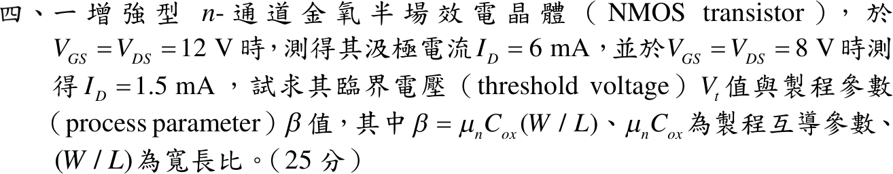

# 109 年電機工程技師｜電子學（包括電力電子學）逐題詳解

> 本頁由題級 canonical 筆記組合；每題保留官方裁切圖、校驗狀態與可追溯的推導。

## 題目導覽
- [[#一、109 年電子學_含電力電子第 1 題|第 1 題：109 年電子學_含電力電子第 1 題]]
- [[#二、109 年電子學_含電力電子第 2 題|第 2 題：109 年電子學_含電力電子第 2 題]]
- [[#三、109 年電子學（含電力電子）第 3 題｜返馳式轉換器|第 3 題：返馳式轉換器]]
- [[#四、109 年電子學_含電力電子第 4 題|第 4 題：109 年電子學_含電力電子第 4 題]]

---

## 一、109 年電子學_含電力電子第 1 題

> 題級識別：EE-109-02-1
> canonical 來源：[[canonical/EE-109-02-1.md]]
> 題級校驗狀態：verified

### 已知與所求

共射開關：$V_B$ 經 $R_B$ 驅動基極，$R_C=11\,\Omega$ 接 $V_{CC}=200\,\mathrm V$；$V_B=10\,\mathrm V$、$V_{CE(sat)}=1.0\,\mathrm V$、$V_{BE(sat)}=1.5\,\mathrm V$，$\beta_F=8\sim40$。求 $\mathrm{ODF}=6$ 時的 $R_B$ 與電晶體總損耗 $P_T$（共 25 分）。

### 考場標準作答

#### 步驟 1：飽和等效電路與集極電流

電晶體工作於飽和區，以定電壓模型把 B–E 換成 $V_{BE(sat)}$、C–E 換成 $V_{CE(sat)}$（圖 1）。集極迴路 KVL（$V_{CC}\to R_C\to V_{CE(sat)}$）：
\[
V_{CC}=I_{CS}R_C+V_{CE(sat)}
\]
\[
I_{CS}=\frac{V_{CC}-V_{CE(sat)}}{R_C}=\frac{200-1.0}{11}=\frac{199}{11}\ \mathrm A=18.091\ \mathrm A
\]

#### 基極電阻 $R_B$

$\beta_F$ 分散於 $8\sim40$，為保證每顆都飽和，取最小 $\beta_{F,\min}=8$ 求臨界基極電流 $I_{BS}$。

臨界基極電流（$\beta_{F,\min}=8$）：
\[
I_{BS}=\frac{I_{CS}}{\beta_{F,\min}}=\frac{199/11}{8}=\frac{199}{88}\ \mathrm A=2.2614\ \mathrm A
\]
實際基極電流：
\[
I_B=\mathrm{ODF}\times I_{BS}=6\times\frac{199}{88}=\frac{597}{44}\ \mathrm A=13.568\ \mathrm A
\]
基極迴路 KVL（$V_B\to R_B\to V_{BE(sat)}$）：
\[
V_B=I_BR_B+V_{BE(sat)}
\]
\[
R_B=\frac{V_B-V_{BE(sat)}}{I_B}=\frac{10-1.5}{597/44}=\frac{8.5\times44}{597}=\frac{374}{597}\ \Omega=0.62647\ \Omega
\]
\[
\boxed{R_B=626.47\ \mathrm{m}\Omega}
\]

#### 總功率損耗 $P_T$

飽和時基極電流流過 B–E、集極電流流過 C–E，兩接面損耗相加：

\[
P_B=V_{BE(sat)}I_B=1.5\times13.568=20.352\ \mathrm W
\]
\[
P_C=V_{CE(sat)}I_{CS}=1.0\times18.091=18.091\ \mathrm W
\]
\[
P_T=P_B+P_C=20.352+18.091=38.443\ \mathrm W
\]
\[
\boxed{P_T=38.44\ \mathrm W}
\]

### 驗算

- 功率平衡：電源供給 $V_{CC}I_{CS}+V_BI_B=3618.18+135.68=3753.86\,\mathrm W$，電阻消耗 $I_{CS}^2R_C+I_B^2R_B=3600.09+115.33=3715.42\,\mathrm W$，差值 $3753.86-3715.42=38.44\,\mathrm W=P_T$。
- 飽和確認：強迫增益 $\beta_{forced}=I_{CS}/I_B=18.091/13.568=1.333<\beta_{F,\min}=8$，任何 $\beta_F\in[8,40]$ 都能飽和。

### 失分點

- 取 $\beta_{\max}=40$ 計算 $I_{BS}$，低增益元件會無法飽和（得 $R_B=3.13\,\Omega$）。
- $P_T$ 漏掉基極損耗 $20.35\,\mathrm W$，只答 $18.09\,\mathrm W$。

---

## 二、109 年電子學_含電力電子第 2 題

> 題級識別：EE-109-02-2
> canonical 來源：[[canonical/EE-109-02-2.md]]
> 題級校驗狀態：needs_manual_review
> [!WARNING] 本題仍有官方資料缺口或事件定義歧義；請以 canonical 條件式解答為準。

### 已知與所求

理想 Boost：$V_s=15\,\mathrm V$、$V_o=30\,\mathrm V$、$I_o=3\,\mathrm A$、$f=25\,\mathrm{kHz}$、$L=100\,\mu\mathrm H$、$C=200\,\mu\mathrm F$。題圖參考方向：$i_L$ 向右流過 $L$，$e_L$ 左正右負；$i_c$ 向下流入 $C$。求 $D$、$\Delta I_L$、$I_{L,\mathrm{peak}}$、$\Delta V_C$、臨界 $L_c$ 與 $C_c$。

### 考場標準作答

#### 步驟 1：兩段電路與時間

設 CCM 穩態。

- **導通（$0<t<DT$）**：$e_L=V_s$；二極體陽極接地、陰極為 $v_o$，逆偏截止；$C$ 獨自供負載，$i_c=-I_o$。
- **截止（$DT<t<T$）**：$i_L$ 不能突變，經二極體流向輸出；$e_L=V_s-V_o$；輸出節點 KCL：$i_c=i_L-I_o$。

\[
T=\frac1f=\frac{1}{25\ \mathrm{kHz}}=40\ \mu\mathrm s
\]

#### 導通率 $D$

穩態下 $i_L$ 一週期淨變化為零，故伏秒平衡：

\[
V_sDT+(V_s-V_o)(1-D)T=0
\]
\[
15D+(15-30)(1-D)=0\ \Rightarrow\ 15D-15+15D=0\ \Rightarrow\ 30D=15
\]
\[
D=1-\frac{V_s}{V_o}=1-\frac{15}{30}=\boxed{0.50}
\]
\[
DT=0.50\times40=20\ \mu\mathrm s
\]

#### 電感漣波電流 $\Delta I_L$

\[
\Delta I_L=\frac{V_s}{L}DT=\frac{15\ \mathrm V\times20\ \mu\mathrm s}{100\ \mu\mathrm H}=\boxed{3\ \mathrm A}
\]

#### 電感峰值電流 $I_{L,\mathrm{peak}}$

電容一週期平均電流為零，故截止段二極體電流（$=i_L$）的整週期平均等於 $I_o$：

\[
(1-D)I_L=I_o\ \Rightarrow\ I_L=\frac{I_o}{1-D}=\frac{3}{1-0.50}=\frac{3}{0.50}=6\ \mathrm A
\]
\[
I_{L,\mathrm{peak}}=I_L+\frac{\Delta I_L}{2}=6+\frac{3}{2}=\boxed{7.50\ \mathrm A}
\]
（谷值 $I_{L,\min}=6-1.50=4.50\ \mathrm A>0$，CCM 成立。）

#### 電容漣波電壓 $\Delta V_C$

導通段二極體截止，電容獨自以 $I_o$ 放電 $DT$（圖 1 陰影）：

\[
\Delta Q=I_oDT=3\ \mathrm A\times20\ \mu\mathrm s=60\ \mu\mathrm C
\]
\[
\Delta V_C=\frac{\Delta Q}{C}=\frac{60\ \mu\mathrm C}{200\ \mu\mathrm F}=\boxed{0.30\ \mathrm V}
\]

#### 臨界電感 $L_c$

CCM／DCM 邊界為谷值電流剛好為零。

負載電阻：
\[
R=\frac{V_o}{I_o}=\frac{30}{3}=10\ \Omega
\]
邊界條件：
\[
I_L=\frac{\Delta I_L}{2}\ \Rightarrow\ \frac{V_o}{R(1-D)}=\frac{V_sDT}{2L_c}
\]
以 $V_s=V_o(1-D)$、$T=1/f$ 代入並解 $L_c$：
\[
L_c=\frac{V_sDT\,R(1-D)}{2V_o}=\frac{D(1-D)^2R}{2f}
\]
\[
L_c=\frac{0.50\times0.50^2\times10\ \Omega}{2\times25\ \mathrm{kHz}}=\frac{1.25\ \Omega}{50\ \mathrm{kHz}}=\boxed{25\ \mu\mathrm H}
\]
$L=100\ \mu\mathrm H>L_c$，確為 CCM。

#### 臨界電容 $C_c$

臨界電容取教材「輸出電容電壓剛好連續」的邊界：導通段放電漣波達 $\Delta V_C=2V_o$（電容電壓在週期內降到零）。

\[
\frac{I_oDT}{C_c}=2V_o\ \Rightarrow\ C_c=\frac{I_oDT}{2V_o}=\frac{60\ \mu\mathrm C}{2\times30\ \mathrm V}=1\ \mu\mathrm F
\]
以 $I_o/V_o=1/R$、$T=1/f$ 化為公式：
\[
\boxed{C_c=\frac{D}{2fR}=\frac{0.50}{2(25\ \mathrm{kHz})(10\ \Omega)}=1\ \mu\mathrm F}
\]
已知 $C=200\ \mu\mathrm F\gg C_c$，輸出電壓連續。

### 驗算

伏秒平衡 $15\times0.50+(15-30)\times0.50=0$；電荷平衡：導通段放出 $3\times20\ \mu=60\ \mu\mathrm C$，截止段 $i_c$ 由 $7.50-3=4.50\ \mathrm A$ 直線降到 $4.50-3=1.50\ \mathrm A$，充入 $\frac{4.50+1.50}{2}\times20\ \mu=60\ \mu\mathrm C$；功率 $15\times6=30\times3=90\ \mathrm W$。邊界回代：$L=L_c$ 時 $\dfrac{\Delta I_L}{2}=\dfrac{15\ \mathrm V\times20\ \mu\mathrm s}{2\times25\ \mu\mathrm H}=6\ \mathrm A=I_L$，谷值為 0；$C=C_c$ 時 $\Delta V_C=\dfrac{60\ \mu\mathrm C}{1\ \mu\mathrm F}=60\ \mathrm V=2V_o$。

### 失分點

- 平均電感電流用 $I_o=3\,\mathrm A$，峰值低估為 $4.50\,\mathrm A$；Boost 的 $I_L=I_s=6\,\mathrm A$。
- 臨界電感漏 $(1-D)^2$ 或 $\frac12$。
- 用自己算出的 $0.30\,\mathrm V$ 倒推出已知的 $200\,\mu\mathrm F$ 當臨界值；臨界值是 $\Delta V_C=2V_o$ 的邊界。

### 條件與疑義

- 題面未明寫臨界電容判準，主解採教材定義 $\Delta V_C=2V_o$；若評分改以容許漣波比 $\varepsilon=\Delta V_{C,\text{允許}}/V_o$ 設計，則 $C_c(\varepsilon)=\frac{D}{Rf\varepsilon}=\frac{2\,\mu\mathrm F}{\varepsilon}$。

---

## 三、109 年電子學（含電力電子）第 3 題｜返馳式轉換器

> 題級識別：EE-109-02-3
> canonical 來源：[[canonical/EE-109-02-3.md]]
> 題級校驗狀態：reference_book_verified

### 已知與所求

返馳式轉換器 $N_p/N_s=4$，$R_L=0.8\,\Omega$、$V_o=24\,\mathrm V$、$V_d=0.7\,\mathrm V$、$V_t=1.2\,\mathrm V$、$f=1.5\,\mathrm{kHz}$、$D=0.75$；忽略變壓器損耗與負載電流漣波，$V_s$ 未給。求 $I_{p(avg)}$、$I_{p(max)}$、$L_p$、$\eta$。題圖中 $R_1$、$R_2$ 與 Control 方塊只是回授取樣與控制，不影響穩態功率級計算。

參考書主解採磁化電流由零開始的 DCM 三角波，且 $I_{p(avg)}$ 指整個週期平均。

### 考場標準作答

#### 步驟 1：負載電流與輸出功率

\[
I_o=\frac{V_o}{R_L}=\frac{24}{0.8}=30\ \mathrm A
\]
\[
P_o=V_oI_o=24\times30=720\ \mathrm W
\]

#### 步驟 2：伏秒平衡求 $V_s$

依參考書取臨界導通：一次側電流每週期由 0 起升，二次側電流恰在週期結束歸零，故截止段整段 $(1-D)T$ 都在退磁。導通段一次側跨壓 $V_s-V_t$；截止段二次側跨壓 $V_o+V_d$，反射到一次側為 $\frac{N_p}{N_s}(V_o+V_d)$。穩態下一次側伏秒平衡：
\[
(V_s-V_t)D=\frac{N_p}{N_s}(V_o+V_d)(1-D)
\]
反射電壓：
\[
\frac{N_p}{N_s}(V_o+V_d)=4\times(24+0.7)=4\times24.7=98.80\ \mathrm V
\]
\[
V_s-V_t=\frac{98.80\times0.25}{0.75}=\frac{98.8}{3}=32.93\ \mathrm V
\]
\[
V_s=\frac{98.8}{3}+1.2=\frac{102.4}{3}=34.13\ \mathrm V
\]
時間：
\[
DT=\frac{D}{f}=\frac{0.75}{1500}=500\ \mu\mathrm s,\qquad (1-D)T=\frac{0.25}{1500}=\frac{500}{3}\ \mu\mathrm s
\]

#### 步驟 3：一週期波形

- 導通 $0<t<DT$：$v_p=V_s-V_t=32.93\,\mathrm V$，$i_p$ 由 0 線性升到 $I_{p(max)}$，$i_s=0$。
- 截止 $DT<t<T$：$i_p=0$，$i_s$ 由 $I_{s(max)}=\frac{N_p}{N_s}I_{p(max)}$ 線性降到 0（參考書取恰在週期結束歸零）。

#### 峰值電流 $I_{p(max)}$

負載電流漣波可忽略，電容平均電流為零，故二次側二極體電流（圖 1 下方三角形）的整週期平均等於 $I_o$；三角形高 $I_{s(max)}$、底 $(1-D)T$。

\[
I_o=\frac{\tfrac12I_{s(max)}(1-D)T}{T}=\tfrac12I_{s(max)}(1-D)
\]
\[
I_{s(max)}=\frac{2I_o}{1-D}=\frac{2\times30}{0.25}=240\ \mathrm A
\]
匝數比換到一次側（安匝相等）：
\[
\boxed{I_{p(max)}=\frac{N_s}{N_p}I_{s(max)}=\frac{240}{4}=60\text{ A}}
\]

#### 平均電流 $I_{p(avg)}$

$i_p$ 只在導通段為 $0\to I_{p(max)}$ 的直線，整週期平均依參考書定義為導通區間平均乘 $D$。

導通區間平均（記為 $I_{p,on}$）：
\[
I_{p,on}=\dfrac{I_{p(max)}}{2}=\dfrac{60}{2}=30\ \mathrm A
\]
整個週期平均：
\[
\boxed{I_{p(avg)}=D\,I_{p,on}=0.75\times30=22.50\ \mathrm A}
\]

#### 激磁電感 $L_p$

\[
I_{p(max)}=\frac{(V_s-V_t)DT}{L_p}\ \Rightarrow\ L_p=\frac{(V_s-V_t)DT}{I_{p(max)}}
\]
代入（$V_s-V_t$ 用精確值 $98.8/3$）：
\[
L_p=\frac{(98.8/3)\times500\,\mu\mathrm s}{60}=\frac{49400}{180}\ \mu\mathrm H
\]
\[
\boxed{L_p=274.44\ \mu\text{H}}
\]

#### 效率 $\eta$

忽略變壓器損耗；輸入功率為 $V_s$ 乘一次側整個週期的平均電流 $I_{p(avg)}$（不是導通區間平均 $I_{p,on}=30\,\mathrm A$）。

\[
P_{in}=V_sI_{p(avg)}=\frac{102.4}{3}\times22.50=\frac{2304}{3}=768\ \mathrm W
\]
\[
\eta=\frac{P_o}{P_{in}}=\frac{720}{768}=0.9375
\]
\[
\boxed{\eta=93.75\%}
\]

### 驗算

- 能量法：每週期傳送 $\frac12L_pI_{p(max)}^2f=\frac12\times274.44\times10^{-6}\times60^2\times1500=741.0\,\mathrm W$，等於 $(V_o+V_d)I_o=24.7\times30=741\,\mathrm W$。
- 退磁時間 $t_{demag}=\dfrac{L_pI_{p(max)}}{(N_p/N_s)(V_o+V_d)}=\dfrac{(49400/180)\,\mu\mathrm H\times60\,\mathrm A}{98.80\,\mathrm V}=\dfrac{500}{3}\,\mu\mathrm s=166.67\,\mu\mathrm s=(1-D)T$，電流恰在週期結束歸零。
- 損耗分帳：$V_tI_{p(avg)}+V_dI_o=1.2\times22.5+0.7\times30=27+21=48\,\mathrm W=768-720$。

### 失分點

- 用導通區間平均 $30\,\mathrm A$ 乘 $V_s$，輸入功率多算成 $1024\,\mathrm W$。
- 二次側三角波只在 $(1-D)T=0.25T$ 內導通，誤用 $D$ 會得 $I_{p(max)}=20\,\mathrm A$。
- 反射電壓要含二極體壓降：$4(24+0.7)=98.80\,\mathrm V$。

### 條件與疑義

題圖未明示 CCM/DCM，也未定義 $I_{p(avg)}$ 是導通區間平均或整個週期平均；另須區分導通區間平均 $I_{p,on}=I_{p(max)}/2$ 與整個週期平均 $I_{p(avg)}=D\,I_{p,on}$ 兩種定義。由 $t_{demag}=t_{off}$，參考書數值恰落在 DCM／臨界導通模式（CrCM）邊界。

$V_s$、$I_{p(avg)}=22.50\,\mathrm A$ 與 $\eta=93.75\%$ 只由平均功率與伏秒平衡決定，CCM 下也相同；若實為 CCM，初級電流有未給定的谷值 $I_{p,valley}>0$，$I_{p(max)}$ 與 $L_p$ 須另給谷值或波形才能唯一決定。

---

## 四、109 年電子學_含電力電子第 4 題

> 題級識別：EE-109-02-4
> canonical 來源：[[canonical/EE-109-02-4.md]]
> 題級校驗狀態：verified

### 已知與所求

增強型 NMOS：$V_{GS}=V_{DS}=12\,\mathrm V$ 時 $I_D=6\,\mathrm{mA}$；$V_{GS}=V_{DS}=8\,\mathrm V$ 時 $I_D=1.5\,\mathrm{mA}$。$\beta=\mu_nC_{ox}(W/L)$。求 $V_t$ 與 $\beta$（共 25 分）。

### 考場標準作答

#### 臨界電壓 $V_t$

增強型 $V_t>0$，且 $V_{DS}=V_{GS}>V_{GS}-V_t$，兩組量測皆在飽和區，適用平方律（未給 $\lambda$，忽略通道長度調變）；同一元件 $\beta$ 相同，兩式相除消去 $\beta$，取根時須兩點都導通（$V_{GS}>V_t$）。

兩點的平方律：
\[
6=\frac{\beta}{2}(12-V_t)^2,\qquad 1.5=\frac{\beta}{2}(8-V_t)^2\qquad(\mathrm{mA},\ \mathrm V)
\]
兩式相除：
\[
\left(\frac{12-V_t}{8-V_t}\right)^2=\frac{6}{1.5}=4
\]
\[
\frac{12-V_t}{8-V_t}=\pm2
\]
取 $+2$：
\[
12-V_t=2(8-V_t)=16-2V_t
\]
\[
\boxed{V_t=4\ \mathrm V}
\]
取 $-2$：$12-V_t=-16+2V_t$，$V_t=\tfrac{28}{3}=9.33\,\mathrm V>8\,\mathrm V$，第二點將截止、與 $I_D=1.5\,\mathrm{mA}$ 矛盾，捨去。

#### 製程參數 $\beta$

\[
\beta=\frac{2I_D}{(V_{GS}-V_t)^2}=\frac{2\times1.5\,\mathrm{mA}}{(8-4)^2\,\mathrm V^2}=\frac{3\,\mathrm{mA}}{16\,\mathrm V^2}
\]
\[
\boxed{\beta=\frac{3}{16}\,\mathrm{mA/V^2}=187.50\ \mu\mathrm{A/V^2}}
\]

### 驗算

- 以另一點回代：$\frac12\times187.50\,\mu\mathrm A/\mathrm V^2\times(12-4)^2\,\mathrm V^2=93.75\times64\,\mu\mathrm A=6000\,\mu\mathrm A=6\,\mathrm{mA}$，與量測一致。
- 飽和條件：兩點 $V_{DS}-(V_{GS}-V_t)=V_t=4\,\mathrm V>0$，飽和假設成立。

### 失分點

- 題目定義 $\beta=\mu_nC_{ox}(W/L)$，電流式要帶 $\frac12$；寫成 $I_D=\beta(V_{GS}-V_t)^2$ 會得 $93.75\,\mu\mathrm{A/V^2}$。
- 開根號未排除 $V_t=9.33\,\mathrm V$ 的增根。

---
