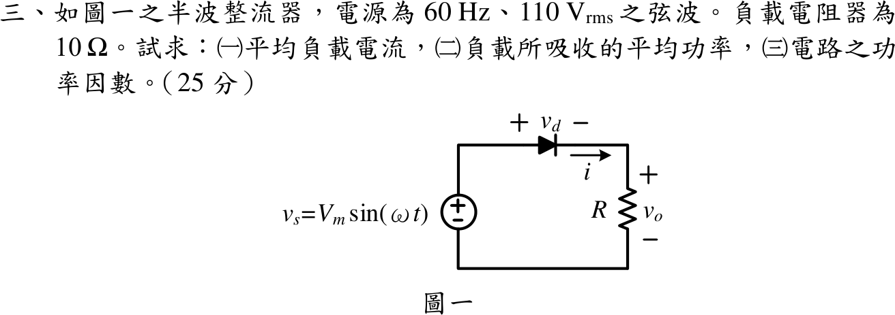
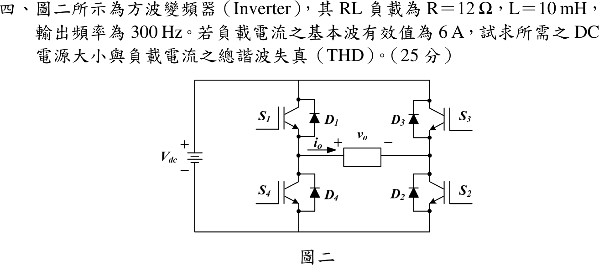

# 110 年電機工程技師｜電子學（包括電力電子學）逐題詳解

> 本頁由題級 canonical 筆記組合；每題保留官方裁切圖、校驗狀態與可追溯的推導。

## 題目導覽
- [[#一、110 年電子學_含電力電子第 1 題|第 1 題：110 年電子學_含電力電子第 1 題]]
- [[#二、110 年電子學_含電力電子第 2 題|第 2 題：110 年電子學_含電力電子第 2 題]]
- [[#三、110 年電子學_含電力電子第 3 題｜半波整流器|第 3 題：半波整流器]]
- [[#四、110 年電子學_含電力電子第 4 題|第 4 題：110 年電子學_含電力電子第 4 題]]

---

## 一、110 年電子學_含電力電子第 1 題

> 題級識別：EE-110-02-1
> canonical 來源：[[canonical/EE-110-02-1.md]]
> 題級校驗狀態：verified

### 已知與所求

$V_{CC}=12\,\mathrm V$、$R_B=100\,\mathrm{k}\Omega$、$R_C=10\,\mathrm{k}\Omega$；$25^\circ\mathrm C$：$\beta_{dc}=100$、$V_{BE}=0.7\,\mathrm V$；$75^\circ\mathrm C$：$\beta_{dc}=150$、$V_{BE}=0.5\,\mathrm V$。繪出集極回授偏壓電路，求 $25\to75^\circ\mathrm C$ 的 Q 點變化率（共 25 分）。以下記 $\beta=\beta_{dc}$。

### 考場標準作答

**解題邏輯**：前提為兩個溫度下 BJT 都在**主動區**（$I_C=\beta I_B$、$V_{BE}$ 取題給值，最後以 $V_{CE}>V_{CE(sat)}=0.2\,\mathrm V$ 驗證），並忽略 $I_{CBO}$ 的溫度變化（題目只給 $\beta$ 與 $V_{BE}$）。
1. 先畫出集極回授偏壓電路（$R_B$ 由集極接回基極）。
2. 對集極迴路、基極迴路各列 KVL，消去 $V_{CE}$ 得 $I_B$ 通式。
3. 分別代入 $25^\circ\mathrm C$、$75^\circ\mathrm C$ 參數求 Q 點 $(I_C,V_{CE})$。
4. 再以 $25^\circ\mathrm C$ 為基準算兩量的變化率。

#### 步驟 1：集極回授偏壓電路

- NPN 射極接地；$R_C$ 由 $V_{CC}$ 接到集極 $C$；$R_B$ 由集極 $C$ 接回基極 $B$，沒有其他基極偏壓源。
- 集極節點 KCL：由 $R_C$ 流下的電流分成進集極的 $I_C$ 與經 $R_B$ 流向基極的 $I_B$，故 $R_C$ 流過 $I_C+I_B$。
- 回授機制：$I_C$ 增加 → $R_C$ 壓降增加 → $V_{CE}$ 下降 → $I_B=(V_{CE}-V_{BE})/R_B$ 減少，抑制 $I_C$ 的增加。

#### 步驟 2：工作點通式

集極迴路（$V_{CC}\to R_C\to C\to E$）：
\[
V_{CC}=(I_C+I_B)R_C+V_{CE}
\]
基極迴路（$C\to R_B\to B\to E$）：
\[
V_{CE}=I_BR_B+V_{BE}
\]
將基極迴路的 $V_{CE}$ 代入集極迴路，並以 $I_C=\beta I_B$ 代換：
\[
V_{CC}=(\beta+1)I_BR_C+I_BR_B+V_{BE}
\]
\[
I_B=\frac{V_{CC}-V_{BE}}{R_B+(\beta+1)R_C},\qquad I_C=\beta I_B,\qquad V_{CE}=I_BR_B+V_{BE}
\]

#### 步驟 3：$25^\circ\mathrm C$ 的 Q 點（$\beta=100$、$V_{BE}=0.7\,\mathrm V$）

\[
R_B+(\beta+1)R_C=100\,\mathrm{k}\Omega+101\times10\,\mathrm{k}\Omega=1110\,\mathrm{k}\Omega
\]
\[
I_B=\frac{12-0.7}{1110\,\mathrm{k}\Omega}=\frac{11.30\,\mathrm V}{1110\,\mathrm{k}\Omega}=10.180\,\mu\mathrm A
\]
\[
I_C=\beta I_B=100\times10.180\,\mu\mathrm A=1018.0\,\mu\mathrm A=1.0180\,\mathrm{mA}
\]
\[
I_BR_B=10.180\,\mu\mathrm A\times100\,\mathrm{k}\Omega=1.0180\,\mathrm V
\]
\[
V_{CE}=I_BR_B+V_{BE}=1.0180+0.7=1.7180\,\mathrm V
\]
（變化率要相減後再除，4 位有效會使框內末位偏差，故此鏈保留 5 位有效數字。）

#### 步驟 4：$75^\circ\mathrm C$ 的 Q 點（$\beta=150$、$V_{BE}=0.5\,\mathrm V$）

\[
R_B+(\beta+1)R_C=100\,\mathrm{k}\Omega+151\times10\,\mathrm{k}\Omega=1610\,\mathrm{k}\Omega
\]
\[
I_B=\frac{12-0.5}{1610\,\mathrm{k}\Omega}=\frac{11.50\,\mathrm V}{1610\,\mathrm{k}\Omega}=7.1429\,\mu\mathrm A
\]
\[
I_C=\beta I_B=150\times7.1429\,\mu\mathrm A=1071.4\,\mu\mathrm A=1.0714\,\mathrm{mA}
\]
\[
I_BR_B=7.1429\,\mu\mathrm A\times100\,\mathrm{k}\Omega=0.71429\,\mathrm V
\]
\[
V_{CE}=I_BR_B+V_{BE}=0.71429+0.5=1.2143\,\mathrm V
\]
主動區檢查：$1.7180\,\mathrm V$ 與 $1.2143\,\mathrm V$ 皆大於 $V_{CE(sat)}=0.2\,\mathrm V$，兩溫度都在主動區，前提成立。

#### Q 點變化率（$25\to75^\circ\mathrm C$）

**邏輯**：Q 點是 $(I_C,V_{CE})$ 兩個量，變化率以 $25^\circ\mathrm C$ 為基準：$\dfrac{X_{75}-X_{25}}{X_{25}}\times100\%$。

集極電流：
\[
\Delta I_C=1.0714-1.0180=0.0534\,\mathrm{mA}
\]
\[
\frac{\Delta I_C}{I_C}=\frac{0.0534\,\mathrm{mA}}{1.0180\,\mathrm{mA}}=0.05246
\]
\[
\boxed{\frac{\Delta I_C}{I_C}=+5.25\%}
\]
集射極電壓：
\[
\Delta V_{CE}=1.2143-1.7180=-0.5037\,\mathrm V
\]
\[
\frac{\Delta V_{CE}}{V_{CE}}=\frac{-0.5037\,\mathrm V}{1.7180\,\mathrm V}=-0.2932
\]
\[
\boxed{\frac{\Delta V_{CE}}{V_{CE}}=-29.32\%}
\]
$\beta$ 增加 50% 而 $I_C$ 只增加 5.25%，集極回授有穩定作用；代價是 $V_{CE}$ 下降約三成。

### 驗算

集極迴路回代：$25^\circ\mathrm C$ 時 $(1018.0+10.180)\,\mu\mathrm A\times10\,\mathrm{k}\Omega=10.282\,\mathrm V$，加 $V_{CE}=1.7180\,\mathrm V$ 得 $12.000\,\mathrm V$；$75^\circ\mathrm C$ 時 $(1071.4+7.1429)\,\mu\mathrm A\times10\,\mathrm{k}\Omega=10.785\,\mathrm V$，加 $1.2143\,\mathrm V$ 得 $11.999\,\mathrm V\approx12\,\mathrm V$（末位為四捨五入誤差）。

### 失分點

- $R_C$ 上的電流寫成 $I_C$（漏 $I_B$），分母變 $R_B+\beta R_C$，得 $I_C=1.03\to1.08\,\mathrm{mA}$、變化率 4.95%。
- $V_{CE}$ 由 $V_{CC}-I_CR_C$ 計算而漏掉 $I_BR_C$，$25^\circ\mathrm C$ 會得 $1.82\,\mathrm V$。
- 只算 $I_C$ 變化率而漏了 $V_{CE}$；Q 點是 $(I_C,V_{CE})$ 兩個量。

---

## 二、110 年電子學_含電力電子第 2 題

> 題級識別：EE-110-02-2
> canonical 來源：[[canonical/EE-110-02-2.md]]
> 題級校驗狀態：verified

### 已知與所求

$\mathrm{CMRR}=20000$、$A_{v(d)}=1500$，環境有 $1\,\mathrm V_{rms}$、$60\,\mathrm{Hz}$ 雜訊（兩輸入端共模耦合）。求（一）$A_{v(c)}$；（二）CMRR 的 dB 值；（三）$I/P_1$ 加 $500\,\mu\mathrm V_{rms}$、$I/P_2$ 接地的輸出；（四）$I/P_1$、$I/P_2$ 加等幅反相 $500\,\mu\mathrm V_{rms}$ 的輸出；（五）輸出端干擾。

### 考場標準作答

**解題邏輯**：前提為線性差動放大器，$A_{v(d)}$、$A_{v(c)}$ 視為實數正值（同頻訊號不額外相移），兩輸入端的同相訊號可直接以有效值相加減；$60\,\mathrm{Hz}$ 雜訊以相同大小、相同相位耦合到兩輸入端（純共模）。先由 CMRR 定義求 $A_{v(c)}$ 並換成 dB；之後每一種輸入都先拆成差模 $v_d$ 與共模 $v_{cm}$，再用疊加式求輸出。

#### 步驟 1：差動放大器的線性模型

輸出等於差模、共模分量各乘自身增益後相加：
\[
v_d=v_1-v_2,\qquad v_{cm}=\frac{v_1+v_2}{2}
\]
\[
v_o=A_{v(d)}\,v_d+A_{v(c)}\,v_{cm}
\]

#### （一）共模增益

**邏輯**：CMRR 定義為差模增益與共模增益之比，已知 CMRR 與 $A_{v(d)}$ 即可反求 $A_{v(c)}$。

\[
\mathrm{CMRR}=\frac{A_{v(d)}}{A_{v(c)}}\ \Rightarrow\ A_{v(c)}=\frac{A_{v(d)}}{\mathrm{CMRR}}
\]
\[
A_{v(c)}=\frac{1500}{20000}=\frac{3}{40}
\]
\[
\boxed{A_{v(c)}=0.075}
\]

#### （二）CMRR（dB）

**邏輯**：CMRR 是兩個電壓增益之比，換成分貝用 $20\log_{10}$（不是功率比的 $10\log_{10}$）。

\[
\mathrm{CMRR}_{\mathrm{dB}}=20\log_{10}\mathrm{CMRR}=20\log_{10}(2\times10^{4})
\]
\[
\log_{10}(2\times10^4)=\log_{10}2+4=0.3010+4=4.3010
\]
\[
\mathrm{CMRR}_{\mathrm{dB}}=20\times4.3010=86.02\ \mathrm{dB}
\]
\[
\boxed{\mathrm{CMRR}_{\mathrm{dB}}=86.02\ \mathrm{dB}}
\]

#### （三）單端輸入

**邏輯**：$I/P_1$ 加 $500\,\mu\mathrm V$、$I/P_2$ 接地（$v_2=0$），先拆成差模與共模分量，再用步驟 1 的疊加式。

\[
v_d=500\ \mu\mathrm V-0=500\ \mu\mathrm V
\]
\[
v_{cm}=\frac{500\ \mu\mathrm V+0}{2}=250\ \mu\mathrm V
\]
差模項與共模項：
\[
A_{v(d)}\,v_d=1500\times500\ \mu\mathrm V=750000\ \mu\mathrm V=0.75\ \mathrm V
\]
\[
A_{v(c)}\,v_{cm}=0.075\times250\ \mu\mathrm V=18.75\ \mu\mathrm V
\]
疊加：
\[
v_o=0.75\ \mathrm V+18.75\ \mu\mathrm V=0.75001875\ \mathrm V
\]
\[
\boxed{v_o=0.75\ \mathrm V_{rms}}
\]
（共模項只占 $18.75\,\mu\mathrm V$，在兩位小數下看不出來。）

#### （四）等幅反相輸入

**邏輯**：兩端等幅反相（$v_2=-v_1$），共模分量為零，只剩差模分量，且差模輸入是單端時的兩倍。

\[
v_d=500\ \mu\mathrm V-(-500\ \mu\mathrm V)=1000\ \mu\mathrm V=1\ \mathrm{mV}
\]
\[
v_{cm}=\frac{500\ \mu\mathrm V+(-500\ \mu\mathrm V)}{2}=0
\]
\[
v_o=1500\times1\ \mathrm{mV}+0.075\times0=1500\ \mathrm{mV}
\]
\[
\boxed{v_o=1.50\ \mathrm V_{rms}}
\]

#### （五）輸出干擾

**邏輯**：雜訊同時、等量耦合到兩輸入端，屬純共模（$v_d=0$），只被共模增益放大。

\[
v_d=1\ \mathrm V-1\ \mathrm V=0
\]
\[
v_{cm}=\frac{1\ \mathrm V+1\ \mathrm V}{2}=1\ \mathrm V
\]
\[
v_{o,n}=A_{v(d)}\times0+A_{v(c)}\times1\ \mathrm V=0.075\times1\ \mathrm V=0.075\ \mathrm V
\]
\[
\boxed{v_{o,n}=75\ \mathrm{mV_{rms}}}
\]
換算回輸入端，相當於 $v_{o,n}/A_{v(d)}=75\ \mathrm{mV}/1500=50\ \mu\mathrm V$ 的差模訊號，約為 $500\ \mu\mathrm V$ 輸入訊號的十分之一；輸出端訊號（（三）$0.75\ \mathrm V$）對干擾（$75\ \mathrm{mV}$）比為 $0.75/0.075=10$ 倍。

### 驗算

以單端輸入疊加拆解（四）：只加 $v_1=500\,\mu\mathrm V$ 得 $0.75\,\mathrm V+18.75\,\mu\mathrm V$；只加 $v_2=-500\,\mu\mathrm V$ 時 $v_d=+500\,\mu\mathrm V$、$v_{cm}=-250\,\mu\mathrm V$，得 $0.75\,\mathrm V-18.75\,\mu\mathrm V$；兩者相加 $1.50\,\mathrm V$，共模項互相抵消，與 $v_d=1\,\mathrm{mV}$ 一致。訊號對干擾比：（四）$1.50/0.075=20$ 倍，等於 $\mathrm{CMRR}\times\dfrac{1\,\mathrm{mV}}{1\,\mathrm V}=20000\times10^{-3}=20$。

### 失分點

- （三）的差模輸入是 $500\,\mu\mathrm V$ 而非 $250\,\mu\mathrm V$；$250\,\mu\mathrm V$ 是共模成分。
- （四）兩端反相，$v_d=1\,\mathrm{mV}$，輸出加倍為 $1.50\,\mathrm V$，不是 $0.75\,\mathrm V$。
- CMRR 換 dB 用 $20\log$（電壓比），用 $10\log$ 會得 43.01 dB。

---

## 三、110 年電子學_含電力電子第 3 題｜半波整流器

> 題級識別：EE-110-02-3
> canonical 來源：[[canonical/EE-110-02-3.md]]
> 題級校驗狀態：verified

### 已知與所求

單一二極體半波整流，$v_s=V_m\sin\omega t$，$110\,\mathrm V_{rms}$、$60\,\mathrm{Hz}$，純電阻負載 $R=10\,\Omega$；題面未給二極體壓降，取理想二極體。求（一）平均負載電流；（二）負載平均功率；（三）功率因數。

### 考場標準作答

**解題邏輯**：理想二極體在 $v_s>0$ 導通（短路）、$v_s<0$ 截止（開路），純電阻負載沒有續流路徑，所以負載電流就是半個正弦。先寫出一週期的電流波形，再依定義積分：平均值 → （一）；方均根值 → $P=I_{rms}^2R$ →（二）；最後 $\mathrm{PF}=P/(V_{s,rms}I_{s,rms})$ →（三）。三問都只用導通區間 $0\sim\pi$ 的積分。

#### 步驟 1：峰值與一週期波形

峰值電壓（題給為有效值）：
\[
V_m=\sqrt2\,V_{s,rms}=110\sqrt2=155.6\ \mathrm V
\]
以理想二極體模型：電源正半週導通、負半週截止；純電阻負載無續流路徑，負半週負載與電源電流都為零。令 $\theta=\omega t$：
\[
v_o(\theta)=\begin{cases}V_m\sin\theta,&0<\theta<\pi\\0,&\pi<\theta<2\pi\end{cases},\qquad i_s(\theta)=i_L(\theta)=v_o(\theta)/R
\]
電流峰值：
\[
I_m=\frac{V_m}{R}=\frac{155.6}{10}=15.56\ \mathrm A
\]

#### （一）平均負載電流

**邏輯**：平均值 = 一週期積分 ÷ 週期 $2\pi$；只有導通的 $0\sim\pi$（圖 1 陰影）有貢獻。

\[
I_{avg}=\frac1{2\pi}\int_0^{\pi}\frac{V_m\sin\theta}{R}\,d\theta=\frac{V_m}{2\pi R}\Big[-\cos\theta\Big]_0^\pi=\frac{V_m}{\pi R}
\]
代入：
\[
I_{avg}=\frac{155.6}{10\pi}=\frac{155.6}{31.42}=4.952\ \mathrm A
\]
\[
\boxed{I_{avg}=4.95\ \mathrm A}
\]

#### （二）負載平均功率

**邏輯**：電阻的平均功率由電流方均根值決定（$P=I_{rms}^2R$），不能用平均值代替；先依 rms 定義積分。

\[
I_{rms}^2=\frac1{2\pi}\int_0^{\pi}\left(\frac{V_m\sin\theta}{R}\right)^2d\theta=\frac{V_m^2}{2\pi R^2}\cdot\frac{\pi}{2}=\frac{V_m^2}{4R^2}
\]
\[
I_{rms}=\frac{V_m}{2R}=\frac{110\sqrt2}{2\times10}=5.5\sqrt2=7.778\ \mathrm A
\]
功率（$V_m^2=(110\sqrt2)^2=24200$ 為精確值）：
\[
P=I_{rms}^2R=\frac{V_m^2}{4R}=\frac{24200}{4\times10}=\frac{24200}{40}
\]
\[
\boxed{P=605\ \mathrm W}
\]

#### （三）功率因數

**邏輯**：功率因數 = 實功率 ÷ 電源視在功率 $V_{s,rms}I_{s,rms}$；電源、二極體、負載串成單一迴路，$I_{s,rms}=I_{rms}$。

\[
I_{s,rms}=I_{rms}=7.778\ \mathrm A,\qquad V_{s,rms}=110\ \mathrm V
\]
視在功率：
\[
S=V_{s,rms}I_{s,rms}=110\times7.778=855.6\ \mathrm{VA}
\]
\[
\mathrm{PF}=\frac{P}{S}=\frac{605}{855.6}=0.7071
\]
\[
\boxed{\mathrm{PF}=0.71}
\]
符號式：$\mathrm{PF}=\dfrac{V_m^2/(4R)}{(V_m/\sqrt2)(V_m/2R)}=\dfrac{1}{\sqrt2}$，與數值相符。此為非正弦電流的總功率因數（含波形失真），不標超前或落後。

### 驗算

傅立葉功率和：$v_o=\frac{V_m}{\pi}+\frac{V_m}{2}\sin\theta-\sum_{n=2,4,\ldots}\frac{2V_m}{\pi(n^2-1)}\cos n\theta$。直流分量功率 $\dfrac{(V_m/\pi)^2}{R}=\dfrac{24200}{10\pi^2}=245.2\ \mathrm W$；基波振幅 $V_m/2=55\sqrt2\ \mathrm V$，功率 $\dfrac{(55\sqrt2)^2}{2\times10}=\dfrac{6050}{20}=302.5\ \mathrm W$；偶次諧波合計 $605-245.2-302.5=57.3\ \mathrm W$，與逐項級數和一致。

### 失分點

- 用 $I_{avg}^2R=4.952^2\times10=245.2\,\mathrm W$ 當功率；非直流波形必須用 rms。
- 純電阻就答 PF $=1$；半波電流的失真使 PF 只有 $0.71$。
- 把 $110\,\mathrm V$ 當峰值，得 $I_{avg}=3.50\,\mathrm A$。

---

## 四、110 年電子學_含電力電子第 4 題

> 題級識別：EE-110-02-4
> canonical 來源：[[canonical/EE-110-02-4.md]]
> 題級校驗狀態：verified

### 已知與所求

全橋方波逆變器（$S_1S_2$ 與 $S_3S_4$ 交替導通，$v_o=\pm V_{dc}$），RL 負載 $R=12\,\Omega$、$L=10\,\mathrm{mH}$，$f=300\,\mathrm{Hz}$，負載電流基本波有效值 $I_{1}=6\,\mathrm A$。求 $V_{dc}$ 與負載電流 THD。

### 考場標準作答

**解題邏輯**：前提為理想開關、方波（180°）控制：前半週觸發 $S_1S_2$、後半週觸發 $S_3S_4$，電流反向時由反並聯二極體續流，所以不論 $i_o$ 正負都有 $v_o=\pm V_{dc}$；電路已達穩態，RL 為線性負載。直流電源由「方波基本波 × 基本波阻抗 = 基本波電流」反求；THD 需要全部諧波電流，改由時域精確解：穩態 $i_o$ 是兩段指數曲線，積分得總有效值 $I_{rms}$，諧波有效值 $I_h=\sqrt{I_{rms}^2-I_1^2}$，$\mathrm{THD}=I_h/I_1$。

#### 步驟 1：方波的基本波與基本波阻抗

$\pm V_{dc}$ 方波的傅立葉級數只有奇次項：
\[
v_o(t)=\sum_{n=1,3,5,\ldots}\frac{4V_{dc}}{n\pi}\sin n\omega t
\]
基本波 $v_1(t)$ 峰值 $4V_{dc}/\pi$，有效值：
\[
V_1=\frac{4V_{dc}}{\sqrt2\,\pi}
\]
角頻率與基本波電抗：
\[
\omega=2\pi f=2\pi\times300=600\pi=1884.956\ \mathrm{rad/s}
\]
\[
X_1=\omega L=1884.956\times0.01=18.84956\ \Omega
\]
（$X_1/R=6\pi/12=\pi/2$，後面 THD 會用到。）基本波阻抗的大小與角度：
\[
|Z_1|=\sqrt{R^2+X_1^2}=\sqrt{12^2+18.84956^2}=\sqrt{144+355.3059}=\sqrt{499.3059}=22.34515\ \Omega
\]
\[
\theta_1=\tan^{-1}\frac{X_1}{R}=\tan^{-1}\frac{18.84956}{12}=\tan^{-1}1.570797=57.52^\circ
\]
（$\theta_1$ 為基本波電流落後電壓的角度，後面不需要。）
（此題 THD 需要多位數連算，故 $|Z_1|$ 保留 7 位有效數字。）

#### 所需直流電源 $V_{dc}$

**邏輯**：RL 為線性負載，基本波電壓只產生基本波電流，$V_1=I_1|Z_1|$；再由方波基本波有效值 $V_1=4V_{dc}/(\sqrt2\pi)$ 反解 $V_{dc}$。

\[
V_1=I_1|Z_1|=6\times22.34515=134.0709\ \mathrm V
\]
\[
V_{dc}=\frac{\sqrt2\,\pi}{4}V_1=1.110721\times134.0709=148.9154\ \mathrm V
\]
\[
\boxed{V_{dc}=148.92\ \mathrm V}
\]

#### 負載電流 THD

**邏輯**：THD 定義為諧波電流總有效值對基本波電流的比值；諧波有無限多項，用「總有效值平方 = 基本波平方 + 諧波平方」改由時域穩態電流的有效值求，避免無窮級數。

時間常數與半週期的比值：
\[
\tau=\frac{L}{R}=\frac{0.01}{12}=0.8333\ \mathrm{ms},\qquad \frac{T}{2}=\frac{1}{2\times300}=1.667\ \mathrm{ms}
\]
\[
\frac{T/2}{\tau}=\frac{1/600}{1/1200}=2
\]
前半週（$0<t<T/2$，$v_o=+V_{dc}$）一階 RL 響應：
\[
L\frac{di_o}{dt}+Ri_o=V_{dc}\ \Rightarrow\ i_o(t)=\frac{V_{dc}}{R}+\left(i_o(0)-\frac{V_{dc}}{R}\right)e^{-t/\tau}
\]
穩態半波對稱：$i_o(0)=-I_{\max}$、$i_o(T/2)=+I_{\max}$（圖 1）。令 $a=V_{dc}/R$，代入 $t=T/2$（$e^{-2}$）：
\[
I_{\max}=a+(-I_{\max}-a)e^{-2}
\]
\[
I_{\max}(1+e^{-2})=a(1-e^{-2})\ \Rightarrow\ I_{\max}=a\,\frac{1-e^{-2}}{1+e^{-2}}=a\tanh1
\]
數值：
\[
a=\frac{148.9154}{12}=12.40962\ \mathrm A,\qquad \tanh1=0.7615942
\]
\[
I_{\max}=12.40962\times0.7615942=9.451\ \mathrm A
\]

總有效值（半波對稱，取前半週平均）。令 $b=a+I_{\max}=a(1+\tanh1)$，前半週 $i_o=a-be^{-t/\tau}$：
\[
I_{rms}^2=\frac{1}{T/2}\int_0^{T/2}\left(a-be^{-t/\tau}\right)^2dt
=a^2-2ab\,\frac{\tau}{T/2}\left(1-e^{-2}\right)+b^2\,\frac{\tau}{T}\left(1-e^{-4}\right)
\]
代入 $\tau/(T/2)=1/2$、$\tau/T=1/4$：
\[
I_{rms}^2=a^2-ab\left(1-e^{-2}\right)+\frac{b^2}{4}\left(1-e^{-4}\right)
\]
用 $1+\tanh1=\dfrac{2}{1+e^{-2}}$ 化簡兩項：
\[
ab\left(1-e^{-2}\right)=a^2\cdot\frac{2\left(1-e^{-2}\right)}{1+e^{-2}}=2a^2\tanh1
\]
\[
\frac{b^2}{4}\left(1-e^{-4}\right)=\frac{a^2}{4}\cdot\frac{4\left(1-e^{-2}\right)\left(1+e^{-2}\right)}{\left(1+e^{-2}\right)^2}=a^2\tanh1
\]
\[
I_{rms}^2=a^2-2a^2\tanh1+a^2\tanh1=a^2\left(1-\tanh1\right)
\]
THD 只需比值 $I_{rms}^2/I_1^2$。由 $V_{dc}$ 的式子，$a=\dfrac{V_{dc}}{R}=\dfrac{\sqrt2\pi|Z_1|I_1}{4R}$，
\[
\left(\frac{a}{I_1}\right)^2=\frac{\pi^2}{8}\cdot\frac{|Z_1|^2}{R^2}=\frac{\pi^2}{8}\left[1+\left(\frac{X_1}{R}\right)^2\right]=\frac{\pi^2}{8}\left(1+\frac{\pi^2}{4}\right)
\]
\[
\left(\frac{a}{I_1}\right)^2=1.233701\times3.467401=4.277736
\]
\[
\frac{I_{rms}^2}{I_1^2}=4.277736\times(1-0.7615942)=4.277736\times0.2384058=1.019837
\]
諧波總有效值對基本波的比值：
\[
\mathrm{THD}_i=\frac{I_h}{I_1}=\frac{\sqrt{I_{rms}^2-I_1^2}}{I_1}=\sqrt{\frac{I_{rms}^2}{I_1^2}-1}=\sqrt{1.019837-1}=\sqrt{0.019837}=0.14084
\]
\[
\boxed{\mathrm{THD}_i=14.08\%}
\]
對應的電流值：$I_{rms}=6\sqrt{1.019837}=6.059\ \mathrm A$，$I_h=0.14084\times6=0.8450\ \mathrm A$。

### 驗算

- 頻域逐項相加：第 $n$ 次諧波 $I_n=\dfrac{V_1/n}{\sqrt{R^2+(nX_1)^2}}$。$n=3$：$\dfrac{44.6903}{57.8079}=773.08\,\mathrm{mA}$；$n=5$：$\dfrac{26.8142}{95.0087}=282.23\,\mathrm{mA}$；$n=7$：$\dfrac{19.1530}{132.4914}=144.56\,\mathrm{mA}$。只取 $3,5,7$ 次得 $\sqrt{773.08^2+282.23^2+144.56^2}=835.59\,\mathrm{mA}$（13.93%）；加到 19 次得 $844.44\,\mathrm{mA}$（14.07%），逐步收斂到時域值 $845.06\,\mathrm{mA}$（14.08%），兩法一致。
- 由 $a$ 直接算：$I_{rms}^2=a^2(1-\tanh1)=12.40962^2\times0.2384058=36.714\,\mathrm{A^2}$，$I_{rms}=6.059\,\mathrm A$，與比值法相同。
- 半波對稱：以 $I_{\max}=a\tanh1=9.45109\,\mathrm A$（多保留位數）代入：$i_o(T/2)=a-(a+I_{\max})e^{-2}=12.40962-21.86071\times0.1353353=12.40962-2.95853=9.451\,\mathrm A=I_{\max}$。

### 失分點

- 基本波有效值是 $\frac{4V_{dc}}{\sqrt2\pi}=0.90V_{dc}$，漏 $\sqrt2$ 會得 $V_{dc}=105.30\,\mathrm V$。
- 諧波阻抗要用 $nX_1$，不能沿用 $|Z_1|$；否則 $I_n=I_1/n$，THD 變成電壓的 48.34%。
- THD 分母是基本波 $6\,\mathrm A$，不是總有效值；只取到 7 次諧波會低估成 13.93%。

---
