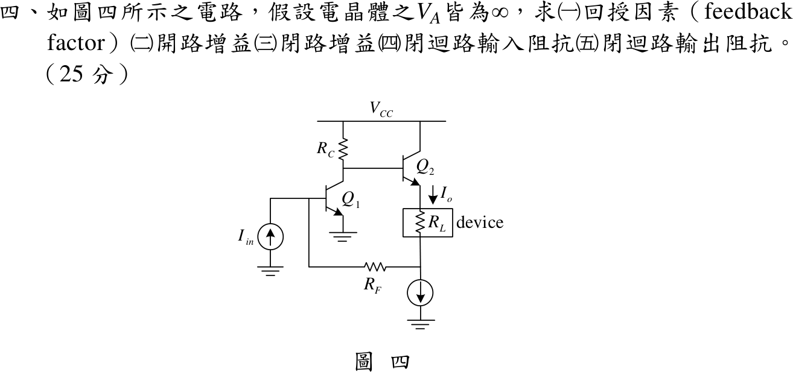

# 111 年電機工程技師｜電子學（包括電力電子學）逐題詳解

> 本頁由題級 canonical 筆記組合；每題保留官方裁切圖、校驗狀態與可追溯的推導。

## 題目導覽
- [[#一、111 年第 1 題｜全波橋式整流器傅立葉分析|第 1 題：全波橋式整流器傅立葉分析]]
- [[#二、111 年電子學第 2 題｜SEPIC 轉換器元件設計|第 2 題：SEPIC 轉換器元件設計]]
- [[#三、111 年電子學第 3 題：MOSFET 源極退化放大器|第 3 題：111 年電子學第 3 題：MOSFET 源極退化放大器]]
- [[#四、111 年電子學第 4 題：並聯—串聯電流回授放大器|第 4 題：111 年電子學第 4 題：並聯—串聯電流回授放大器]]

---

## 一、111 年第 1 題｜全波橋式整流器傅立葉分析

> 題級識別：EE-111-02-1
> canonical 來源：[[canonical/EE-111-02-1.md]]
> 題級校驗狀態：verified

### 已知與所求

理想二極體橋式整流，$v_s=V_m\sin\omega t$，$V_m=100\,\mathrm V$、$f=60\,\mathrm{Hz}$，負載串聯 $R=10\,\Omega$、$L=12\,\mathrm{mH}$。題給 $v_o=V_o+\sum_{n=2,4,\ldots}V_n\cos(n\omega t+\pi)$，$V_n=V_o\left(\frac1{n-1}-\frac1{n+1}\right)=\frac{2V_o}{n^2-1}$。求（一）$V_o$；（二）最初兩個交流項電流 $I_2,I_4$；（三）負載消耗功率；（四）功率因數。

### 考場標準作答

**解題邏輯**：理想橋式整流使 $v_o=|v_s|$（電流連續、驗算段確認），$v_o$ 依題給傅立葉級數拆成直流項加偶次諧波。負載 $R$–$L$ 為線性，可逐項疊加：直流項只看 $R$，第 $n$ 次諧波以阻抗 $Z_n=R+jn\omega L$ 求電流振幅。依序求 $V_o$ → $I_0$、$I_2$、$I_4$ → 以各分量方均值相加得 $I_{rms}^2$ 與 $P$ → $\mathrm{PF}=P/(V_{s,rms}I_{s,rms})$。

#### 步驟 1：輸出波形與逐項等效電路

- 圖 1(a)：$v_o=|V_m\sin\omega t|$，週期為 $\pi$（角度），平均值即直流項 $V_o$。
- 圖 1(b)：疊加原理下每一項單獨作用；直流時電感短路，只剩 $R$；第 $n$ 次諧波時電感阻抗 $jn\omega L$。

角頻率：
\[
\omega=2\pi f=2\pi\times60=377.0\ \mathrm{rad/s}
\]

#### （一）直流輸出電壓

**邏輯**：傅立葉級數的常數項就是 $v_o$ 的平均值；$v_o$ 每半週重複，只需在 $0\sim\pi$ 積分再除以 $\pi$。

\[
V_o=\frac1\pi\int_0^\pi V_m\sin\theta\,d\theta=\frac{V_m}{\pi}\Big[-\cos\theta\Big]_0^\pi=\frac{2V_m}{\pi}
\]
代入 $V_m=100\ \mathrm V$：
\[
V_o=\frac{2\times100}{\pi}=\frac{200}{\pi}
\]
\[
\boxed{V_o=63.66\ \mathrm V}
\]

#### 步驟 2：直流項電流

直流時電感視為短路（圖 1(b) 取 $n=0$），只剩 $R$：
\[
I_0=\frac{V_o}{R}=\frac{63.66}{10}=6.366\ \mathrm A
\]

#### （二）最初兩個交流項電流（振幅）

**邏輯**：每個交流項是頻率 $n\omega$ 的弦波電源，套圖 1(b)：電流振幅 $I_n=V_n/|Z_n|$，$|Z_n|=\sqrt{R^2+(n\omega L)^2}$；最初兩項為 $n=2,4$。

$n=2$ 諧波電壓：
\[
V_2=\frac{2V_o}{2^2-1}=\frac23V_o=\frac23\times63.66=42.44\ \mathrm V
\]
電抗：
\[
2\omega L=2\times377.0\times12\times10^{-3}=9.048\ \Omega
\]
阻抗大小與角度：
\[
|Z_2|=\sqrt{10^2+9.048^2}=\sqrt{100+81.87}=\sqrt{181.9}=13.49\ \Omega
\]
\[
\angle Z_2=\tan^{-1}\frac{9.048}{10}=42.14^\circ
\]
電流振幅：
\[
I_2=\frac{V_2}{|Z_2|}=\frac{42.44}{13.49}=3.146\ \mathrm A
\]
\[
\boxed{I_2=3.15\ \mathrm A}
\]

$n=4$ 諧波電壓：
\[
V_4=\frac{2V_o}{4^2-1}=\frac2{15}V_o=\frac2{15}\times63.66=8.488\ \mathrm V
\]
電抗：
\[
4\omega L=4\times377.0\times12\times10^{-3}=18.10\ \Omega
\]
阻抗大小與角度：
\[
|Z_4|=\sqrt{10^2+18.10^2}=\sqrt{100+327.6}=\sqrt{427.6}=20.68\ \Omega
\]
\[
\angle Z_4=\tan^{-1}\frac{18.10}{10}=61.08^\circ
\]
電流振幅：
\[
I_4=\frac{V_4}{|Z_4|}=\frac{8.488}{20.68}=0.4104\ \mathrm A
\]
\[
\boxed{I_4=0.41\ \mathrm A}
\]

#### （三）負載消耗功率

**邏輯**：電感不耗實功，功率只在 $R$；不同頻率分量一週期內正交，$I_{rms}^2$ 等於各分量方均值相加（直流項取全值，交流項取振幅平方的一半），再乘 $R$。

\[
I_{rms}^2=I_0^2+\frac{I_2^2}{2}+\frac{I_4^2}{2}+\sum_{n\ge6}\frac{I_n^2}{2}
\]
答案要到小數兩位，此計算鏈保留 5 位有效數字，並以 $V_n$、$|Z_n|^2$ 的精確式直接平方（不經開根號）：$I_n^2/2=V_n^2/(2|Z_n|^2)$，其中 $V_o=200/\pi$、$\omega L=2\pi\times60\times0.012=1.44\pi\ \Omega$。

逐項：
\[
I_0^2=\Big(\frac{V_o}{R}\Big)^2=\Big(\frac{20}{\pi}\Big)^2=\frac{400}{\pi^2}=40.528\ \mathrm{A^2}
\]
\[
V_2^2=\Big(\frac{400}{3\pi}\Big)^2=1801.3\ \mathrm{V^2},\qquad |Z_2|^2=10^2+(2.88\pi)^2=100+81.862=181.86\ \Omega^2
\]
\[
\frac{I_2^2}{2}=\frac{V_2^2}{2|Z_2|^2}=\frac{1801.3}{2\times181.86}=\frac{1801.3}{363.72}=4.9524\ \mathrm{A^2}
\]
\[
V_4^2=\Big(\frac{80}{3\pi}\Big)^2=72.051\ \mathrm{V^2},\qquad |Z_4|^2=10^2+(5.76\pi)^2=100+327.45=427.45\ \Omega^2
\]
\[
\frac{I_4^2}{2}=\frac{V_4^2}{2|Z_4|^2}=\frac{72.051}{2\times427.45}=\frac{72.051}{854.90}=0.08428\ \mathrm{A^2}
\]
$n\ge6$ 各項同法計算（$n=6$ 時 $I_6=0.1258\,\mathrm A$，其後迅速變小），合計：
\[
\sum_{n\ge6}\frac{I_n^2}{2}=0.009974\ \mathrm{A^2}
\]
相加：
\[
I_{rms}^2=40.528+4.9524+0.08428+0.009974=45.575\ \mathrm{A^2}
\]
\[
P=I_{rms}^2R=45.575\times10=455.75\ \mathrm W
\]
\[
\boxed{P=455.75\ \mathrm W}
\]
（只取 $n=0,2,4$ 三項得 $40.528+4.9524+0.08428=45.565$，$P=455.65\ \mathrm W$，差 0.02%，考場可用。）

#### （四）功率因數

**邏輯**：功率因數 = 實功率 ÷ 電源視在功率。橋式整流只改變電流方向，電源電流有效值等於負載電流有效值；電源電壓為純弦波，視在功率直接用兩個有效值相乘。

\[
I_{s,rms}=I_{rms}=\sqrt{45.575}=6.751\ \mathrm A
\]
\[
V_{s,rms}=\frac{V_m}{\sqrt2}=\frac{100}{\sqrt2}=70.71\ \mathrm V
\]
視在功率：
\[
S=V_{s,rms}I_{s,rms}=70.71\times6.751=477.4\ \mathrm{VA}
\]
\[
\mathrm{PF}=\frac{P}{S}=\frac{455.75}{477.4}=0.9547
\]
\[
\boxed{\mathrm{PF}=0.95}
\]
電流含直流與偶次諧波而失真，此為含失真的總功率因數，不標超前或落後。

### 驗算

時域法：半週期內 $i(\theta)=\frac{V_m}{|Z_1|}\sin(\theta-\phi)+Ke^{-\theta R/(\omega L)}$，以週期條件 $i(0)=i(\pi)$ 定 $K$，得 $i(0)=i_{\min}>0$（連續導通，$v_o$ 確為全波正弦），積分 $\frac1\pi\int_0^\pi i^2d\theta=45.575\ \mathrm{A^2}$（全程不捨入），與傅立葉功率和一致。另 $(10+j9.048)\tilde I_2=-42.44$ 回到題給相位 $\pi$ 的諧波電壓。

### 失分點

- $I_2,I_4$ 是振幅，功率要再除以 2（或先換有效值）；直接 $I_0^2+I_2^2+I_4^2$ 會高估。
- 功率因數分母要用電源電流有效值 $6.751\,\mathrm A$，不是 $I_0=6.366\,\mathrm A$。
- 阻抗要用 $n\omega L$，誤用基頻 $\omega L=4.524\,\Omega$ 會使 $I_2$ 偏大。

---

## 二、111 年電子學第 2 題｜SEPIC 轉換器元件設計

> 題級識別：EE-111-02-2
> canonical 來源：[[canonical/EE-111-02-2.md]]
> 題級校驗狀態：verified

### 已知與所求

SEPIC：$V_{in}=15\,\mathrm V$、$V_o=6\,\mathrm V$、$R=2\,\Omega$、$f=250\,\mathrm{kHz}$（$T=4\,\mu\mathrm s$）。求（一）$L_1,L_2$ 使各自電感電流峰對峰變化為其平均值的 40%；（二）$C_1,C_2$ 使電容電壓變化為 $V_o$ 的 2%（$0.12\,\mathrm V$）。

### 考場標準作答

**解題邏輯**：CCM 穩態一週期分「開關導通 $DT$」與「開關截止 $(1-D)T$」兩段。先由兩段等效電路寫出各電感電壓與電容電流；$L_2$ 伏秒平衡得 $V_{C1}$ 與 $D$ 的關係、$L_1$ 伏秒平衡得增益 $D/(1-D)$；再由功率守恆與電容電荷平衡得兩電感平均電流。之後兩問都用導通段：電感 $\Delta i=V\cdot DT/L$；電容 $\Delta V=\Delta Q/C$，$\Delta Q$ 為導通段放出的電荷。

#### 步驟 1：兩段等效電路

參考方向：$i_{L1}$ 由 $V_{in}$ 經 $L_1$ 向右；$i_{L2}$ 由地經 $L_2$ 向上；$C_1$ 左端為正。

- **導通（$0<t<DT$）**：$L_1$ 直接跨 $V_{in}$，$v_{L1}=V_{in}$；$C_1$ 經開關跨在 $L_2$ 上，$v_{L2}=V_{C1}$；二極體陽極電位 $-V_{C1}$ 而逆偏。$C_1$ 放出 $i_{L2}$（$i_{C1}=-I_{L2}$），$C_2$ 獨自供應負載（$i_{C2}=-I_o$）。
- **截止（$DT<t<T$）**：二極體導通，$i_{L1}$ 經 $C_1$、$i_{L2}$ 一起經二極體送往輸出；$v_{L1}=V_{in}-V_{C1}-V_o$，$v_{L2}=-V_o$。$C_1$ 吸收 $i_{L1}$（$i_{C1}=+I_{L1}$）。

#### 步驟 2：伏秒平衡求 $D$ 與 $V_{C1}$

$L_2$：
\[
V_{C1}D+(-V_o)(1-D)=0\ \Rightarrow\ V_{C1}=\frac{V_o(1-D)}{D}
\]
$L_1$：
\[
V_{in}D+(V_{in}-V_{C1}-V_o)(1-D)=0
\]
把 $V_{C1}$ 代入，$(V_{C1}+V_o)(1-D)=V_o(1-D)/D+V_o(1-D)=V_o(1-D)/D$：
\[
V_{in}=\frac{V_o(1-D)}{D}\ \Rightarrow\ \frac{V_o}{V_{in}}=\frac{D}{1-D},\qquad V_{C1}=V_{in}=15\ \mathrm V
\]
\[
D=\frac{V_o}{V_o+V_{in}}=\frac{6}{6+15}=\frac{6}{21}=\frac27=0.2857
\]
\[
T=\frac{1}{f}=\frac{1}{250\times10^{3}}=4\ \mu\mathrm s,\qquad DT=\frac27\times4=\frac87=1.143\ \mu\mathrm s
\]

#### 步驟 3：平均電流

負載電流：
\[
I_o=\frac{V_o}{R}=\frac62=3\ \mathrm A
\]
$C_2$ 電荷平衡：導通段放出 $I_oDT$、截止段吸收 $(I_{L1}+I_{L2}-I_o)(1-D)T$；$C_1$ 電荷平衡 $I_{L2}D=I_{L1}(1-D)$。兩式合併得 $I_{L2}=I_o$：
\[
I_{L2}=I_o=3\ \mathrm A
\]
$L_1$ 電流即輸入電流，由功率守恆：
\[
I_{L1}=I_{in}=\frac{V_oI_o}{V_{in}}=\frac{6\times3}{15}=\frac{18}{15}=1.20\ \mathrm A
\]

#### （一）電感 $L_1$、$L_2$

**邏輯**：$v_L=L\,di/dt$；導通段兩電感都承受 $+V_{in}$（$L_2$ 承受 $V_{C1}=V_{in}$），電流線性上升 $\Delta i_L=V_{in}DT/L$，令它等於平均值的 $40\%$ 解 $L$。

導通段伏秒（兩電感相同）：
\[
V_{in}DT=15\times\frac87\ \mu=\frac{120}{7}\ \mu\mathrm{V\cdot s}=17.14\ \mu\mathrm{V\cdot s}
\]
允許的峰對峰變化：
\[
\Delta i_{L1}=0.40\times1.20=0.48\ \mathrm A
\]
\[
\Delta i_{L2}=0.40\times3=1.20\ \mathrm A
\]
\[
L=\frac{V_{in}DT}{\Delta i_L}
\]
\[
L_1=\frac{120/7\ \mu}{0.48}=\frac{250}{7}\ \mu\mathrm H=35.71\ \mu\mathrm H
\]
\[
L_2=\frac{120/7\ \mu}{1.20}=\frac{100}{7}\ \mu\mathrm H=14.29\ \mu\mathrm H
\]
\[
\boxed{L_1=35.71\ \mu\mathrm H},\qquad \boxed{L_2=14.29\ \mu\mathrm H}
\]

#### （二）電容 $C_1$、$C_2$

**邏輯**：$\Delta V_C=\Delta Q/C$；導通段 $C_1$ 放出 $I_{L2}$、$C_2$ 放出 $I_o$，兩者都是 $3\ \mathrm A$ 持續 $DT$，電壓由最高降到最低，故放出電荷相同。

允許的電壓變化：
\[
\Delta V_C=0.02\times6=0.12\ \mathrm V
\]
導通段放出的電荷：
\[
\Delta Q=3\times\frac87\ \mu=\frac{24}{7}\ \mu\mathrm C=3.429\ \mu\mathrm C
\]
\[
C=\frac{\Delta Q}{\Delta V_C}=\frac{24/7\ \mu}{0.12}=\frac{200}{7}\ \mu\mathrm F=28.57\ \mu\mathrm F
\]
\[
\boxed{C_1=28.57\ \mu\mathrm F},\qquad \boxed{C_2=28.57\ \mu\mathrm F}
\]

### 驗算

截止期間核對電荷平衡：$C_1$ 吸收 $I_{L1}(1-D)T=1.20\times\frac57\times4\,\mu=3.43\,\mu\mathrm C$，等於導通期間放出的 $I_{L2}DT=3\times\frac27\times4\,\mu=3.43\,\mu\mathrm C$，故 $\Delta V_{C1}=3.43\,\mu/28.57\,\mu=0.12\,\mathrm V$。功率守恆 $15\times1.20=6\times3=18\,\mathrm W$。

### 失分點

- $C_1$ 的轉移電荷用 $I_{L2}=3\,\mathrm A$（或截止期間的 $I_{L1}$ 配 $1-D$）；用 $I_{in}=1.2\,\mathrm A$ 配 $D$ 會得 $11.43\,\mu\mathrm F$。
- $L_2$ 的平均電流是 $I_o=3\,\mathrm A$，不是 $I_{in}$。
- SEPIC 增益為 $D/(1-D)$，誤用 Boost 的 $1/(1-D)$ 會得負的 $D$。

---

## 三、111 年電子學第 3 題：MOSFET 源極退化放大器

> 題級識別：EE-111-02-3
> canonical 來源：[[canonical/EE-111-02-3.md]]
> 題級校驗狀態：reference_book_verified

### 已知與所求

$\mu_nC_{ox}=200\,\mu\mathrm{A/V^2}$、$\lambda=0$、$V_{TH}=0.4\,\mathrm V$、$|A_v|=5\,\mathrm{V/V}$、$I_{DS}=3.17\,\mathrm{mA}$、$I_{R1}=0.167\,\mathrm{mA}$、$R_S=30\,\Omega$、$R_D=200\,\Omega$、$V_{DD}=1.8\,\mathrm V$；$R_1$–$R_2$ 閘極分壓，輸入經電容耦合；跨 $R_S$ 電壓等於過驅電壓。求（一）$g_m$；（二）$W/L$；（三）$R_1,R_2$。

題面資料互相矛盾：$V_{OV}=I_DR_S$ 加上平方律必得 $g_m=2I_D/V_{OV}=2/R_S$，與指定增益 5 不相容，故 $g_m$、$W/L$ 以雙分支作答。

### 考場標準作答

**解題邏輯**：前提：$M_1$ 工作於**飽和區**（長通道平方律、$\lambda=0$），閘極不取直流電流，耦合電容直流開路、信號頻率短路，$V_{DD}$ 對交流為地。先由「跨 $R_S$ 電壓 = 過驅電壓」求 $V_{OV}$、$V_G$ 並驗證飽和；（一）用源極退化小訊號增益 $|A_v|=g_mR_D/(1+g_mR_S)$ 解 $g_m$；（二）用 $g_m=\mu_nC_{ox}(W/L)V_{OV}$ 或 $I_D=\tfrac12\mu_nC_{ox}(W/L)V_{OV}^2$ 解 $W/L$；（三）分壓器電流與 $V_G$ 定 $R_1,R_2$。題面資料互相矛盾（平方律加上 $V_{OV}=I_DR_S$ 必得 $g_m=2/R_S$，與增益 5 不相容），$g_m$、$W/L$ 以雙分支作答，$R_1,R_2$ 與分支無關。

#### 步驟 1：直流偏壓量

飽和區 MOSFET 閘極無直流電流，$I_D$ 全部流過 $R_S$；題設跨 $R_S$ 的電壓即過驅電壓：
\[
V_{OV}=V_S=I_DR_S=3.17\,\mathrm{mA}\times30\,\Omega=95.10\ \mathrm{mV}
\]
\[
V_{GS}=V_{TH}+V_{OV}=0.4\ \mathrm V+95.10\ \mathrm{mV}=495.10\ \mathrm{mV}
\]
\[
V_G=V_{GS}+V_S=495.10\ \mathrm{mV}+95.10\ \mathrm{mV}=590.20\ \mathrm{mV}
\]
飽和檢查（$I_D$ 依序流過 $R_D$、$M_1$、$R_S$）：
\[
V_{DS}=V_{DD}-I_D(R_D+R_S)=1.8-3.17\,\mathrm{mA}\times230\,\Omega=1.8-0.7291=1.0709\ \mathrm V
\]
$V_{DS}=1.0709\,\mathrm V>V_{OV}=0.0951\,\mathrm V$，飽和成立。

#### （一）$g_m$

**邏輯**：$R_S$ 未旁路，源極電壓隨 $i_d$ 變動而抵消部分 $v_{in}$（源極退化），由小訊號等效電路推得 $|A_v|=g_mR_D/(1+g_mR_S)$；題給 $|A_v|=5$ 可直接解 $g_m$，但平方律另給一個 $g_m$，兩者都要列出。

增益推導（圖 2）：
\[
v_s=i_dR_S=g_mv_{gs}R_S
\]
\[
v_{gs}=v_{in}-v_s=v_{in}-g_mR_Sv_{gs}\ \Rightarrow\ v_{gs}=\frac{v_{in}}{1+g_mR_S}
\]
\[
v_o=-i_dR_D=-g_mv_{gs}R_D=-\frac{g_mR_D}{1+g_mR_S}\,v_{in}
\]
\[
|A_v|=\frac{g_mR_D}{1+g_mR_S}
\]

增益分支（以題給 $|A_v|=5$ 為準）：
\[
\frac{g_mR_D}{1+g_mR_S}=5\ \Rightarrow\ g_mR_D=5+5g_mR_S\ \Rightarrow\ g_m=\frac{5}{R_D-5R_S}
\]
\[
g_m=\frac{5}{200-5\times30}=\frac{5}{50\,\Omega}
\]
\[
\boxed{g_m=100.00\ \mathrm{mS}}
\]
平方律分支（以 $I_D$ 與 $V_{OV}$ 為準）：飽和區 $I_D=\tfrac12g_mV_{OV}$，故
\[
g_m=\frac{2I_D}{V_{OV}}=\frac{2I_D}{I_DR_S}=\frac{2}{R_S}=\frac{2}{30\,\Omega}=\frac{1}{15}\ \mathrm S
\]
\[
\boxed{g_m=66.67\ \mathrm{mS}}
\]
以此 $g_m$ 回代增益：
\[
g_mR_D=\frac{200}{15}=\frac{40}{3},\qquad 1+g_mR_S=1+\frac{30}{15}=3
\]
\[
|A_v|=\frac{40/3}{3}=\frac{40}{9}=4.444444\neq5
\]

#### （二）$W/L$

**邏輯**：飽和區 $g_m=\mu_nC_{ox}\dfrac WLV_{OV}$（增益分支代入 $g_m$），或直接用平方律 $I_D=\tfrac12\mu_nC_{ox}\dfrac WLV_{OV}^2$（平方律分支）。

增益分支：
\[
\frac WL=\frac{g_m}{\mu_nC_{ox}V_{OV}}
\]
\[
\mu_nC_{ox}V_{OV}=200\,\mu\mathrm{A/V^2}\times0.0951\,\mathrm V=19.02\,\mu\mathrm{A/V}
\]
\[
\frac WL=\frac{100.00\ \mathrm{mA/V}}{19.02\,\mu\mathrm{A/V}}=\frac{0.1}{19.02\times10^{-6}}
\]
\[
\boxed{\frac WL=5257.62}
\]
平方律分支：
\[
\frac WL=\frac{2I_D}{\mu_nC_{ox}V_{OV}^2}
\]
\[
2I_D=2\times3.17\,\mathrm{mA}=6.34\ \mathrm{mA}
\]
\[
V_{OV}^2=(0.0951\,\mathrm V)^2=0.00904401\ \mathrm{V^2}
\]
\[
\mu_nC_{ox}V_{OV}^2=200\,\mu\mathrm{A/V^2}\times0.00904401\ \mathrm{V^2}=1.808802\,\mu\mathrm A
\]
\[
\frac WL=\frac{6.34\ \mathrm{mA}}{1.808802\,\mu\mathrm A}=\frac{6.34\times10^{-3}}{1.808802\times10^{-6}}
\]
\[
\boxed{\frac WL=3505.08}
\]

#### （三）$R_1,R_2$

**邏輯**：閘極不吸收直流電流，$R_1$、$R_2$ 串聯分壓，兩者電流都是 $I_{R1}=0.167\,\mathrm{mA}$；分壓點電壓必須等於步驟 1 的 $V_G$（圖 1）。此結果與 $g_m$ 的分支無關。

$R_1$ 承受 $V_{DD}-V_G$：
\[
V_{R1}=V_{DD}-V_G=1.8\ \mathrm V-0.5902\ \mathrm V=1.2098\ \mathrm V
\]
\[
R_1=\frac{V_{R1}}{I_{R1}}=\frac{1.2098\ \mathrm V}{0.167\,\mathrm{mA}}=7244.31\ \Omega
\]
\[
\boxed{R_1=7.24\ \mathrm{k}\Omega}
\]
$R_2$ 承受 $V_G$：
\[
R_2=\frac{V_G}{I_{R1}}=\frac{0.5902\ \mathrm V}{0.167\,\mathrm{mA}}=3534.13\ \Omega
\]
\[
\boxed{R_2=3.53\ \mathrm{k}\Omega}
\]

### 驗算

- 增益分支回代：$g_mR_D=0.1\times200=20$、$1+g_mR_S=1+0.1\times30=4$，$|A_v|=20/4=5$。
- 平方律分支以另一式 $g_m=\sqrt{2\mu_nC_{ox}(W/L)I_D}=\sqrt{2\times200\,\mu\times3505.08\times3.17\,\mathrm m}=\sqrt{0.0044444}=66.67\ \mathrm{mS}$，與 $2I_D/V_{OV}$ 一致。
- KVL：$0.167\,\mathrm{mA}\times(7244.31+3534.13)\,\Omega=0.167\,\mathrm{mA}\times10778.44\,\Omega=1.80\ \mathrm V=V_{DD}$。

### 失分點

- $V_G$ 要加兩次 $V_{OV}$（$V_{GS}=V_{TH}+V_{OV}$ 再加 $V_S=V_{OV}$），只加一次會得 $R_2=2.96\,\mathrm{k}\Omega$。
- 源極未旁路，增益分母必有 $1+g_mR_S$；寫成 $g_mR_D=5$ 會得 $g_m=25\,\mathrm{mS}$。
- 只寫其中一個 $g_m$ 而不說明另一條件不成立，會被視為忽略題給數據。

### 條件與疑義

**雙分支來源。**參考書主解列 $g_m=1\,\mathrm{mS}$、$W/L=3522.2$、$R_2=3.3185\,\mathrm{k}\Omega$、$R_1=7.459\,\mathrm{k}\Omega$；但 $g_m=1\,\mathrm{mS}$ 代入其增益式只得 $\frac{200}{1030}=0.1942$，應為排印或計算錯誤，且其 $R_1,R_2$ 來自把 $V_{GS}=0.4951\,\mathrm V$ 誤排為 $0.4591\,\mathrm V$。

**最小更正候選。**矛盾無法靠改 $I_D$ 消除（$g_m=2/R_S$ 與 $I_D$ 無關），只有兩種單點更正：

- 增益改為 $4.444444$：即上方平方律分支。
- 保留 $|A_v|=5$、改 $R_S$：$5=\frac{(2/R_S)R_D}{3}\Rightarrow R_S=26.666667\,\Omega$、$g_m=0.075\,\mathrm S$、$V_{OV}=0.0845333\,\mathrm V$、$W/L=4436.120$，$R_1=7.370858\,\mathrm{k}\Omega$、$R_2=3.407585\,\mathrm{k}\Omega$。

**完整精度對照。**以下為上方各分支顯示值的完整精度（雙分支來源說明用，非考場作答）：增益分支 $W/L=5257.624$；平方律分支 $g_m=0.0666667\,\mathrm S$、$W/L=3505.082$。

---

## 四、111 年電子學第 4 題：並聯—串聯電流回授放大器

> 題級識別：EE-111-02-4
> canonical 來源：[[canonical/EE-111-02-4.md]]
> 題級校驗狀態：needs_manual_review
> [!WARNING] 本題仍有官方資料缺口或事件定義歧義；請以 canonical 條件式解答為準。

### 已知與所求

$I_{in}$ 注入 $Q_1$ 基極；$Q_1$ 共射，集極經 $R_C$ 接 $V_{CC}$ 並驅動 $Q_2$ 基極；$Q_2$ 射極電流 $I_o$ 向下流過負載 $R_L$（device）到節點 $x$，$x$ 經 $R_F$ 接回 $Q_1$ 基極，另以理想電流源接地（交流開路）。$V_A=\infty$（$r_o=\infty$），題面無數值。以 $\beta_T$ 表 $Q_2$ 電流增益、$\beta_f$ 表回授因素。求（一）回授因素；（二）開路增益；（三）閉路增益；（四）閉迴路輸入阻抗；（五）閉迴路輸出阻抗。

### 考場標準作答

**解題邏輯**：前提為 hybrid-$\pi$ 小訊號模型，$V_A=\infty$（$r_o=\infty$），$V_{CC}$ 交流接地，節點 $x$ 的偏壓電流源為理想電流源（交流開路）；題面無數值，全部以符號作答。先判斷回授型態（電流取樣、電流混合），由節點 $x$ 的 KCL 得回授因素 $\beta_f$；再依 g 參數雙埠規則畫 A 電路（$g_{11}=0$ 不負載輸入端，$g_{22}=R_F$ 串入輸出迴路），由分流求開路增益 $A$；最後用回授公式求 $A_f$、$R_{if}$（並聯混合，除以 $1+A\beta_f$）與 $R_{of}$（串聯取樣，乘以 $1+A\beta_f$）。

#### 步驟 1：回授型態

**型態：**輸入端是電流並聯混合，輸出端是電流串聯取樣，屬並聯-串聯（Shunt-Series）／電流-電流（Current-Current Feedback）負回授，以 g 參數二埠分析；回授網路為 $R_F$，埠 1 為 $Q_1$ 基極、埠 2 為節點 $x$。

- 輸出端：$R_L$ 與 $R_F$ 在 $Q_2$ 射極迴路中串聯，$R_F$ 取樣的是負載電流 $I_o$（串聯取樣）。
- 輸入端：$R_F$ 的電流與 $I_{in}$ 在 $Q_1$ 基極節點相加減（並聯混合），進入 $r_{\pi1}$ 的是誤差電流 $I_{in}-I_f$。

#### （一）回授因素

**邏輯**：偏壓電流源交流開路，節點 $x$ 只剩 $R_L$ 與 $R_F$ 兩條支路，KCL 直接給出回授電流與輸出電流的比值。

令 $I_f$ 為由輸入節點經 $R_F$ 流出的電流（$I_f=(v_{b1}-v_x)/R_F$），$I_o$ 向下流過 $R_L$ 進入 $x$。節點 $x$ 的 KCL（流入 = 流出，偏壓電流源交流電流為 0）：
\[
I_o=\frac{v_x-v_{b1}}{R_F}+0=-I_f
\]
\[
\boxed{\beta_f=\frac{I_f}{I_o}=-1}
\]

#### 步驟 2：A 電路（含回授網路負載）

g 參數負載：$g_{11}=I_1/V_1|_{I_2=0}$ 是 $x$ 端開路時由基極看入 $R_F$ 的電導，$R_F$ 無電流，故 $g_{11}=0$，輸入端不加負載；$g_{22}=V_2/I_2|_{V_1=0}=R_F$，串入輸出迴路。

輸入端：$I_{in}$ 全部流入 $r_{\pi1}$，
\[
R_{iA}=r_{\pi1},\qquad v_{\pi1}=I_{in}r_{\pi1}
\]
由 $Q_2$ 基極看入（射極迴路 $R_L+R_F$ 反射 $(1+\beta_T)$ 倍）：
\[
R_{b2}=r_{\pi2}+(1+\beta_T)(R_L+R_F)
\]

#### （二）開路增益

**邏輯**：$Q_1$ 的受控電流 $g_{m1}v_{\pi1}$ 由節點 $C_1$ 抽出，由 $R_C$ 與 $Q_2$ 基極（$R_{b2}$）兩條路分攤；$Q_2$ 基極電流放大 $(1+\beta_T)$ 倍成為 $I_o$。

節點 $C_1$ 分流（$i_{b2}$ 參考方向由 $C_1$ 流入 $Q_2$ 基極，與受控源抽出的方向相反，故帶負號）：
\[
i_{b2}=-g_{m1}v_{\pi1}\cdot\frac{R_C}{R_C+R_{b2}}
\]
射極電流：
\[
I_o=(1+\beta_T)\,i_{b2}=-g_{m1}v_{\pi1}\cdot\frac{(1+\beta_T)R_C}{R_C+R_{b2}}
\]
代入 $v_{\pi1}=I_{in}r_{\pi1}$ 與 $R_{b2}$：
\[
\boxed{A=\frac{I_o}{I_{in}}=-\frac{g_{m1}r_{\pi1}(1+\beta_T)R_C}{R_C+r_{\pi2}+(1+\beta_T)(R_L+R_F)}}
\]
$A<0$、$\beta_f<0$，迴路增益 $A\beta_f=|A|>0$，確為負回授。

#### （三）閉路增益

**邏輯**：負回授的閉迴路增益 $A_f=A/(1+A\beta_f)$；迴路增益 $A\beta_f=|A|$。

\[
A\beta_f=A\times(-1)=|A|
\]
\[
\boxed{A_f=\frac{A}{1+A\beta_f}=\frac{A}{1+|A|}}\approx\frac1{\beta_f}=-1\quad(|A|\gg1)
\]

#### （四）閉迴路輸入阻抗

**邏輯**：輸入端為並聯（電流）混合，回授把輸入阻抗除以 $1+A\beta_f$；開迴路輸入阻抗為步驟 2 的 $R_{iA}=r_{\pi1}$。

\[
\boxed{R_{if}=\frac{R_{iA}}{1+A\beta_f}=\frac{r_{\pi1}}{1+|A|}}
\]

#### （五）閉迴路輸出阻抗

**邏輯**：輸出端為串聯（電流）取樣，回授使輸出阻抗提高 $(1+A\beta_f)$ 倍，所以先求開迴路輸出阻抗 $R_{oA}$，再乘上 $1+A\beta_f$。

求 $R_{oA}$：令 $I_{in}=0$，則 $v_{\pi1}=0$、$g_{m1}v_{\pi1}=0$，$Q_2$ 基極只經 $R_C$ 接地。在 $Q_2$ 射極由下往上看入，$i_{b2}$ 由 $C_1$ 流入基極時 $C_1$ 電位為 $-i_{b2}R_C$：
\[
v_{e2}=v_{c1}-i_{b2}r_{\pi2}=-i_{b2}(R_C+r_{\pi2})
\]
流入射極的電流 $-(1+\beta_T)i_{b2}$，射極看入電阻：
\[
\frac{v_{e2}}{-(1+\beta_T)i_{b2}}=\frac{R_C+r_{\pi2}}{1+\beta_T}
\]
輸出迴路在與 $R_L$ 串聯處斷開看入（含 $R_L$ 與 $g_{22}=R_F$）：
\[
R_{oA}=R_L+R_F+\frac{R_C+r_{\pi2}}{1+\beta_T}
\]
$|A|$ 的分母可寫成 $(1+\beta_T)R_{oA}$：
\[
R_C+r_{\pi2}+(1+\beta_T)(R_L+R_F)=(1+\beta_T)\left[R_L+R_F+\frac{R_C+r_{\pi2}}{1+\beta_T}\right]=(1+\beta_T)R_{oA}
\]
\[
R_{oA}|A|=R_{oA}\cdot\frac{g_{m1}r_{\pi1}(1+\beta_T)R_C}{(1+\beta_T)R_{oA}}=g_{m1}r_{\pi1}R_C
\]
代入 $R_{of}=R_{oA}(1+|A|)=R_{oA}+R_{oA}|A|$：
\[
\boxed{R_{of}=R_{oA}(1+A\beta_f)=R_L+R_F+\frac{R_C+r_{\pi2}}{1+\beta_T}+g_{m1}r_{\pi1}R_C}
\]
$g_{m1}r_{\pi1}R_C$ 是 $Q_1$ 的電流增益 $\beta_1$ 乘 $R_C$，通常遠大於其他項，所以閉迴路輸出阻抗很高，接近理想電流源；若要由負載端看入（不含 $R_L$），再減去 $R_L$。

### 驗算

精確節點分析（不做二埠近似）：基極 KCL $v_b/r_{\pi1}=I_{in}-I_f$，$x$ 點 $I_f=-I_o$，解得
\[
\frac{I_o}{I_{in}}=\frac{-r_{\pi1}(1+\beta_T)(1+g_{m1}R_C)}{r_{\pi1}(1+\beta_T)(1+g_{m1}R_C)+R_C+r_{\pi2}+(1+\beta_T)(R_L+R_F)}
\]
與（三）只差 $R_F$ 的前饋項，$g_{m1}\to\infty$ 時同趨於 $-1$。精確輸入電阻 $R_{in}=R_{if}\parallel R_{oA}$（前饋路徑經 $R_F$、$R_L$ 進 $Q_2$），相對差約 $1/(g_{m1}R_C)$；負載看入的精確輸出電阻為 $R_F+\frac{R_C+r_{\pi2}}{1+\beta_T}+g_{m1}r_{\pi1}R_C+r_{\pi1}$，即（五）去掉 $R_L$ 後再加前饋項 $r_{\pi1}$。

### 失分點

- 把型態判成串聯-並聯（電壓）回授；本題輸入是電流源、取樣量是負載電流。
- 把 $R_F$ 當成輸入端對地負載（$R_F\parallel r_{\pi1}$）；$x$ 端只接交流開路的電流源，$g_{11}=0$。
- 偏壓電流源當交流短路，會讓 $I_o$ 分流到地而得 $|\beta_f|<1$。

### 條件與疑義

參考書取 $I_f$ 流入輸入節點，寫 $\beta_f=\frac{I_f}{I_o}=1$，並以 $R_{iA}=R_F\parallel r_{\pi1}$ 作輸入負載：$A=-(R_F\parallel r_{\pi1})g_{m1}\frac{(1+\beta_T)R_C}{R_C+r_{\pi2}+(1+\beta_T)(R_L+R_F)}$、$R_{if}=\frac{R_F\parallel r_{\pi1}}{1+A\beta_f}$（參考書開路增益式漏掉 $R_F\parallel r_{\pi1}$ 因子，此處已補回；其 $A<0$ 配 $\beta_f=+1$ 時分母須讀作 $1+|A|$）。$R_F$ 要成為輸入端對地負載，必須其遠端交流接地；但那樣 $I_o$ 會流入地而不經 $R_F$ 回到輸入，$\beta_f=0$，與參考書自己的 $|\beta_f|=1$ 矛盾，故不採用。以 $r_{\pi1}=2.5\,\mathrm{k}\Omega$、$r_{\pi2}=250\,\Omega$、$g_{m1}=40\,\mathrm{mS}$、$\beta_T=100$、$R_C=5\,\mathrm{k}\Omega$、$R_L=100\,\Omega$、$R_F=1\,\mathrm{k}\Omega$ 試算：$A_f$ 精確 $-0.997713$、本解 $-0.997701$、參考書形式 $-0.992001$；$A$ 本解 $-434.0$、參考書 $-124.0$；負載看入輸出電阻精確 $503.6\,\mathrm{k}\Omega$、本解（含 $R_L$）$501.2\,\mathrm{k}\Omega$、參考書形式 $144.0\,\mathrm{k}\Omega$。

---
