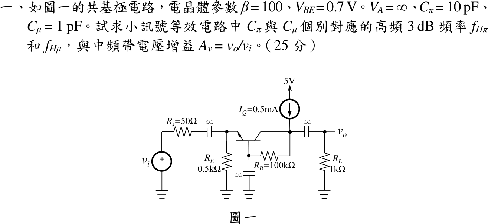

# 112 年電機工程技師｜電子學（包括電力電子學）逐題詳解

> 本頁由題級 canonical 筆記組合；每題保留官方裁切圖、校驗狀態與可追溯的推導。

## 題目導覽
- [[#一、EE-112-02-1|第 1 題：EE-112-02-1]]
- [[#二、112 年電子學第 2 題：Schmitt 觸發鬆弛振盪器|第 2 題：112 年電子學第 2 題：Schmitt 觸發鬆弛振盪器]]
- [[#三、112 年電子學（含電力電子）第 3 題｜反相降升壓轉換器 CCM 漣波設計|第 3 題：反相降升壓轉換器 CCM 漣波設計]]
- [[#四、112 年電子學（含電力電子）第 4 題｜半波整流器傅立葉級數與平滑電感|第 4 題：半波整流器傅立葉級數與平滑電感]]

---

## 一、EE-112-02-1

> 題級識別：EE-112-02-1
> canonical 來源：[[canonical/EE-112-02-1.md]]
> 題級校驗狀態：reference_book_verified

### 已知與所求

$\beta=100$、$V_{BE}=0.7\,\mathrm V$、$V_A=\infty$、$C_\pi=10\,\mathrm{pF}$、$C_\mu=1\,\mathrm{pF}$；$R_s=50\,\Omega$、$R_E=0.5\,\mathrm{k}\Omega$、$R_B=100\,\mathrm{k}\Omega$（集極接基極，基極經電容旁路）、$R_L=1\,\mathrm{k}\Omega$；$I_Q=0.5\,\mathrm{mA}$ 由 5 V 流入集極節點。圖中三個標示 $\infty$ 的外接電容交流短路。求 $f_{H\pi}$、$f_{H\mu}$ 與中頻 $A_v=v_o/v_i$。題圖沒有明示熱電壓，取 $V_T=25\,\mathrm{mV}$。

### 考場標準作答

#### 步驟 1：偏壓與小訊號參數

設 BJT 在主動區（$V_{BE}=0.7\,\mathrm V$）、$V_A=\infty$（無 $r_o$），$V_T=25\,\mathrm{mV}$（題圖未給，假設）。集極節點 KCL：$I_Q=I_C+I_B$（$I_B$ 經 $R_B$ 流入基極），而 $I_E=I_C+I_B$，故
\[
I_E=I_Q=0.5\,\mathrm{mA},\qquad I_C=\frac{\beta}{\beta+1}I_E=495.05\,\mu\mathrm{A}
\]
（$I_C=\tfrac{100}{101}\times0.5\,\mathrm{mA}=495.05\,\mu\mathrm A$。）主動區檢查：
\[
V_B=V_{BE}+I_ER_E=0.7+0.5\,\mathrm{mA}\times0.5\,\mathrm{k}\Omega=0.7+0.25=0.95\,\mathrm V
\]
\[
I_BR_B=\frac{0.5\,\mathrm{mA}}{101}\times100\,\mathrm{k}\Omega=4.9505\,\mu\mathrm A\times100\,\mathrm{k}\Omega=0.49505\,\mathrm V
\]
\[
V_{CB}=I_BR_B=0.49505\,\mathrm V>0
\]
集基接面逆偏，主動區成立。小訊號參數：
\[
g_m=\frac{I_C}{V_T}=\frac{495.05\,\mu\mathrm A}{25\,\mathrm{mV}}=19.80\,\mathrm{mS}
\]
\[
r_\pi=\frac{\beta}{g_m}=\frac{\beta V_T}{I_C}=\frac{100\times25\,\mathrm{mV}}{495.05\,\mu\mathrm A}=5.050\,\mathrm{k}\Omega
\]
\[
r_e=\frac{V_T}{I_E}=\frac{25\,\mathrm{mV}}{0.5\,\mathrm{mA}}=50\,\Omega
\]

#### 步驟 2：高頻小訊號等效電路

偏壓電流源交流開路，5 V 與三個 $\infty$ 電容交流接地／短路。

- 基極經 $\infty$ 電容接地，$v_b=0$，故 $v_\pi=v_b-v_e=-v_e$。
- $r_\pi$、$C_\pi$ 接在 $B$–$E$，即射極節點對地；$C_\mu$ 接在 $B$–$C$，即集極節點對地，不必用米勒等效。
- 受控源 $g_mv_\pi$ 參考方向由 $C$ 流向 $E$；集極節點對地另有 $R_L$ 與 $R_B$（$R_B$ 另一端為交流地的基極）。
- 由射極看入電晶體（基極接地，外加 $v_e$）：流入電流 $=v_e/r_\pi+g_mv_e=v_e(1+\beta)/r_\pi$，故看入電阻 $r_\pi/(\beta+1)=5050/101=50\,\Omega=r_e$。

#### $C_\pi$ 對應的 $f_{H\pi}$

令 $v_i=0$、$C_\mu$ 開路，射極節點對地電阻為 $R_s$、$R_E$ 與電晶體看入電阻 $r_e$ 三者並聯：

\[
R_\pi=R_s\parallel R_E\parallel r_e=\frac{1}{\dfrac1{50}+\dfrac1{500}+\dfrac1{50}}=\frac{1}{0.042\,\mathrm S}=\frac{500}{21}\,\Omega=23.8095\,\Omega
\]
\[
2\pi R_\pi C_\pi=2\pi\times23.8095\,\Omega\times10\,\mathrm{pF}=1.4960\times10^{-9}\,\mathrm s
\]
\[
f_{H\pi}=\frac{1}{2\pi R_\pi C_\pi}=\frac{1}{1.4960\times10^{-9}\,\mathrm s}
\]
\[
\boxed{f_{H\pi}=668.45\,\mathrm{MHz}}
\]

#### $C_\mu$ 對應的 $f_{H\mu}$

$r_o=\infty$、受控電流源對所見電阻為開路，集極節點對地只剩 $R_L\parallel R_B$：

\[
R_\mu=R_L\parallel R_B=\frac{1\,\mathrm k\times100\,\mathrm k}{1\,\mathrm k+100\,\mathrm k}=\frac{100}{101}\,\mathrm{k}\Omega=990.10\,\Omega
\]
\[
2\pi R_\mu C_\mu=2\pi\times990.10\,\Omega\times1\,\mathrm{pF}=6.2210\times10^{-9}\,\mathrm s
\]
\[
f_{H\mu}=\frac{1}{2\pi R_\mu C_\mu}=\frac{1}{6.2210\times10^{-9}\,\mathrm s}
\]
\[
\boxed{f_{H\mu}=160.75\,\mathrm{MHz}}
\]

#### 中頻帶電壓增益

中頻時 $C_\pi,C_\mu$ 視為開路。集極節點 KCL：$v_o/(R_L\parallel R_B)+g_mv_\pi=0$，代入 $v_\pi=-v_e$ 得 $v_o=g_mv_e(R_L\parallel R_B)$（共基極不反相）。

射極輸入電阻與分壓比：
\[
R_E\parallel r_e=\frac{500\times50}{500+50}=\frac{500}{11}\,\Omega=45.45\,\Omega
\]
\[
\frac{v_e}{v_i}=\frac{R_E\parallel r_e}{R_s+R_E\parallel r_e}=\frac{500/11}{50+500/11}=\frac{500}{1050}=\frac{10}{21}=0.4762
\]
集極側：
\[
\frac{v_o}{v_e}=g_m(R_L\parallel R_B)=19.80\,\mathrm{mS}\times990.10\,\Omega=19.604
\]
相乘：
\[
A_v=\frac{v_o}{v_i}=\frac{10}{21}\times19.604=\frac{196.04}{21}=9.335
\]
\[
\boxed{A_v=9.34\ \mathrm{V/V}}
\]

### 驗算

- 電流分流（取 $v_i=1\,\mathrm V$）：$R_s$ 電流 $\dfrac{1}{50+45.45}=10.476\,\mathrm{mA}$，其中流入電晶體射極的比例 $\dfrac{R_E}{R_E+r_e}=\dfrac{500}{550}$，$i_e=10.476\times\dfrac{500}{550}=9.524\,\mathrm{mA}$；$v_o=\alpha i_e(R_L\parallel R_B)=0.9901\times9.524\,\mathrm{mA}\times990.10\,\Omega=9.34\,\mathrm V$。
- 含兩電容的節點方程中，射極節點只含 $C_\pi$、集極節點只含 $C_\mu$，受控源單向耦合，故 $A_v(s)=9.34/[(1+s/\omega_{H\pi})(1+s/\omega_{H\mu})]$，兩極點恰為上兩式（非近似）。

### 失分點

- 漏掉 $R_B$（集極只取 $R_L$）會得 $f_{H\mu}=159.15\,\mathrm{MHz}$、$A_v=9.43\,\mathrm{V/V}$。
- $C_\pi$ 所見電阻漏掉 $r_e$（只取 $R_s\parallel R_E$）會得 $f_{H\pi}=350.14\,\mathrm{MHz}$。
- 基極交流接地，$C_\mu$ 直接跨集極–地，不可套共射極的米勒倍增。

### 條件與疑義

- 取 $V_T=26\,\mathrm{mV}$ 時 $f_{H\pi}=656.21\,\mathrm{MHz}$、$A_v=9.14\,\mathrm{V/V}$，$f_{H\mu}$ 不變。
- 參考書同取 25 mV，得 $f_{H\pi}=6.69\times10^8\,\mathrm{Hz}$、$f_{H\mu}=1.6\times10^8\,\mathrm{Hz}$，與上式一致；書中中頻增益約 9.47 V/V 為近似值，與本解差 1.43%。

---

## 二、112 年電子學第 2 題：Schmitt 觸發鬆弛振盪器

> 題級識別：EE-112-02-2
> canonical 來源：[[canonical/EE-112-02-2.md]]
> 題級校驗狀態：verified

### 已知與所求

理想運放；$v_X$ 接反相端，經 $R_X=40\,\mathrm{k}\Omega$ 接 $v_o$、經 $C_X=0.02\,\mu\mathrm F$ 接地；非反相端 $v_+$ 由 $R_2=20\,\mathrm{k}\Omega$（接 $v_o$）與 $R_1=10\,\mathrm{k}\Omega$（接地）分壓；$v_o=\pm5\,\mathrm V$。$t=0$ 時 $v_o$ 剛切至高電位。求 $v_X(t)$、振盪頻率 $f$、責任週期 $D$（高電位時間百分比），共 25 分。

### 考場標準作答

#### 步驟 1：臨界電壓

設理想運放（輸入端不取電流）在正回授下當比較器，$v_o$ 只有 $\pm5\,\mathrm V$ 兩態，$v_X$ 一越過 $v_+$ 即瞬間翻轉。$v_+$ 由 $R_1$、$R_2$ 對 $v_o$ 分壓（非反相端不取電流）：
\[
\beta=\frac{R_1}{R_1+R_2}=\frac{10}{10+20}=\frac{1}{3}
\]
\[
V_{TH}=\beta\times(+5)=\frac{5}{3}\,\mathrm V\approx1.667\,\mathrm V\quad(v_o=+5\,\mathrm V\ \text{時})
\]
\[
V_{TL}=\beta\times(-5)=-\frac{5}{3}\,\mathrm V\approx-1.667\,\mathrm V\quad(v_o=-5\,\mathrm V\ \text{時})
\]
$v_o=+5\,\mathrm V$ 時 $v_X$ 要升到 $V_{TH}$ 才翻成 $-5\,\mathrm V$；$v_o=-5\,\mathrm V$ 時 $v_X$ 要降到 $V_{TL}$ 才翻回 $+5\,\mathrm V$。

#### 步驟 2：時間常數與初值

反相端不取電流，$C_X$ 只經 $R_X$ 由 $v_o$ 充放電：
\[
\tau=R_XC_X=40\times10^{3}\times0.02\times10^{-6}=8\times10^{-4}\,\mathrm s=800\,\mu\mathrm s
\]
$t=0$ 時 $v_o$ 剛由 $-5$ 切到 $+5\,\mathrm V$，表示 $v_X$ 剛降到下臨界（電容電壓不能突變）：
\[
v_X(0)=V_{TL}=-\frac{5}{3}\,\mathrm V
\]

#### $v_X(t)$ 時間函數

每一段 $v_o$ 為定值，$v_X$ 以 $\tau$ 指數趨向該段的 $v_o$：$v_X(t)=v_\infty+[v_X(t_0)-v_\infty]e^{-(t-t_0)/\tau}$；$v_X$ 碰到臨界電壓即為該段終點。

高電位段（$v_o=+5\,\mathrm V$，$t_0=0$，$v_\infty=5\,\mathrm V$）：
\[
v_X(t)=5+\left(-\frac{5}{3}-5\right)e^{-t/\tau}=5-\frac{20}{3}e^{-t/\tau}\ \mathrm V
\]
到達 $V_{TH}$ 的時刻 $t_H$：
\[
5-\frac{20}{3}e^{-t_H/\tau}=\frac{5}{3}
\]
\[
\frac{20}{3}e^{-t_H/\tau}=5-\frac{5}{3}=\frac{10}{3}
\]
\[
e^{-t_H/\tau}=\frac{10/3}{20/3}=\frac{1}{2}\ \Rightarrow\ t_H=\tau\ln2
\]
\[
t_H=800\,\mu\mathrm s\times0.693147=554.52\,\mu\mathrm s
\]
低電位段（$v_o=-5\,\mathrm V$，$t_0=t_H$，$v_X(t_H)=\tfrac53\,\mathrm V$，$v_\infty=-5\,\mathrm V$）：
\[
v_X(t)=-5+\left(\frac{5}{3}+5\right)e^{-(t-t_H)/\tau}=-5+\frac{20}{3}e^{-(t-t_H)/\tau}\ \mathrm V
\]
到達 $V_{TL}$ 時 $-5+\tfrac{20}{3}e^{-t_L/\tau}=-\tfrac53$，同理得 $e^{-t_L/\tau}=\tfrac12$：
\[
t_L=\tau\ln2=554.52\,\mu\mathrm s
\]
之後 $v_X$ 回到 $-\tfrac53\,\mathrm V$、狀態與 $t=0$ 相同，波形以 $T=t_H+t_L$ 重複（$\tau=800\,\mu\mathrm s$、$t_H=554.52\,\mu\mathrm s$）：
\[
\boxed{v_X(t)=\begin{cases}5-\dfrac{20}{3}e^{-t/800\,\mu\mathrm s}\ \mathrm V, & 0\le t<t_H\\[6pt]-5+\dfrac{20}{3}e^{-(t-t_H)/800\,\mu\mathrm s}\ \mathrm V, & t_H\le t<T\end{cases},\quad v_X(t+T)=v_X(t)}
\]

#### 振盪頻率

\[
T=t_H+t_L=2\tau\ln2=2\times800\,\mu\mathrm s\times0.693147=1109.04\,\mu\mathrm s
\]
\[
f=\frac{1}{T}=\frac{1}{1109.04\times10^{-6}\,\mathrm s}
\]
\[
\boxed{f=901.68\,\mathrm{Hz}}
\]

#### 責任週期

上下臨界（$\pm\tfrac53\,\mathrm V$）與飽和電壓（$\pm5\,\mathrm V$）皆對稱，兩段時間相等：

\[
D=\frac{t_H}{T}=\frac{554.52\,\mu\mathrm s}{1109.04\,\mu\mathrm s}=0.50
\]
\[
\boxed{D=50\%}
\]

### 驗算

- 通式 $T=2\tau\ln\dfrac{1+\beta}{1-\beta}$，$\beta=\tfrac13$：$\dfrac{1+1/3}{1-1/3}=\dfrac{4/3}{2/3}=2$，$T=2\tau\ln2$，與上相同。
- 代回：$v_X(t_H)=5-\tfrac{20}{3}\times\tfrac12=5-\tfrac{10}{3}=\tfrac53\,\mathrm V=V_{TH}$，翻轉點正確。
- 以比較器規則逐步模擬 $dv_X/dt=(v_o-v_X)/\tau$，得頻率 $901.68\,\mathrm{Hz}$、高電位占比 $50\%$。

### 失分點

- 起點取 $v_X(0)=0$；$t=0$ 剛切換，電容電壓應在下臨界 $-\tfrac53\,\mathrm V$，第一段才會是完整的半週期。
- 分壓比寫成 $R_2/(R_1+R_2)=\tfrac23$，臨界值錯成 $\pm\tfrac{10}{3}\,\mathrm V$，$T=2\tau\ln5$、$f=388.33\,\mathrm{Hz}$。
- 指數式的趨向值寫成臨界電壓；$v_X$ 是趨向 $v_o=\pm5\,\mathrm V$，到臨界就翻轉。

---

## 三、112 年電子學（含電力電子）第 3 題｜反相降升壓轉換器 CCM 漣波設計

> 題級識別：EE-112-02-3
> canonical 來源：[[canonical/EE-112-02-3.md]]
> 題級校驗狀態：verified

### 已知與所求

$V_s=24\,\mathrm V$，$V_o=36\,\mathrm V$（題圖輸出端上負下正，即上端對共地為 $V_o=-36\,\mathrm V$ 的反相輸出），$R=10\,\Omega$，$f_s=100\,\mathrm{kHz}$，理想、CCM。參考方向依題圖：$i_L$ 向下流過 $L$、$v_L$ 上正下負，$i_D$ 由輸出上端經二極體流向 $L$ 上端，$i_C$ 由電容向上流出。求使 $i_{L,\min}=0.4I_L$ 的 $L$，及 $\Delta V_o/V_o=0.5\%$ 的 $C$。

### 考場標準作答

#### 步驟 1：兩個開關狀態的等效電路

設 CCM 穩態。

- **Q 導通（$0<t<DT_s$）**：$V_s$ 直接跨在 $L$ 上，$v_L=+V_s=24\,\mathrm V$，$i_L$ 上升。$L$ 上端為 $+24\,\mathrm V$、輸出上端為 $-36\,\mathrm V$，二極體逆偏截止，$C$ 單獨供給負載，$i_C=-I_o$。
- **Q 截止（$DT_s<t<T_s$）**：$i_L$ 不能突變，迫使二極體導通，$L$ 上端接到輸出上端，$v_L=-V_o=-36\,\mathrm V$，$i_L$ 下降；此時 $i_D=i_L$，輸出上端節點 KCL 得 $i_C=i_L-I_o$。

#### 步驟 2：伏秒平衡求 $D$

穩態下 $i_L$ 一週期淨變化為零，即 $v_L$ 一週期平均為零：
\[
V_s\cdot DT_s+(-V_o)(1-D)T_s=0\ \Rightarrow\ V_sD=V_o(1-D)
\]
\[
D=\frac{V_o}{V_s+V_o}=\frac{36}{24+36}=\frac{36}{60}=0.60
\]
\[
T_s=\frac{1}{f_s}=\frac{1}{100\times10^{3}}=10\,\mu\mathrm s,\qquad DT_s=0.60\times10=6\,\mu\mathrm s,\qquad (1-D)T_s=4\,\mu\mathrm s
\]

#### 步驟 3：電荷平衡求 $I_L$

負載電流：
\[
I_o=\frac{V_o}{R}=\frac{36}{10}=3.60\,\mathrm A
\]
穩態下電容一週期淨電荷為零（$i_C$ 平均為零），故二極體電流平均值等於 $I_o$。二極體只在截止段導通且 $i_D=i_L$；$i_L$ 在該段為直線，其平均值等於峰谷中點 $I_L$：
\[
\langle i_D\rangle=(1-D)I_L=I_o
\]
\[
I_L=\frac{I_o}{1-D}=\frac{3.60}{1-0.60}=\frac{3.60}{0.40}=9\,\mathrm A
\]

#### 電感值 $L$

三角波的平均值位於峰谷正中，由谷值規格得峰對峰漣波 $\Delta i_L$。

谷值與峰對峰漣波：
\[
i_{L,\min}=0.4I_L=0.4\times9=3.60\,\mathrm A
\]
\[
\Delta i_L=2(I_L-i_{L,\min})=2(9-3.60)=2\times5.40=10.80\,\mathrm A
\]
（峰值 $i_{L,\max}=I_L+\Delta i_L/2=9+5.40=14.40\,\mathrm A$。）

導通段電流上升量：
\[
\Delta i_L=\frac{V_s}{L}\,DT_s\ \Rightarrow\ L=\frac{V_sDT_s}{\Delta i_L}
\]
代入：
\[
V_sDT_s=24\times6\times10^{-6}=1.44\times10^{-4}\,\mathrm{V\cdot s}
\]
\[
L=\frac{1.44\times10^{-4}}{10.80}=1.33\times10^{-5}\,\mathrm H
\]
\[
\boxed{L=\tfrac{40}{3}\,\mu\mathrm H\approx13.33\,\mu\mathrm H}
\]

#### 電容值 $C$

導通段二極體截止，電容獨自以 $I_o$ 放電 $DT_s$（圖 2 陰影），這段電荷損失即 $C\Delta V_o$。

放電電荷：
\[
\Delta Q=I_oDT_s=3.60\times6\times10^{-6}=2.16\times10^{-5}\,\mathrm C=21.60\,\mu\mathrm C
\]
允許漣波（$0.5\%$ 即 $5\times10^{-3}$）：
\[
\Delta V_o=5\times10^{-3}\times36=0.18\,\mathrm V
\]
\[
C=\frac{\Delta Q}{\Delta V_o}=\frac{2.16\times10^{-5}}{0.18}=1.20\times10^{-4}\,\mathrm F
\]
\[
\boxed{C=120\,\mu\text{F}}
\]
（合併成公式：$\dfrac{\Delta V_o}{V_o}=\dfrac{I_oDT_s}{CV_o}=\dfrac{D}{RCf_s}$，$C=\dfrac{0.60}{10\times10^{5}\times5\times10^{-3}}=\dfrac{0.60}{5000}=120\,\mu\mathrm F$，同值。）

### 驗算

- 截止段下降量：$\dfrac{V_o(1-D)T_s}{L}=\dfrac{36\times4\times10^{-6}}{13.33\times10^{-6}}=10.80\,\mathrm A$，與導通段上升量相等；$i_L$ 在 $3.60\sim14.40\,\mathrm A$，谷值 $>0$，CCM 成立。
- 功率守恆：$P_o=36^2/10=129.60\,\mathrm W$；輸入平均電流 $DI_L=0.60\times9=5.40\,\mathrm A$，$P_s=24\times5.40=129.60\,\mathrm W$，相等。
- 截止段充電電荷：$i_C=i_L-I_o$ 由 $14.40-3.60=10.80\,\mathrm A$ 線性降到 $3.60-3.60=0$，面積 $\tfrac12\times10.80\times4\times10^{-6}=21.60\,\mu\mathrm C$，等於導通段放電量，電荷平衡成立。

### 失分點

- 把「最小值為平均值 40%」當成 $\Delta i_L=0.4I_L$，得 $L=40\,\mu\mathrm H$。
- 平均電感電流誤取 $I_o=3.60\,\mathrm A$，漏除 $(1-D)$。
- 套 Boost 增益 $1/(1-D)$ 得 $D=1/3$。

---

## 四、112 年電子學（含電力電子）第 4 題｜半波整流器傅立葉級數與平滑電感

> 題級識別：EE-112-02-4
> canonical 來源：[[canonical/EE-112-02-4.md]]
> 題級校驗狀態：verified

### 已知與所求

$v_s=170\sin(377t)\,\mathrm V$，$D_1$ 串聯、$D_2$ 為飛輪二極體，負載 $L$–$R$–$V_{dc}$ 串聯，$R=10\,\Omega$、$V_{dc}=24\,\mathrm V$，元件理想。以傅立葉級數求使 $\Delta i_o\le1\,\mathrm A$ 的 $L$、$V_{dc}$ 吸收功率、$R$ 吸收功率。

### 考場標準作答

#### 步驟 1：負載端電壓波形

- $0<\omega t<\pi$：$v_s>0$，$D_1$ 導通，$v_o=v_s=170\sin\omega t$，$D_2$ 逆偏。
- $\pi<\omega t<2\pi$：$v_s<0$ 使 $D_1$ 逆偏，$i_o>0$ 不能中斷，經 $D_2$ 續流，$v_o=0$。

（$i_o$ 恆正的前提在（一）求出 $L$ 後驗證。）

#### 步驟 2：傅立葉級數與平均電流

$V_m=170\,\mathrm V$、$\omega=377\,\mathrm{rad/s}$，半波正弦的級數：
\[
v_o(t)=\frac{V_m}{\pi}+\frac{V_m}{2}\sin\omega t-\sum_{k=1}^{\infty}\frac{2V_m}{\pi(4k^2-1)}\cos 2k\omega t
\]
直流項：
\[
V_0=\frac{V_m}{\pi}=\frac{170}{3.14159}=54.1127\,\mathrm V
\]
電感對直流短路，平均電流由 $R$ 與 $V_{dc}$ 決定：
\[
I_0=\frac{V_0-V_{dc}}{R}=\frac{54.1127-24}{10}=\frac{30.1127}{10}=3.01127\,\mathrm A
\]
各次諧波電壓振幅：
\[
V_1=\frac{V_m}{2}=\frac{170}{2}=85\,\mathrm V
\]
\[
V_2=\frac{2V_m}{3\pi}=\frac{340}{9.4248}=36.075\,\mathrm V
\]
\[
V_4=\frac{2V_m}{15\pi}=\frac{340}{47.124}=7.2150\,\mathrm V
\]
（6 次以上更小且阻抗更大，影響可略。）

#### （一）電感值 $L$

**基頻估算**（$\Delta i_o\approx2I_1$）：
\[
2I_1=\frac{2V_1}{|R+j\omega L|}=1\ \Rightarrow\ |Z_1|=2\times85=170\,\Omega
\]
\[
(\omega L)^2=|Z_1|^2-R^2=170^2-10^2=28\,900-100=28\,800
\]
\[
\omega L=\sqrt{28\,800}=169.71\,\Omega
\]
\[
L=\frac{169.71}{377}=0.4502\,\mathrm H
\]
此 $L$ 下的 2 次諧波：
\[
|Z_2|=\sqrt{10^2+(2\times169.71)^2}=\sqrt{100+115\,206}=339.57\,\Omega
\]
\[
I_2=\frac{V_2}{|Z_2|}=\frac{36.075}{339.57}=0.1062\,\mathrm A
\]
2 次諧波與基頻的峰值不同相，疊加後實際峰對峰約 $1.10\,\mathrm A$，超過限制，$L$ 須加大。

**諧波疊加求 $L$**：以 $i_o(\omega t)=I_0+\sum_n \mathrm{Re}\{\bar V_n e^{jn\omega t}/(R+jn\omega L)\}$ 逐點取最大、最小，試算使 $\max i_o-\min i_o=1\,\mathrm A$，得 $L=0.49617\,\mathrm H$。在此 $L$ 下各次阻抗與電流：

\[
\omega L=377\times0.49617=187.056\,\Omega
\]
\[
|Z_1|=\sqrt{10^2+187.056^2}=\sqrt{100+34\,990}=187.32\,\Omega,\qquad \angle Z_1=\tan^{-1}\frac{187.056}{10}=86.94^\circ
\]
\[
I_1=\frac{85}{187.32}=0.4538\,\mathrm A
\]
\[
|Z_2|=\sqrt{10^2+374.112^2}=\sqrt{100+139\,960}=374.25\,\Omega,\qquad \angle Z_2=\tan^{-1}\frac{374.112}{10}=88.47^\circ
\]
\[
I_2=\frac{36.075}{374.25}=0.09639\,\mathrm A
\]
\[
|Z_4|=\sqrt{10^2+748.224^2}=\sqrt{100+559\,839}=748.29\,\Omega,\qquad \angle Z_4=\tan^{-1}\frac{748.224}{10}=89.23^\circ
\]
\[
I_4=\frac{7.2150}{748.29}=0.009642\,\mathrm A
\]
疊加後最大值約在 $\omega t\approx159.6^\circ$、$i_{o,\max}=3.517\,\mathrm A$；最小值約在 $\omega t\approx16.8^\circ$、$i_{o,\min}=2.517\,\mathrm A$：
\[
\Delta i_o=3.517-2.517=1.000\,\mathrm A
\]
\[
\boxed{L=496.17\,\mathrm{mH}}
\]
$i_o$ 在約 $2.52\sim3.52\,\mathrm A$ 之間恆正，電流連續，步驟 1 的半波正弦前提成立。

#### （二）dc 電源 $V_{dc}$ 吸收的功率

直流源電壓恆定，與諧波電流乘積的一週期平均為零，只有平均電流作功：

\[
P_{V_{dc}}=V_{dc}I_0=24\times3.01127=72.27\,\mathrm W
\]
\[
\boxed{P_{V_{dc}}=72.27\,\mathrm W}
\]

#### （三）電阻 $R$ 吸收的功率

不同頻率的電流分量在一週期內正交，$I_{rms}^2=I_0^2+\sum_n I_n^2/2$（Parseval）。

\[
I_0^2=3.01127^2=9.06775\,\mathrm A^2
\]
\[
\frac{I_1^2}{2}=\frac{0.4538^2}{2}=\frac{0.2059}{2}=0.1030\,\mathrm A^2
\]
\[
\frac{I_2^2}{2}=\frac{0.09639^2}{2}=\frac{0.009291}{2}=0.004646\,\mathrm A^2
\]
\[
\frac{I_4^2}{2}=\frac{0.009642^2}{2}=\frac{9.297\times10^{-5}}{2}=4.648\times10^{-5}\,\mathrm A^2
\]
\[
I_{rms}^2=9.06775+0.1030+0.004646+0.00004648=9.1754\,\mathrm A^2
\]
\[
P_R=RI_{rms}^2=10\times9.1754=91.75\,\mathrm W
\]
\[
\boxed{P_R=91.75\,\mathrm W}
\]
### 驗算

- 時域：以 $L\,di/dt+Ri=v_o(t)-V_{dc}$ 逐段精確積分至週期穩態，得峰對峰 $1.00\,\mathrm A$、平均 $3.01\,\mathrm A$、$R\overline{i^2}=91.75\,\mathrm W$，與級數一致。
- 功率守恆：理想電感與二極體不耗能，電源送出平均功率 $=72.27+91.75=164.02\,\mathrm W$。

### 失分點

- 只用基頻得 $L\approx0.45\,\mathrm H$ 是常見教科書作法，但嚴格峰對峰約 $1.10\,\mathrm A$；考場寫 0.45 H 時應註明 2 次諧波使 $L$ 需略增（約 0.50 H）。
- $P_{V_{dc}}$ 用 $V_{dc}I_{rms}$；直流源只與平均電流作功。
- $P_R$ 只算 $I_0^2R=90.68\,\mathrm W$，漏掉諧波電流的功率。

---
