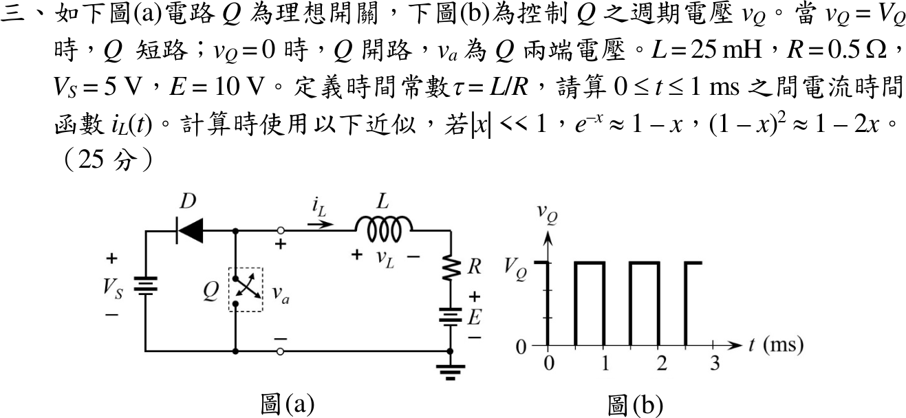
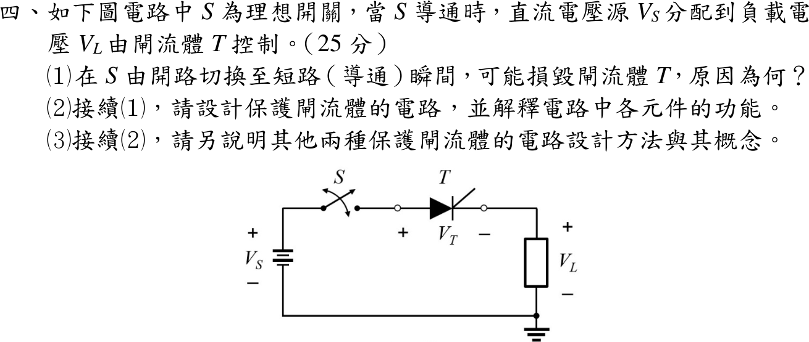

# 114 年電機工程技師｜電子學（包括電力電子學）逐題詳解

> 本頁由題級 canonical 筆記組合；每題保留 QID、官方裁切、校驗狀態與完整得分型解答。

## 題目導覽
- [[#一、114 年電子學第 1 題｜BJT 差動放大器|第 1 題：BJT 差動放大器]]
- [[#二、114 年電子學第 2 題｜零點與開路時間常數|第 2 題：零點與開路時間常數]]
- [[#三、114 年電子學第 3 題｜切換 R-L 電路的電感電流|第 3 題：切換 R-L 電路的電感電流]]
- [[#四、114 年電子學第 4 題｜閘流體 dv/dt 與 di/dt 保護|第 4 題：閘流體 dv/dt 與 di/dt 保護]]

---

## 一、114 年電子學第 1 題｜BJT 差動放大器

> 題級識別：`EE-114-02-1`
> canonical 來源：`canonical/EE-114-02-1.md`
> 題級校驗狀態：`verified`

![[01_原始試題/依考科/02_電子學_含電力電子/images/questions/PE_114年_電子學（包括電力電子學）_Q01.png]]

> 官方裁切來源：`01_原始試題/依考科/02_電子學_含電力電子/images/questions/PE_114年_電子學（包括電力電子學）_Q01.png`

### 已知與所求

$Q_1=Q_2$ 工作於主動區，$\beta=40$、$r_o=\infty$、$V_T=25\,\mathrm{mV}$；尾端為 $I_S=2\,\mathrm{mA}$ 電流源並聯 $R_S=2\,\mathrm{k}\Omega$，$R_C=2\,\mathrm{k}\Omega$。$Q_1$ 基極接 $v_1$、$Q_2$ 基極接 $v_2$，$v_o$ 正端在 $Q_2$ 集極、負端在 $Q_1$ 集極。求 $v_2=-v_1,\ v_1,\ -3v_1$ 三種情況的 $R_i=v_1/i_1$ 與 $A_v=v_o/v_1$。

**數值答案的偏壓前提：**題圖沒有負電源、基極直流電位或 $V_{BE}$，若 $R_S$ 在直流還有分流，就無法唯一求出 $I_C$。本解取 $I_S$ 為總尾射極電流、$R_S$ 只代表尾源的小訊號並聯電阻，每支 $I_E=1\,\mathrm{mA}$；若 $R_S$ 確有未知直流分流，下列數字都不是唯一精確答案。

### 考場標準作答

#### 小訊號參數

小信號模型：主動區 BJT 的 T 模型與 hybrid-$\pi$ 模型；每管射極電流為尾電流的一半，$I_E=1\,\mathrm{mA}$，$I_C=\alpha I_E$。
\[
\alpha=\frac{\beta}{\beta+1}=\frac{40}{41}=0.98,\qquad I_C=\alpha I_E=975.61\ \mu\mathrm A
\]
\[
g_m=\frac{I_C}{V_T}=\frac{975.61\ \mu\mathrm A}{25\ \mathrm{mV}}=39.02\ \mathrm{mS},\qquad r_e=\frac{V_T}{I_E}=\frac{25\ \mathrm{mV}}{1\ \mathrm{mA}}=25\ \Omega,\qquad r_\pi=(\beta+1)r_e=1025\ \Omega
\]

#### 射極節點與通式

令 $v_2=kv_1$。兩管射極接在同一節點，只經 $R_S$ 到交流地（電流源交流開路）：對射極節點寫 KCL，用 T 模型 $i_e=(v_B-v_e)/r_e$：
\[
\frac{v_1-v_e}{r_e}+\frac{v_2-v_e}{r_e}=\frac{v_e}{R_S}
\Rightarrow v_e=\frac{(1+k)v_1}{2+r_e/R_S}=\frac{1+k}{2+25/2000}v_1=\frac{1+k}{2.01}v_1
\]
輸入電阻由基極電流 $i_1=(v_1-v_e)/r_\pi$ 得；差動輸出為兩集極電壓之差，$R_i$、$A_v$ 通式為
\[
R_i=\frac{v_1}{i_1}=\frac{r_\pi v_1}{v_1-v_e},\qquad
v_o=v_{c2}-v_{c1}=\alpha R_C\frac{(v_1-v_e)-(v_2-v_e)}{r_e}=g_mR_C(1-k)v_1
\]
射極電壓 $v_e$ 在差動輸出中相消，故增益只看 $(1-k)$：
\[
g_mR_C=39.02\ \mathrm{mS}\times2\ \mathrm{k}\Omega=78.05
\]

#### （1）$v_2=-v_1$

差動輸入 $k=-1$，兩管基極電壓大小相等、方向相反，射極節點為交流虛地，$v_e=0$：
\[
R_i=\frac{r_\pi v_1}{v_1-0}=r_\pi,\qquad A_v=g_mR_C(1-k)=78.05\times2
\]
\[
\boxed{R_i=r_\pi=1025\,\Omega},\qquad \boxed{A_v=2g_mR_C=156.10\ \mathrm{V/V}}
\]

#### （2）$v_2=v_1$

共模輸入 $k=1$：兩管同相，電流全部流過 $R_S$，每側等效射極電阻為 $2R_S$（對半電路的共模分析），$R_i$ 變得很大。先求 $v_1-v_e$：
\[
v_e=\frac{2}{2.01}v_1,\qquad v_1-v_e=v_1\frac{r_e/R_S}{2+r_e/R_S}=v_1\frac{1.25\times10^{-2}}{2.01}=6.21\times10^{-3}\,v_1
\]
\[
R_i=\frac{r_\pi}{6.21\times10^{-3}}=(\beta+1)(r_e+2R_S)=41\times(25+4000)
\]
差動輸出對共模 $(1-k)=0$：
\[
\boxed{R_i=165025\,\Omega},\qquad \boxed{A_v=g_mR_C(1-1)=0}
\]

#### （3）$v_2=-3v_1$

任意輸入可拆成差模與共模（疊加原理）：$v_d=v_1-v_2=4v_1$、$v_{cm}=(v_1+v_2)/2=-v_1$；輸出只放大差模，但 $R_i$ 受共模成分經 $R_S$ 的影響。先由通式求 $v_e$ 與 $v_1-v_e$：
\[
v_e=\frac{1+(-3)}{2.01}v_1=-0.99\,v_1,\qquad v_1-v_e=1.99\,v_1
\]
\[
R_i=\frac{r_\pi}{1.99}=\frac{1025\ \Omega}{1.99},\qquad A_v=g_mR_C(1-k)=78.05\times4
\]
\[
\boxed{R_i=514.10\,\Omega},\qquad \boxed{A_v=4g_mR_C=312.20\ \mathrm{V/V}}
\]

### 驗算

- 共模（2）用半電路：每側射極電阻為 $2R_S$，$R_i=(\beta+1)(r_e+2R_S)=41(4025)=165025\,\Omega$，與通式一致；理想差動輸出完全抑制共模，$A_v=0$。
- （3）分解為差模 $v_d=v_1-v_2=4v_1$ 與共模 $v_{cm}=-v_1$：差動輸出只看 $v_d$，$A_v=g_mR_C\cdot4=312.20$；射極 KCL 代回 $\frac{(v_1-v_e)+(v_2-v_e)}{r_e}=\frac{-1.24\times10^{-2}\,v_1}{25}=-4.97\times10^{-4}\,v_1=v_e/R_S$ 成立。

### 失分點

- 把尾電流 $2\,\mathrm{mA}$ 整個當成單管 $I_C$，會得 $g_m=0.08\,\mathrm S$、增益加倍。
- 共模時把 $v_e=v_1$ 視為精確而得 $R_i=\infty$；$R_S$ 有限，$R_i=165025\,\Omega$。
- $v_o$ 正端在 $Q_2$ 集極；若取 $v_{c1}-v_{c2}$，三個增益全部變號。

### 條件與疑義

- 若改採 $I_C\approx I_E=1\,\mathrm{mA}$ 的考場近似（$g_m=0.04\,\mathrm S$、$r_\pi=1\,\mathrm{k}\Omega$），三組 $(R_i,A_v)$ 為 $(1.000\,\mathrm{k}\Omega,160)$、$(165.0\,\mathrm{k}\Omega,0)$、$(501.52\,\Omega,320)$，與上列差約 2.5%。

---

## 二、114 年電子學第 2 題｜零點與開路時間常數

> 題級識別：`EE-114-02-2`
> canonical 來源：`canonical/EE-114-02-2.md`
> 題級校驗狀態：`verified`

![[01_原始試題/依考科/02_電子學_含電力電子/images/questions/PE_114年_電子學（包括電力電子學）_Q02.png]]

> 官方裁切來源：`01_原始試題/依考科/02_電子學_含電力電子/images/questions/PE_114年_電子學（包括電力電子學）_Q02.png`

### 已知與所求

$R_s=15\,\mathrm{k}\Omega$、$R_a=3\,\mathrm{k}\Omega$、$C_a=3\,\mathrm{pF}$（跨接 $v_a$ 與 $v_o$ 節點）、$G_m=15\,\mathrm{mA/V}$（電流 $G_mv_a$ 由 $v_o$ 節點向下流到地）、$R_L=1\,\mathrm{k}\Omega$、$C_L=2\,\mathrm{pF}$。$A_v(s)\approx A_{vo}\dfrac{1+s/\omega_z}{1+s/\omega_H}$，求 $A_{vo}$、$\omega_z$，並以開路時間常數法求 $\omega_H$。

### 考場標準作答

#### $A_{vo}$

直流時電容視為開路（$C_a$、$C_L$ 不導通）：先由 $R_s$、$R_a$ 分壓得 $v_a$，再由受控電流源流過 $R_L$ 得 $v_o$（電流向下流經 $R_L$，故為反相）。

\[
v_a=v_s\frac{R_a}{R_s+R_a}=v_s\frac{3}{15+3}=\frac{v_s}{6},\qquad v_o=-G_mv_aR_L
\]
\[
A_{vo}=-G_mR_L\frac{R_a}{R_s+R_a}=-(15\times10^{-3})(1\times10^{3})\frac{3}{18}=-15\times\frac16
\]
\[
\boxed{A_{vo}=-2.50\ \mathrm{V/V}}
\]

#### $\omega_z$

零點是使 $v_o=0$ 的複頻率：$v_o=0$ 時負載與 $C_L$ 無電流，輸出節點上只剩 $C_a$ 前饋電流與 $G_mv_a$ 互相抵消。

輸出節點 KCL：
\[
(v_o-v_a)sC_a+G_mv_a+\frac{v_o}{R_L}+sC_Lv_o=0\ \Rightarrow\ (G_m-sC_a)v_a+\left[\frac1{R_L}+s(C_a+C_L)\right]v_o=0
\]
令 $v_o=0$（$v_a\ne0$）：$G_m-sC_a=0$，
\[
s=\frac{G_m}{C_a}=\frac{15\times10^{-3}}{3\times10^{-12}}=+5.00\times10^{9}\ \mathrm{rad/s}
\]
零點在右半平面。題圖 (b) 的形式為 $1+s/\omega_z$，該因子在 $s=+5.00\times10^9$ 時為零，故 $\omega_z$ 為負值：
\[
\boxed{\omega_z=-\frac{G_m}{C_a}=-5.00\times10^{9}\ \mathrm{rad/s}}
\]
即 $A_v(s)\approx-2.50\,(1-s/5.00\times10^9)/(1+s/\omega_H)$。

#### $\omega_H$（開路時間常數）

開路時間常數法：令 $v_s=0$，逐一看每個電容兩端的等效電阻（其餘電容開路），$\omega_H\simeq1/\sum\tau_i$。

$C_a$ 所見電阻（$C_L$ 開路）：$v_s=0$ 時 $R_s\parallel R_a$ 接在 $v_a$ 節點對地，記為
\[
R'=R_s\parallel R_a=\frac{15(3)}{15+3}=2.50\ \mathrm{k}\Omega
\]
在 $C_a$ 兩端接測試源，令 $I_x$ 由 $v_o$ 端注入、自 $v_a$ 端流回，則 $v_a=-I_xR'$；輸出節點 KCL $I_x=G_mv_a+v_o/R_L$，得 $v_o=R_L(I_x+G_mR'I_x)$，故 $V_x=v_o-v_a$：
\[
R_a^{o}=\frac{V_x}{I_x}=R'+R_L+G_mR'R_L=2.50+1+(15)(2.50)(1)=2.50+1+37.50=41\ \mathrm{k}\Omega
\]
\[
\tau_a=C_aR_a^{o}=(3\times10^{-12})(41\times10^{3})=123\ \mathrm{ns}
\]
$C_L$ 所見電阻（$C_a$ 開路，$v_a=0$，受控源為零）為 $R_L$：
\[
\tau_L=R_LC_L=(1\times10^{3})(2\times10^{-12})=2\ \mathrm{ns}
\]
\[
\boxed{\omega_H\simeq\frac{1}{\tau_a+\tau_L}=\frac{1}{123+2\ \mathrm{ns}}=\frac{1}{125\ \mathrm{ns}}=8.00\times10^{6}\ \mathrm{rad/s}}
\]

### 驗算

完整轉移函數分母 $D(s)=1+1.25\times10^{-7}s+1.50\times10^{-17}s^2$（$s^1$ 係數即 $\tau_a+\tau_L$），兩根為 $8.01\times10^6$ 與 $8.33\times10^9\,\mathrm{rad/s}$；主極點與 OCTC 結果差 0.1%，且 $|\omega_z|/\omega_H=625\gg1$，符合題設。

### 失分點

- $\tau_a$ 只取 $C_a(R'+R_L)=10.50\,\mathrm{ns}$，漏掉 $G_mR'R_L=37.50\,\mathrm{k}\Omega$ 的米勒效應項，$\omega_H$ 會高估約 10 倍。
- 直流時把 $C_a$ 當短路，分壓與 $A_{vo}$ 都錯。
- 零點寫成 $1/(R_LC_a)$；零點只由 $C_a$ 前饋電流與 $G_mv_a$ 相消決定。

---

## 三、114 年電子學第 3 題｜切換 R-L 電路的電感電流

> 題級識別：`EE-114-02-3`
> canonical 來源：`canonical/EE-114-02-3.md`
> 題級校驗狀態：`verified`

![[01_原始試題/依考科/02_電子學_含電力電子/images/questions/PE_114年_電子學（包括電力電子學）_Q03.png]]

> 官方裁切來源：`01_原始試題/依考科/02_電子學_含電力電子/images/questions/PE_114年_電子學（包括電力電子學）_Q03.png`

### 已知與所求

$L=25\,\mathrm{mH}$、$R=0.5\,\Omega$、$V_S=5\,\mathrm V$、$E=10\,\mathrm V$，$\tau=L/R$。二極體陽極接開關節點 $a$、陰極接 $V_S$ 正端；$i_L$ 由 $a$ 經 $L,R$ 流入 $E$ 正端。圖 (b)：$0\le t<0.5\,\mathrm{ms}$ 為 $v_Q=0$（$Q$ 開路），$0.5\le t<1\,\mathrm{ms}$ 為 $v_Q=V_Q$（$Q$ 短路），週期 1 ms，故**先開路、後短路**。求 $0\le t\le1\,\mathrm{ms}$ 的 $i_L(t)$。

### 考場標準作答

**解題邏輯**：$Q$ 只切換節點 $a$ 的電壓，每段內都是一階 $R$–$L$ 電路受定電壓驅動，解為「終值 + (初值 − 終值)$e^{-t/\tau}$」。先判斷兩段的 $v_a$（$Q$ 開路時二極體導通把 $v_a$ 箝在 $V_S$；$Q$ 短路時 $v_a=0$），寫出兩段的指數解；題面沒有給初始電流，故以週期穩態 $i_L(1\,\mathrm{ms})=i_L(0)$ 與電感電流連續解出兩個邊界值，最後依題給近似把指數展成直線。

#### 步驟 1：時間常數與題給近似

\[
\tau=\frac{L}{R}=\frac{25\times10^{-3}}{0.5}=0.05\,\mathrm s=50\,\mathrm{ms}
\]
每段歷時 $0.5\,\mathrm{ms}$，指數的自變數：
\[
x=\frac{0.5\,\mathrm{ms}}{\tau}=\frac{0.5}{50}=0.01\ll1
\]
\[
a=e^{-0.01}\approx1-0.01=0.99
\]
\[
a^2\approx1-2(0.01)=0.98
\]

#### 步驟 2：兩段的等效電路與微分方程

圖 (b) 的 $v_Q$ 在 $0\sim0.5\,\mathrm{ms}$ 為 0、$0.5\sim1\,\mathrm{ms}$ 為 $V_Q$，故**先開路、後短路**。

- **第一段 $0\le t<0.5\,\mathrm{ms}$（$Q$ 開路）**：週期穩態下 $i_L<0$（稍後驗證），電流由 $E$ 經 $R,L$ 流回節點 $a$，唯一去路是經二極體（陽極 $a$、陰極 $V_S$ 正端）流入 $V_S$，二極體導通，$v_a=V_S=5\,\mathrm V$。沿 $a\to L\to R\to E$ 寫 KVL：
\[
L\dot i_L+Ri_L=V_S-E=-5
\]
- **第二段 $0.5\le t<1\,\mathrm{ms}$（$Q$ 短路）**：$v_a=0$，二極體陽極 $0\,\mathrm V$、陰極 $5\,\mathrm V$，反偏截止：
\[
L\dot i_L+Ri_L=-E=-10
\]

#### 步驟 3：兩段的指數解

第一段終值（$\dot i_L=0$）：
\[
i_{L,\infty1}=\frac{-5}{0.5}=-10\,\mathrm A
\]
\[
i_L(t)=-10+(i_0+10)e^{-t/\tau},\qquad i_0=i_L(0)
\]
$t=0.5\,\mathrm{ms}$ 時的值（電感電流連續，即第二段初值）：
\[
i_m=i_L(0.5\,\mathrm{ms})=-10+(i_0+10)a
\]
第二段終值：
\[
i_{L,\infty2}=\frac{-10}{0.5}=-20\,\mathrm A
\]
\[
i_L(t)=-20+(i_m+20)e^{-(t-0.5\,\mathrm{ms})/\tau}
\]

#### 步驟 4：週期穩態求邊界值

**邏輯**：題面沒有給初始電流，穩態下一週期結束時電流回到起點，$i_L(1\,\mathrm{ms})=i_L(0)$，與步驟 3 的連續條件聯立即可消去 $i_m$。

\[
i_0=-20+(i_m+20)a
\]
代入 $i_m+20=10+(i_0+10)a$：
\[
i_0=-20+\bigl[10+(i_0+10)a\bigr]a=-20+10a+10a^2+i_0a^2
\]
\[
(1-a^2)\,i_0=-20+10a+10a^2
\]
左邊係數：
\[
1-a^2=1-0.98=0.02
\]
右邊：
\[
-20+10(0.99)+10(0.98)=-20+9.90+9.80=-0.30
\]
\[
i_0=\frac{-0.30}{0.02}=-15\,\mathrm A
\]
切換瞬間的電流：
\[
i_0+10=-15+10=-5\,\mathrm A
\]
\[
i_m=-10+(-5)(0.99)=-10-4.95=-14.95\,\mathrm A
\]

#### 步驟 5：以 $e^{-x}\approx1-x$ 展開成時間函數

**邏輯**：每段 $t/\tau\le0.01$，題給近似把指數換成直線，斜率 $=(\text{初值}-\text{終值})/\tau$ 取負號。

$1/\tau=1/0.05=20\,\mathrm{s^{-1}}$（$t$ 以 s 計）。

第一段：
\[
i_L\approx-10+(-5)\Bigl(1-\frac{t}{\tau}\Bigr)=-10-5+5(20)t=-15+100t
\]
第二段，$i_m+20=-14.95+20=5.05\,\mathrm A$：
\[
i_L\approx-20+5.05\Bigl(1-\frac{t-0.5\,\mathrm{ms}}{\tau}\Bigr)=-20+5.05-5.05(20)(t-0.5\,\mathrm{ms})
\]
\[
=-14.95-101\,(t-0.5\times10^{-3})
\]
\[
\boxed{i_L(t)=\begin{cases}-15+100t\ \ \mathrm A, & 0\le t\le0.5\,\mathrm{ms}\\[4pt]-14.95-101\,(t-0.5\times10^{-3})\ \ \mathrm A, & 0.5\le t\le1\,\mathrm{ms}\end{cases}}
\]
端點檢查：$t=0.5\,\mathrm{ms}$ 第一段給 $-15+100(5\times10^{-4})=-15+0.05=-14.95\,\mathrm A$，與第二段起點相同；$t=1\,\mathrm{ms}$ 第二段給 $-14.95-101(5\times10^{-4})=-14.95-0.0505=-15.00\,\mathrm A$，回到 $i_0$。電流全程為負，第一段二極體持續導通的假設成立。

### 驗算

- 斜率法：$\dot i_L=(v_a-Ri_L-E)/L$。以 $i_L\approx-15\,\mathrm A$ 代入，第一段 $(5+7.50-10)\,\mathrm V/25\,\mathrm{mH}=+100\,\mathrm{A/s}$、第二段 $(0+7.50-10)\,\mathrm V/25\,\mathrm{mH}=-100\,\mathrm{A/s}$，與上式斜率一致（第二段 $101$ 來自起點 $-14.95\,\mathrm A$）。
- 平均值：$\bar v_a=0.5\times5=2.50\,\mathrm V$，$\bar i_L=(\bar v_a-E)/R=-15\,\mathrm A$。
- 不作近似的精確週期解 $i_0=-10(2+a)/(1+a)=-15.02\,\mathrm A$、$i_m=-14.98\,\mathrm A$，與近似答案差 $25\,\mathrm{mA}$（0.17%），漣波同為 $0.05\,\mathrm A$。

### 失分點

- 把 $0\sim0.5\,\mathrm{ms}$ 讀成短路，兩段方程順序顛倒。
- $Q$ 開路時仍令 $v_a=0$，漏掉二極體把節點箝在 $V_S=5\,\mathrm V$。
- 自設 $i_L(0)=0$；題面沒有此條件，且第二段初值須用電感電流連續 $i_L(0.5\,\mathrm{ms}^-)=i_L(0.5\,\mathrm{ms}^+)$。

### 條件與疑義

若不取週期穩態，須另給 $i_0$；上列含 $i_0$ 的通解只在第一段 $i_L<0$（二極體導通）時成立。

---

## 四、114 年電子學第 4 題｜閘流體 dv/dt 與 di/dt 保護

> 題級識別：`EE-114-02-4`
> canonical 來源：`canonical/EE-114-02-4.md`
> 題級校驗狀態：`verified`

![[01_原始試題/依考科/02_電子學_含電力電子/images/questions/PE_114年_電子學（包括電力電子學）_Q04.png]]

> 官方裁切來源：`01_原始試題/依考科/02_電子學_含電力電子/images/questions/PE_114年_電子學（包括電力電子學）_Q04.png`

### 已知與所求

直流源 $V_S$、理想開關 $S$、閘流體 $T$（$+V_T-$）與負載（$+V_L-$）串聯，無數值。求（1）$S$ 閉合瞬間可能損毀 $T$ 的原因；（2）保護電路設計與各元件功能；（3）另兩種保護方法與概念。

### 考場標準作答

#### （1）損毀原因

迴路 KVL 恆有 $V_S=V_T+V_L$。$S$ 閉合時 $T$ 尚未觸發、處於阻斷，負載無電流，故 $V_L\approx0$、$V_T\approx V_S$：$T$ 兩端電壓在極短時間內由 0 跳到 $V_S$，$dv_T/dt$ 極大。$J_2$ 接面電容 $C_j$ 的位移電流
\[
\boxed{i_j=C_j\frac{dv_T}{dt}}
\]
相當於注入閘極的觸發電流，超過 $(dv/dt)_{cr}$ 即在無閘極訊號下誤導通。誤導通時導通區只在閘極附近一小塊，電流若以很大 $di/dt$ 上升，電流密度集中造成局部熱點而燒毀（$di/dt$ 損壞）。

#### （2）RC 緩衝器（snubber）

在 $T$ 兩端並聯串聯的 $R_s$–$C_s$：

- $C_s$：$S$ 閉合時先由 $C_s$ 承接電壓步階，使 $v_T$ 依時間常數上升，限制 $dv_T/dt$。
- $R_s$：$T$ 觸發導通時限制 $C_s$ 經 $T$ 放電的尖峰電流 $V_S/R_s$（避免放電 $di/dt$ 過大），並阻尼配線電感與 $C_s$ 的振盪。

以電阻性負載 $R_L$ 估算（$S$ 閉合、$T$ 阻斷）：
\[
v_T(0^+)=\frac{R_s}{R_L+R_s}V_S,\qquad \boxed{\left.\frac{dv_T}{dt}\right|_{0^+}=\frac{R_LV_S}{(R_L+R_s)^2C_s}<\left(\frac{dv}{dt}\right)_{cr}}
\]
$C_s$ 加大則斜率變小；$R_s$ 也不可過大，否則 $v_T(0^+)$ 的初始步階變大。

#### （3）另兩種方法

1. **串聯限流電感 $L_s$（di/dt 保護）：**導通瞬間 $L_s\,di/dt=V_S-Ri$，故
\[
\boxed{\left.\frac{di_T}{dt}\right|_{0^+}=\frac{V_S}{L_s}<\left(\frac{di}{dt}\right)_{cr}}
\]
讓導通區有時間擴散到整個晶片；常與 RC 緩衝器搭配（$L_s$ 限 $di/dt$、$R_sC_s$ 限 $dv/dt$）。
2. **過電壓箝位（MOV／TVS 或 RCD 吸收）：**MOV／TVS 並接 $T$，正常電壓時近似開路，超過箝位電壓即導通吸收突波能量，使 $V_T$ 不超過 $V_{DRM}$；RCD 則以二極體把尖峰能量導入電容、由電阻耗散。另可串快速熔絲作過電流保護，其 $I^2t$ 須小於 $T$ 的 $I^2t$ 額定。

### 驗算

- 終值：$t\to\infty$ 時 $C_s$ 充至 $V_S$、電流為 0，$v_T\to V_S$、$V_L\to0$，與阻斷態 KVL 一致。
- 單位：$\dfrac{R_LV_S}{(R_L+R_s)^2C_s}$ 為 $\mathrm{V}/(\Omega\cdot\mathrm F)=\mathrm{V/s}$；$V_S/L_s$ 為 $\mathrm{V/H}=\mathrm{A/s}$。
- 極限：$R_s\to0$ 時斜率為 $V_S/(R_LC_s)$；無緩衝器（$C_s\to0$）時斜率趨於無限大，即（1）的步階。

### 失分點

- 只寫「突波」，未指出接面電容位移電流 $C_j\,dv/dt$ 造成誤觸發的機制。
- 緩衝器只並一顆電容而無 $R_s$：$T$ 導通瞬間 $C_s$ 直接經 $T$ 短路放電，反而造成極大 $di/dt$；主回路 $di/dt$ 也不是 RC 能限制，須靠串聯 $L_s$。
- 寫成 $S$ 閉合時 $T$ 與負載都承受 $V_S$；由 $V_S=V_T+V_L$，兩者不能同時各取 $V_S$，阻斷時是 $V_T\approx V_S$。
