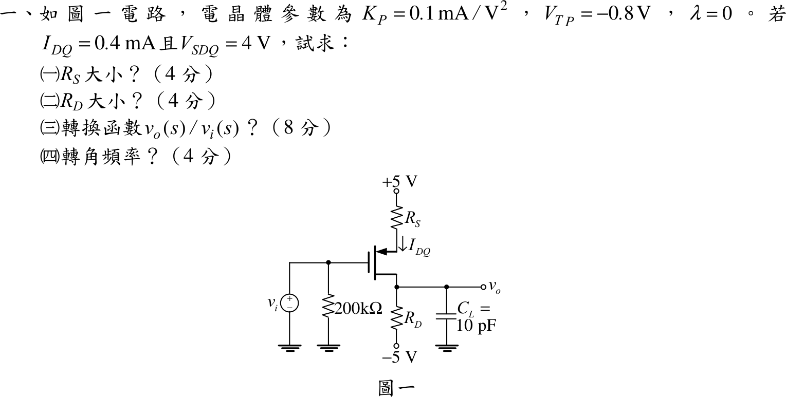
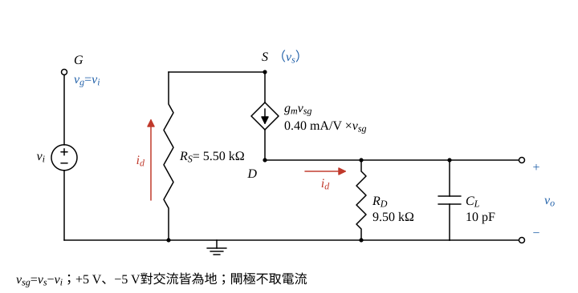

# 104 年電子學（含電力電子）第 1 題｜PMOS 偏壓與源極退化頻率響應

## 已知與所求

PMOS：$K_P=0.1\text{ mA/V}^2$、$V_{TP}=-0.8\text{ V}$、$\lambda=0$；$I_{DQ}=0.4\text{ mA}$、$V_{SDQ}=4\text{ V}$。依圖：$+5\text{ V}$ 經 $R_S$ 接源極，閘極接 $v_i$（經 $200\text{ k}\Omega$ 到地，無直流電流，$V_G=0$），汲極接 $R_D$ 到 $-5\text{ V}$，輸出 $v_o$ 取自汲極並接 $C_L=10\text{ pF}$ 到地；$R_S$ 沒有旁路電容。

求（一）$R_S$（4 分）；（二）$R_D$（4 分）；（三）$v_o(s)/v_i(s)$（8 分）；（四）轉角頻率（4 分）。

題目的符號（$K_P$、$V_{TP}$、$I_{DQ}$、$V_{SDQ}$）沿用導通參數定義 $I_D=K_P(V_{SG}+V_{TP})^2$；另一種慣例的結果見文末「條件與疑義」。

## 考場標準作答

**解題邏輯**：先做直流、再做交流。直流：PMOS 工作於**飽和區**（題給 $I_{DQ}$ 即飽和電流，最後驗 $V_{SD}\ge V_{SG}-|V_{TP}|$），由平方律 $I_{DQ}\to V_{SG}$；閘極不取直流電流，$V_G=0$，故 $V_S=V_{SG}$，再沿 $+5\text{ V}\to R_S$ 與 $R_D\to-5\text{ V}$ 用歐姆定律求 $R_S$、$R_D$。交流：**小訊號假設**（$v_{sg}\ll$ 過驅電壓，以 $g_m$ 線性化；$\lambda=0$ 無 $r_o$），$\pm5\text{ V}$ 為交流地；$R_S$ 無旁路，源極節點 KCL 得 $i_d$，$i_d$ 流入汲極的 $R_D\parallel C_L$ 得 $v_o(s)$；轉角頻率即輸出節點唯一極點。

### 步驟 1：$V_{SG}$ 與源極電壓

**導通參數平方律**（飽和區）：
\[
I_{DQ}=K_P(V_{SG}-|V_{TP}|)^2
\]
\[
(V_{SG}-0.8)^2=\frac{I_{DQ}}{K_P}=\frac{0.4}{0.1}=4
\]
\[
V_{SG}-0.8=2\quad(\text{取正根：導通須 }V_{SG}>|V_{TP}|)
\]
\[
V_{SG}=0.8+2=2.80\text{ V}
\]
閘極無直流電流，$V_G=0$：
\[
V_S=V_G+V_{SG}=0+2.80=2.80\text{ V}
\]

### （一）$R_S$（4 分）

**邏輯**：$I_{DQ}$ 由 $+5\text{ V}$ 經 $R_S$ 流入源極，$R_S$ 兩端電壓 $=5-V_S$，歐姆定律即得。

\[
R_S=\frac{5-V_S}{I_{DQ}}=\frac{5-2.80}{0.4\text{ mA}}=\frac{2.20\text{ V}}{0.4\text{ mA}}
\]
\[
\boxed{R_S=5.50\text{ k}\Omega}
\]

### （二）$R_D$（4 分）

**邏輯**：由 $V_{SD}$ 定出汲極電壓，同一個 $I_{DQ}$ 由汲極經 $R_D$ 流到 $-5\text{ V}$。

\[
V_D=V_S-V_{SDQ}=2.80-4=-1.20\text{ V}
\]
\[
R_D=\frac{V_D-(-5)}{I_{DQ}}=\frac{-1.20+5}{0.4\text{ mA}}=\frac{3.80\text{ V}}{0.4\text{ mA}}
\]
\[
\boxed{R_D=9.50\text{ k}\Omega}
\]
飽和區檢查：$V_{SDQ}=4\text{ V}\ge V_{SG}-|V_{TP}|=2.80-0.8=2\text{ V}$，成立。

### （三）轉移函數（8 分）

**邏輯**：把電晶體換成小訊號模型（圖 1），源極節點 KCL 處理未旁路的 $R_S$（源極退化），汲極節點用 $R_D\parallel\frac{1}{sC_L}$ 的阻抗乘 $i_d$ 得 $v_o$。

轉導（導通參數慣例 $g_m=\partial I_D/\partial V_{SG}$）：
\[
g_m=2K_P(V_{SG}-|V_{TP}|)=2\times0.1\times2=0.40\text{ mA/V}
\]

畫法：閘極接 $v_i$（$200\text{ k}\Omega$ 與理想電壓源並聯，不改變 $v_g=v_i$，可略）；源極 $S$ 經 $R_S$ 到交流地；$S\to D$ 為受控電流源 $i_d=g_mv_{sg}$；汲極 $D$ 經 $R_D$、$C_L$ 到地。

源極節點 KCL（$R_S$ 由地流入 $S$ 的電流 $=$ 流出 $S$ 的 $i_d$）：
\[
\frac{0-v_s}{R_S}=i_d,\qquad i_d=g_mv_{sg}=g_m(v_s-v_i)
\]
由第一式 $v_s=-i_dR_S$，代入第二式：
\[
i_d=g_m(-i_dR_S-v_i)
\]
\[
i_d(1+g_mR_S)=-g_mv_i
\]
\[
i_d=-\frac{g_mv_i}{1+g_mR_S}
\]
汲極節點：$i_d$ 流入 $D$，經 $R_D\parallel C_L$ 流到地：
\[
Z_D(s)=R_D\parallel\frac1{sC_L}=\frac{R_D}{1+sR_DC_L}
\]
\[
v_o=i_dZ_D(s)=-\frac{g_mR_D}{(1+g_mR_S)(1+sR_DC_L)}\,v_i
\]
代入數值：
\[
g_mR_S=0.40\times5.50=2.20,\qquad 1+g_mR_S=3.20
\]
\[
g_mR_D=0.40\times9.50=3.80
\]
\[
A_{v0}=-\frac{g_mR_D}{1+g_mR_S}=-\frac{3.80}{3.20}=-1.1875
\]
\[
R_DC_L=(9.50\times10^{3}\ \Omega)(10\times10^{-12}\text{ F})=9.50\times10^{-8}\text{ s}=95\text{ ns}
\]
\[
\boxed{\frac{v_o(s)}{v_i(s)}=-\frac{g_mR_D}{(1+g_mR_S)(1+sR_DC_L)}=-\frac{1.19}{1+9.50\times10^{-8}s}}
\]

### （四）轉角頻率（4 分）

**邏輯**：（三）的分母只有一個極點 $s=-1/(R_DC_L)$；它只由汲極節點的 $R_D$、$C_L$ 決定，與 $R_S$ 退化無關。

\[
\omega_c=\frac1{R_DC_L}=\frac1{95\text{ ns}}=1.053\times10^{7}\text{ rad/s}
\]
\[
f_c=\frac{1}{2\pi R_DC_L}=\frac{1}{2\pi\times0.095\ \mu\text{s}}=\frac{1}{0.5969\ \mu\text{s}}=1.675\text{ MHz}
\]
\[
\boxed{f_c=1.68\text{ MHz}}
\]

## 驗算

- 偏壓 KVL（$+5\text{ V}\to R_S\to$ 源汲 $\to R_D\to-5\text{ V}$）：$5-0.4\times5.50-4-0.4\times9.50+5=5-2.20-4-3.80+5=0$。
- 轉導另算：$g_m=2\sqrt{K_PI_{DQ}}=2\sqrt{0.1\times0.4}=2\times0.2=0.40\text{ mA/V}$。
- 小訊號回代：$i_d/v_i=-0.40/3.20=-0.125\text{ mA/V}$；$v_s=-i_dR_S=0.125\times5.50\,v_i=0.6875\,v_i$；$v_{sg}=v_s-v_i=-0.3125\,v_i$；$g_mv_{sg}=0.40\times(-0.3125)\,v_i=-0.125\,v_i$（mA），與 $i_d$ 相同；$|A_{v0}|=0.125\times9.50=1.1875$。

## 失分點

- 圖中 $R_S$ 沒有旁路電容，中頻增益要除以 $1+g_mR_S=3.20$；用 $-g_mR_D=-3.80$ 會大三倍多。
- 源極 $V_S=V_G+V_{SG}=2.80\text{ V}$，不是 0；$R_S$ 用 $5-V_S$、$R_D$ 用 $V_D-(-5)$。
- 轉角頻率只由 $R_DC_L$ 決定，與 $R_S$ 退化無關。

## 條件與疑義

題幹只給「$K_P=0.1\text{ mA/V}^2$」而未寫平方律公式。上列採導通參數寫法（記號 $K_P,V_{TP},I_{DQ},V_{SDQ}$ 的教科書慣例，且 $R_S,R_D$ 得整齊數值 $5.50/9.50\text{ k}\Omega$）。若採 ½$K_P$ 慣例 $I_D=\tfrac12K_P(V_{SG}-|V_{TP}|)^2$：

$$
V_{SG}=0.8+\sqrt8=3.628\text{ V},\quad R_S=\frac{5-3.628}{0.4}=3.43\text{ k}\Omega,\quad R_D=\frac{3.628-4+5}{0.4}=11.57\text{ k}\Omega,\quad g_m=K_P\sqrt8=282.84\ \mu\text{A/V}
$$
$$
\frac{v_o(s)}{v_i(s)}=-\frac{g_mR_D}{(1+g_mR_S)(1+sR_DC_L)}=-\frac{1.66}{1+1.157\times10^{-7}s},\ \ A_{v0}=-\frac{3.273}{1.970}=-1.66,\ \ f_c=1.38\text{ MHz}
$$
兩種慣例只改數值，結構 $-\dfrac{g_mR_D}{1+g_mR_S}\cdot\dfrac1{1+sR_DC_L}$ 相同；以官方公布解答的 $R_S$ 為準選擇其一。
