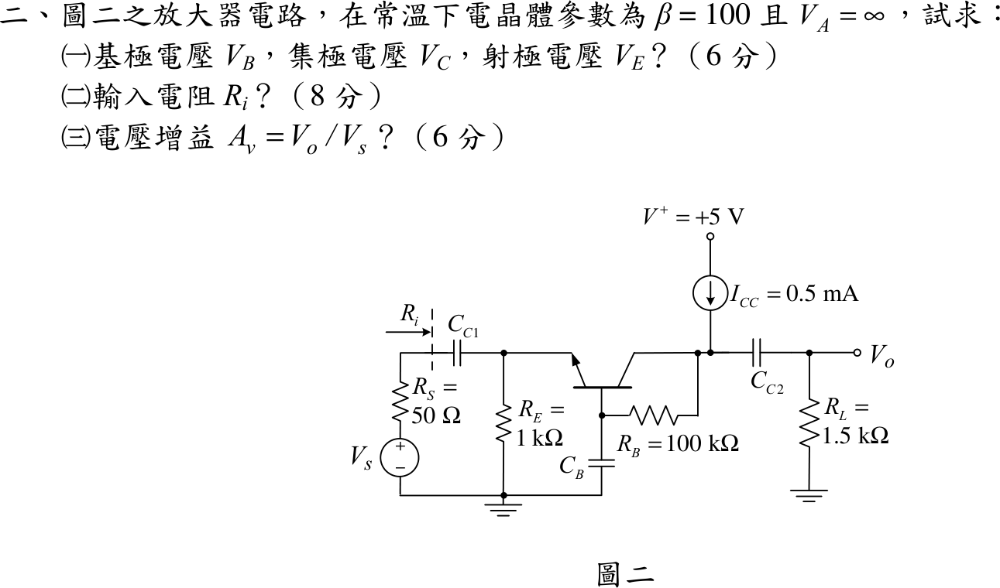
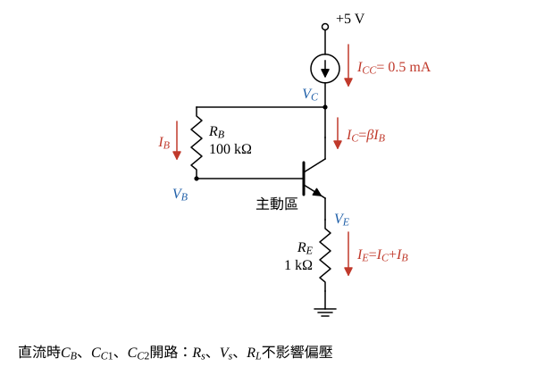
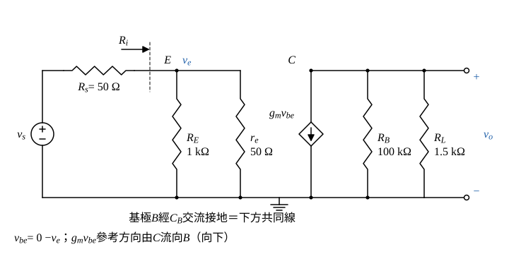

# 104 年電子學（含電力電子）第 2 題｜BJT 共基極偏壓與中頻增益

## 已知與所求

NPN，$\beta=100$、$V_A=\infty$；$+5\text{ V}$ 經電流源 $I_{CC}=0.5\text{ mA}$ 注入集極節點，$R_B=100\text{ k}\Omega$ 接在集極節點與基極之間，基極經 $C_B$ 交流接地；$R_E=1\text{ k}\Omega$ 接地，信號 $V_s$ 經 $R_s=50\ \Omega$、$C_{C1}$ 進射極，集極經 $C_{C2}$ 接 $R_L=1.5\text{ k}\Omega$。題目未給 $V_{BE}$ 與 $V_T$，取 $V_{BE}=0.7\text{ V}$、$V_T=25\text{ mV}$（假設）。

求（一）$V_B,V_C,V_E$（6 分）；（二）輸入電阻 $R_i$（8 分）；（三）$A_v=V_o/V_s$（6 分）。

## 考場標準作答

**解題邏輯**：直流時所有電容開路，假設 BJT 在**主動區**（$I_C=\beta I_B$、$V_{BE}=0.7\text{ V}$，求出電位後以 $V_{CB}>0$ 驗證）；關鍵是集極節點 KCL——$I_{CC}$ 分成 $I_C$ 與經 $R_B$ 的 $I_B$，所以 $I_E=I_{CC}$，再由 $R_E$、$V_{BE}$、$R_B$ 依序得 $V_E\to V_B\to V_C$。交流（中頻，電容短路；**小訊號假設**，$V_A=\infty$ 無 $r_o$）：$C_B$ 使基極接地，成共基極；由射極看入是 $r_e\parallel R_E$ 即 $R_i$；$R_B$ 改為跨在集極與地之間，與 $R_L$ 並聯成交流負載，$A_v=\dfrac{R_i}{R_s+R_i}\,g_mR_{L,ac}$。

### （一）直流電位（6 分）

**邏輯**：電流源接在集極節點，$R_B$ 又把基極接到同一節點，所以 $I_{CC}$ 同時供給 $I_C$ 與 $I_B$；射極電流因此等於 $I_{CC}$，不需先知道 $\beta$ 就能定 $V_E$。

集極節點 KCL（$C_B$ 開路，$R_B$ 的電流全部進基極，即 $I_B$）：
\[
I_{CC}=I_C+I_B
\]
射極電流：
\[
I_E=I_C+I_B=I_{CC}=0.5\text{ mA}
\]
\[
I_B=\frac{I_E}{\beta+1}=\frac{0.5\text{ mA}}{101}=4.9505\ \mu\text{A}
\]
\[
I_C=\beta I_B=100\times4.9505\ \mu\text{A}=495.05\ \mu\text{A}
\]
射極、基極、集極電位：
\[
V_E=I_ER_E=0.5\text{ mA}\times1\text{ k}\Omega
\]
\[
\boxed{V_E=0.50\text{ V}}
\]
\[
V_B=V_E+V_{BE}=0.50+0.7
\]
\[
\boxed{V_B=1.20\text{ V}}
\]
\[
I_BR_B=4.9505\ \mu\text{A}\times100\text{ k}\Omega=0.49505\text{ V}
\]
\[
V_C=V_B+I_BR_B=1.20+0.49505=1.69505\text{ V}
\]
\[
\boxed{V_C=1.70\text{ V}}
\]
主動區檢查：$V_{CB}=V_C-V_B=0.49505\text{ V}>0$（集基接面逆偏）、$V_{BE}=0.7\text{ V}$（基射接面順偏），假設成立。

### 步驟 2：小訊號參數與交流等效電路

$r_e$（由射極看入的小訊號電阻）與 $g_m$：
\[
r_e=\frac{V_T}{I_E}=\frac{25\text{ mV}}{0.5\text{ mA}}=50\ \Omega
\]
\[
g_m=\frac{I_C}{V_T}=\frac{495.05\ \mu\text{A}}{25\text{ mV}}=19.802\text{ mA/V}
\]

畫法：$C_{C1}$、$C_{C2}$、$C_B$ 短路，$+5\text{ V}$ 為交流地、理想電流源 $I_{CC}$ 交流開路；基極 $B$ 接地，射極 $E$ 經 $r_e$ 到 $B$（地），集極受控源 $g_mv_{be}$ 由 $C$ 流向 $B$（地）；$R_B$ 原接在集極與基極之間，基極接地後變成集極對地。

### （二）輸入電阻 $R_i$（8 分）

**邏輯**：題圖虛線在 $R_s$ 與 $C_{C1}$ 之間，$R_i$ 是由 $C_{C1}$ 往右看入射極節點；該節點對地有 $R_E$ 與 $r_e$ 兩條路徑（受控源接在集極與地之間，不從射極節點取電流），兩者並聯。

\[
R_i=R_E\parallel r_e=\frac{R_Er_e}{R_E+r_e}=\frac{1000\times50}{1000+50}=\frac{50000}{1050}
\]
\[
\boxed{R_i=47.62\ \Omega}
\]

### （三）電壓增益 $A_v$（6 分）

**邏輯**：輸入端是 $R_s$ 與 $R_i$ 分壓得 $v_e$；集極端受控源電流 $g_mv_{be}=-g_mv_e$（參考方向 $C\to B$），由地經 $R_{L,ac}$ 流入集極，$v_o=g_mv_eR_{L,ac}$。

交流負載（基極交流接地，$R_B$ 跨在集極與地之間）：
\[
R_{L,ac}=R_L\parallel R_B=\frac{1.5\times100}{1.5+100}=\frac{150}{101.5}=1.47783\text{ k}\Omega
\]
輸入分壓（以 $R_i=\tfrac{1000}{21}\ \Omega$ 精確值）：
\[
\frac{v_e}{v_s}=\frac{R_i}{R_s+R_i}=\frac{1000/21}{50+1000/21}=\frac{1000}{2050}=\frac{20}{41}=0.4878
\]
集極輸出：
\[
v_o=-(g_mv_{be})R_{L,ac}=-g_m(0-v_e)R_{L,ac}=g_mR_{L,ac}\,v_e
\]
\[
g_mR_{L,ac}=19.802\text{ mA/V}\times1.47783\text{ k}\Omega=29.264
\]
\[
A_v=\frac{v_o}{v_s}=\frac{R_i}{R_s+R_i}\,g_mR_{L,ac}=\frac{20}{41}\times29.264=\frac{585.28}{41}
\]
\[
\boxed{A_v=14.28\text{ V/V}}
\]

## 驗算

- 直流守恆：$I_C+I_B=495.05+4.9505=500.00\ \mu\text{A}=I_{CC}$；$V_C-V_B=I_BR_B=0.49505\text{ V}$。
- hybrid-$\pi$ 另解 $R_i$：$r_\pi=\beta/g_m=100/19.802=5.050\text{ k}\Omega$，射極節點看入 $1/(1/R_E+1/r_\pi+g_m)=1/(1+0.1980+19.802)\text{ mS}=1/21.00\text{ mS}=47.62\ \Omega$，與 $R_E\parallel r_e$ 相同（因 $r_\pi\parallel\tfrac1{g_m}=\tfrac{\alpha}{g_m}=r_e$）。
- 節點方程數值解（verify 腳本）：$A_v=14.275$，四捨五入 $14.28$。

## 失分點

- 電流源接在集極節點而 $R_B$ 把基極也接到該節點，$I_{CC}$ 必須分給集極與基極：$I_E=I_{CC}=0.5\text{ mA}$，不是 $I_C=I_{CC}$、$I_E=505.00\ \mu\text{A}$。
- 增益不能只看 $R_L$：基極交流接地使 $R_B$ 跨在集極與地之間，$R_{L,ac}=R_L\parallel R_B$。
- $R_i$ 是看入 $C_{C1}$ 右側，不含 $R_s$；$A_v$ 才要乘 $R_i/(R_s+R_i)$ 的分壓。
