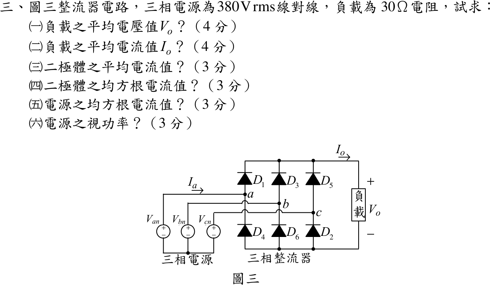
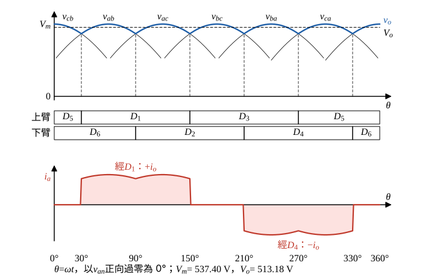

# 104 年電子學（含電力電子）第 3 題｜三相六脈波二極體整流器

## 已知與所求

三相電源 $380\ \mathrm V_{\mathrm{rms}}$（線對線），$D_1,D_3,D_5$ 為上臂（陽極分別接 $a,b,c$），$D_4,D_6,D_2$ 為下臂（陰極分別接 $a,b,c$），負載 $R=30\ \Omega$ 純電阻，二極體理想。求（一）$V_o$（4 分）；（二）$I_o$（4 分）；（三）二極體平均電流（3 分）；（四）二極體 rms 電流（3 分）；（五）電源 rms 電流（3 分）；（六）電源視在功率（3 分）。

## 考場標準作答

**解題邏輯**：三相六脈波橋式整流器的導通規則是「上臂接電位最高的相、下臂接電位最低的相」，所以 $v_o$ 每 $60^\circ$ 換一次線電壓，是線電壓峰值附近 $\pm30^\circ$ 的包絡（步驟 1）。（一）（二）對一個 $60^\circ$ 脈波積分求平均；負載是純電阻，電流 $i_o=v_o/R$ 隨脈波起伏，不是定值，所以（四）（五）（六）要先用脈波積分求負載 rms 電流 $I_{o,\mathrm{rms}}$（步驟 3），再依每顆二極體、每條相線分到的時段比例換算。前提：理想二極體、三相平衡、相序 $abc$、換相瞬間完成。

### 步驟 1：導通順序與波形

以 $v_{an}$ 正向過零為 $\theta=0^\circ$，每 $60^\circ$ 由最高相與最低相決定導通對（圖 1）：

| $\theta$ | $30^\circ$–$90^\circ$ | $90^\circ$–$150^\circ$ | $150^\circ$–$210^\circ$ | $210^\circ$–$270^\circ$ | $270^\circ$–$330^\circ$ | $330^\circ$–$390^\circ$ |
|---|---|---|---|---|---|---|
| 導通 | $D_1,D_6$ | $D_1,D_2$ | $D_3,D_2$ | $D_3,D_4$ | $D_5,D_4$ | $D_5,D_6$ |
| $v_o$ | $v_{ab}$ | $v_{ac}$ | $v_{bc}$ | $v_{ba}$ | $v_{ca}$ | $v_{cb}$ |

- 每顆二極體導通 $120^\circ$（連續兩個脈波），一週期 6 個相同的脈波。
- a 相線電流 $i_a$：$30^\circ$–$150^\circ$ 經 $D_1$ 流出為 $+i_o$，$210^\circ$–$330^\circ$ 經 $D_4$ 流回為 $-i_o$，其餘 $0$。

### 步驟 2：線電壓峰值與單一脈波

\[
V_m=\sqrt2\,V_{LL}=\sqrt2\times380=537.40\ \mathrm V
\]
以脈波中心（線電壓峰值）為 $\phi=0$，一個脈波為
\[
v_o=V_m\cos\phi,\qquad -\frac{\pi}{6}\le\phi\le\frac{\pi}{6}
\]

### 步驟 3：負載 rms 電流 $I_{o,\mathrm{rms}}$（（四）（五）（六）共用）

純電阻 $i_o=v_o/R$，6 個脈波相同，一個脈波（寬 $\pi/3$）的均方即全週期均方：
\[
I_{o,\mathrm{rms}}^2=\frac{1}{\pi/3}\int_{-\pi/6}^{\pi/6}\left(\frac{V_m\cos\phi}{R}\right)^2d\phi
=\frac{V_m^2}{R^2}\frac3\pi\int_{-\pi/6}^{\pi/6}\cos^2\phi\,d\phi
\]
積分：
\[
\int_{-\pi/6}^{\pi/6}\cos^2\phi\,d\phi=\left[\frac{\phi}{2}+\frac{\sin2\phi}{4}\right]_{-\pi/6}^{\pi/6}=\frac\pi6+\frac{\sqrt3}{4}
\]
\[
\frac\pi6+\frac{\sqrt3}{4}=0.5236+0.4330=0.9566
\]
\[
\frac3\pi\left(\frac\pi6+\frac{\sqrt3}{4}\right)=0.9549\times0.9566=0.9135
\]
\[
\frac{V_m}{R}=\frac{537.40}{30}=17.91\ \mathrm A
\]
\[
\sqrt{0.9135}=0.9558
\]
\[
I_{o,\mathrm{rms}}=\frac{V_m}{R}\sqrt{0.9135}=17.91\times0.9558=17.12\ \mathrm A
\]

### （一）負載平均電壓 $V_o$（4 分）

**邏輯**：$v_o$ 由 6 個相同的脈波組成，對一個 $60^\circ$（$\pi/3$）脈波取平均即可。

\[
V_o=\frac{1}{\pi/3}\int_{-\pi/6}^{\pi/6}V_m\cos\phi\,d\phi=\frac{3V_m}{\pi}\Big[\sin\phi\Big]_{-\pi/6}^{\pi/6}=\frac{3V_m}{\pi}\left(\frac12+\frac12\right)=\frac{3V_m}{\pi}
\]
\[
V_o=\frac{3\times537.40}{\pi}=\frac{1612.2}{\pi}
\]
\[
\boxed{V_o=513.18\ \mathrm V}
\]

### （二）負載平均電流 $I_o$（4 分）

**邏輯**：純電阻 $i_o=v_o/R$，平均值直接除以 $R$。

\[
I_o=\frac{V_o}{R}=\frac{513.18}{30}
\]
\[
\boxed{I_o=17.11\ \mathrm A}
\]

### （三）二極體平均電流（3 分）

**邏輯**：每顆二極體只在 6 個相同脈波中的 2 個導通，且導通時電流就是 $i_o$，所以平均值為負載的 $2/6=1/3$。

\[
I_{D,\mathrm{avg}}=\frac{I_o}{3}=\frac{17.11}{3}
\]
\[
\boxed{I_{D,\mathrm{avg}}=5.70\ \mathrm A}
\]

### （四）二極體 rms 電流（3 分）

**邏輯**：三顆上橋二極體輪流承擔全部正向負載電流，每顆的均方值是負載的 $1/3$；均方要用步驟 3 的 $I_{o,\mathrm{rms}}$，不能用平均值 $I_o$。

\[
I_{D,\mathrm{rms}}^2=\frac{I_{o,\mathrm{rms}}^2}{3}\ \Rightarrow\ I_{D,\mathrm{rms}}=\frac{I_{o,\mathrm{rms}}}{\sqrt3}=\frac{17.12}{1.732}
\]
\[
\boxed{I_{D,\mathrm{rms}}=9.88\ \mathrm A}
\]

### （五）電源 rms 電流（3 分）

**邏輯**：一條相線另有對稱的正、負兩段：$i_a$ 經 $D_1$ 送出 $+i_o$（$120^\circ$），經 $D_4$ 收回 $-i_o$（$120^\circ$），平方後兩段都等於 $i_o^2$，均方值是負載的 $2/3$（圖 1 下）。

\[
I_{s,\mathrm{rms}}^2=\frac23I_{o,\mathrm{rms}}^2\ \Rightarrow\ I_{s,\mathrm{rms}}=I_{o,\mathrm{rms}}\sqrt{\frac23}=17.12\times0.8165
\]
\[
\boxed{I_{s,\mathrm{rms}}=13.98\ \mathrm A}
\]

### （六）電源視在功率（3 分）

**邏輯**：三相平衡電源的視在功率 $S=\sqrt3\,V_{LL}I_{s,\mathrm{rms}}$，電流用（五）含諧波的 rms 值。

\[
S=\sqrt3\,V_{LL}I_{s,\mathrm{rms}}=\sqrt3\times380\times13.98
\]
\[
\sqrt3\times380=658.2\ \mathrm V
\]
\[
S=658.2\times13.98=9201.6\ \mathrm{VA}
\]
\[
\boxed{S=9.20\ \mathrm{kVA}}
\]

## 驗算

- 功率守恆：負載實功 $P=I_{o,\mathrm{rms}}^2R=17.12^2\times30=8793\ \mathrm W$（完整精度 $8794\ \mathrm W$）；以完整精度 $S=9201\ \mathrm{VA}$，$P/S=8794/9201=0.9558$，等於電阻負載六脈波輸入功因 $\sqrt{\tfrac12+\tfrac{3\sqrt3}{4\pi}}=\sqrt{0.9135}=0.9558$，且 $\le1$。
- 以一週期取樣、依「最高相接上臂、最低相接下臂」的導通表直接計算，得 $V_o=513.18\ \mathrm V$、$I_{D,\mathrm{rms}}=9.88\ \mathrm A$、$I_{s,\mathrm{rms}}=13.98\ \mathrm A$。此處不能僅憑導通時間比例把脈動電流當定值：本題六脈波漣波小，$I_o=17.11\ \mathrm A$ 與 $I_{o,\mathrm{rms}}=17.12\ \mathrm A$ 只差 $0.01\ \mathrm A$，數值碰巧接近，但 rms 必須由步驟 3 的脈波積分求得。

## 失分點

- 把 $380\ \mathrm V$ 當相電壓，或平均電壓公式誤用相電壓峰值。
- 直接令 $I_{o,\mathrm{rms}}=I_o$；本題是電阻負載，不是大電感平滑的定電流負載。
- 視在功率漏乘 $\sqrt3$，或把 VA 寫成 W。
