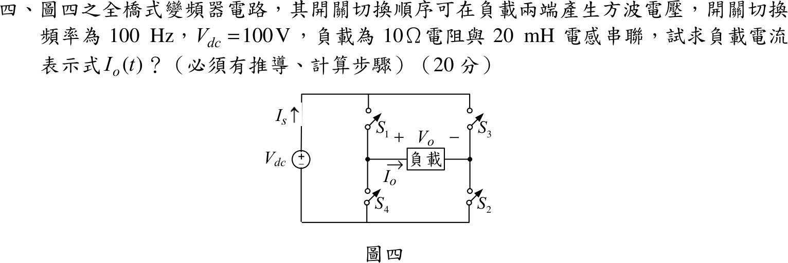
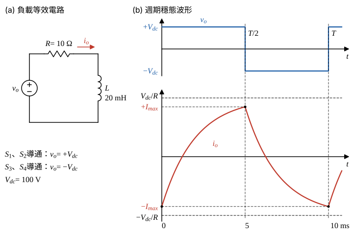

# 104 年電子學（含電力電子）第 4 題｜單相全橋逆變器 RL 負載電流

## 已知與所求

單相全橋變頻器（$S_1,S_2$ 與 $S_3,S_4$ 兩對輪流導通）在負載端產生方波 $v_o=\pm V_{dc}$；切換頻率 $f=100\text{ Hz}$、$V_{dc}=100\text{ V}$，負載為 $R=10\ \Omega$ 串聯 $L=20\text{ mH}$。求週期穩態負載電流 $i_o(t)$（題目記為 $I_o(t)$，20 分）。取 $0\le t<5\text{ ms}$ 為 $S_1,S_2$ 導通、$v_o=+V_{dc}$（起點定義，假設）；$i_o$ 參考方向依題圖由 $S_1,S_4$ 中點流向 $S_3,S_2$ 中點。

## 考場標準作答

### 步驟 1：週期與時間常數

\[
T=\frac{1}{f}=\frac{1}{100}=10\text{ ms},\qquad \frac T2=5\text{ ms}
\]
\[
\tau=\frac{L}{R}=\frac{20\times10^{-3}}{10}=2\times10^{-3}\text{ s}=2\text{ ms},\qquad \frac1\tau=500\ \mathrm{s^{-1}}
\]
\[
\frac{V_{dc}}{R}=\frac{100}{10}=10\text{ A}
\]

### 步驟 2：正半週的一階解

設理想開關（各含反並聯二極體，$v_o$ 為與電流方向無關的理想 $\pm V_{dc}$ 方波），求週期穩態。$0\le t\le T/2$ 時 $v_o=+V_{dc}$，負載迴路 KVL：
\[
L\frac{di_o}{dt}+Ri_o=V_{dc}
\]
一階電路解 = 穩態值 $+$（初值 $-$ 穩態值）$\times e^{-t/\tau}$，穩態值 $V_{dc}/R=10\text{ A}$。週期穩態的起點電流記為 $i_o(0)=-I_{max}$（圖 1(b)）：
\[
i_o(t)=\frac{V_{dc}}{R}+\left(i_o(0)-\frac{V_{dc}}{R}\right)e^{-t/\tau}
\]
\[
i_o(t)=10+(-I_{max}-10)e^{-500t}=10-(10+I_{max})e^{-500t}\ \text{A}
\]

### 步驟 3：半波對稱邊界條件求 $I_{max}$

$v_o$ 後半週是前半週的負值，週期穩態電流同樣滿足 $i_o(t+T/2)=-i_o(t)$；因此半週末的電流必須是起點的負值：
\[
i_o\!\left(\tfrac T2\right)=+I_{max}
\]
指數因子：
\[
e^{-(T/2)/\tau}=e^{-5/2}=e^{-2.5}=0.08208
\]
代入步驟 2 的式子：
\[
I_{max}=10-(10+I_{max})(0.08208)
\]
移項：
\[
I_{max}(1+0.08208)=10(1-0.08208)
\]
\[
1.08208\,I_{max}=9.1792
\]
\[
I_{max}=\frac{9.1792}{1.08208}=8.4829\text{ A}
\]
\[
\boxed{I_{max}=8.48\text{ A}}
\]

### 負載電流 $i_o(t)$（20 分）

負半週以 $t=T/2$ 為時間原點，套用同一個一階解。

正半週指數項係數：
\[
10+I_{max}=10+8.4829=18.4829\approx18.48\text{ A}
\]
負半週（$T/2\le t\le T$，$v_o=-V_{dc}$，穩態值 $-10\text{ A}$，初值 $i_o(T/2)=+I_{max}$）：
\[
i_o(t)=-\frac{V_{dc}}{R}+\left(I_{max}+\frac{V_{dc}}{R}\right)e^{-(t-T/2)/\tau}=-10+18.48\,e^{-500(t-0.005)}\ \text{A}
\]
合併（$t$ 以秒計）：
\[
\boxed{i_o(t)=\begin{cases}
10-18.48\,e^{-500t}\ \text{A}, & 0\le t\le5\text{ ms}\\[2pt]
-10+18.48\,e^{-500(t-0.005)}\ \text{A}, & 5\text{ ms}\le t\le10\text{ ms}
\end{cases}}
\]
之後每週期 $T=10\text{ ms}$ 重複；電流在 $\pm8.48\text{ A}$ 之間擺動。

## 驗算

- 週期封閉：$i_o(10\text{ ms})=-10+18.4829\times0.08208=-10+1.5171=-8.4829\text{ A}=-I_{max}$，回到起點，且在 $t=0,5,10\text{ ms}$ 電流連續（電感電流不能跳變）。
- 對 $L\,di_o/dt=v_o-Ri_o$ 由 $i_o(0)=0$ 起以四階 Runge–Kutta 連續積分 60 個週期（遠大於 $\tau$），最後一週期電流在 $-8.48\sim+8.48\text{ A}$，與上式最大差異小於 $1\text{ mA}$。

## 失分點

- 從 $i_o(0)=0$ 起算只是開機暫態，不是週期穩態；必須用 $i_o(0)=-I_{max}$、$i_o(T/2)=+I_{max}$ 的對稱邊界條件。
- 負半週的指數時間原點要平移到 $t=5\text{ ms}$（$e^{-500(t-0.005)}$），否則末端電流錯。
- 把 $e^{-2.5}$ 取兩位 $0.08$ 再往下算，$I_{max}$ 會變成 $8.52\text{ A}$。
