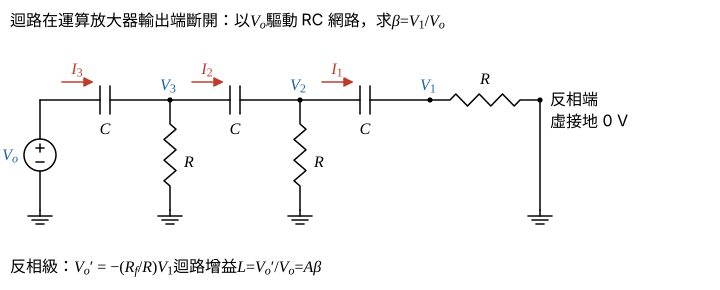

# 104 年電子學（含電力電子）第 5 題｜三階 RC 移相振盪器

## 已知與所求

理想運算放大器；輸出 $V_o\to C\to V_3\ (R\text{ 接地})\to C\to V_2\ (R\text{ 接地})\to C\to V_1\to R\to$ 反相端，$R_f$ 由輸出接回反相端，非反相端接地；題圖電流 $I_3,I_2,I_1$ 依序由左向右流過三顆 $C$。求（一）迴路增益（10 分）；$R=6\text{ k}\Omega$、$f_0=5\text{ kHz}$ 時，（二）$C$（5 分）；（三）$R_f$（5 分）。

## 考場標準作答

**解題邏輯**：前提為理想運算放大器（反相端虛接地、輸入不取電流），且分析小訊號線性振盪條件。在運算放大器輸出端把迴路斷開（圖 1）：迴路增益 = 反相級增益 $A=-R_f/R$ × RC 網路轉移 $\beta=V_1/V_o$。$\beta$ 由網路末端往回推（$I_1\to V_2\to I_2\to V_3\to I_3\to V_o$），每一步只用歐姆定律與 KCL（步驟 1）。之後依 Barkhausen 條件 $A\beta(j\omega_0)=1$：相位條件（$\beta$ 為負實數）定 $\omega_0$ 而求 $C$，幅值條件定 $R_f$。

### 步驟 1：RC 網路轉移函數 $\beta$（由末端往回推）

令 $x=sRC$（$1/(sC)=R/x$）。最後一個 $R$ 接虛接地（0 V），$I_1$ 全部流過它：
\[
I_1R=V_1
\]
第三顆 $C$ 兩端：$V_2=V_1+I_1\cdot\dfrac{R}{x}$：
\[
V_2=V_1+\frac{V_1}{x}=V_1\,\frac{x+1}{x}
\]
節點 $V_2$ 的 KCL（$I_2$ 流入 = 流向 $I_1$ + 流經對地 $R$）：
\[
I_2R=I_1R+V_2=V_1+V_1\frac{x+1}{x}=V_1\,\frac{2x+1}{x}
\]
第二顆 $C$ 兩端：
\[
V_3=V_2+I_2\frac{R}{x}=V_1\left[\frac{x+1}{x}+\frac{2x+1}{x^2}\right]=V_1\,\frac{x^2+3x+1}{x^2}
\]
節點 $V_3$ 的 KCL：
\[
I_3R=I_2R+V_3=V_1\left[\frac{2x+1}{x}+\frac{x^2+3x+1}{x^2}\right]=V_1\,\frac{3x^2+4x+1}{x^2}
\]
第一顆 $C$ 兩端：
\[
V_o=V_3+I_3\frac{R}{x}=V_1\left[\frac{x^2+3x+1}{x^2}+\frac{3x^2+4x+1}{x^3}\right]=V_1\,\frac{x^3+6x^2+5x+1}{x^3}
\]
\[
\beta(s)=\frac{V_1}{V_o}=\frac{x^3}{x^3+6x^2+5x+1},\qquad x=sRC
\]

### （一）迴路增益（10 分）

**邏輯**：反相端虛接地，最後一個 $R$ 同時是反相放大器的輸入電阻，故反相級 $V_o'=-(R_f/R)V_1$；迴路增益是斷開點繞一圈回來的比值 $V_o'/V_o=A\beta$。

\[
A=\frac{V_o'}{V_1}=-\frac{R_f}{R}
\]
\[
L(s)=\frac{V_o'}{V_o}=A\beta=-\frac{R_f}{R}\cdot\frac{x^3}{x^3+6x^2+5x+1}
\]
\[
\boxed{L(s)=-\frac{R_f}{R}\cdot\frac{s^3R^3C^3}{s^3R^3C^3+6s^2R^2C^2+5sRC+1}}
\]

### （二）$C$（5 分）

**邏輯**：Barkhausen 條件要求 $L(j\omega_0)=1$（正實數）；反相級已提供 $-1$，所以 $\beta(j\omega_0)$ 必須是負實數，即 $\beta^{-1}$ 的虛部為零，由此解出 $\omega_0$，再以 $\omega_0=2\pi f_0$ 求 $C$。

令 $s=j\omega$、$a=\omega RC$，則 $x=ja$，$\dfrac1x=-\dfrac{j}{a}$、$\dfrac1{x^2}=-\dfrac1{a^2}$、$\dfrac1{x^3}=\dfrac{j}{a^3}$：
\[
\beta^{-1}=1+\frac6x+\frac5{x^2}+\frac1{x^3}=1-\frac{6j}{a}-\frac{5}{a^2}+\frac{j}{a^3}
\]
\[
\beta^{-1}=\left(1-\frac{5}{a^2}\right)-j\left(\frac6a-\frac1{a^3}\right)
\]
虛部為零：
\[
\frac6a-\frac1{a^3}=0\ \Rightarrow\ a^2=\frac16\ \Rightarrow\ \omega_0RC=\frac{1}{\sqrt6}
\]
\[
\omega_0=\frac{1}{\sqrt6\,RC}\ \Rightarrow\ C=\frac{1}{2\pi\sqrt6\,Rf_0}
\]
代入（$R=6000\ \Omega$、$f_0=5000\text{ Hz}$）：
\[
2\pi\sqrt6=6.2832\times2.4495=15.391
\]
\[
Rf_0=6000\times5000=3\times10^{7}\ \Omega/\mathrm s
\]
\[
2\pi\sqrt6\,Rf_0=15.391\times3\times10^{7}=4.6173\times10^{8}\ \mathrm{F^{-1}}
\]
\[
C=\frac{1}{4.6173\times10^{8}}=2.1658\times10^{-9}\text{ F}
\]
\[
\boxed{C=2.17\text{ nF}}
\]

### （三）$R_f$（5 分）

**邏輯**：在 $\omega_0$ 時 $\beta$ 已是實數，只剩幅值條件 $A\beta=1$，解出 $R_f/R$。

$a^2=1/6$ 代入 $\beta^{-1}$ 的實部：
\[
\frac{5}{a^2}=5\times6=30
\]
\[
\beta^{-1}(j\omega_0)=1-30=-29\ \Rightarrow\ \beta(j\omega_0)=-\frac1{29}
\]
振盪條件：
\[
L(j\omega_0)=A\beta=\left(-\frac{R_f}{R}\right)\left(-\frac1{29}\right)=\frac{R_f}{29R}=1
\]
\[
R_f=29R=29\times6\text{ k}\Omega
\]
\[
\boxed{R_f=174\text{ k}\Omega}
\]
（實務上取 $R_f$ 略大於 $29R$ 以確保起振。）

## 驗算

- 以符號節點分析（三個節點方程聯立）另解 $\beta$，同為 $x^3/(x^3+6x^2+5x+1)$；$\beta(j\omega_0)=-1/29$，$A\beta=+R_f/(29R)$ 為正實數，相位條件成立。
- 數值回代：$\omega_0=\dfrac{1}{\sqrt6\times6000\times2.1658\times10^{-9}}=\dfrac{1}{3.1831\times10^{-5}}=3.1416\times10^{4}\text{ rad/s}$，$f_0=\omega_0/(2\pi)=5.00\text{ kHz}$。

## 失分點

- $\beta$ 的分母係數是 $x^3+6x^2+5x+1$（$x^2$ 係數 6、$x$ 係數 5），對調會使 $\omega_0$ 與增益 29 都錯。
- 迴路增益含反相級的負號：$L=A\beta=-(R_f/R)\beta$；$\beta(j\omega_0)<0$ 才使 $L$ 為正，不是 $L=\beta R_f/R$ 單看大小。
- 最末的 $R$ 接在虛接地，等同第三個對地電阻，不可另把它當作放大器輸入阻抗忽略。
