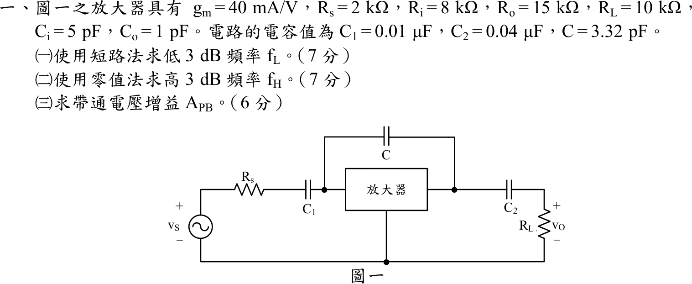
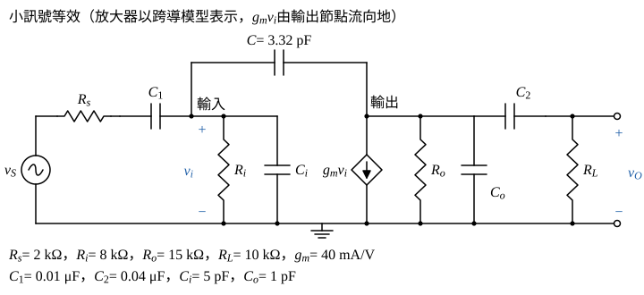
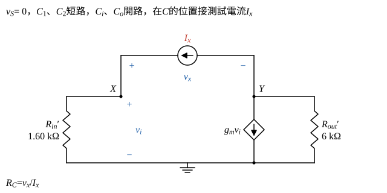

# 105 年電子學（含電力電子）第 1 題｜放大器頻率響應與時間常數

## 已知與所求

$g_m=40\text{ mA/V}$、$R_s=2\text{ k}\Omega$、$R_i=8\text{ k}\Omega$、$R_o=15\text{ k}\Omega$、$R_L=10\text{ k}\Omega$、$C_i=5\text{ pF}$、$C_o=1\text{ pF}$、$C_1=0.01\ \mu\text{F}$、$C_2=0.04\ \mu\text{F}$、$C=3.32\text{ pF}$。依圖：$v_S\to R_s\to C_1\to$ 放大器輸入端，放大器輸出端經 $C_2$ 接 $R_L$（$v_O$），$C$ 跨接放大器輸入與輸出節點。題圖未畫放大器內部，依題給參數採跨導模型（假設）：輸入端 $R_i$、$C_i$ 對地，輸出端受控電流源 $g_mv_i$ 並聯 $R_o$、$C_o$（反相）。

求（一）短路法 $f_L$（7 分）；（二）零值法 $f_H$（7 分）；（三）帶通增益 $A_{PB}$（6 分）。

## 考場標準作答

### 步驟 1：小訊號等效電路

- 輸入節點電壓 $v_i$（對地），受控電流源 $g_mv_i$ 由輸出節點流向地，所以帶通時輸出 $=-g_mv_i\times(\text{輸出端總電阻})$，為反相放大。
- 求某顆電容所見電阻時：$v_S=0$，同頻段的其他耦合電容短路、內部電容開路，再從該電容兩端看進去。

### （一）低 3 dB 頻率 $f_L$（短路法，7 分）

低頻時 $C_i,C_o,C$ 開路，以短路時間常數法 $\omega_L\approx\sum1/(R_kC_k)$ 求解。

$C_1$ 所見電阻（$v_S=0$，$C_2$ 短路）：$C_1$ 一端經 $R_s$ 接地，另一端經 $R_i$ 接地，兩者串聯：
\[
R_{C1}=R_s+R_i=2+8=10\text{ k}\Omega
\]
$C_2$ 所見電阻（$C_1$ 短路）：輸入側無激勵且 $C$ 開路，$v_i=0$，受控源 $g_mv_i=0$ 等同開路，$C_2$ 一端經 $R_o$、另一端經 $R_L$ 接地：
\[
R_{C2}=R_o+R_L=15+10=25\text{ k}\Omega
\]
兩個時間常數：
\[
R_{C1}C_1=(10\times10^{3})(0.01\times10^{-6})=1\times10^{-4}\text{ s}
\]
\[
R_{C2}C_2=(25\times10^{3})(0.04\times10^{-6})=1\times10^{-3}\text{ s}
\]
各自的轉角頻率：
\[
f_{L1}=\frac{1}{2\pi R_{C1}C_1}=\frac{1}{2\pi\times10^{-4}}=\frac{10^{4}}{2\pi}=1591.55\text{ Hz},\qquad
f_{L2}=\frac{1}{2\pi R_{C2}C_2}=\frac{1}{2\pi\times10^{-3}}=\frac{10^{3}}{2\pi}=159.15\text{ Hz}
\]
\[
f_L\approx f_{L1}+f_{L2}=1591.55+159.15
\]
\[
\boxed{f_L\approx1750.70\text{ Hz}\approx 1.75\text{ kHz}}
\]

### （二）高 3 dB 頻率 $f_H$（零值法，7 分）

高頻時 $C_1,C_2$ 短路、$v_S=0$；跨接電容 $C$ 所見電阻含受控源的米勒放大，以測試電流源求出。

輸入、輸出節點對地電阻（$C_1,C_2$ 短路後 $R_s$ 並在輸入、$R_L$ 並在輸出）：
\[
R_{in}'=R_s\parallel R_i=\frac{2\times8}{2+8}=\frac{16}{10}=1.60\text{ k}\Omega
\]
\[
R_{out}'=R_o\parallel R_L=\frac{15\times10}{15+10}=\frac{150}{25}=6\text{ k}\Omega
\]

$C$ 所見電阻 $R_C=v_x/I_x$（圖 2，$v_x=v_X-v_Y$）。$I_x$ 流入 $X$ 後全部經 $R_{in}'$ 到地：
\[
v_i=v_X=I_xR_{in}'
\]
節點 $Y$ 的 KCL（流出為正：$R_{out}'$ 向下、受控源向下、$I_x$ 流入測試源）：
\[
\frac{v_Y}{R_{out}'}+g_mv_i+I_x=0\ \Rightarrow\ v_Y=-R_{out}'\,(I_x+g_mI_xR_{in}')=-I_xR_{out}'(1+g_mR_{in}')
\]
\[
v_x=v_X-v_Y=I_xR_{in}'+I_xR_{out}'(1+g_mR_{in}')
\]
\[
R_C=\frac{v_x}{I_x}=R_{in}'+R_{out}'+g_mR_{in}'R_{out}'
\]
代入：
\[
g_mR_{in}'=(40\times10^{-3})(1.60\times10^{3})=64
\]
\[
g_mR_{in}'R_{out}'=64\times6\text{ k}\Omega=384\text{ k}\Omega
\]
\[
R_C=1.60+6+384=391.60\text{ k}\Omega
\]
三個時間常數：
\[
R_{in}'C_i=(1.60\times10^{3})(5\times10^{-12})=8\text{ ns}
\]
\[
R_{out}'C_o=(6\times10^{3})(1\times10^{-12})=6\text{ ns}
\]
\[
R_CC=(391.60\times10^{3})(3.32\times10^{-12})=1300.112\text{ ns}
\]
\[
\tau_H=\sum R_kC_k=8+6+1300.112=1314.112\text{ ns}
\]
\[
2\pi\tau_H=2\pi\times1314.112\text{ ns}=8256.81\text{ ns}
\]
\[
f_H=\frac{1}{2\pi\tau_H}=\frac{1}{8256.81\times10^{-9}\text{ s}}=121.11\times10^{3}\text{ Hz}
\]
\[
\boxed{f_H\approx 121.11\text{ kHz}}
\]

### （三）帶通電壓增益 $A_{PB}$（6 分）

帶通區耦合電容短路、內部電容開路，只剩電阻與受控源。

輸入分壓：
\[
\frac{v_i}{v_S}=\frac{R_i}{R_s+R_i}=\frac{8}{2+8}=0.80
\]
輸出（$g_mv_i$ 由輸出節點流向地，$v_O=-g_mv_iR_{out}'$）：
\[
\frac{v_O}{v_i}=-g_m(R_o\parallel R_L)=-(40\times10^{-3})(6\times10^{3})=-240
\]
\[
A_{PB}=\frac{v_i}{v_S}\cdot\frac{v_O}{v_i}=0.80\times(-240)
\]
\[
\boxed{A_{PB}=-192\text{ V/V}}
\]

## 驗算

- 高頻側改解 $C_1,C_2$ 短路時的完整節點方程式，得二階轉移函數 $H(s)=\dfrac{-192\,(1-s/s_z)}{1+b_1s+b_2s^2}$；其 $b_1=1.314112\ \mu\text{s}$，與零值時間常數總和 $\tau_H=1314.112\ \mathrm{ns}$ 相同（$b_1$ 理論上即 $\sum R_kC_k$）。分母 $1+b_1s+b_2s^2$（$b_2=2.392\times10^{-16}\ \mathrm{s^2}$）的兩根：主極點 $7.611\times10^5\ \mathrm{rad/s}$，即 $121.13\ \mathrm{kHz}$；第二極點約 $5.49\times10^{9}\ \mathrm{rad/s}$，遠離主極點。零值法的 $121.11\ \mathrm{kHz}$ 是 $1/(2\pi b_1)$，與真正主極點只差 0.02%，故以單極點估算 $f_H$ 合理。
- 低頻側改解兩個高通極點的完整幅頻式 $\dfrac{\omega^4}{(\omega^2+\omega_1^2)(\omega^2+\omega_2^2)}=\dfrac12$（$\omega_1=10^4$、$\omega_2=10^3\text{ rad/s}$），得 $f_{-3\,\mathrm{dB}}\approx1.61\text{ kHz}$；短路法的 $1.75\text{ kHz}$ 是題目指定方法下的估計值，略偏高。

## 失分點

- $C$ 跨接輸入與輸出，必須用 $R_C=R_{in}'+R_{out}'+g_mR_{in}'R_{out}'$；若只加 $C_i$、$C_o$ 的時間常數，$f_H$ 會高估約百倍。
- 低頻短路法求 $C_1$ 的電阻要含 $R_s$（$10\text{ k}\Omega$），而高頻零值法的輸入電阻是 $R_s\parallel R_i=1.60\text{ k}\Omega$，兩者不同。
- $A_{PB}$ 為負號（反相），且須含 $R_i/(R_s+R_i)=0.80$ 的輸入分壓。
