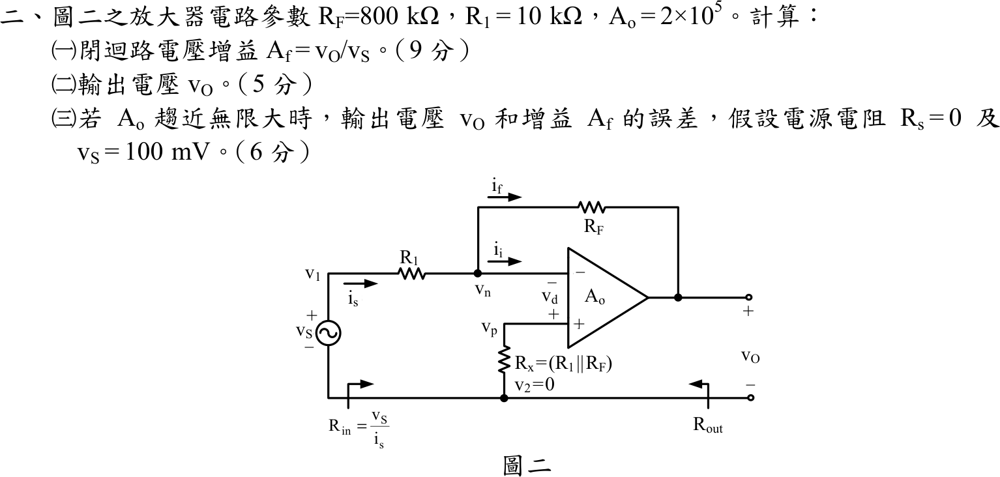

# 105 年電子學（含電力電子）第 2 題｜有限開路增益反相運算放大器

## 已知與所求

$R_F=800\text{ k}\Omega$、$R_1=10\text{ k}\Omega$、$A_o=2\times10^5$；$v_p$ 經 $R_x=R_1\parallel R_F$ 接地（無電流，$v_p=0$），運算放大器 $v_O=A_o(v_p-v_n)=-A_ov_n$。求（一）$A_f=v_O/v_S$（9 分）；（二）$v_S=100\text{ mV}$ 時的 $v_O$（5 分）；（三）$A_o\to\infty$ 時 $v_O$ 與 $A_f$ 的誤差（$R_S=0$，6 分）。

## 考場標準作答

### （一）閉迴路增益

有限增益運算放大器不能假設虛短路：仍以反相端 KCL（運算放大器輸入不取電流）建立方程式，再用 $v_O=-A_ov_n$ 消去 $v_n$。

反相端 KCL：
$$
\frac{v_S-v_n}{R_1}=\frac{v_n-v_O}{R_F},\qquad v_n=-\frac{v_O}{A_o}
$$
代入並整理得：
$$
A_f=\frac{v_O}{v_S}=-\frac{R_F/R_1}{1+\dfrac{1+R_F/R_1}{A_o}}
$$
代入 $R_F/R_1=800/10=80$、$A_o=2\times10^{5}$：
$$
A_f=-\frac{80}{1+\dfrac{81}{2\times10^{5}}}=-\frac{80}{1.000405}
$$
$$
\boxed{A_f\approx-79.97\text{ V/V}}
$$

### （二）輸出電壓

輸出電壓為閉迴路增益乘以輸入（以完整精度的 $A_f=-80/1.000405$ 計算，不用四捨五入後的 $A_f$）：
$$
v_O=A_fv_S=-\frac{80}{1.000405}(0.1)=-\frac{8}{1.000405}
$$
$$
\boxed{v_O\approx-8.00\text{ V}}
$$

### （三）與 $A_o\to\infty$ 比較的誤差

$A_o\to\infty$ 時 $v_n\to0$（虛接地），理想值為 $A_f=-R_F/R_1=-80\text{ V/V}$、$v_O=-8\text{ V}$。誤差用未四捨五入的 $A_f$ 求：
$$
A_f-(-80)=80\left(1-\frac{1}{1.000405}\right)=3.24\times10^{-2}\text{ V/V},\qquad
\Delta v_O=v_S\,[A_f-(-80)]=0.1\times3.24\times10^{-2}
$$
$$
\Delta v_O=\boxed{+3.24\text{ mV}}
$$
增益的相對誤差（輸出電壓的相對誤差相同）：
$$
\varepsilon=\frac{A_f-(-80)}{-80}=\frac{3.24\times10^{-2}}{-80}=-4.05\times10^{-4},\qquad
\boxed{\varepsilon=-4.05\times10^{-2}\%}
$$

## 驗算

反相端電壓 $v_n=-v_O/A_o=+39.98\ \mu\text{V}$，幾乎為虛接地。以兩側電流回代：$\dfrac{v_S-v_n}{R_1}=\dfrac{0.1-0.00003998}{10\text{ k}}=10.00\ \mu\text{A}$，$\dfrac{v_n-v_O}{R_F}=\dfrac{0.00003998+7.99676}{800\text{ k}}=10.00\ \mu\text{A}$（兩式以完整精度計算差小於 $0.01\ \mu\mathrm A$），KCL 成立。

## 失分點

- 誤差須相對 $A_o\to\infty$ 的理想值 $-80$（$-8\text{ V}$）計算；用 $1/A_o$ 近似 $-81/A_o$ 時別漏掉 $1+R_F/R_1=81$。
- $v_O$ 為負，誤差 $\Delta v_O=+3.24\text{ mV}$ 是「比理想值 $-8\text{ V}$ 更正」，符號不可寫反。
