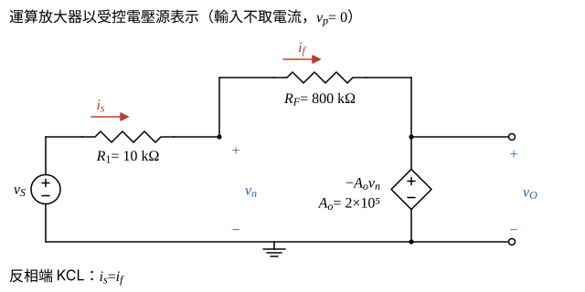

# 105 年電子學（含電力電子）第 2 題｜有限開路增益反相運算放大器

## 已知與所求

$R_F=800\text{ k}\Omega$、$R_1=10\text{ k}\Omega$、$A_o=2\times10^5$；$v_p$ 經 $R_x=R_1\parallel R_F$ 接地（無電流，$v_p=0$），運算放大器 $v_O=A_o(v_p-v_n)=-A_ov_n$。題圖電流 $i_s$（經 $R_1$）、$i_f$（經 $R_F$）皆由左向右，運算放大器輸入電流 $i_i=0$。求（一）$A_f=v_O/v_S$（9 分）；（二）$v_O$（5 分，以（三）給的 $v_S=100\text{ mV}$ 計算）；（三）$A_o\to\infty$ 時 $v_O$ 與 $A_f$ 的誤差（$R_s=0$、$v_S=100\text{ mV}$，6 分）。

## 考場標準作答

### 步驟 1：有限增益等效電路

設運算放大器輸入電阻無限大、輸出電阻為零、開路增益 $A_o$ 有限且工作於線性區；因 $A_o$ 有限，不能假設 $v_n=0$，改以受控電壓源 $-A_ov_n$ 表示（圖 1）。

- $R_x$ 無電流，$v_p=0$；輸出 $v_O=A_o(0-v_n)=-A_ov_n$。
- 運算放大器輸入不取電流，所以流過 $R_1$ 的 $i_s$ 全部流進 $R_F$：$i_s=i_f$。

### （一）閉迴路增益 $A_f$（9 分）

反相端 KCL：
\[
\frac{v_S-v_n}{R_1}=\frac{v_n-v_O}{R_F},\qquad v_n=-\frac{v_O}{A_o}
\]
兩邊乘 $R_F$：
\[
\frac{R_F}{R_1}(v_S-v_n)=v_n-v_O\ \Rightarrow\ \frac{R_F}{R_1}v_S=v_n\left(1+\frac{R_F}{R_1}\right)-v_O
\]
代入 $v_n=-v_O/A_o$：
\[
\frac{R_F}{R_1}v_S=-v_O\left[1+\frac{1+R_F/R_1}{A_o}\right]
\]
\[
A_f=\frac{v_O}{v_S}=-\frac{R_F/R_1}{1+\dfrac{1+R_F/R_1}{A_o}}
\]
代入數值：
\[
\frac{R_F}{R_1}=\frac{800}{10}=80,\qquad 1+\frac{R_F}{R_1}=81
\]
\[
\frac{81}{A_o}=\frac{81}{2\times10^{5}}=4.05\times10^{-4}
\]
\[
A_f=-\frac{80}{1+4.05\times10^{-4}}=-\frac{80}{1.000405}=-79.9676\text{ V/V}
\]
\[
\boxed{A_f\approx-79.97\text{ V/V}}
\]

### （二）輸出電壓 $v_O$（5 分）

保留 $A_f=-79.9676$ 的完整位數（（三）要用與理想值的微小差）：

\[
v_O=A_fv_S=(-79.9676)(0.1\text{ V})=-7.99676\text{ V}
\]
\[
\boxed{v_O\approx-8.00\text{ V}}
\]

### （三）與 $A_o\to\infty$ 比較的誤差（6 分）

$A_o\to\infty$ 時 $81/A_o\to0$、$v_n\to0$（虛接地）。

理想值：
\[
A_{f,\infty}=-\frac{R_F}{R_1}=-80\text{ V/V},\qquad v_{O,\infty}=A_{f,\infty}v_S=-80\times0.1=-8\text{ V}
\]
增益誤差：
\[
\Delta A_f=A_f-A_{f,\infty}=-79.9676-(-80)=0.0324\text{ V/V}
\]
輸出電壓誤差：
\[
\Delta v_O=v_O-v_{O,\infty}=-7.99676-(-8)=0.00324\text{ V}
\]
\[
\boxed{\Delta v_O=+3.24\text{ mV}}
\]
相對誤差（增益與輸出電壓相同）：
\[
\varepsilon=\frac{\Delta A_f}{A_{f,\infty}}=\frac{0.0324}{-80}=-4.05\times10^{-4}
\]
\[
\boxed{\varepsilon=-4.05\times10^{-4}=-0.0405\%}
\]
即有限 $A_o$ 使 $|A_f|$ 比理想值小 $0.0405\%$，$v_O$ 比 $-8\text{ V}$ 高 $3.24\text{ mV}$。

## 驗算

反相端電壓 $v_n=-v_O/A_o=7.99676/(2\times10^{5})=+39.98\ \mu\text{V}$，幾乎為虛接地。以兩側電流回代：$\dfrac{v_S-v_n}{R_1}=\dfrac{100\text{ mV}-0.04\text{ mV}}{10\text{ k}\Omega}=\dfrac{99.96\text{ mV}}{10\text{ k}\Omega}=10.00\ \mu\text{A}$，$\dfrac{v_n-v_O}{R_F}=\dfrac{0.04\text{ mV}+7996.76\text{ mV}}{800\text{ k}\Omega}=\dfrac{7996.80\text{ mV}}{800\text{ k}\Omega}=10.00\ \mu\text{A}$（兩式以完整精度計算差小於 $0.01\ \mu\mathrm A$），$i_s=i_f$ 成立。

## 失分點

- 誤差須相對 $A_o\to\infty$ 的理想值 $-80$（$-8\text{ V}$）計算；用 $1/A_o$ 近似 $-81/A_o$ 時別漏掉 $1+R_F/R_1=81$。
- $v_O$ 為負，誤差 $\Delta v_O=+3.24\text{ mV}$ 是「比理想值 $-8\text{ V}$ 更正」，符號不可寫反。
- 用已四捨五入的 $A_f=-79.97$ 去算誤差，會得 $\Delta v_O=3.00\text{ mV}$，與正確 $3.24\text{ mV}$ 不符。
