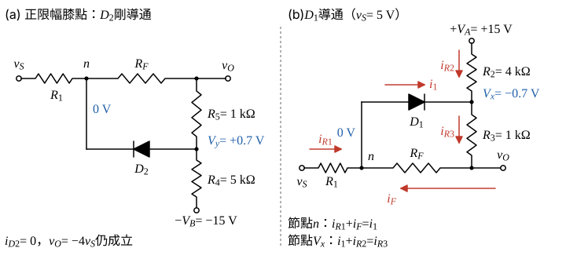
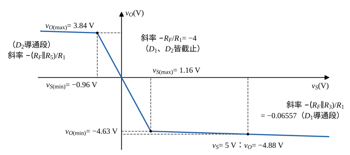

# 105 年電子學（含電力電子）第 3 題｜可調式雙向二極體限幅器

## 已知與所求

$R_1=15\ \mathrm{k}\Omega$、$R_F=60\ \mathrm{k}\Omega$、$R_2=4\ \mathrm{k}\Omega$、$R_3=1\ \mathrm{k}\Omega$、$R_4=5\ \mathrm{k}\Omega$、$R_5=1\ \mathrm{k}\Omega$、$V_A=15\ \mathrm V$、$-V_B=-15\ \mathrm V$、$V_D=0.7\ \mathrm V$，理想運算放大器。依圖：$D_1$ 陽極接反相端 $n$、陰極接 $V_x$（$V_x$ 經 $R_2$ 接 $+V_A$、經 $R_3$ 接 $v_O$）；$D_2$ 陽極接 $V_y$（$V_y$ 經 $R_5$ 接 $v_O$、經 $R_4$ 接 $-V_B$）、陰極接 $n$；$R_F$ 始終跨接 $n$ 與 $v_O$。

求（一）$v_{O(\max)}$ 與 $v_{S(\min)}$（8 分）；（二）$v_{O(\min)}$ 與 $v_{S(\max)}$（6 分）；（三）$v_S=5\ \mathrm V$ 的 $v_O$（6 分）。

## 考場標準作答

### 步驟 1：兩二極體皆截止時的增益與分壓式

設二極體導通時為 $0.7\ \mathrm V$ 定壓降、未達 $0.7\ \mathrm V$ 即開路，$v_O$ 未達運放飽和；理想運放使 $n$ 為虛接地，$R_x=R_1\parallel R_F$ 無電流、無壓降。兩二極體截止時為反相放大器：
\[
v_O=-\frac{R_F}{R_1}v_S=-\frac{60}{15}v_S=-4v_S
\]
$V_x$ 是 $+V_A$ 與 $v_O$ 經 $R_2$、$R_3$ 的分壓點（電流由 $V_A$ 流向 $v_O$，$V_x$ 由 $V_A$ 端起算減去 $R_2$ 的壓降）：
\[
V_x=V_A+(v_O-V_A)\frac{R_2}{R_2+R_3}=15+(v_O-15)\frac{4}{5}
\]
$V_y$ 是 $v_O$ 與 $-V_B$ 經 $R_5$、$R_4$ 的分壓點：
\[
V_y=-V_B+(v_O+V_B)\frac{R_4}{R_4+R_5}=-15+(v_O+15)\frac{5}{6}
\]
$v_O=0$ 時 $V_x=15-12=3\ \mathrm V$、$V_y=-15+12.50=-2.50\ \mathrm V$，兩二極體都逆偏；$D_1$ 要 $0-V_x\ge0.7$，$D_2$ 要 $V_y-0\ge0.7$ 才導通。

### （一）正的箝位電壓 $v_{O(\max)}$ 與 $v_{S(\min)}$（8 分）

$v_S$ 為負時 $v_O=-4v_S$ 往正升，$V_y$ 升到 $+V_D=0.7\ \mathrm V$ 時 $D_2$ 剛導通（$i_{D2}=0$，圖 1(a)）。

膝點條件：
\[
V_y=-15+(v_O+15)\frac{5}{6}=0.7
\]
\[
(v_O+15)\frac{5}{6}=15.70
\]
\[
v_O+15=15.70\times\frac{6}{5}=18.84
\]
\[
\boxed{v_{O(\max)}=18.84-15=+3.84\ \mathrm V}
\]
膝點時 $i_{D2}=0$，$v_O=-4v_S$ 仍成立：
\[
v_{S(\min)}=\frac{v_{O(\max)}}{-4}=\frac{3.84}{-4}
\]
\[
\boxed{v_{S(\min)}=-0.96\ \mathrm V}
\]
越過此膝點後 $D_2$ 導通、$V_y$ 固定為 $+0.7\ \mathrm V$，與（三）同法對 $n$、$V_y$ 寫 KCL，得斜率 $-(R_F\parallel R_5)/R_1=-\tfrac{60/61}{15}=-0.06557$（圖 2 左段；$R_5=R_3=1\ \mathrm{k}\Omega$，故與右段同斜率）。

### （二）負的箝位電壓 $v_{O(\min)}$ 與 $v_{S(\max)}$（6 分）

$v_S$ 為正時 $v_O$ 往負降，$V_x$ 降到 $-V_D=-0.7\ \mathrm V$ 時 $D_1$ 剛導通。

膝點條件：
\[
V_x=15+(v_O-15)\frac{4}{5}=-0.7
\]
\[
(v_O-15)\frac{4}{5}=-15.70
\]
\[
v_O-15=-15.70\times\frac{5}{4}=-19.625
\]
\[
v_O=-19.625+15=-4.625\ \mathrm V,\qquad \boxed{v_{O(\min)}=-4.63\ \mathrm V}
\]
\[
v_{S(\max)}=\frac{v_{O(\min)}}{-4}=\frac{-4.625}{-4}=1.15625\ \mathrm V,\qquad \boxed{v_{S(\max)}=+1.16\ \mathrm V}
\]

### （三）$v_S=5\ \mathrm V$ 時的輸出電壓（6 分）

因 $5\ \mathrm V>v_{S(\max)}=1.16\ \mathrm V$，$D_1$ 導通、$V_x=-0.7\ \mathrm V$（圖 1(b)）；$R_F$ 仍在迴路內，$v_O$ 不是定值，故對 $n$、$V_x$ 兩節點寫 KCL。

參考方向（圖 1(b)）：$i_{R1}$ 由 $v_S$ 經 $R_1$ 流入 $n$；$i_F$ 由 $v_O$ 經 $R_F$ 流入 $n$；$i_1$ 由 $n$ 經 $D_1$ 流入 $V_x$；$i_{R2}$ 由 $+V_A$ 經 $R_2$ 流入 $V_x$；$i_{R3}$ 由 $V_x$ 經 $R_3$ 流向 $v_O$。$n=0\ \mathrm V$、$V_x=-0.7\ \mathrm V$。

節點 $n$：
\[
i_{R1}+i_F=i_1,\qquad i_{R1}=\frac{v_S-0}{R_1}=\frac{v_S}{R_1},\qquad i_F=\frac{v_O-0}{R_F}=\frac{v_O}{R_F}
\]
節點 $V_x$：
\[
i_1+i_{R2}=i_{R3},\qquad i_{R2}=\frac{V_A-V_x}{R_2}=\frac{15+0.7}{4\ \mathrm{k}\Omega}=3.925\ \mathrm{mA},\qquad i_{R3}=\frac{V_x-v_O}{R_3}=\frac{-0.7-v_O}{R_3}
\]
兩式消去 $i_1$：
\[
\frac{v_S}{R_1}+\frac{v_O}{R_F}+\frac{15.70}{R_2}=\frac{-0.7-v_O}{R_3}
\]
兩邊乘以 $60\ \mathrm{k}\Omega$（$60/15=4$、$60/60=1$、$60/4=15$、$60/1=60$）：
\[
4v_S+v_O+15\times15.70=60(-0.7-v_O)
\]
\[
4v_S+v_O+235.5=-42-60v_O
\]
\[
61v_O=-4v_S-235.5-42=-4v_S-277.5
\]
代入 $v_S=5\ \mathrm V$：
\[
61v_O=-20-277.5=-297.5
\]
\[
v_O=\frac{-297.5}{61}=-4.877\ \mathrm V
\]
\[
\boxed{v_O=-4.88\ \mathrm V}
\]

由 $61v_O=-4v_S-277.5$ 可見 $D_1$ 導通段斜率為 $-4/61=-(R_F\parallel R_3)/R_1=-0.06557$，即圖 2 右段；硬箝位的 $-4.63\ \mathrm V$ 只是此段的起點。

## 驗算

- $D_1$ 確實導通：$i_1=i_{R1}+i_F=\dfrac{5}{15}+\dfrac{-4.877}{60}=0.3333-0.08128=0.2520\ \mathrm{mA}>0$；另由 $V_x$ 端 $i_1=i_{R3}-i_{R2}=(-0.7+4.877)-3.925=4.177-3.925=0.252\ \mathrm{mA}$，兩側相同。
- $D_2$ 確實截止：$V_y=-15+(-4.877+15)\times\tfrac56=-15+8.436=-6.564\ \mathrm V<0.7\ \mathrm V$。
- 由膝點沿斜率外推：$-4.625+(-0.06557)(5-1.15625)=-4.625-0.2520=-4.877\ \mathrm V$，與（三）相同；以四種二極體組合逐一求解、取電流與偏壓皆合理者的數值掃描，膝點為 $v_S=-0.96\ \mathrm V$、$+1.16\ \mathrm V$，與（一）（二）相同。

## 失分點

- 把 $-4.63\ \mathrm V$ 當成 $v_S=5\ \mathrm V$ 的輸出：它只是限幅開始的位準；$R_F$ 仍在迴路中，$5\ \mathrm V$ 時輸出為 $-4.88\ \mathrm V$。
- 正向限幅用 $R_4/(R_4+R_5)=5/6$（另一端接 $-V_B$），負向限幅用 $R_2/(R_2+R_3)=4/5$（另一端接 $+V_A$），兩側不可互換。
- 忽略反相關係：$v_{S(\min)}$（負輸入）對應正限幅 $v_{O(\max)}$。

## 條件與疑義

註：若以硬箝位簡化，（三）會寫成 $v_O=v_{O(\min)}=-4.63\ \mathrm V$（見（二））；本解保留 $R_F$ 在迴路中，答 $-4.88\ \mathrm V$。
