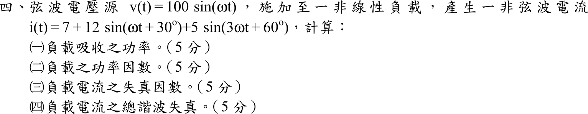

# 105 年電子學（含電力電子）第 4 題｜非線性負載諧波功率與功率因數

## 已知與所求

$v(t)=100\sin\omega t$；$i(t)=7+12\sin(\omega t+30^\circ)+5\sin(3\omega t+60^\circ)$。求（一）吸收功率；（二）功率因數；（三）電流失真因數；（四）電流總諧波失真（各 5 分）。

## 考場標準作答

電壓只有基波，電流含直流、基波與三次諧波；不同頻率的電壓、電流乘積平均為零，故功率只看同頻率分量，而 rms 則是所有分量平方和的平方根。先求各分量 rms：
$$
V_{rms}=\frac{100}{\sqrt2}=70.71\text{ V},\qquad
I_{dc}=7\text{ A},\quad I_1=\frac{12}{\sqrt2}=8.49\text{ A},\quad I_3=\frac{5}{\sqrt2}=3.54\text{ A}
$$
$$
I_{rms}=\sqrt{I_{dc}^2+I_1^2+I_3^2}=\sqrt{7^2+\tfrac{12^2}{2}+\tfrac{5^2}{2}}=\sqrt{49+72+12.50}=\sqrt{133.50}=11.55\text{ A}
$$

### （一）吸收功率

電壓只有基波，故只有基波電流貢獻實功，相角差 $\phi_1=30^\circ-0^\circ=30^\circ$：
$$
P=V_{rms}I_1\cos\phi_1=\frac{100}{\sqrt2}\cdot\frac{12}{\sqrt2}\cdot\frac{\sqrt3}{2}=600\cdot\frac{\sqrt3}{2}
$$
$$
\boxed{P=300\sqrt{3}\approx519.62\text{ W}}
$$

### （二）功率因數

非弦波下功率因數定義為 $PF=P/S$，其中視在功率 $S=V_{rms}I_{rms}$ 含全部諧波：
$$
S=V_{rms}I_{rms}=\frac{100}{\sqrt2}\sqrt{133.50}=817.01\text{ VA}
$$
$$
PF=\frac PS=\frac{519.62}{817.01},\qquad \boxed{PF=6.36\times10^{-1}\ (\text{超前})}
$$
電流基波相位 $+30^\circ$ 超前電壓，故為超前。

### （三）失真因數

失真因數是基波電流占總 rms 電流的比例：
$$
DF=\frac{I_1}{I_{rms}}=\frac{\sqrt{72}}{\sqrt{133.50}}=\sqrt{\frac{72}{133.50}}
$$
$$
\boxed{DF=73.44\%}
$$

### （四）總諧波失真

THD 以基波為基準，分子是所有非基波成分（含直流與三次諧波）的 rms：
$$
I_h=\sqrt{I_{rms}^2-I_1^2}=\sqrt{133.50-72}=\sqrt{61.50}=7.84\text{ A}
$$
$$
THD=\frac{I_h}{I_1}=\sqrt{\frac{61.50}{72}}
$$
$$
\boxed{THD=92.42\%\approx0.92}
$$
依 IEEE-519 不計直流時 $THD=I_3/I_1=5/12=41.67\%$。

## 驗算

$PF=DF\cdot\cos\phi_1=73.44\%\times\dfrac{\sqrt3}{2}=63.60\%$，與 $P/S$ 一致；$THD=\sqrt{1/DF^2-1}=92.42\%$。再以一個週期取樣積分 $\overline{vi}$ 與 FFT 分離基波，得 $P=519.62\text{ W}$、$DF=73.44\%$，同上。

## 失分點

- 直流 $7\text{ A}$ 與三次諧波都計入 $I_{rms}$，但因電壓無直流與三次成分，不貢獻實功；若把 $5\sin(3\omega t+60^\circ)$ 也乘進 $P$ 會多算。
- 峰值需除 $\sqrt2$ 才是 rms；漏除會使 $S$ 與 PF 錯。
- THD 的分母是基波 $I_1$，不是 $I_{rms}$。
