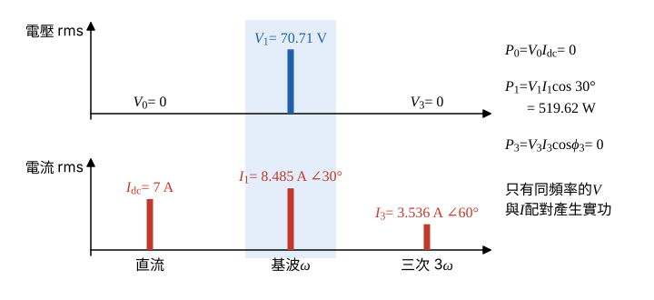

# 105 年電子學（含電力電子）第 4 題｜非線性負載諧波功率與功率因數

## 已知與所求

$v(t)=100\sin\omega t\ \mathrm V$；$i(t)=7+12\sin(\omega t+30^\circ)+5\sin(3\omega t+60^\circ)\ \mathrm A$。求（一）負載吸收功率；（二）功率因數；（三）電流失真因數；（四）電流總諧波失真（各 5 分）。

## 考場標準作答

### 步驟 1：各分量 rms 與總 rms

$v$、$i$ 皆為穩態週期量，正弦分量 rms 為峰值除以 $\sqrt2$。電壓 rms（只有基波）：
\[
V_{\mathrm{rms}}=V_1=\frac{100}{\sqrt2}=70.71\ \mathrm V
\]
電流各分量 rms（直流本身即 rms）：
\[
I_{\mathrm{dc}}=7\ \mathrm A,\qquad I_1=\frac{12}{\sqrt2}=8.485\ \mathrm A,\qquad I_3=\frac{5}{\sqrt2}=3.536\ \mathrm A
\]
總 rms 為各分量平方和開根號，平方項用精確值：
\[
I_{\mathrm{rms}}=\sqrt{I_{\mathrm{dc}}^2+I_1^2+I_3^2}
\]
\[
I_{\mathrm{dc}}^2=7^2=49,\qquad I_1^2=\frac{12^2}{2}=72,\qquad I_3^2=\frac{5^2}{2}=12.50
\]
\[
I_{\mathrm{rms}}=\sqrt{49+72+12.50}=\sqrt{133.50}=11.55\ \mathrm A
\]

### （一）吸收功率（5 分）

不同頻率的電壓、電流乘積一週期平均為零；電壓的直流與三次分量為 0（圖 1），故只有基波配對 $V_1I_1\cos\phi_1$ 產生實功。

各頻率的實功：
\[
P_0=V_0I_{\mathrm{dc}}=0\times7=0,\qquad P_3=V_3I_3\cos\phi_3=0
\]
基波相角差（電流相位減電壓相位）：
\[
\phi_1=30^\circ-0^\circ=30^\circ
\]
\[
P=P_1=V_1I_1\cos\phi_1=\frac{100}{\sqrt2}\cdot\frac{12}{\sqrt2}\cos30^\circ
\]
\[
\frac{100}{\sqrt2}\cdot\frac{12}{\sqrt2}=\frac{1200}{2}=600\ \mathrm{VA}
\]
\[
P=600\times\frac{\sqrt3}{2}=300\sqrt3
\]
\[
\boxed{P=300\sqrt{3}\approx519.62\ \mathrm W}
\]

### （二）功率因數（5 分）

非弦波時 $PF=P/S$，$S=V_{\mathrm{rms}}I_{\mathrm{rms}}$ 須用含全部分量的 $I_{\mathrm{rms}}$：

\[
S=V_{\mathrm{rms}}I_{\mathrm{rms}}=\frac{100}{\sqrt2}\times\sqrt{133.50}=\sqrt{5000\times133.50}=\sqrt{667500}=817.0\ \mathrm{VA}
\]
\[
PF=\frac{P}{S}=\frac{519.62}{817.0}=0.6360
\]
基波電流相位 $+30^\circ$，領先電壓，故為超前：
\[
\boxed{PF\approx0.64\ (\text{超前})}
\]

### （三）電流失真因數（5 分）

失真因數為基波電流 rms 占總電流 rms 之比：

\[
DF=\frac{I_1}{I_{\mathrm{rms}}}=\sqrt{\frac{I_1^2}{I_{\mathrm{rms}}^2}}=\sqrt{\frac{72}{133.50}}
\]
\[
\frac{72}{133.50}=0.5393
\]
\[
DF=\sqrt{0.5393}=0.7344
\]
\[
\boxed{DF=73.44\%}
\]

### （四）電流總諧波失真（5 分）

$THD$ 以基波為分母，分子為基波以外成分（直流 $7\ \mathrm A$ 與三次 $3.536\ \mathrm A$）的 rms。

非基波成分 rms：
\[
I_h=\sqrt{I_{\mathrm{rms}}^2-I_1^2}=\sqrt{I_{\mathrm{dc}}^2+I_3^2}=\sqrt{133.50-72}=\sqrt{61.50}=7.842\ \mathrm A
\]
\[
THD=\frac{I_h}{I_1}=\sqrt{\frac{61.50}{72}}
\]
\[
\frac{61.50}{72}=0.8542
\]
\[
THD=\sqrt{0.8542}=0.9242
\]
\[
\boxed{THD=92.42\%}
\]
若依 IEEE-519 只計交流諧波（不含直流），則 $THD=I_3/I_1=5/12=41.67\%$；本題電流明列直流項，故以含直流的 $92.42\%$ 為答。

## 驗算

- $PF=DF\times\cos\phi_1=0.7344\times0.8660=0.6360$，與 $P/S$ 相同。
- $THD=\sqrt{1/DF^2-1}=\sqrt{1/0.5393-1}=\sqrt{0.8543}=0.9243$，與（四）在第四位內一致。
- 以一個週期取樣數值積分 $\overline{v\,i}$、以 FFT 分出基波，得 $P=519.62\ \mathrm W$、$DF=73.44\%$、$THD=92.42\%$，同上。

## 失分點

- 把直流 $7\ \mathrm A$ 或三次諧波乘進 $P$：電壓沒有這兩個頻率成分，它們只增加 $I_{\mathrm{rms}}$、不貢獻實功。
- 峰值忘了除 $\sqrt2$，使 $S$ 與 $PF$ 錯。
- $THD$ 的分母是基波 $I_1$，不是 $I_{\mathrm{rms}}$。
