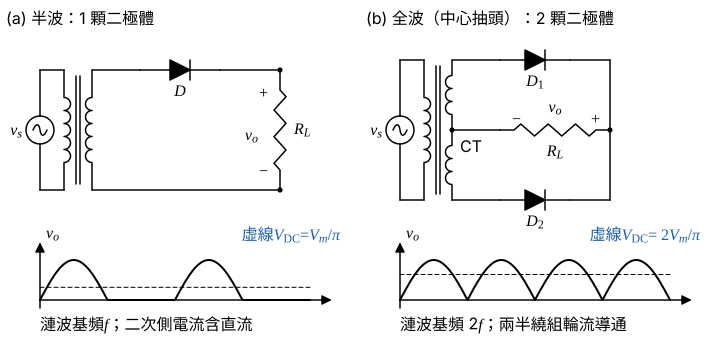
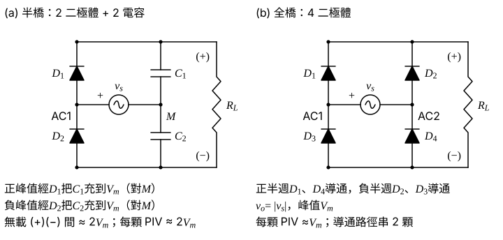
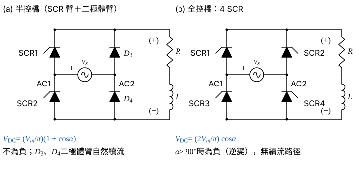

# 105 年電子學第 5 題｜整流器拓撲與波形比較

## 已知與所求

題目要求（一）說明半波與全波整流器之差異並畫電路（10 分）；（二）說明半橋與全橋整流器之差異並畫電路（10 分）。未指定負載與元件，以下採理想二極體、純電阻負載、輸入 $v_s=V_m\sin\omega t$（頻率 $f$）。「半橋」一詞題目未定義，（二）依兩種常見讀法分別作答。

## 考場標準作答

**解題邏輯**：兩小題都是「畫電路＋比較」。比較指標固定用四項：元件數、輸出平均值 $V_{DC}$（由一週期積分求）、漣波基頻、二極體反向峰值電壓（PIV）／導通壓降；前提為理想二極體、純電阻負載、$v_s=V_m\sin\omega t$。（一）半波只取正半週、全波把負半週翻正，故平均值與漣波頻率都加倍。（二）「半橋」題目未定義，依兩種常見讀法各畫一組並比較。

### （一）半波與全波整流器（10 分）

**邏輯**：差異的根源是負半週是否被利用；寫出兩者的 $v_o$ 後，積分求 $V_{DC}$、看週期得漣波頻率。

- 半波（圖 1(a)）：一顆二極體與負載串聯，只有正半週導通，$v_o=V_m\sin\omega t$（正半週）、$0$（負半週）。
- 全波（圖 1(b)）：中心抽頭變壓器兩半繞組各接一顆二極體，正半週 $D_1$、負半週 $D_2$ 導通，電流都由 $(+)$ 經 $R_L$ 流回 CT，$v_o=|V_m\sin\omega t|$；亦可用四顆二極體的橋式（圖 2(b)）。

半波平均值（一週期 $2\pi$ 只有 $0\sim\pi$ 有輸出）：
\[
V_{DC,\text{半波}}=\frac{1}{2\pi}\int_0^\pi V_m\sin\theta\,d\theta=\frac{V_m}{2\pi}\Big[-\cos\theta\Big]_0^\pi=\frac{V_m}{2\pi}\times2=\frac{V_m}{\pi}
\]
全波平均值（週期縮為 $\pi$）：
\[
V_{DC,\text{全波}}=\frac{1}{\pi}\int_0^\pi V_m\sin\theta\,d\theta=\frac{V_m}{\pi}\times2=\frac{2V_m}{\pi}
\]

| 指標 | 半波 | 全波 |
|---|---:|---:|
| 平均值 $V_{DC}$ | $V_m/\pi$ | $2V_m/\pi$ |
| 負載 rms 電壓 | $V_m/2$ | $V_m/\sqrt2$ |
| 漣波基頻 | $f$ | $2f$ |
| 變壓器二次電流 | 單向，含直流分量，易使鐵心偏磁 | 交流對稱，無直流分量 |

\[
\boxed{V_{DC,\text{全波}}=2V_{DC,\text{半波}}=\dfrac{2V_m}{\pi},\ f_{ripple}=2f}
\]
全波的平均輸出為半波的 2 倍，漣波頻率加倍，同樣的濾波電容可得較小的漣波電壓。

### （二）半橋與全橋整流器（10 分）

**邏輯**：全橋用兩個二極體臂；半橋只有一個整流臂，另一臂換成電容（讀法 a）或換成二極體（相控時為半控，讀法 b）。比較時看元件數、輸出大小與極性、PIV／導通壓降。

**讀法 (a)：二極體臂＋電容臂（半橋）對四二極體全橋。**

- 半橋（圖 2(a)）：$D_1$ 陽極接 AC1、陰極接 $(+)$；$D_2$ 陰極接 AC1、陽極接 $(−)$；電容中點 M 接電源另一端。正峰值經 $D_1$ 把 $C_1$ 充到 $V_m$，負峰值經 $D_2$ 把 $C_2$ 充到 $V_m$。
- 全橋（圖 2(b)）：正半週 $D_1$、$D_4$，負半週 $D_2$、$D_3$ 導通，負載電流方向不變，$v_o=|v_s|$。

| 項目 | 半橋（二極體臂＋電容臂） | 全橋 |
|---|---|---|
| 元件 | 2 二極體、2 電容 | 4 二極體 |
| 輸出 | 正、負峰值各把 $C_1,C_2$ 充到 $V_m$，相對 M 為 $\pm V_m$，$(+)$ 與 $(−)$ 間無載約 $2V_m$（倍壓） | 輸出約 $V_m$（扣兩顆二極體壓降）、脈動為 $\lvert v_s\rvert$ |
| 導通壓降 | 1 顆二極體 | 2 顆二極體 |
| 每顆二極體反向峰值 | 約 $2V_m$ | 約 $V_m$ |

\[
\boxed{\text{半橋：2 二極體＋2 電容，輸出 }\pm V_m\text{（倍壓 }2V_m\text{）；全橋：4 二極體，輸出 }V_m}
\]

**讀法 (b)：相控整流的半控橋對全控橋。**

連續電流、理想元件、觸發角 $\alpha$。半控橋在 $v_o$ 欲轉負時由 $D_3$、$D_4$ 續流把 $v_o$ 箝在 0，輸出只有 $\alpha\sim\pi$ 段：
\[
V_{DC,\text{半控}}=\frac{1}{\pi}\int_\alpha^\pi V_m\sin\theta\,d\theta=\frac{V_m}{\pi}\Big[-\cos\theta\Big]_\alpha^\pi=\frac{V_m}{\pi}(1+\cos\alpha)
\]
全控橋無續流路徑，SCR 導通到下一對觸發為止（$\alpha\sim\pi+\alpha$），$v_o$ 可為負：
\[
V_{DC,\text{全控}}=\frac{1}{\pi}\int_\alpha^{\pi+\alpha} V_m\sin\theta\,d\theta=\frac{V_m}{\pi}\big[\cos\alpha-\cos(\pi+\alpha)\big]=\frac{2V_m}{\pi}\cos\alpha
\]

| 項目 | 半控橋（2 SCR＋2 二極體） | 全控橋（4 SCR） |
|---|---|---|
| 平均輸出 | $\dfrac{V_m}{\pi}(1+\cos\alpha)$ | $\dfrac{2V_m}{\pi}\cos\alpha$ |
| 輸出極性 | 不為負，$\alpha\to\pi$ 時趨近 0 | $\alpha>90^\circ$ 可為負（逆變） |
| 續流 | 有自然續流路徑 | 無，需電源側換相 |

\[
\boxed{V_{DC,\text{半控}}=\dfrac{V_m}{\pi}(1+\cos\alpha),\ \ V_{DC,\text{全控}}=\dfrac{2V_m}{\pi}\cos\alpha}
\]

## 驗算

以理想二極體取樣模擬：半波平均 $0.3183V_m$、全波 $0.6366V_m$；半波 rms $0.5V_m$、全波 $0.7071V_m$；FFT 最低漣波分量位於 $f$（半波）與 $2f$（全波）；半波二次電流平均值不為零，橋式為零；電容臂半橋穩態兩電容各充至 $V_m$；半控橋與全控橋的平均值取樣積分與上列兩式一致（如 $\alpha=60^\circ$：$0.4775V_m$ 與 $0.3183V_m$）。

## 失分點

- 全波不是「半波的二極體數量加倍」：重點是負半週也被翻正，所以平均值與漣波頻率都加倍。
- 整流語境的半橋、全橋不是兩開關、四開關的逆變器半橋、H 橋。
- 比較 $V_{DC}$ 前須先確定「半橋」指哪一種讀法與 $V_m$ 的定義；半控橋的輸出平均值含 $(1+\cos\alpha)$，不是 $2\cos\alpha$。

## 條件與疑義

「半橋」在題目中未定義，上列 (a)、(b) 為兩種讀法。第三種讀法：半橋指中心抽頭全波整流（2 顆二極體、二次側分兩半繞組輪流供電，免四顆二極體但需抽頭；每顆二極體反向峰值約 $2V_m$，$V_m$ 為半繞組峰值；導通壓降 1 顆），與全橋（4 顆、免抽頭、PIV 約 $V_m$、壓降 2 顆）比較，兩者理想平均值同為 $2V_m/\pi$（各以自身繞組峰值定義）。
