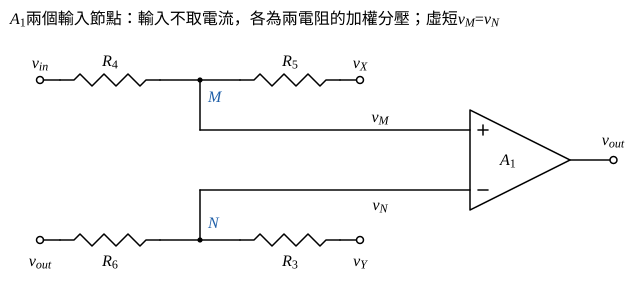

# 106 年電子學第 1 題｜雙積分器狀態變數濾波器

## 已知與所求

三顆運放皆理想。左運放 $A_1$：$+$ 輸入點 $M$ 由 $v_{in}$ 經 $R_4$、由 $X$ 經 $R_5$ 供電；$-$ 輸入點 $N$ 由輸出 $v_{out}$ 經 $R_6$、由 $Y$ 經 $R_3$ 供電；輸出為 $v_{out}$。中運放 $A_2$：$v_{out}$ 經 $R_1$ 入 $-$，$C_1$ 跨接輸出 $X$ 與 $-$，$+$ 接地。右運放 $A_3$：$X$ 經 $R_2$ 入 $-$，$C_2$ 跨接輸出 $Y$ 與 $-$，$+$ 接地。求（一）$v_X/v_{out}$（6 分）、（二）$v_Y/v_{out}$（6 分）、（三）$v_{out}=A\,v_{in}+B\,v_{out}$ 中的 $A$、$B$（8 分）。$A$ 為係數，與運放名稱 $A_1,A_2,A_3$ 無關。

## 考場標準作答

**解題邏輯**：前提為三顆理想運放（輸入不取電流、線性區虛短路）。$A_2$、$A_3$ 的 $+$ 端接地，$-$ 端為虛接地，各是一個 $R$ 輸入、$C$ 回授的反相積分器：在虛接地節點寫 KCL 得（一），再把兩級積分器級聯得（二）。$A_1$ 的兩個輸入節點各是兩電阻的加權分壓（圖 1），令 $v_M=v_N$ 解出 $v_{out}$，$v_{in}$ 項係數即 $A$，其餘 $v_X,v_Y$ 項用（一）（二）換成 $v_{out}$ 的倍數即 $B$。

### （一）$v_X/v_{out}$（6 分）

**邏輯**：$A_2$ 的 $-$ 端為虛接地（0 V），流經 $R_1$ 的電流全部流進 $C_1$（運放不取電流），KCL 只剩兩項。

虛接地節點 KCL（流入 $-$ 端的電流和為 0）：
\[
\frac{v_{out}-0}{R_1}+\frac{v_X-0}{1/(sC_1)}=0
\]
\[
\frac{v_{out}}{R_1}+sC_1v_X=0\ \Rightarrow\ v_X=-\frac{v_{out}}{sR_1C_1}
\]
\[
\boxed{\frac{v_X}{v_{out}}(s) = -\frac{1}{sR_1C_1}}
\]

### （二）$v_Y/v_{out}$（6 分）

**邏輯**：$A_3$ 是同型的反相積分器，輸入為 $v_X$；先得 $v_Y/v_X$，再與（一）相乘（兩級負號相消）。

$A_3$ 虛接地節點 KCL：
\[
\frac{v_X}{R_2}+sC_2v_Y=0\ \Rightarrow\ \frac{v_Y}{v_X}=-\frac{1}{sR_2C_2}
\]
級聯：
\[
\frac{v_Y}{v_{out}}=\frac{v_Y}{v_X}\cdot\frac{v_X}{v_{out}}=\left(-\frac{1}{sR_2C_2}\right)\left(-\frac{1}{sR_1C_1}\right)
\]
\[
\boxed{\frac{v_Y}{v_{out}}(s)=\frac{1}{s^2R_1R_2C_1C_2}}
\]

### （三）$A$、$B$（8 分）

**邏輯**：$A_1$ 輸入不取電流，$M$、$N$ 兩點各由兩個電阻的 KCL 決定電壓；虛短 $v_M=v_N$ 把兩式接起來，解出 $v_{out}$ 後依「$v_{in}$ 項」與「正比於 $v_{out}$ 的項」分組。

節點 $M$ 的 KCL（$v_{in}$ 經 $R_4$、$v_X$ 經 $R_5$ 流入，運放不取電流）：
\[
\frac{v_{in}-v_M}{R_4}+\frac{v_X-v_M}{R_5}=0
\]
兩邊乘 $R_4R_5$：
\[
R_5(v_{in}-v_M)+R_4(v_X-v_M)=0\ \Rightarrow\ v_M=\frac{R_5v_{in}+R_4v_X}{R_4+R_5}
\]
節點 $N$ 同理（$v_{out}$ 經 $R_6$、$v_Y$ 經 $R_3$）：
\[
\frac{v_{out}-v_N}{R_6}+\frac{v_Y-v_N}{R_3}=0\ \Rightarrow\ v_N=\frac{R_3v_{out}+R_6v_Y}{R_3+R_6}
\]
虛短 $v_N=v_M$：
\[
\frac{R_3v_{out}+R_6v_Y}{R_3+R_6}=\frac{R_5v_{in}+R_4v_X}{R_4+R_5}
\]
兩邊乘 $(R_3+R_6)/R_3$，移項解 $v_{out}$：
\[
v_{out}=\frac{R_3+R_6}{R_3}\cdot\frac{R_5v_{in}+R_4v_X}{R_4+R_5}-\frac{R_6}{R_3}v_Y
\]
展開成三項：
\[
v_{out}=\frac{R_5(R_3+R_6)}{R_3(R_4+R_5)}v_{in}+\frac{R_4(R_3+R_6)}{R_3(R_4+R_5)}v_X-\frac{R_6}{R_3}v_Y
\]
$v_{in}$ 項的係數就是 $A$：
\[
\boxed{A=\frac{R_5 (R_3 + R_6)}{R_3 (R_4 + R_5)}}
\]
其餘兩項代入（一）$v_X=-\dfrac{v_{out}}{sR_1C_1}$、（二）$v_Y=\dfrac{v_{out}}{s^2R_1R_2C_1C_2}$：
\[
\frac{R_4(R_3+R_6)}{R_3(R_4+R_5)}v_X=-\frac{R_4(R_3+R_6)}{R_3(R_4+R_5)}\cdot\frac{1}{sR_1C_1}\,v_{out}
\]
\[
-\frac{R_6}{R_3}v_Y=-\frac{R_6}{R_3}\cdot\frac{1}{s^2R_1R_2C_1C_2}\,v_{out}
\]
兩項合併為 $B\,v_{out}$：
\[
\boxed{B=-\frac{R_4(R_3+R_6)}{R_3(R_4+R_5)}\cdot\frac{1}{sR_1C_1}-\frac{R_6}{R_3}\cdot\frac{1}{s^2R_1R_2C_1C_2}}
\]
$B$ 是 $s$ 的函數（回授項）；整理得 $\dfrac{v_{out}}{v_{in}}=\dfrac{A}{1-B}$。

## 驗算

令 $R_1\sim R_6=1\,\mathrm{k\Omega}$、$C_1=C_2=1\,\mu\mathrm F$、$\omega=1000\ \mathrm{rad/s}$（$sRC=j$）：$A=1$、$B=-\dfrac1j-\dfrac{1}{j^2}=1+j$，故 $v_{out}/v_{in}=1/(1-B)=j$。直接檢查：$v_X=-v_{out}/j=jv_{out}$、$v_Y=-v_{out}$，故 $v_N=(v_{out}+v_Y)/2=0$；虛短得 $v_M=(v_{in}+v_X)/2=0$，即 $v_X=-v_{in}$、$v_{out}=jv_{in}$，一致。另外令 $v_X=v_Y=0$ 時 $A_1$ 為非反相放大器，增益 $(1+R_6/R_3)\cdot R_5/(R_4+R_5)=A$。

## 失分點

- $v_Y/v_{out}$ 經兩級反相積分器，符號為正（$+1/(s^2R_1R_2C_1C_2)$），不是負。
- $N$ 點是 $v_{out}$ 經 $R_6$、$v_Y$ 經 $R_3$ 的分壓：$v_{out}$ 的權重是 $R_3/(R_3+R_6)$，$v_Y$ 的權重是 $R_6/(R_3+R_6)$；對調權重會使 $A$ 變成 $R_5(R_3+R_6)/(R_6(R_4+R_5))$。
- $M$ 點 $v_{in}$ 的權重是 $R_5/(R_4+R_5)$（遠端電阻在分子），不是 $R_4/(R_4+R_5)$。
