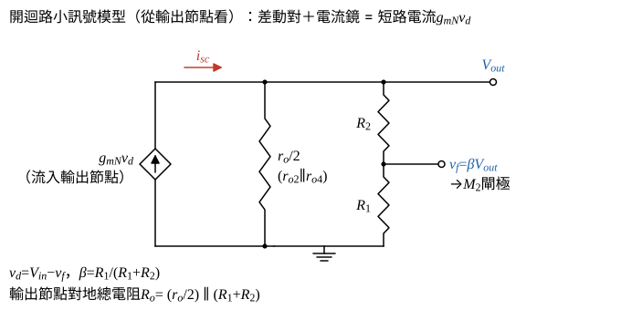

# 106 年電子學第 2 題｜MOSFET 差動放大器負回授

## 已知與所求

$M_1$、$M_2$ 為 NMOS 差動對（尾端理想電流源 $I_{SS}$），$M_3$（閘汲短接）、$M_4$ 為 PMOS 電流鏡負載；$V_{in}$ 加在 $M_1$ 閘極，輸出 $V_{out}$ 取自 $M_2$、$M_4$ 汲極，經 $R_2$、$R_1$ 分壓接到 $M_2$ 閘極。考慮所有 MOSFET 的 $r_o$。題圖無元件數值，答案為符號式；參考書（非官方答案）採對稱模型 $r_{ON}=r_{OP}=r_o$，$g_{mN}=g_{m1}=g_{m2}$，$\beta=R_1/(R_1+R_2)$。求（一）回授的影響（6 分）；（二）閉迴路增益（7 分）；（三）閉迴路輸出阻抗（7 分）。

## 考場標準作答

**解題邏輯**：前提為小訊號線性分析，四顆 MOSFET 都在飽和區（主動區），尾端為理想電流源，電流鏡理想（$g_{mP}r_o\gg1$，$M_4$ 複製 $M_1$ 的小訊號電流），忽略基體效應（$M_1$、$M_2$ 源極接共源節點，$g_{mb}$ 原則上不為零），且採參考書的對稱模型 $r_{ON}=r_{OP}=r_o$。
1. 先判斷回授型態（電壓取樣、串聯混合）與極性（一）。
2. 把放大器化成輸出端的諾頓模型：短路電流 $g_{mN}v_d$、輸出電阻 $\approx r_o/2$。
3. 並計入回授網路在輸出端的負載 $R_1+R_2$ 得開迴路增益 $A$（步驟 1、2）。
4. 最後用 $V_{out}=Av_d$、$v_d=V_{in}-\beta V_{out}$ 解 $A_f$（二）。
5. 以測試電壓源求 $R_{out,f}$（三）。

### （一）回授的影響（6 分）

**邏輯**：看回授網路在輸出端怎麼取樣（並接 → 取樣電壓）、在輸入端怎麼混合（接到 $M_2$ 閘極，與 $V_{in}$ 在差動對中相減 → 串聯），再用「輸出上升時回授把輸出拉回」確認是負回授。

- 取樣：$R_2$、$R_1$ 串聯後並接在輸出端與地之間，取樣的是輸出電壓 $V_{out}$。
- 混合：分壓點 $v_f=\beta V_{out}$（$\beta=R_1/(R_1+R_2)$）接 $M_2$ 閘極，差動對放大的是 $v_d=V_{in}-v_f$，回授訊號與輸入以電壓相減（串聯）。
- 極性：$V_{in}$ 上升 → $M_1$ 電流增加 → 經 $M_3$、$M_4$ 鏡射推高 $V_{out}$，故 $M_1$ 閘極是非反相輸入、$M_2$ 閘極是反相輸入；$V_{out}$ 上升 → $v_f$ 上升 → $M_2$ 電流增加，把輸出拉低，為負回授。

\[
\boxed{\text{串聯-並聯（電壓串聯）負回授}}
\]
影響：閉迴路增益 $A_f=A/(1+A\beta)$，$A\beta\gg1$ 時趨近 $1/\beta=1+R_2/R_1$，對 $g_m,r_o$ 變動不敏感；輸出阻抗降為開迴路的 $1/(1+A\beta)$；頻寬增加、非線性失真降低；串聯混合使輸入阻抗增大，閘極輸入阻抗本就近無限大。

### 步驟 1：差動對＋電流鏡的短路電流與輸出電阻

輸出端交流短路（$V_{out}=0$）時，理想尾電流源使 $M_1$、$M_2$ 小訊號電流大小相等、方向相反，各分到 $v_d$ 的一半：
\[
i_{d1}=g_{mN}\frac{v_d}{2},\qquad i_{d2}=-g_{mN}\frac{v_d}{2}
\]
$M_3$ 吸收 $i_{d1}$，$M_4$ 把它鏡射成流入輸出節點的電流 $i_{d1}$；$M_2$ 的汲極電流 $i_{d2}$ 由輸出節點流出。輸出節點流入的短路電流：
\[
i_{sc}=i_{d1}-i_{d2}=g_{mN}\frac{v_d}{2}+g_{mN}\frac{v_d}{2}=g_{mN}v_d
\]
$v_d=0$（兩閘極交流接地）時由輸出節點看入的電阻：$M_2$ 的源極接在共源節點，尾電流源交流開路，該節點並未交流接地，所以不能把 $r_{o2}$ 直接當成接地電阻。在輸出端加測試電壓 $v_x$，電流分兩路（對稱模型 $r_{o2}=r_{o4}=r_o$）：
- 經 $M_2$ 進入差動對：尾端交流開路，流進 $M_2$ 的電流必須全部由 $M_1$ 流出，路徑上 $r_{o2}$、$r_{o1}$ 串聯（兩管的 $g_{mN}$ 項互相抵消），電流約 $v_x/(2r_o)$；它流過 $M_3$，再由 $M_4$ 鏡射，從輸出節點多抽一份約 $v_x/(2r_o)$，兩者合計約 $v_x/r_o$。
- 經 $r_{o4}$ 直接到交流地（$V_{DD}$）：$v_x/r_o$。

總測試電流約 $2v_x/r_o$（鏡射完整需 $g_{mP}r_o\gg1$）：
\[
\frac{v_x}{i_x}\approx\frac{v_x}{2v_x/r_o}=\frac{r_o}{2}\quad(=r_{o2}\parallel r_{o4})
\]
完整節點解為 $\dfrac{r_o(2g_{mP}r_o+3)}{4(g_{mP}r_o+1)}$，$g_{mP}r_o\gg1$ 時趨近 $r_o/2$；驗算中完整解與本解 $0.84\%$ 的差異即來自這個近似。

### 步驟 2：計入回授網路負載的開迴路增益 $A$

$M_2$ 閘極不取電流，所以回授網路在輸入端不造成負載；在輸出端，分壓器從輸出端到地是一條串聯支路，**輸出端負載為 $R_1+R_2$**，與 $r_o/2$ 並聯：
\[
R_o=\frac{r_o}{2}\parallel(R_1+R_2)=\frac{\dfrac{r_o}{2}(R_1+R_2)}{\dfrac{r_o}{2}+R_1+R_2}
\]
開迴路（$v_d\to V_{out}$）增益：諾頓電流 $i_{sc}$ 全部流過 $R_o$，
\[
V_{out}=i_{sc}R_o=g_{mN}v_dR_o
\]
\[
A=\frac{V_{out}}{v_d}=g_{mN}R_o=g_{mN}\left[\frac{r_o}{2}\parallel(R_1+R_2)\right]
\]

### （二）閉迴路增益（7 分）

**邏輯**：開迴路關係 $V_{out}=Av_d$ 與混合關係 $v_d=V_{in}-\beta V_{out}$ 聯立，消去 $v_d$ 即得 $A_f$。

\[
V_{out}=Av_d=A(V_{in}-\beta V_{out})
\]
\[
V_{out}(1+A\beta)=AV_{in}
\]
\[
\boxed{A_f=\frac{V_{out}}{V_{in}}=\frac{A}{1+A\beta}},\qquad A=g_{mN}\left[\frac{r_o}{2}\parallel(R_1+R_2)\right],\quad \beta=\frac{R_1}{R_1+R_2}
\]
$R_1+R_2\gg r_o/2$ 時 $A\to\tfrac12g_{mN}r_o$，即參考書採用的 $A$；$A\beta\gg1$ 時 $A_f\to1/\beta=1+R_2/R_1$。

### （三）閉迴路輸出阻抗（7 分）

**邏輯**：令 $V_{in}=0$，在輸出端加測試電壓 $v_x$，回授使 $v_d=-\beta v_x$，受控源從輸出節點多抽走 $g_{mN}\beta v_x$；$R_{out,f}=v_x/i_x$。

輸出節點 KCL：測試電流 $i_x$ 加上受控源注入的 $g_{mN}v_d$，等於經 $R_o$ 流到地的電流：
\[
i_x+g_{mN}v_d=\frac{v_x}{R_o}\ \Rightarrow\ i_x=\frac{v_x}{R_o}-g_{mN}v_d,\qquad v_d=0-\beta v_x=-\beta v_x
\]
\[
i_x=\frac{v_x}{R_o}+g_{mN}\beta v_x=\frac{v_x}{R_o}\,(1+g_{mN}R_o\beta)=\frac{v_x}{R_o}\,(1+A\beta)
\]
\[
\boxed{R_{out,f}=\frac{v_x}{i_x}=\frac{R_o}{1+A\beta}=\frac{\dfrac{r_o}{2}\parallel(R_1+R_2)}{1+A\beta}}
\]
分子與參考書的 $(R_1+R_2)\parallel(r_o/2)$ 相同；參考書分母的 $A$ 取 $\tfrac12g_{mN}r_o$（未含負載），$R_{out,f}$ 因此差約 28%，見條件與疑義。

## 驗算

對四顆電晶體做完整小訊號節點解（含 $g_{m3},g_{m4}$、各 $r_o$，尾端理想電流源），代入 $g_{mN}=g_{mP}=1\,\mathrm{mS}$、$r_o=100\,\mathrm{k\Omega}$、$R_1=10\,\mathrm{k\Omega}$、$R_2=90\,\mathrm{k\Omega}$：$A_f=7.68$，上式（含負載的 $A$）給 $7.69$，相差 0.14%；$R_{out,f}$ 精確 $7757\,\Omega$，上式 $7692\,\Omega$（0.84%）。令 $g_{mP}\to\infty$ 兩式嚴格相等。

## 失分點

- 把分壓器負載寫成 $R_1\parallel R_2$；從輸出端看，$R_1$、$R_2$ 是串聯到地，負載是 $R_1+R_2$。
- 以為 $A_f$ 恆等於 $1+R_2/R_1$；只有 $A\beta\gg1$ 才成立，有限 $A$ 時是 $A/(1+A\beta)$。
- 只說「降低輸出阻抗」而不寫 $1/(1+A\beta)$，且忘記要乘上 $r_o/2$ 與 $R_1+R_2$ 的並聯開迴路值。

## 條件與疑義

參考書的開迴路增益 $A=\tfrac12g_{mN}r_o$ 未計入分壓器負載 $R_1+R_2$，但其 $R_{out,f}$ 分子卻含 $(R_1+R_2)\parallel(r_o/2)$，兩處對負載的處理不一致。以上述數值（完整節點解 $A_f=7.68$、$R_{out,f}=7757\,\Omega$）比較：

| 項目 | 完整節點解 | 含負載的 $A$ | 參考書未含負載的 $A=\tfrac12g_{mN}r_o$ |
|---|---|---|---|
| $A_f$ | 7.68 | 7.69 | 8.33（高 8.5%） |
| $R_{out,f}$ | 7757 $\Omega$ | 7692 $\Omega$ | 5556 $\Omega$（低 28%） |

兩者僅在 $R_1+R_2\gg r_o/2$ 時一致。官方題面未給數值，也無標準答案；本解以含負載的 $A$ 為主解，參考書形式視為該極限。
