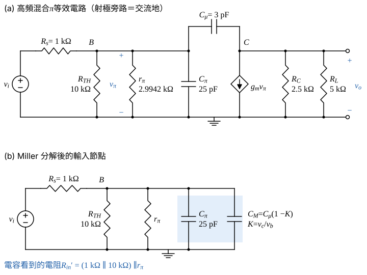

# 106 年電子學第 3 題｜BJT 共射放大器的 Miller 電容與上 3-dB 頻率

## 已知與所求

供電 $\pm5\,\mathrm V$；基極分壓 $20\,\mathrm{k\Omega}$（接 $+5\,\mathrm V$）與 $20\,\mathrm{k\Omega}$（接 $-5\,\mathrm V$）；$R_C=2.5\,\mathrm{k\Omega}$、射極 $R_E=5\,\mathrm{k\Omega}$ 接 $-5\,\mathrm V$ 並以無限大電容旁路；輸入為 $R_s=1\,\mathrm{k\Omega}$ 串耦合電容（無限大）、輸出經耦合電容接 $R_L=5\,\mathrm{k\Omega}$。$\beta=100$、$V_{BE(on)}=0.7\,\mathrm V$、$V_A=\infty$、$C_\pi=25\,\mathrm{pF}$、$C_\mu=3\,\mathrm{pF}$。求（一）$I_{CQ}$（10 分）、（二）Miller 電容（5 分）、（三）上 3-dB 頻率（5 分）。

題目未給，本解採用 $V_T=25\,\mathrm{mV}$（假設）。

## 考場標準作答

### （一）$I_{CQ}$（10 分）

設 BJT 工作於主動區（$I_C=\beta I_B$）；基極分壓網路以戴維寧等效化為單一迴路。

基極戴維寧等效（分壓於 $+5$ 與 $-5\,\mathrm V$ 之間）：
\[
V_{TH}=-5+\bigl(5-(-5)\bigr)\frac{20}{20+20}=-5+10\times0.5=0\ \mathrm V
\]
\[
R_{TH}=20\,\mathrm k\parallel20\,\mathrm k=\frac{20\times20}{20+20}=10\ \mathrm{k\Omega}
\]
基–射迴路 KVL（$V_{TH}\to R_{TH}\to V_{BE}\to R_E\to-5\,\mathrm V$）：
\[
V_{TH}-I_BR_{TH}-V_{BE(on)}-(\beta+1)I_BR_E=-5
\]
\[
I_B=\frac{V_{TH}-V_{BE(on)}-(-5)}{R_{TH}+(\beta+1)R_E}
\]
\[
R_{TH}+(\beta+1)R_E=10\ \mathrm{k\Omega}+101\times5\ \mathrm{k\Omega}=515\ \mathrm{k\Omega}
\]
\[
I_B=\frac{0-0.7+5}{515\ \mathrm{k\Omega}}=\frac{4.3\ \mathrm V}{515\ \mathrm{k\Omega}}=8.3495\ \mu\mathrm A
\]
\[
I_{CQ}=\beta I_B=100\times8.3495\ \mu\mathrm A
\]
\[
\boxed{I_{CQ}=834.95\ \mu\mathrm A}
\]
主動區檢查（$I_E=(\beta+1)I_B$）：
\[
I_E=101\times8.3495\ \mu\mathrm A=843.30\ \mu\mathrm A,\qquad V_E=-5+I_ER_E=-5+843.30\ \mu\mathrm A\times5\ \mathrm{k\Omega}=-5+4.2165=-0.7835\ \mathrm V
\]
\[
V_C=5-I_{CQ}R_C=5-834.95\ \mu\mathrm A\times2.5\ \mathrm{k\Omega}=5-2.0874=2.9126\ \mathrm V
\]
\[
V_{CE}=V_C-V_E=2.9126-(-0.7835)=3.6961\ \mathrm V>V_{CE(sat)}=0.3\ \mathrm V
\]
主動區假設成立。

### 步驟 2：小訊號參數與高頻等效電路

\[
g_m=\frac{I_{CQ}}{V_T}=\frac{834.95\ \mu\mathrm A}{25\ \mathrm{mV}}=33.398\ \mathrm{mS}
\]
\[
r_\pi=\frac{\beta}{g_m}=\frac{100}{33.398\ \mathrm{mS}}=2.9942\ \mathrm{k\Omega}
\]

畫法：$\pm5\,\mathrm V$ 為交流地，兩個 $20\,\mathrm{k\Omega}$ 變成基極對地並聯的 $R_{TH}=10\,\mathrm{k\Omega}$；射極旁路故 $E$ 接地；$R_C$ 與 $R_L$ 在集極對地並聯；$C_\mu$ 跨接 $B$–$C$（圖 1a）。Miller 分解後輸入節點只剩 $R_s$、$R_{TH}$、$r_\pi$、$C_\pi$、$C_M$（圖 1b）。

### （二）Miller 電容（5 分）

$C_\mu$ 兩端電壓為 $v_b-v_c=v_b(1-K)$，故輸入側等效 $C_M=C_\mu(1-K)$；$K$ 取交流負載 $R_L'=R_C\parallel R_L$ 的中頻增益。

交流負載：
\[
R_L'=R_C\parallel R_L=\frac{2.5\times5}{2.5+5}=\frac{12.5}{7.5}=1.6667\ \mathrm{k\Omega}
\]
射極交流接地，圖 1(a) 的基射電壓就是基極電壓：
\[
v_\pi=v_b
\]
集極節點（Miller 近似忽略 $C_\mu$ 前饋電流）：受控電流 $g_mv_\pi$ 由 $C$ 流向地，只能由 $R_L'$ 供給：
\[
v_c=-g_mv_\pi R_L'=-g_mR_L'v_b
\]
基極到集極增益：
\[
K=\frac{v_c}{v_b}=-g_mR_L'=-33.398\ \mathrm{mS}\times1.6667\ \mathrm{k\Omega}=-55.664
\]
\[
C_M=C_\mu(1-K)=3\ \mathrm{pF}\times(1+55.664)=3\ \mathrm{pF}\times56.664
\]
\[
\boxed{C_M=169.99\ \mathrm{pF}}
\]

### （三）上 3-dB 頻率（5 分）

圖 1b 的輸入節點為單一 RC 主導極點：$C_\pi+C_M$ 所見電阻為 $v_i$ 短路後的 $R_s\parallel R_{TH}\parallel r_\pi$。

信號源與偏壓分壓的並聯：
\[
R_s\parallel R_{TH}=\frac{1\times10}{1+10}=\frac{10}{11}\ \mathrm{k\Omega}=909.09\ \Omega
\]
再並 $r_\pi$：
\[
R_{in}'=\frac{0.90909\times2.9942}{0.90909+2.9942}\ \mathrm{k\Omega}=\frac{2.7220}{3.9033}\ \mathrm{k\Omega}=0.69736\ \mathrm{k\Omega}=697.36\ \Omega
\]
總輸入電容：
\[
C_{in}=C_\pi+C_M=25+169.99=194.99\ \mathrm{pF}
\]
時間常數與頻率：
\[
\tau=R_{in}'C_{in}=697.36\ \Omega\times194.99\ \mathrm{pF}=135.98\ \mathrm{ns}
\]
\[
f_H=\frac1{2\pi\tau}=\frac1{2\pi\times135.98\ \mathrm{ns}}=\frac{1}{854.39\ \mathrm{ns}}=1.1704\ \mathrm{MHz}
\]
\[
\boxed{f_H=1.17\ \mathrm{MHz}}
\]
輸出側主導性檢查：輸出 Miller 電容 $C_\mu(1-1/K)=3\times(1+1/55.664)=3.054\ \mathrm{pF}$，輸出極點 $\dfrac1{2\pi R_L'\times3.054\ \mathrm{pF}}=\dfrac1{2\pi\times1666.7\times3.054\times10^{-12}}=31.27\ \mathrm{MHz}\gg f_H$，輸入極點主導。

## 驗算

偏壓：$I_E=(\beta+1)I_B=101\times8.3495=843.30\ \mu\mathrm A$，$V_E=-5+I_ER_E=-5+4.2165=-0.7835\ \mathrm V$，$V_B=V_{TH}-I_BR_{TH}=-0.0835\ \mathrm V$，$V_B-V_E=0.70\ \mathrm V$ 吻合 $V_{BE(on)}$；$V_C=5-I_{CQ}R_C=5-2.0874=2.9126\ \mathrm V$，$V_{CE}=2.9126-(-0.7835)=3.70\ \mathrm V>0.3\ \mathrm V$，主動區成立。高頻：以 $C_\mu$ 跨接基極與集極的完整兩節點方程數值求 $|v_o/v_i|$ 下降 3 dB，得 $1.13\ \mathrm{MHz}$，與 Miller 近似 $1.17\ \mathrm{MHz}$ 差約 3%（Miller 近似忽略 $C_\mu$ 前饋與輸出極點的交互作用）。

## 失分點

- 射極電阻反射到基極要乘 $(\beta+1)=101$，分母是 $R_{TH}+101R_E$，不是 $R_{TH}+\beta R_E$ 或只有 $R_E$。
- Miller 增益用 $R_C\parallel R_L=1.6667\ \mathrm{k\Omega}$（交流負載），不是只用 $R_C$ 或 $R_L$。
- $R_{in}'$ 漏掉基極偏壓分壓 $10\,\mathrm{k\Omega}$ 時，$R_{in}'=749.64\ \Omega$，$f_H$ 偏低為 $1.09\ \mathrm{MHz}$。
