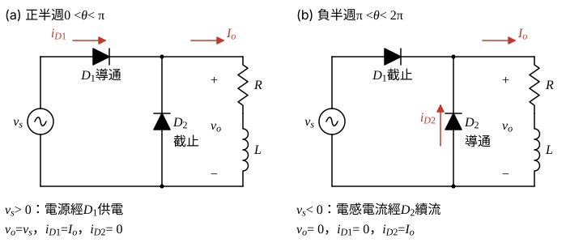

# 106 年電子學第 4 題｜單相半波整流器與續流二極體

## 已知與所求

$v_s=V_P\sin\omega t$，$V_P=340\,\mathrm V$、$\omega=377\,\mathrm{rad/s}$，$D_1$ 串在電源與負載之間，$D_2$ 跨在負載兩端（陰極接 $v_o$ 的 $+$ 端），負載 $R=4\,\Omega$ 串 $L\to\infty$。求（一）$v_o,i_{D1},i_{D2}$ 波形；（二）$i_o$ 平均值；（三）輸入電流 rms；（四）功率因數。

## 考場標準作答

**解題邏輯**：理想二極體；$L\to\infty$ 使負載電流為無漣波的常數 $I_o$，兩顆二極體必有一顆導通。正半週 $D_1$ 導通、負半週 $D_2$ 續流，由此畫出 $v_o$、$i_{D1}$、$i_{D2}$。穩態電感平均電壓為零，$I_o=V_{o,avg}/R$；輸入電流只在正半週等於 $I_o$，其 rms 用定義積分；功率因數用 $P/S$，$P$ 全部消耗在 $R$。

### 步驟 1：兩個半週的等效電路

- **正半週（$0<\theta<\pi$，$\theta=\omega t$）**：$v_s>0$，$D_1$ 順偏導通，$v_o=v_s>0$ 使 $D_2$ 逆偏截止；電源供給 $I_o$。
- **負半週（$\pi<\theta<2\pi$）**：$v_s<0$ 欲使 $v_o$ 變負，但電感電流 $I_o$ 不能中斷，迫使 $D_2$ 導通把 $v_o$ 箝在 0，$D_1$ 承受逆壓截止；電源電流為零。

### （一）$v_o$、$i_{D1}$、$i_{D2}$ 波形（5 分）

**邏輯**：直接寫出步驟 1 兩段的 $v_o$ 與二極體電流，畫在同一時間軸。

\[
v_o=\begin{cases}340\sin\theta,&0<\theta<\pi\\0,&\pi<\theta<2\pi\end{cases},\quad
i_{D1}=\begin{cases}I_o,&0<\theta<\pi\\0,&\pi<\theta<2\pi\end{cases},\quad
i_{D2}=\begin{cases}0,&0<\theta<\pi\\I_o,&\pi<\theta<2\pi\end{cases}
\]
\[
\boxed{D_1:\ 0\sim\pi\ \text{導通},\qquad D_2:\ \pi\sim2\pi\ \text{續流}}
\]

### （二）$i_o$ 平均值（5 分）

**邏輯**：穩態電感一週期平均電壓為零，$v_o$ 的平均值全部落在 $R$ 上，$I_o=V_{o,avg}/R$。

$v_o$ 只在正半週為半個正弦（半波整流輸出），平均值：
\[
V_{o,avg}=\frac1{2\pi}\int_0^\pi V_P\sin\theta\,d\theta=\frac{V_P}{2\pi}\Big[-\cos\theta\Big]_0^\pi=\frac{V_P}{2\pi}\times2=\frac{V_P}{\pi}
\]
\[
V_{o,avg}=\frac{340}{\pi}=108.23\ \mathrm V
\]
\[
\boxed{I_o = \frac{V_{o,avg}}{R}=\frac{340/\pi}{4}=27.06\ \mathrm A}
\]

### （三）輸入電流 rms 值（5 分）

**邏輯**：電源只在 $D_1$ 導通的正半週供電，輸入電流就是 $i_{D1}$（正半週為定值 $I_o$，負半週為 0；$D_2$ 的續流不經電源），依 rms 定義積分。

\[
I_{s,rms}=\sqrt{\frac1{2\pi}\int_0^{2\pi}i_{D1}^2\,d\theta}=\sqrt{\frac1{2\pi}\int_0^\pi I_o^2\,d\theta}
\]
積分得 $\pi I_o^2$，除以 $2\pi$ 後開根號：
\[
I_{s,rms}=\sqrt{\frac{\pi I_o^2}{2\pi}}=\frac{I_o}{\sqrt2}=\frac{27.06}{\sqrt2}
\]
\[
\boxed{I_{s,rms}=19.13\ \mathrm A}
\]

### （四）輸入端功率因數（5 分）

**邏輯**：非弦波下 $PF=P/S$：實功 $P$ 全部消耗在 $R$（電感與理想二極體無損），視在功率 $S$ 為電源 rms 電壓乘輸入電流 rms。為避免捨入誤差，$P$、$S$ 都保留 $V_P/\pi$ 的精確式。

實功率：
\[
P=I_o^2R=\Big(\frac{340}{4\pi}\Big)^2\times4=\frac{340^2}{4\pi^2}=\frac{115600}{4\pi^2}=2928.18\ \mathrm W
\]
電源 rms 電壓：
\[
V_{s,rms}=\frac{V_P}{\sqrt2}=\frac{340}{\sqrt2}=240.42\ \mathrm V
\]
視在功率（$I_{s,rms}=\dfrac{340}{4\pi\sqrt2}$）：
\[
S=V_{s,rms}I_{s,rms}=\frac{340}{\sqrt2}\times\frac{340}{4\pi\sqrt2}=\frac{340^2}{8\pi}=\frac{115600}{8\pi}=4599.58\ \mathrm{VA}
\]
\[
PF=\frac PS=\frac{2928.18}{4599.58}=\frac{115600/(4\pi^2)}{115600/(8\pi)}=\frac{8\pi}{4\pi^2}
\]
\[
\boxed{PF = \frac{2}{\pi}=63.66\%}
\]
電流基本波與電壓同相，PF 偏低完全來自電流波形失真。

## 驗算

以傅立葉基本波檢查：輸入電流為 $0\sim\pi$ 的方波 $I_o$，基本波正弦分量振幅 $2I_o/\pi$、餘弦分量為 0，故基本波與電壓同相（位移因數 1），基本波 rms $=\sqrt2I_o/\pi$。畸變因數 $=\dfrac{\sqrt2I_o/\pi}{I_o/\sqrt2}=\dfrac2\pi$，PF $=1\times2/\pi$，與 $P/S$ 相同。電源實功率 $\frac1{2\pi}\int_0^\pi V_P\sin\theta\,I_o\,d\theta=V_PI_o/\pi=2928.18\ \mathrm W=RI_o^2$。

## 失分點

- 把輸入電流算成負載電流（$I_o$）或含 $D_2$ 續流段；$D_2$ 的電流不經電源，輸入 rms 只有 $I_o/\sqrt2$。
- 套用純電阻半波整流的 $I_{s,rms}=V_P/(2R)=42.50\ \mathrm A$；本題 $L\to\infty$ 使電流為定值 $27.06\ \mathrm A$。
- 把功率因數當成位移因數 $\cos\phi=1$；輸入電流是方波，畸變使 PF $=2/\pi$。
