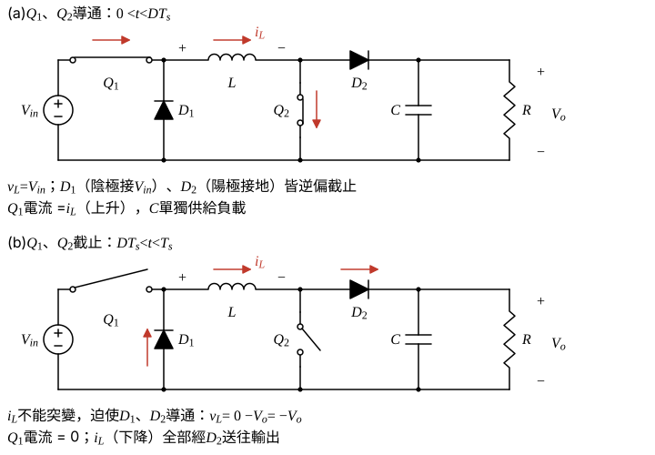
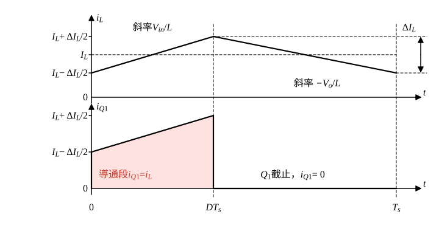

# 106 年電子學第 5 題｜同步開關非反相升降壓轉換器

## 已知與所求

理想元件；$Q_1$ 串於 $V_{in}$ 與 $L$ 之間，$D_1$ 自地接到 $Q_1$–$L$ 節點，$Q_2$ 自 $L$–$D_2$ 節點接地，$D_2$ 接輸出電容 $C$ 與 $R$。$Q_1,Q_2$ 同步 PWM、工作週期 $D$、頻率 $f$，CCM 穩態。題目無數值，答案為符號式。求（一）$V_o/V_{in}$（須推導）；（二）$Q_1$ 電流 rms。

## 考場標準作答

### 步驟 1：兩段等效電路

設理想元件、CCM 穩態，輸出電容夠大使 $V_o$ 視為定值；$Q_1,Q_2$ 同時切換。

- **導通（$0<t<DT_s$）**：$Q_1$ 把 $L$ 左端接到 $V_{in}$，$Q_2$ 把 $L$ 右端接地，$v_L=V_{in}$，$i_L$ 上升；$D_1$ 陰極在 $V_{in}$、$D_2$ 陽極在地，皆逆偏截止，$C$ 單獨供給負載。
- **截止（$DT_s<t<T_s$）**：$i_L$ 不能突變，經 $D_1$（由地流入 $L$ 左端）與 $D_2$（送往輸出）續流；$L$ 左端為 0、右端為 $V_o$，$v_L=-V_o$，$i_L$ 下降。

### （一）電壓比 $V_o/V_{in}$（10 分）

穩態下 $i_L$ 一週期淨變化為零，故電感伏秒平衡：

\[
V_{in}DT_s+(-V_o)(1-D)T_s=0
\]
\[
V_{in}D=V_o(1-D)\ \Longrightarrow\ \frac{V_o}{V_{in}}=\frac{D}{1-D}
\]
\[
\boxed{\frac{V_o}{V_{in}} = \frac{D}{1 - D}}
\]

### 步驟 2：平均電感電流與漣波

輸出電荷平衡：$C$ 平均電流為零，負載電流 $I_o$ 全由 $D_2$ 供給，而 $D_2$ 只在 $(1-D)T_s$ 內送出 $i_L$：
\[
I_o=(1-D)I_L,\qquad I_o=\frac{V_o}{R}
\]
\[
I_L=\frac{I_o}{1-D}=\frac{V_o}{(1-D)R}
\]
電感漣波（導通段 $v_L=V_{in}$、歷時 $DT_s=D/f$）：
\[
\Delta I_L=\frac{V_{in}DT_s}{L}=\frac{V_{in}D}{Lf}
\]

### （二）$Q_1$ 電流 rms 值（10 分）

$Q_1$ 只在 $DT_s$ 內承載 $i_L$（圖 2 陰影），截止段為零。

導通段為三角形電感電流的上升斜坡，以 $I_L$ 為中心、峰峰值 $\Delta I_L$：
\[
i_L(t)=I_L+u(t),\qquad u\ \text{由}\ -\frac{\Delta I_L}{2}\ \text{線性升到}\ +\frac{\Delta I_L}{2}
\]
平方後取平均（$u$ 均勻分布，平均值為零，交叉項 $2I_Lu$ 平均為零）：
\[
\overline{u^2}=\frac{1}{\Delta I_L}\int_{-\Delta I_L/2}^{\Delta I_L/2}u^2\,du=\frac{1}{\Delta I_L}\cdot\frac{2}{3}\Big(\frac{\Delta I_L}{2}\Big)^3=\frac{(\Delta I_L)^2}{12}
\]
即三角波對平均值的均方偏差為峰峰值平方的 $\frac{1}{12}$，故導通段均方值：
\[
\overline{i_L^2}=I_L^2+\frac{(\Delta I_L)^2}{12}
\]
$Q_1$ 只在 $D$ 比例的時間導通，一週期均方值：
\[
I_{Q1,rms}^2=\frac{1}{T_s}\int_0^{DT_s}i_L^2\,dt=D\,\overline{i_L^2}=D\left[I_L^2+\frac{(\Delta I_L)^2}{12}\right]
\]
代入步驟 2 的 $I_L$、$\Delta I_L$，開根號：
\[
\boxed{I_{Q1,rms}=\sqrt{D\left[\left(\frac{V_o}{(1-D)R}\right)^2+\frac{(\Delta I_L)^2}{12}\right]},\quad \Delta I_L=\frac{V_{in}D}{Lf}}
\]
僅在小漣波近似（$\Delta I_L\ll I_L$）下才簡化為 $I_{Q1,rms}\approx I_L\sqrt D=\dfrac{V_o\sqrt D}{(1-D)R}=\dfrac{D^{1.5}V_{in}}{(1-D)^2R}$。

## 驗算

功率守恆：輸入電流只在導通段等於 $i_L$，平均值 $DI_L$；$P_{in}=V_{in}DI_L=V_{in}D\cdot\dfrac{V_{in}D}{(1-D)^2R}=\dfrac{1}{R}\Big(\dfrac{V_{in}D}{1-D}\Big)^2=\dfrac{V_o^2}{R}$，與（一）相容。取假想數值（非題目給定）$V_{in}=12\,\mathrm V$、$D=0.40$、$R=10\,\Omega$、$L=100\,\mu\mathrm H$、$f=25\,\mathrm{kHz}$：$V_o=12\times0.40/0.60=8\,\mathrm V$，$I_L=8/(0.60\times10)=1.333\,\mathrm A$，$\Delta I_L=12\times0.40/(100\times10^{-6}\times25\times10^3)=1.92\,\mathrm A$；$I_L^2=1.778$、$(\Delta I_L)^2/12=0.3072$，$I_{Q1,rms}=\sqrt{0.40\times(1.778+0.3072)}=\sqrt{0.8341}=0.9133\,\mathrm A$，與時域兩段斜坡積分一致（小漣波近似 $1.333\times\sqrt{0.40}=0.8431\,\mathrm A$，偏低）。

## 失分點

- 把此同步雙開關拓撲當成普通 Boost，寫成 $V_o/V_{in}=1/(1-D)$；本圖導通時 $L$ 兩端是 $V_{in}$，關斷時是 $-V_o$，比值為 $D/(1-D)$。
- $I_L=I_o/(1-D)$，漏除 $(1-D)$ 會低估 $Q_1$ 電流。
- rms 要除以整個週期 $T_s$（乘 $D$ 再開根號），並保留 $\Delta I_L^2/12$；未註明小漣波近似就刪掉此項是不完整的。
