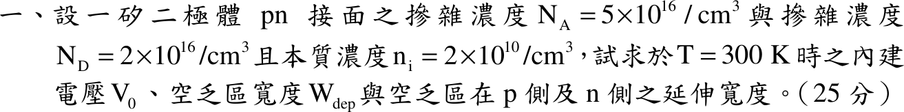

# 107 年電子學第 1 題｜PN 接面內建電壓與空乏區

## 已知與所求

矽 pn 接面（平衡、無外加偏壓）：$N_A=5\times10^{16}\ \mathrm{cm^{-3}}$、$N_D=2\times10^{16}\ \mathrm{cm^{-3}}$、$n_i=2\times10^{10}\ \mathrm{cm^{-3}}$、$T=300\,\mathrm K$。求 $V_0$、$W_{dep}$、$x_p$、$x_n$。

題目未給、本解採用的常數（假設）：$kT/q=25.85\,\mathrm{mV}$（$k=1.381\times10^{-23}$、$q=1.602\times10^{-19}$），$\varepsilon_{Si}=11.7\varepsilon_0=1.036\times10^{-12}\ \mathrm{F/cm}$。

## 考場標準作答

### 內建電壓

平衡時擴散電位與漂移電位抵消，$p$ 側與 $n$ 側的載子濃度比決定內建電壓，用 $V_0=\dfrac{kT}{q}\ln\dfrac{N_AN_D}{n_i^2}$。

先求乘積比：
\[
\frac{N_AN_D}{n_i^2}=\frac{(5\times10^{16})(2\times10^{16})}{(2\times10^{10})^2}=\frac{10^{33}}{4\times10^{20}}=2.50\times10^{12},\qquad \ln(2.50\times10^{12})=28.55
\]
\[
V_0=\frac{kT}{q}\ln\frac{N_AN_D}{n_i^2}=(25.85\times10^{-3})(28.55)
\]
\[
\boxed{V_0=0.74\ \mathrm V}
\]

### 空乏區寬度

空乏區兩側電荷量相等（電荷中性 $N_Ax_p=N_Dx_n$），再由 Poisson 方程式積分使電位降等於 $V_0$，得到總寬度 $W_{dep}=x_p+x_n$。

\[
W_{dep}=\sqrt{\frac{2\varepsilon_{Si}V_0}{q}\left(\frac1{N_A}+\frac1{N_D}\right)}
\]
各因子（$V_0$ 以未四捨五入的完整值代入，顯示為 $0.74\ \mathrm V$）：
\[
\frac{2\varepsilon_{Si}}{q}=\frac{2(1.036\times10^{-12})}{1.602\times10^{-19}}=1.29\times10^{7},\qquad
\frac1{N_A}+\frac1{N_D}=2\times10^{-17}+5\times10^{-17}=7\times10^{-17}
\]
\[
W_{dep}=\sqrt{(1.29\times10^{7})(7\times10^{-17})(0.74)}=\sqrt{6.68\times10^{-10}}=2.58\times10^{-5}\ \mathrm{cm}
\]
換成 nm（$1\ \mathrm{cm}=10^7\ \mathrm{nm}$）：
\[
\boxed{W_{dep}=258.48\ \mathrm{nm}}
\]

### 兩側延伸

由 $N_Ax_p=N_Dx_n$ 與 $x_p+x_n=W_{dep}$ 聯立，各側延伸量與該側摻雜濃度成反比：
\[
x_p=W_{dep}\frac{N_D}{N_A+N_D}=258.48\times\frac27,\qquad
x_n=W_{dep}\frac{N_A}{N_A+N_D}=258.48\times\frac57
\]
\[
\boxed{x_p=73.85\ \mathrm{nm}},\qquad
\boxed{x_n=184.63\ \mathrm{nm}}
\]
空乏區向濃度較低的 n 側延伸較多。

## 驗算

以峰值電場檢查：$E_{max}=qN_Dx_n/\varepsilon_{Si}=(1.602\times10^{-19})(2\times10^{16})(1.85\times10^{-5})/(1.036\times10^{-12})=5.71\times10^{4}\ \mathrm{V/cm}$，與由 p 側算得的 $qN_Ax_p/\varepsilon_{Si}$ 相同；三角形電場面積 $V_0=\tfrac12E_{max}W_{dep}=\tfrac12(5.71\times10^4)(2.58\times10^{-5})=0.74\ \mathrm V$。

## 失分點

- $x_n$ 與 $x_p$ 對調：$x_p=W\,N_D/(N_A+N_D)$（輕摻雜的 n 側 $x_n$ 較大）。
- $W_{dep}$ 公式漏掉 2（寫成 $\varepsilon V_0/q$）會得約 $182.77\ \mathrm{nm}$；濃度以 $\mathrm{cm^{-3}}$、$\varepsilon$ 以 $\mathrm{F/cm}$ 時結果單位是 cm，需換成 nm（$1\ \mathrm{cm}=10^7\ \mathrm{nm}$）。
- $V_0$ 的對數是自然對數 $\ln$，不是 $\log_{10}$。
