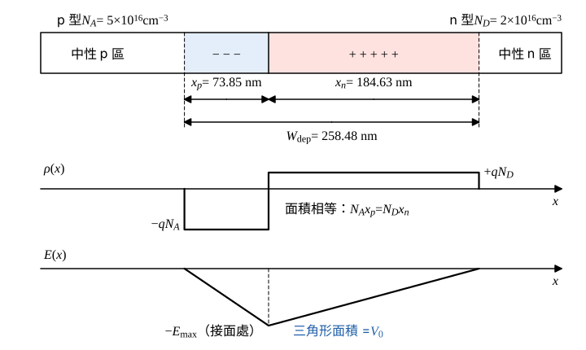

# 107 年電子學第 1 題｜PN 接面內建電壓與空乏區

## 已知與所求

矽 pn 接面（平衡、無外加偏壓）：$N_A=5\times10^{16}\ \mathrm{cm^{-3}}$、$N_D=2\times10^{16}\ \mathrm{cm^{-3}}$、$n_i=2\times10^{10}\ \mathrm{cm^{-3}}$、$T=300\,\mathrm K$。求 $V_0$、$W_{dep}$、$x_p$、$x_n$。

題目未給、本解採用的常數（假設）：$V_T=kT/q=25.85\ \mathrm{mV}$（300 K 常用值），$q=1.602\times10^{-19}\ \mathrm C$，$\varepsilon_{Si}=11.7\varepsilon_0=1.036\times10^{-12}\ \mathrm{F/cm}$。

## 考場標準作答

**解題邏輯**：平衡、無外加偏壓、突變接面且空乏區近似（空乏區內載子全空、外側為中性）。內建電壓由兩側多數載子濃度比決定：$V_0=V_T\ln(N_AN_D/n_i^2)$。空乏區用兩個關係定出：電荷中性 $N_Ax_p=N_Dx_n$，以及 Poisson 方程式積分得電場三角形面積 $=V_0$，合成 $W_{dep}$ 公式；再按濃度反比分配成 $x_p$、$x_n$。$W_{dep}$ 要答到 nm 小數兩位（5 位有效數字），這條計算鏈的中間值保留 5 位有效數字。

### 內建電壓 $V_0$

**邏輯**：平衡時擴散與漂移抵消，p 側與 n 側的電位差由載子濃度比的對數決定。

\[
V_0=V_T\ln\frac{N_AN_D}{n_i^2}
\]
先求濃度比：
\[
\frac{N_AN_D}{n_i^2}=\frac{(5\times10^{16})(2\times10^{16})}{(2\times10^{10})^2}=\frac{10^{33}}{4\times10^{20}}=2.5\times10^{12}
\]
\[
\ln(2.5\times10^{12})=28.547
\]
\[
V_0=0.025850\times28.547=0.73794\ \mathrm V
\]
\[
\boxed{V_0=0.74\ \mathrm V}
\]

### 空乏區寬度 $W_{dep}$

**邏輯**：圖 1 中 $\rho(x)$ 兩塊面積相等（$N_Ax_p=N_Dx_n$）；對 $\rho/\varepsilon$ 積分得三角形電場，其面積 $\tfrac12E_{max}W_{dep}=V_0$，兩式消去 $E_{max}$ 即得下式。

\[
W_{dep}=\sqrt{\frac{2\varepsilon_{Si}V_0}{q}\left(\frac1{N_A}+\frac1{N_D}\right)}
\]
各因子：
\[
\frac{2\varepsilon_{Si}}{q}=\frac{2\times1.036\times10^{-12}}{1.602\times10^{-19}}=1.2934\times10^{7}\ \mathrm{(V\cdot cm)^{-1}}
\]
\[
\frac1{N_A}+\frac1{N_D}=\frac1{5\times10^{16}}+\frac1{2\times10^{16}}=2\times10^{-17}+5\times10^{-17}=7\times10^{-17}\ \mathrm{cm^3}
\]
相乘（$V_0$ 用 $0.73794\ \mathrm V$）：
\[
(1.2934\times10^{7})(7\times10^{-17})=9.0538\times10^{-10}
\]
\[
W_{dep}^2=9.0538\times10^{-10}\times0.73794=6.6812\times10^{-10}\ \mathrm{cm^2}
\]
\[
W_{dep}=\sqrt{6.6812\times10^{-10}}=2.5848\times10^{-5}\ \mathrm{cm}
\]
換成 nm（$1\ \mathrm{cm}=10^7\ \mathrm{nm}$）：
\[
\boxed{W_{dep}=258.48\ \mathrm{nm}}
\]

### p 側與 n 側延伸寬度

**邏輯**：由 $N_Ax_p=N_Dx_n$ 與 $x_p+x_n=W_{dep}$ 聯立，各側延伸量與該側摻雜濃度成反比。

聯立消去 $x_n$：
\[
N_Ax_p=N_D(W_{dep}-x_p)\ \Rightarrow\ x_p=W_{dep}\frac{N_D}{N_A+N_D},\qquad x_n=W_{dep}\frac{N_A}{N_A+N_D}
\]
代入（$N_D/(N_A+N_D)=2/7$，$N_A/(N_A+N_D)=5/7$）：
\[
x_p=258.48\times\frac27=\frac{516.96}{7}=73.851\ \mathrm{nm}
\]
\[
x_n=258.48\times\frac57=\frac{1292.4}{7}=184.63\ \mathrm{nm}
\]
\[
\boxed{x_p=73.85\ \mathrm{nm}},\qquad
\boxed{x_n=184.63\ \mathrm{nm}}
\]
空乏區向濃度較低的 n 側延伸較多。

## 驗算

以峰值電場檢查：n 側 $E_{max}=\dfrac{qN_Dx_n}{\varepsilon_{Si}}=\dfrac{(1.602\times10^{-19})(2\times10^{16})(1.8463\times10^{-5})}{1.036\times10^{-12}}=5.7100\times10^{4}\ \mathrm{V/cm}$；p 側 $\dfrac{qN_Ax_p}{\varepsilon_{Si}}=\dfrac{(1.602\times10^{-19})(5\times10^{16})(7.3851\times10^{-6})}{1.036\times10^{-12}}=5.7099\times10^{4}\ \mathrm{V/cm}$，兩側相同（末位差來自捨入）。三角形電場面積 $\tfrac12E_{max}W_{dep}=\tfrac12\times5.7100\times10^4\times2.5848\times10^{-5}=0.7380\ \mathrm V$，與 $V_0=0.73794\ \mathrm V$ 相符。

## 失分點

- $x_n$ 與 $x_p$ 對調：$x_p=W\,N_D/(N_A+N_D)$（輕摻雜的 n 側 $x_n$ 較大）。
- $W_{dep}$ 公式漏掉 2（寫成 $\varepsilon V_0/q$）會得約 $182.77\ \mathrm{nm}$；濃度以 $\mathrm{cm^{-3}}$、$\varepsilon$ 以 $\mathrm{F/cm}$ 時結果單位是 cm，需換成 nm（$1\ \mathrm{cm}=10^7\ \mathrm{nm}$）。
- $V_0$ 的對數是自然對數 $\ln$，不是 $\log_{10}$。
