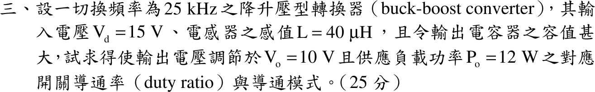

# 107 年電子學第 3 題｜降升壓型轉換器

## 已知與所求

降升壓轉換器（buck-boost），$f_s=25\ \mathrm{kHz}$、$V_d=15\ \mathrm V$、$L=40\ \mu\mathrm H$，輸出電容極大，$V_o=10\ \mathrm V$、$P_o=12\ \mathrm W$。求開關導通率 $D$ 與導通模式。

## 考場標準作答

### 判別導通模式

先假設 CCM 求 $D$，再用邊界電感 $L_B$ 與實際 $L$ 比較：$L<L_B$ 表示電感電流會降到零（DCM），此時 CCM 增益式不再適用。

負載等效電阻：
\[
R=\frac{V_o^2}{P_o}=\frac{10^2}{12}=8.33\ \Omega
\]
CCM 假設下的導通率（volt-second 平衡 $V_dD=V_o(1-D)$）：
\[
D_{\rm CCM}=\frac{V_o}{V_d+V_o}=\frac{10}{15+10}=0.40,\qquad 1-D_{\rm CCM}=0.60
\]
邊界電感：
\[
L_B=\frac{(1-D_{\rm CCM})^2R}{2f_s}=\frac{(0.60)^2(8.33)}{2(25\times10^{3})}=\frac{3.00}{5\times10^{4}}=60\ \mu\mathrm H
\]
實際 $L=40\ \mu\mathrm H<L_B=60\ \mu\mathrm H$，電感電流在每週期內降到零，故為不連續導通模式：$\boxed{\mathrm{DCM}}$，不能使用 CCM 的 $D=0.40$。

### DCM 導通率

DCM 每週期電感由 0 充到 $I_{\rm pk}$ 再放回 0，每週期傳遞能量 $\tfrac12LI_{\rm pk}^2$，無損失時等於輸出能量 $P_o/f_s$，故以功率平衡求 $D$。

導通期間電感跨壓為 $V_d$，峰值電流與輸出功率：
\[
I_{\rm pk}=\frac{V_dD}{Lf_s},\qquad P_o=\frac{1}{2}LI_{\rm pk}^2f_s=\frac{V_d^2D^2}{2Lf_s}
\]
解 $D$：
\[
D=\sqrt{\frac{2Lf_sP_o}{V_d^2}}=\sqrt{\frac{2(40\times10^{-6})(25\times10^{3})(12)}{15^2}}=\sqrt{\frac{24}{225}}
\]
\[
\boxed{D=\frac{2\sqrt6}{15}=32.66\%}
\]
放能期間佔比由 $V_dD=V_oD_2$（電感伏秒平衡）求得：
\[
D_2=\frac{V_dD}{V_o}=\frac{15(3.27\times10^{-1})}{10}=48.99\%,\qquad D+D_2=81.65\%<100\%
\]
與 DCM 假設一致。

## 驗算

改用電荷平衡：峰值電流
\[
I_{\rm pk}=\frac{V_dD}{Lf_s}=\frac{15(3.27\times10^{-1})}{(40\times10^{-6})(25\times10^{3})}=\frac{4.90}{1.00}=4.90\ \mathrm A
\]
放能期間電感電流自 $I_{\rm pk}$ 線性降到 0，輸出平均電流
\[
I_o=\frac{I_{\rm pk}D_2}{2}=\frac{4.90(4.90\times10^{-1})}{2}=1.20\ \mathrm A
\]
$V_oI_o=10(1.20)=12\ \mathrm W=P_o$，且 $V_o/R=10/8.33=1.20\ \mathrm A$，兩者一致。

## 失分點

- 只解 CCM 增益 \(V_o/V_d=D/(1-D)\) 就答 \(D=0.40\)，未先比較 \(L\) 與 \(L_B\)；以 0.40 代入 DCM 功率式會得 18 W 而非 12 W。
- 導通時電感跨壓是 \(V_d=15\ \mathrm V\)，不是 \(V_o\)。
- \(25\ \mathrm{kHz}\)、\(40\ \mu\mathrm H\) 的單位換算（\(10^3\)、\(10^{-6}\)）漏算。
