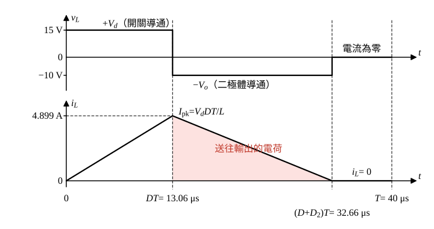

# 107 年電子學第 3 題｜降升壓型轉換器

## 已知與所求

降升壓轉換器（buck-boost），$f_s=25\ \mathrm{kHz}$、$V_d=15\ \mathrm V$、$L=40\ \mu\mathrm H$，輸出電容極大，$V_o=10\ \mathrm V$、$P_o=12\ \mathrm W$。求開關導通率 $D$ 與導通模式。

## 考場標準作答

### 步驟 1：負載電阻與 CCM 候選導通率

\[
R=\frac{V_o^2}{P_o}=\frac{10^2}{12}=\frac{25}{3}=8.333\ \Omega
\]
設理想元件，輸出電容極大，$V_o=10\ \mathrm V$ 視為定值；導通模式未知，先假設 CCM。CCM 伏秒平衡 $V_dD=V_o(1-D)$：
\[
D_{\rm CCM}=\frac{V_o}{V_d+V_o}=\frac{10}{15+10}=0.40,\qquad 1-D_{\rm CCM}=0.60
\]

### 判別導通模式

CCM 與 DCM 的分界為電感電流谷值剛好為零。

CCM 下平均電感電流與漣波（截止段 $v_L=-V_o$、歷時 $(1-D)T$）：
\[
I_L=\frac{I_o}{1-D}=\frac{V_o}{(1-D)R},\qquad \Delta I_L=\frac{V_o(1-D)}{Lf_s}
\]
令 $\Delta I_L=2I_L$ 解出邊界電感：
\[
\frac{V_o(1-D)}{L_Bf_s}=\frac{2V_o}{(1-D)R}\ \Rightarrow\ L_B=\frac{(1-D)^2R}{2f_s}
\]
代入 $D_{\rm CCM}=0.40$：
\[
L_B=\frac{(0.60)^2\times\frac{25}{3}}{2\times25\times10^{3}}=\frac{0.36\times\frac{25}{3}}{5\times10^{4}}=\frac{3}{5\times10^{4}}=60\ \mu\mathrm H
\]
實際 $L=40\ \mu\mathrm H<L_B=60\ \mu\mathrm H$，電感電流在每週期內降到零，為不連續導通模式：
\[
\boxed{\mathrm{DCM}}
\]
故不能使用 CCM 的 $D=0.40$。

### DCM 導通率

DCM 每週期電感電流由 0 起升，導通末儲能 $\tfrac12LI_{\rm pk}^2$ 在放能段全部送到輸出（圖 1），無損失時每週期能量乘 $f_s$ 等於 $P_o$。

導通段 $v_L=V_d$、歷時 $DT=D/f_s$，峰值電流：
\[
I_{\rm pk}=\frac{V_dDT}{L}=\frac{V_dD}{Lf_s}
\]
功率平衡：
\[
P_o=\frac12LI_{\rm pk}^2f_s=\frac12L\Big(\frac{V_dD}{Lf_s}\Big)^2f_s=\frac{V_d^2D^2}{2Lf_s}
\]
解 $D$：
\[
D=\sqrt{\frac{2Lf_sP_o}{V_d^2}}
\]
代入（$Lf_s=40\times10^{-6}\times25\times10^{3}=1$）：
\[
2Lf_sP_o=2\times1\times12=24,\qquad V_d^2=15^2=225
\]
\[
D=\sqrt{\frac{24}{225}}=\frac{\sqrt{24}}{15}=\frac{2\sqrt6}{15}=0.3266
\]
\[
\boxed{D=\frac{2\sqrt6}{15}=32.66\%}
\]
放能段佔比 $D_2$ 由電感伏秒平衡 $V_dD=V_oD_2$ 求得：
\[
D_2=\frac{V_dD}{V_o}=\frac{15\times0.3266}{10}=\frac{4.899}{10}=0.4899=48.99\%
\]
\[
D+D_2=0.3266+0.4899=0.8165,\qquad D+D_2=81.65\%<100\%
\]
放能在週期結束前完成，與 DCM 假設一致。

## 驗算

改用電荷平衡：峰值電流
\[
I_{\rm pk}=\frac{V_dD}{Lf_s}=\frac{15\times0.3266}{40\times10^{-6}\times25\times10^{3}}=\frac{4.899}{1}=4.899\ \mathrm A
\]
放能段電感電流自 $I_{\rm pk}$ 線性降到 0，全數流向輸出，輸出平均電流（圖 1 陰影面積 ÷ $T$）：
\[
I_o=\frac{I_{\rm pk}D_2}{2}=\frac{4.899\times0.4899}{2}=\frac{2.400}{2}=1.200\ \mathrm A
\]
$V_oI_o=10\times1.200=12.00\ \mathrm W=P_o$，且 $V_o/R=10\div\frac{25}{3}=1.200\ \mathrm A$，兩者一致。

## 失分點

- 只解 CCM 增益 \(V_o/V_d=D/(1-D)\) 就答 \(D=0.40\)，未先比較 \(L\) 與 \(L_B\)；以 0.40 代入 DCM 功率式會得 18 W 而非 12 W。
- 導通時電感跨壓是 \(V_d=15\ \mathrm V\)，不是 \(V_o\)。
- \(25\ \mathrm{kHz}\)、\(40\ \mu\mathrm H\) 的單位換算（\(10^3\)、\(10^{-6}\)）漏算。
