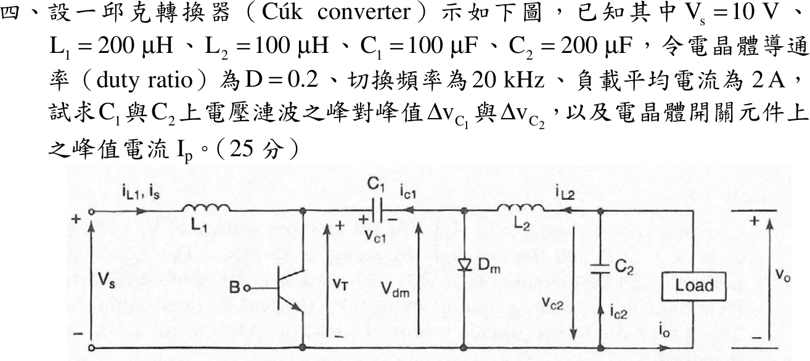

# 107 年電子學第 4 題｜Ćuk 轉換器

## 已知與所求

Ćuk 轉換器：$V_s=10\ \mathrm V$、$L_1=200\ \mu\mathrm H$、$L_2=100\ \mu\mathrm H$、$C_1=100\ \mu\mathrm F$、$C_2=200\ \mu\mathrm F$，$D=0.2$、$f_s=20\ \mathrm{kHz}$、負載平均電流 $I_o=2\ \mathrm A$。求 $\Delta v_{C1}$、$\Delta v_{C2}$（峰對峰）與電晶體峰值電流 $I_p$。

## 考場標準作答

Ćuk 轉換器穩態時 $L_1,L_2$ 的伏秒平衡與 $C_1$ 的安秒（電荷）平衡成立，故先用無損失功率平衡求電感平均電流，再以各開關狀態下的電容電荷、電感斜率求漣波。

$T=1/f_s=50\ \mu\mathrm s$。穩態 $V_o=V_sD/(1-D)=10(0.2)/0.80=2.50\ \mathrm V$，$I_{L2}=I_o=2\ \mathrm A$；無損失 $V_sI_{L1}=V_oI_o$：
\[
I_{L1}=\frac{V_oI_o}{V_s}=\frac{2.50(2)}{10}=0.50\ \mathrm A
\]
$V_{C1}=V_s+V_o=12.50\ \mathrm V$。導通期間 $L_1$ 跨壓 $V_s=10\ \mathrm V$，$L_2$ 跨壓 $V_{C1}-V_o=10\ \mathrm V$。

### $\Delta v_{C1}$

電晶體導通（$DT$）時 $C_1$ 以 $I_{L2}$ 放電，$\Delta v_{C1}=\Delta Q/C_1$：
\[
\Delta v_{C1}=\frac{I_{L2}DT}{C_1}=\frac{2(0.2)(50\ \mu\mathrm s)}{100\ \mu\mathrm F}=\frac{20\ \mu\mathrm C}{100\ \mu\mathrm F}\Rightarrow\boxed{\Delta v_{C1}=0.20\text{ V}}
\]

### $\Delta v_{C2}$

負載電流為直流，$C_2$ 吸收 $L_2$ 電流的三角漣波（峰對峰 $\Delta i_{L2}$ 的三角波，電荷面積為 $\Delta i_{L2}T/8$）。先求 $\Delta i_{L2}$：
\[
\Delta i_{L2}=\frac{V_{L2}DT}{L_2}=\frac{10(0.2)(50\ \mu\mathrm s)}{100\ \mu\mathrm H}=1\ \mathrm A
\]
\[
\Delta v_{C2}=\frac{\Delta i_{L2}}{8f_sC_2}=\frac{1}{8(20\,000)(200\ \mu\mathrm F)}=\frac{1\ \mathrm A}{32\ \mathrm S}\Rightarrow\boxed{\Delta v_{C2}=31.25\text{ mV}}
\]

### 峰值電流 $I_p$

電晶體導通時同時承載兩個電感電流，峰值出現在導通期末，各為平均值加半個漣波。先求 $\Delta i_{L1}$：
\[
\Delta i_{L1}=\frac{V_sDT}{L_1}=\frac{10(0.2)(50\ \mu\mathrm s)}{200\ \mu\mathrm H}=0.50\ \mathrm A
\]
\[
I_{L1}+\frac{\Delta i_{L1}}2=0.50+0.25=0.75\ \mathrm A,\qquad I_{L2}+\frac{\Delta i_{L2}}2=2+0.50=2.50\ \mathrm A
\]
\[
\boxed{I_p=0.75+2.50=3.25\text{ A}}
\]

## 驗算

以關斷期間（$(1-D)T$）檢查 $C_1$：此時 $C_1$ 由 $I_{L1}$ 充電，$\Delta v_{C1}=I_{L1}(1-D)T/C_1=0.50(0.80)(50\ \mu\mathrm s)/100\ \mu\mathrm F=0.20\ \mathrm V$，與導通期間放電量相同。$\Delta i_{L2}$ 亦可由關斷期間 $L_2$ 跨壓 $V_o$ 檢查：$V_o(1-D)T/L_2=2.50(0.80)(50\ \mu\mathrm s)/100\ \mu\mathrm H=1\ \mathrm A$。

## 失分點

- $C_1$ 在導通期間放電電流是 $I_{L2}$（$2\ \mathrm A$），不是 $I_{L1}$；關斷期間才是 $I_{L1}=0.50\ \mathrm A$、時間 $(1-D)T$。
- $\Delta v_{C2}$ 是三角波電荷面積，分母為 $8f_sC_2$，不是 $f_sC_2$。
- $I_p$ 需把兩電感的平均值與半個漣波相加，只加平均值會得 $2.50\ \mathrm A$。
