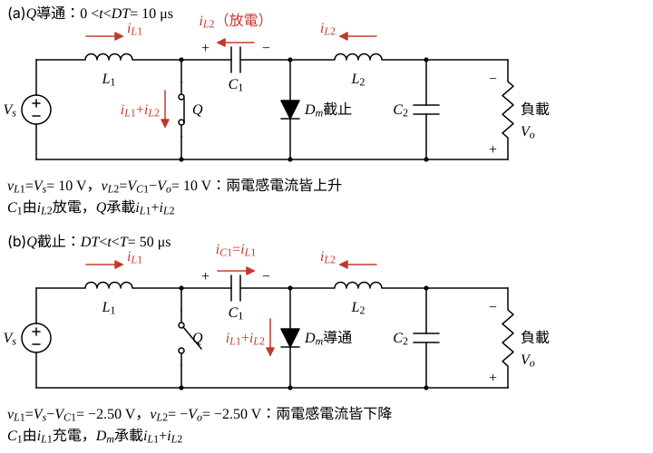
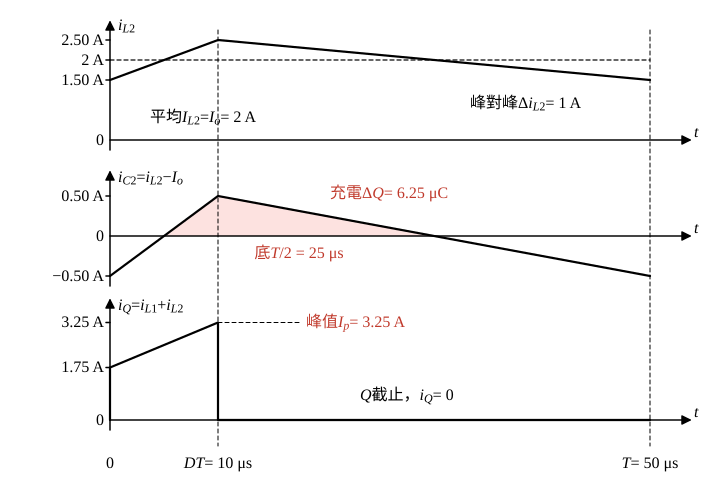

# 107 年電子學第 4 題｜Ćuk 轉換器

## 已知與所求

Ćuk 轉換器：$V_s=10\ \mathrm V$、$L_1=200\ \mu\mathrm H$、$L_2=100\ \mu\mathrm H$、$C_1=100\ \mu\mathrm F$、$C_2=200\ \mu\mathrm F$，$D=0.2$、$f_s=20\ \mathrm{kHz}$、負載平均電流 $I_o=2\ \mathrm A$。求 $\Delta v_{C1}$、$\Delta v_{C2}$（峰對峰）與電晶體峰值電流 $I_p$。Ćuk 輸出為反相，以下 $V_o$ 一律取大小。

## 考場標準作答

**解題邏輯**：理想元件、CCM 穩態，且電容漣波遠小於其平均電壓（各電容電壓視為定值來算電感斜率）。先畫電晶體導通、截止兩段的等效電路，由 $L_1$、$L_2$ 伏秒平衡求 $V_{C1}$、$V_o$，由 $C_1$ 電荷平衡求 $I_{L1}$（$C_2$ 平均電流為零，故 $I_{L2}=I_o$）。之後 $\Delta v_{C1}$ 用導通段 $C_1$ 的放電電荷；$\Delta v_{C2}$ 用 $i_{L2}$ 三角漣波在 $C_2$ 的充電面積；$I_p$ 為導通期末兩電感電流峰值之和。

### 步驟 1：兩段等效電路與週期

\[
T=\frac{1}{f_s}=\frac{1}{20\times10^{3}}=50\ \mu\mathrm s,\qquad DT=0.2\times50=10\ \mu\mathrm s,\qquad (1-D)T=40\ \mu\mathrm s
\]

- **導通（$0<t<DT$）**：$Q$ 把 $C_1$ 左端接地，$C_1$ 右端為 $-V_{C1}$，$D_m$ 逆偏截止。$v_{L1}=V_s$；$v_{L2}=V_{C1}-V_o$；$i_{L2}$ 經 $C_1$ 流回 $Q$，$C_1$ 放電（$i_{C1}=-i_{L2}$）；$Q$ 承載 $i_{L1}+i_{L2}$。
- **截止（$DT<t<T$）**：$i_{L1}$ 經 $C_1$、$D_m$ 回地，$C_1$ 充電（$i_{C1}=i_{L1}$）；$D_m$ 把 $L_2$ 左端接地，$v_{L1}=V_s-V_{C1}$，$v_{L2}=-V_o$。

### 步驟 2：平均電壓與平均電流

$L_1$ 伏秒平衡：
\[
V_s\,DT+(V_s-V_{C1})(1-D)T=0\ \Rightarrow\ V_{C1}=\frac{V_s}{1-D}=\frac{10}{0.80}=12.50\ \mathrm V
\]
$L_2$ 伏秒平衡：
\[
(V_{C1}-V_o)DT+(-V_o)(1-D)T=0\ \Rightarrow\ V_o=DV_{C1}=0.2\times12.50=2.50\ \mathrm V
\]
導通段兩電感跨壓：
\[
v_{L1}=V_s=10\ \mathrm V,\qquad v_{L2}=V_{C1}-V_o=12.50-2.50=10\ \mathrm V
\]
$C_2$ 一週期平均電流為零，負載直流電流全由 $L_2$ 供給：
\[
I_{L2}=I_o=2\ \mathrm A
\]
$C_1$ 電荷平衡（導通段放電 $I_{L2}DT$ = 截止段充電 $I_{L1}(1-D)T$）：
\[
I_{L1}=\frac{I_{L2}D}{1-D}=\frac{2\times0.2}{0.80}=\frac{0.40}{0.80}=0.50\ \mathrm A
\]

### 步驟 3：兩電感的漣波

導通段 $v_L$ 固定，電流直線上升：
\[
\Delta i_{L1}=\frac{v_{L1}DT}{L_1}=\frac{10\times10\times10^{-6}}{200\times10^{-6}}=\frac{100}{200}=0.50\ \mathrm A
\]
\[
\Delta i_{L2}=\frac{v_{L2}DT}{L_2}=\frac{10\times10\times10^{-6}}{100\times10^{-6}}=\frac{100}{100}=1\ \mathrm A
\]

### $\Delta v_{C1}$

**邏輯**：導通段 $C_1$ 只由 $i_{L2}$ 放電，電容漣波小時 $i_{L2}$ 可取平均值 $I_{L2}$，放電電荷 $\Delta Q_1=I_{L2}DT$ 就是 $C_1\Delta v_{C1}$。

\[
\Delta v_{C1}=\frac{\Delta Q_1}{C_1}=\frac{I_{L2}DT}{C_1}
\]
\[
\Delta Q_1=2\times10\times10^{-6}=20\ \mu\mathrm C
\]
\[
\Delta v_{C1}=\frac{20\times10^{-6}}{100\times10^{-6}}=0.20\ \mathrm V
\]
\[
\boxed{\Delta v_{C1}=0.20\text{ V}}
\]

### $\Delta v_{C2}$

**邏輯**：負載電流為直流 $I_o$，$C_2$ 承受 $i_{C2}=i_{L2}-I_o$；$i_{C2}>0$ 的期間 $C_2$ 由最低充到最高電壓，該段為底 $T/2$、高 $\Delta i_{L2}/2$ 的三角形（圖 2 陰影），其面積就是 $C_2\Delta v_{C2}$。

$i_{C2}$ 在導通段中點（$t=5\ \mu\mathrm s$）由負轉正、在截止段中點（$t=10+20=30\ \mu\mathrm s$）轉負，正值歷時：
\[
30-5=25\ \mu\mathrm s=\frac T2
\]
充電電荷（三角形面積）：
\[
\Delta Q_2=\frac12\cdot\frac T2\cdot\frac{\Delta i_{L2}}{2}=\frac12\times25\times10^{-6}\times0.50=6.25\ \mu\mathrm C
\]
\[
\Delta v_{C2}=\frac{\Delta Q_2}{C_2}=\frac{6.25\times10^{-6}}{200\times10^{-6}}=0.03125\ \mathrm V
\]
\[
\boxed{\Delta v_{C2}=31.25\text{ mV}}
\]
（合併成公式：$\Delta v_{C2}=\dfrac{\Delta i_{L2}}{8f_sC_2}=\dfrac{1}{8\times20\,000\times200\times10^{-6}}=\dfrac{1}{32}\ \mathrm V$，同值。）

### 峰值電流 $I_p$

**邏輯**：導通段 $Q$ 承載 $i_{L1}+i_{L2}$（圖 1(a)），兩電流同時在導通期末到達峰值，各為平均值加半個漣波（圖 2 下圖）。

\[
I_p=\Big(I_{L1}+\frac{\Delta i_{L1}}2\Big)+\Big(I_{L2}+\frac{\Delta i_{L2}}2\Big)
\]
\[
I_{L1}+\frac{\Delta i_{L1}}2=0.50+\frac{0.50}{2}=0.50+0.25=0.75\ \mathrm A
\]
\[
I_{L2}+\frac{\Delta i_{L2}}2=2+\frac{1}{2}=2+0.50=2.50\ \mathrm A
\]
\[
\boxed{I_p=0.75+2.50=3.25\text{ A}}
\]

## 驗算

以截止段（$(1-D)T$）檢查 $C_1$：此時 $C_1$ 由 $I_{L1}$ 充電，$\Delta v_{C1}=I_{L1}(1-D)T/C_1=0.50(0.80)(50\ \mu\mathrm s)/100\ \mu\mathrm F=0.20\ \mathrm V$，與導通段放電量相同。$\Delta i_{L2}$ 亦可由截止段 $L_2$ 跨壓 $V_o$ 檢查：$V_o(1-D)T/L_2=2.50(0.80)(50\ \mu\mathrm s)/100\ \mu\mathrm H=1\ \mathrm A$。功率守恆：$V_sI_{L1}=10\times0.50=5\ \mathrm W$，$V_oI_o=2.50\times2=5\ \mathrm W$，相等。

## 失分點

- $C_1$ 在導通段放電電流是 $I_{L2}$（$2\ \mathrm A$），不是 $I_{L1}$；截止段才是 $I_{L1}=0.50\ \mathrm A$、時間 $(1-D)T$。
- $\Delta v_{C2}$ 是三角波電荷面積，分母為 $8f_sC_2$，不是 $f_sC_2$。
- $I_p$ 需把兩電感的平均值與半個漣波相加，只加平均值會得 $2.50\ \mathrm A$。
