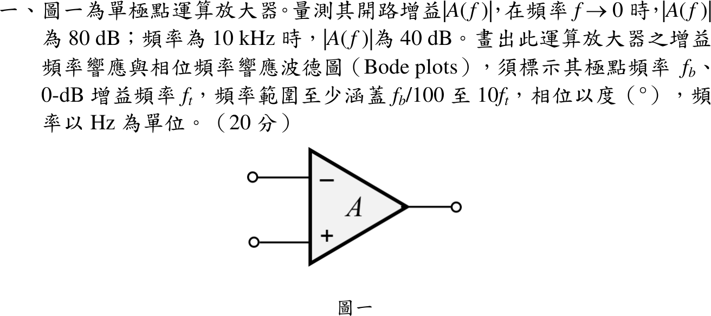
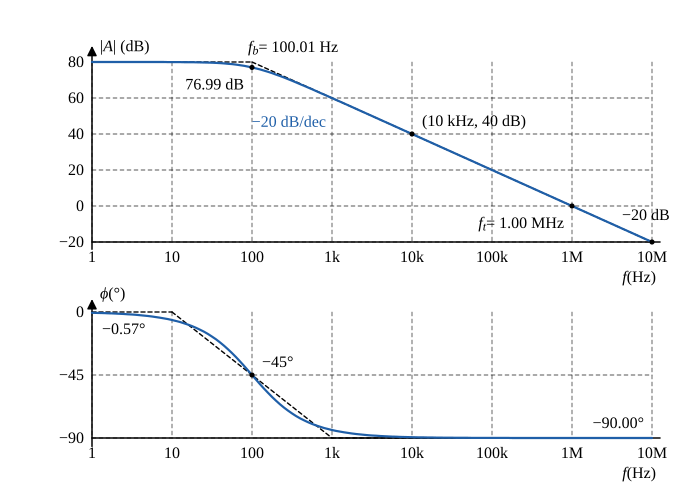

# 108 年電子學第 1 題｜單極點運算放大器波德圖

## 已知與所求

單極點開路增益：$f\to0$ 時 $|A|=80\,\mathrm{dB}$；$f=10\,\mathrm{kHz}$ 時 $|A|=40\,\mathrm{dB}$。畫幅頻與相頻波德圖，標出極點頻率 $f_b$、0 dB 頻率 $f_t$，範圍至少 $f_b/100\sim10f_t$，相位以度、頻率以 Hz。

## 考場標準作答

### 步驟 1：dB 換成倍數

設單極點（一階低通）模型 $A(f)=\dfrac{A_0}{1+jf/f_b}$。電壓增益用 $20\log_{10}$：$|A|_{\mathrm{dB}}=20\log_{10}|A|\ \Rightarrow\ |A|=10^{|A|_{\mathrm{dB}}/20}$。
\[
A_0=10^{80/20}=10^{4}
\]
\[
|A(10\ \mathrm{kHz})|=10^{40/20}=10^{2}=100
\]

### 極點頻率 $f_b$

\[
|A(f)|=\frac{A_0}{\sqrt{1+(f/f_b)^2}}
\]
代入 $f=10^4\,\mathrm{Hz}$、$|A|=100$、$A_0=10^4$：
\[
100=\frac{10^4}{\sqrt{1+(10^4/f_b)^2}}
\]
\[
\sqrt{1+(10^4/f_b)^2}=\frac{10^4}{100}=100
\]
兩邊平方：
\[
1+(10^4/f_b)^2=10^4
\]
\[
(10^4/f_b)^2=10^4-1=9999
\]
\[
\frac{10^4}{f_b}=\sqrt{9999}=99.995
\]
\[
f_b=\frac{10^4}{99.995}=100.005\ \mathrm{Hz}
\]
\[
\boxed{f_b=100.01\ \mathrm{Hz}\approx100\ \mathrm{Hz}}
\]

### 0 dB 頻率 $f_t$

\[
1=\frac{A_0}{\sqrt{1+(f_t/f_b)^2}}
\]
\[
1+(f_t/f_b)^2=A_0^2\ \Rightarrow\ f_t=f_b\sqrt{A_0^2-1}
\]
代入 $A_0=10^4$：
\[
\sqrt{A_0^2-1}=\sqrt{10^8-1}=9999.99995\approx10^{4}
\]
\[
f_t=100.005\times10^{4}=1.00005\times10^{6}\ \mathrm{Hz}
\]
\[
\boxed{f_t=1.00\ \mathrm{MHz}}
\]
（即增益頻寬積 $f_t\approx A_0f_b$。）

### 波德圖

幅值與相位式：
\[
|A|_{\mathrm{dB}}(f)=20\log_{10}\frac{A_0}{\sqrt{1+(f/f_b)^2}}=80-10\log_{10}\!\left[1+(f/f_b)^2\right]
\]
\[
\phi(f)=-\tan^{-1}\frac{f}{f_b}
\]
在 $f=f_b$（$f/f_b=1$）：
\[
|A|_{\mathrm{dB}}=80-10\log_{10}2=80-10\times0.3010=76.99\ \mathrm{dB},\qquad \phi=-\tan^{-1}1=-45^\circ
\]
各標示點（$f_b=100.005\,\mathrm{Hz}$ 代入）：

| $f$ | 1 Hz（$f_b/100$） | $f_b$ | 10 kHz | $f_t$ | 10 MHz（$10f_t$） |
|---|---|---|---|---|---|
| $f/f_b$ | 0.0100 | 1 | 99.995 | 10000 | 99995 |
| $\lvert A\rvert$ (dB) | 80.00 | 76.99 | 40.00 | 0.00 | −20.00 |
| $\phi$ (°) | −0.57 | −45 | −89.43 | −89.99 | −90.00 |

畫法：
- 幅頻圖：80 dB 平線畫到 $f_b=100.01\,\mathrm{Hz}$，之後以 $-20\,\mathrm{dB/decade}$ 直線下降，經 $10\,\mathrm{kHz}$ 的 40 dB、$f_t=1.00\,\mathrm{MHz}$ 的 0 dB，到 $10\,\mathrm{MHz}$ 的 $-20\,\mathrm{dB}$；精確曲線在 $f_b$ 比漸近線低 3.01 dB。
- 相頻圖：$f_b/10$ 以下約 $0^\circ$，$f_b/10\sim10f_b$ 以 $-45^\circ/\mathrm{decade}$ 下降並在 $f_b$ 通過 $-45^\circ$，$10f_b$ 以上趨近 $-90^\circ$。

## 驗算

以幾何方式檢查增益頻寬積：$A_0f_b=10^4\times100.005=1.00005\times10^6\ \mathrm{Hz}\approx1.00\ \mathrm{MHz}=f_t$。代回量測點：$f/f_b=10^4/100.005=99.995$，$1+99.995^2=1+9999.0=10000$，$80-10\log_{10}10000=80-40=40\ \mathrm{dB}$，與題給量測一致。

## 失分點

- 40 dB 是 $100$ V/V（$20\log_{10}$），不是 40 V/V；若誤用 $10\log_{10}$ 會得 $10^4$ 而得到錯誤的 $f_b$。
- $f_b$ 是 $-3\,\mathrm{dB}$ 轉折點（相位 $-45^\circ$），$f_t\approx10^4f_b$ 才是 0 dB 交越；兩者不可混標。
- 單極點相位是 $0^\circ\to-90^\circ$（負值），並要涵蓋 $f_b/100=1\ \mathrm{Hz}$ 到 $10f_t=10\ \mathrm{MHz}$。
