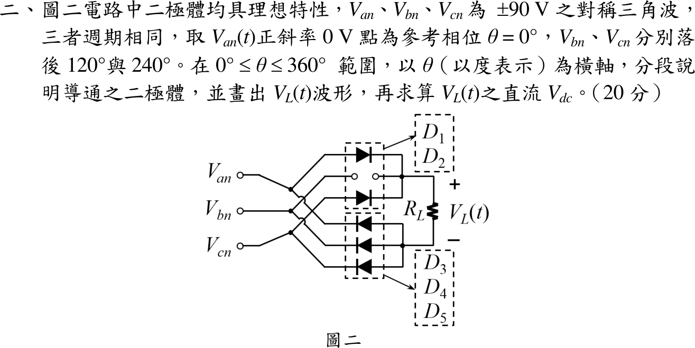
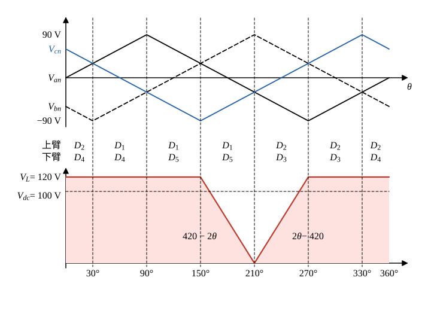

# 108 年電子學第 2 題｜三相三角波整流（五顆二極體）

## 已知與所求

$V_{an},V_{bn},V_{cn}$ 為 $\pm90\,\mathrm V$ 對稱三角波，$V_{an}$ 於 $\theta=0^\circ$ 以正斜率過零，$V_{bn},V_{cn}$ 落後 $120^\circ$、$240^\circ$；二極體理想。依圖逐線追蹤：

- 上臂（陰極接負載 $+$）：$D_1$ 接 $a$ 相、$D_2$ 接 $c$ 相；**$b$ 相上臂為斷開的缺口，沒有二極體**。
- 下臂（陽極接負載 $-$）：$D_3$ 接 $a$、$D_4$ 接 $b$、$D_5$ 接 $c$。

求 $0\le\theta\le360^\circ$ 各段導通二極體、$V_L(\theta)$ 波形與 $V_{dc}$。

## 考場標準作答

**解題邏輯**：理想二極體中，上臂（陰極共接負載 $+$）由連接相中電位最高者導通，下臂（陽極共接負載 $-$）由電位最低者導通，故 $V_L=$（上臂可接相的最大值）$-$（下臂可接相的最小值）。本圖 $b$ 相沒有上臂二極體，上臂只能在 $a$、$c$ 間選。先寫出三角波每段的直線方程式，逐段比大小定導通二極體與 $V_L$；再以面積求平均值 $V_{dc}$。

### 步驟 1：三相三角波的分段方程式

三角波振幅 $90\,\mathrm V$、四分之一週期 $90^\circ$，斜率 $\pm1\,\mathrm{V/deg}$。$V_{an}$ 於 $0^\circ$ 正斜率過零：
\[
V_{an}=\begin{cases}\theta,&0^\circ\le\theta\le90^\circ\\180-\theta,&90^\circ\le\theta\le270^\circ\\\theta-360,&270^\circ\le\theta\le360^\circ\end{cases}
\]
$V_{bn}$、$V_{cn}$ 分別把 $\theta$ 換成 $\theta-120^\circ$、$\theta-240^\circ$，在 $0\sim360^\circ$ 內為
\[
V_{bn}=\begin{cases}-60-\theta,&0^\circ\le\theta\le30^\circ\\\theta-120,&30^\circ\le\theta\le210^\circ\\300-\theta,&210^\circ\le\theta\le360^\circ\end{cases}\qquad
V_{cn}=\begin{cases}60-\theta,&0^\circ\le\theta\le150^\circ\\\theta-240,&150^\circ\le\theta\le330^\circ\\420-\theta,&330^\circ\le\theta\le360^\circ\end{cases}
\]

### 導通二極體（分段說明）

**邏輯**：依圖逐線追蹤——上臂 $D_1$ 接 $a$、$D_2$ 接 $c$，**$b$ 相上臂為斷開缺口**；下臂 $D_3$ 接 $a$、$D_4$ 接 $b$、$D_5$ 接 $c$。故
\[
V_L(\theta)=\max(V_{an},V_{cn})-\min(V_{an},V_{bn},V_{cn})
\]
交點（換相角）由兩條直線相等求得，例如 $V_{an}=V_{cn}$：$\theta=60-\theta\Rightarrow\theta=30^\circ$；$180-\theta=\theta-240\Rightarrow\theta=210^\circ$（此時兩者皆 $-30\,\mathrm V$）。

| $\theta$ | 上臂（最高） | 下臂（最低） | $V_L$ 計算 | $V_L$ |
|---|---|---|---|---|
| $0^\circ\sim30^\circ$ | $D_2$（$c$） | $D_4$（$b$） | $(60-\theta)-(-60-\theta)$ | $120\,\mathrm V$ |
| $30^\circ\sim90^\circ$ | $D_1$（$a$） | $D_4$（$b$） | $\theta-(\theta-120)$ | $120\,\mathrm V$ |
| $90^\circ\sim150^\circ$ | $D_1$（$a$） | $D_5$（$c$） | $(180-\theta)-(60-\theta)$ | $120\,\mathrm V$ |
| $150^\circ\sim210^\circ$ | $D_1$（$a$） | $D_5$（$c$） | $(180-\theta)-(\theta-240)$ | $420-2\theta$（$\mathrm V$） |
| $210^\circ\sim270^\circ$ | $D_2$（$c$） | $D_3$（$a$） | $(\theta-240)-(180-\theta)$ | $2\theta-420$（$\mathrm V$） |
| $270^\circ\sim330^\circ$ | $D_2$（$c$） | $D_3$（$a$） | $(\theta-240)-(\theta-360)$ | $120\,\mathrm V$ |
| $330^\circ\sim360^\circ$ | $D_2$（$c$） | $D_4$（$b$） | $(420-\theta)-(300-\theta)$ | $120\,\mathrm V$ |

$150^\circ\sim270^\circ$ 時 $b$ 相最高（$V_{bn}$ 在 $210^\circ$ 達 $+90\,\mathrm V$）卻沒有上臂二極體，上節點只能取 $a$ 或 $c$，$V_L$ 在 $210^\circ$ 降到 $0$。

### $V_L$ 波形

**邏輯**：把上表各段畫在同一 $\theta$ 軸（圖 1 下方）：$120\,\mathrm V$ 平台共 $240^\circ$，$150^\circ\sim270^\circ$ 為 V 形凹陷，端點 $V_L(150^\circ)=420-300=120\,\mathrm V$、$V_L(210^\circ)=420-420=0$、$V_L(270^\circ)=540-420=120\,\mathrm V$，與平台連續。

### 直流值 $V_{dc}$

**邏輯**：直流值 = 一週期平均 = 波形面積 ÷ $360^\circ$；面積分成平台矩形與兩段斜坡三角形。

平台面積（$30^\circ+60^\circ+60^\circ+60^\circ+30^\circ=240^\circ$）：
\[
A_1=120\times240=28800\ \mathrm{V\cdot deg}
\]
兩段斜坡（各底 $60^\circ$、高 $120\,\mathrm V$ 的三角形）：
\[
A_2=2\times\tfrac12\times60\times120=7200\ \mathrm{V\cdot deg}
\]
\[
\boxed{V_{dc}=\frac{A_1+A_2}{360^\circ}=\frac{28800+7200}{360}=\frac{36000}{360}=100\ \mathrm V}
\]

## 驗算

用「缺臂扣除」法：若 $b$ 相也有上臂二極體，$V_L$ 全程為 $120\,\mathrm V$；缺少它造成 $150^\circ\sim270^\circ$ 的三角形凹陷，面積 $\tfrac12(120^\circ)(120\,\mathrm V)=7200\ \mathrm{V\cdot deg}$，平均少 $7200/360=20\,\mathrm V$，得 $120-20=100\,\mathrm V$。

## 失分點

- 把圖當成六顆二極體的標準橋式，得 $V_L\equiv120\,\mathrm V$、$V_{dc}=120\,\mathrm V$；本圖 $b$ 相上臂缺口使 $V_{dc}$ 只有 $100\,\mathrm V$。
- 只標最高相與最低相，忽略 $210^\circ$ 附近上臂只能在 $a$、$c$ 之間換相，漏畫 $V_L$ 降到 0 的凹陷。
- 套用正弦三相的 $1.35V_{LL}$；本題輸入是三角波，須逐段用直線方程式。
