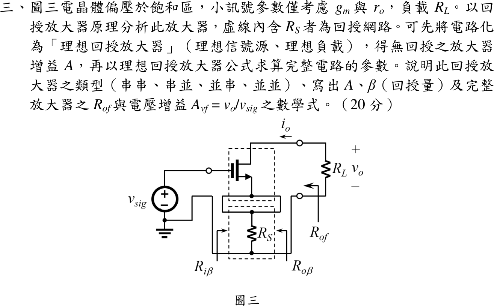
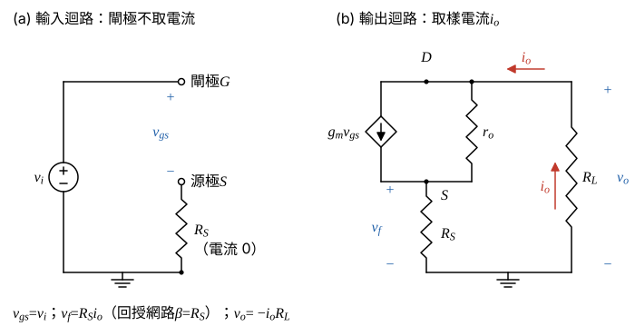

# 108 年電子學第 3 題｜MOSFET 串聯-串聯負回授

## 已知與所求

NMOS 偏壓於飽和區，小訊號只有 $g_m$、$r_o$；閘極接 $v_{sig}$，汲極接 $R_L$（$i_o$ 為汲極電流，$v_o$ 為 $R_L$ 上電壓），源極經 $R_S$ 接地；虛線內 $R_S$ 為回授網路。求回授型態、$A$、$\beta$、$R_{of}$、$A_{vf}=v_o/v_{sig}$。

## 考場標準作答

### 回授型態

設電晶體偏壓於飽和區，小訊號只用 $g_m$ 與 $r_o$（忽略基體效應，閘極不取電流），$v_{sig}$ 為理想電壓源、$R_L$ 為理想負載。

- 輸出端：$R_S$ 與 $R_L$ 在同一個汲極—源極迴路中串聯，流過 $R_S$ 的就是輸出電流 $i_o$，取樣量為**電流**（串聯取樣）。
- 輸入端：$R_S$ 上的電壓 $v_f=R_Si_o$ 出現在閘源迴路，KVL 得 $v_{gs}=v_{sig}-v_f$，回授量以**電壓**與訊號相減（串聯混合）。
- 極性：$v_{sig}\uparrow\Rightarrow i_o\uparrow\Rightarrow v_f\uparrow\Rightarrow v_{gs}\downarrow$，回授抵銷輸入變化，為負回授。

\[
\boxed{\text{串聯-串聯（電流串聯）負回授；基本放大器為互導放大器 }A=i_o/v_i}
\]

### 步驟 1：A 電路（含回授網路負載）

串串回授以 z 參數處理負載：輸入迴路串入 $z_{11}=R_S$（輸出埠開路時由輸入埠看入），輸出迴路串入 $z_{22}=R_S$（輸入埠開路時由輸出埠看入）。

- 輸入迴路（圖 1(a)）：閘極不取電流，$z_{11}=R_S$ 上電流為 0、壓降為 0，故 $v_{gs}=v_i$。
- 輸出迴路（圖 1(b)）：受控源 $g_mv_{gs}$ 由汲極流向源極、並聯 $r_o$，外接 $R_L$ 與 $z_{22}=R_S$ 串聯；$i_o$ 依題圖參考方向由 $R_L$ 流入汲極，正好是受控源推動的方向。

### $A$、$\beta$

輸出迴路分流（$g_mv_{gs}$ 分給 $r_o$ 與 $R_L+R_S$ 兩條路）：
\[
i_o=g_mv_{gs}\cdot\frac{r_o}{r_o+(R_L+R_S)}
\]
代入 $v_{gs}=v_i$：
\[
\boxed{A=\frac{i_o}{v_i}=\frac{g_mr_o}{r_o+R_L+R_S}}
\]
回授網路（輸入埠開路、閘極不取電流）：
\[
v_f=R_S\,i_o
\]
\[
\boxed{\beta=\frac{v_f}{i_o}=R_S}
\]
理想 $r_o\to\infty$ 時 $A\to g_m$。

### 電壓增益 $A_{vf}$

串串負回授的閉迴路互導 $A_f=i_o/v_{sig}=A/(1+A\beta)$；$i_o$ 由 $R_L$ 下端往上流向汲極，與 $v_o$ 上正下負相反，故 $v_o=-i_oR_L$。

迴路增益：
\[
A\beta=\frac{g_mr_o}{r_o+R_L+R_S}\cdot R_S=\frac{g_mr_oR_S}{r_o+R_L+R_S}
\]
\[
1+A\beta=\frac{r_o+R_L+R_S+g_mr_oR_S}{r_o+R_L+R_S}
\]
閉迴路互導（分子分母的 $r_o+R_L+R_S$ 相消）：
\[
A_f=\frac{i_o}{v_{sig}}=\frac{A}{1+A\beta}=\frac{g_mr_o}{r_o+R_L+R_S+g_mr_oR_S}
\]
換成電壓增益：
\[
v_o=-i_oR_L\ \Rightarrow\ A_{vf}=\frac{v_o}{v_{sig}}=-R_L\cdot\frac{i_o}{v_{sig}}=-R_LA_f
\]
\[
\boxed{A_{vf}=-\frac{g_mr_oR_L}{r_o+R_L+R_S+g_mr_oR_S}}
\]
輸入電阻 $R_{if}\to\infty$（閘極不取電流）。

### 輸出電阻 $R_{of}$

$R_{of}$ 由 $R_L$ 的位置往放大器看入（不含 $R_L$），故 A 電路改以 $R_L=0$ 計算。

$R_L=0$ 時 A 電路由 $R_L$ 位置看入：$v_{gs}=v_i=0$，受控源為零，只剩 $r_o$ 與 $R_S$ 串聯：
\[
R_o=r_o+R_S
\]
$R_L=0$ 時的開迴路增益（$A$ 式代 $R_L=0$）：
\[
A_0=\frac{g_mr_o}{r_o+R_S}
\]
\[
A_0\beta=\frac{g_mr_oR_S}{r_o+R_S}
\]
\[
R_{of}=R_o(1+A_0\beta)=(r_o+R_S)\left(1+\frac{g_mr_oR_S}{r_o+R_S}\right)=(r_o+R_S)+g_mr_oR_S
\]
\[
\boxed{R_{of}=r_o+R_S+g_mr_oR_S}
\]

## 驗算

直接對閘、汲、源節點寫小訊號 KCL（不用回授公式）：$v_o/R_L+i_d=0$、$i_d=v_s/R_S$、$i_d=g_m(v_{sig}-v_s)+(v_o-v_s)/r_o$，解得與上式相同。代入 $g_m=2\,\mathrm{mS}$、$r_o=50\,\mathrm{k\Omega}$、$R_L=5\,\mathrm{k\Omega}$、$R_S=1\,\mathrm{k\Omega}$、$v_{sig}=1\,\mathrm V$：分母 $50+5+1+100=156\,\mathrm{k\Omega}$，$A_{vf}=-500/156=-3.2051$，即 $v_o=-3.2051\,\mathrm V$；$i_d=3.2051/5=0.64103\,\mathrm{mA}$，$v_s=R_Si_d=0.64103\,\mathrm V$。檢查 KCL：$g_m(1-0.64103)=2\times0.35897=717.95\,\mu\mathrm A$，$(v_o-v_s)/r_o=(-3.2051-0.64103)/50\,\mathrm{k\Omega}=-76.92\,\mu\mathrm A$，相加 $641.03\,\mu\mathrm A=v_s/R_S$，成立；$R_{of}=50+1+100=151\,\mathrm{k\Omega}$。極限：$R_S\to0$ 得 $-g_mr_oR_L/(r_o+R_L)$（無退化共源級）；$r_o\to\infty$ 得 $-g_mR_L/(1+g_mR_S)$。

## 失分點

- 把電流取樣誤判為並聯取樣而寫成串並或並串；$R_S$ 串在源極、取樣的是汲極電流。
- 忘記 $v_o=-i_oR_L$ 的反相號，把 $A_{vf}$ 寫成正值。
- 取 $A=g_m$ 卻同時保留 $r_o$：有限 $r_o$ 時基本放大器要用 $g_mr_o/(r_o+R_L+R_S)$，否則分母少了 $R_L+R_S$。
