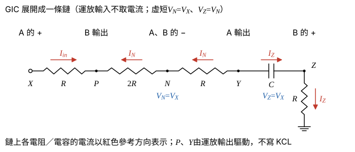
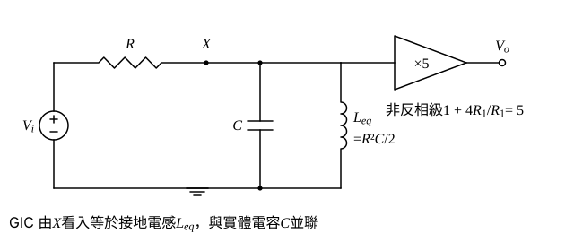

# 108 年電子學第 4 題｜GIC 主動濾波器轉移函數

## 已知與所求

運算放大器皆理想。上方放大器：$+$ 輸入接節點 $X$，$-$ 輸入經 $R_1$ 接地、$4R_1$ 接回輸出 $V_o$。$V_i$ 經 $R$ 接到 $X$，$X$ 對地接 $C$，另有 GIC 由 $X$ 經 $R\to P$、$2R\to N$、$R\to Y$、$C\to Z$、$R\to$ 地串成鏈：GIC 的運放 $A$（右上；$+$ 接 $X$、$-$ 接 $N$、輸出 $Y$），運放 $B$（左下；輸出 $P$、$-$ 接 $N$、$+$ 接 $Z$）。求 $T(s)=V_o/V_i$，並判斷濾波器類型與階數。

## 考場標準作答

**解題邏輯**：前提為理想運放（輸入不取電流、線性區虛短路），運放 A、B 與 5 個被動元件構成 GIC（廣義阻抗轉換器）。先沿 GIC 鏈由最右端往回推電流與節點電壓，求由 $X$ 看入的阻抗 $Z_{in}$（等效接地電感 $L_{eq}$）；再在節點 $X$ 寫 KCL（$V_i$ 經 $R$ 流入，$C$ 與 GIC 流出）解 $V_X/V_i$，乘上上方非反相級的增益 5 得 $T(s)$；最後看 $T(0)$、$T(\infty)$ 與分母次數判斷類型與階數。

### 步驟 1：GIC 由 $X$ 看入的阻抗

依題圖接線：運放 A 的 $+$ 接 $X$、$-$ 接 $N$、輸出 $Y$；運放 B 的 $+$ 接 $Z$、$-$ 接 $N$、輸出 $P$。$P$、$Y$ 是運放輸出（可供任意電流，不寫 KCL），$N$、$Z$ 只接運放輸入（不取電流）。

虛短：
\[
V_N=V_X\ (\text{運放 A}),\qquad V_Z=V_N=V_X\ (\text{運放 B})
\]
$Z$ 經 $R$ 接地的電流：
\[
I_Z=\frac{V_Z}{R}=\frac{V_X}{R}
\]
節點 $Z$ 的 KCL（運放 B 的 $+$ 不取電流）：流經 $C$（$Y\to Z$）的電流也是 $I_Z$，
\[
V_Y-V_Z=\frac{I_Z}{sC}=\frac{V_X}{sRC}\ \Rightarrow\ V_Y=V_X\left(1+\frac{1}{sRC}\right)
\]
$N$–$Y$ 間 $R$ 的電流（$Y\to N$）：
\[
I_N=\frac{V_Y-V_N}{R}=\frac{V_X/(sRC)}{R}=\frac{V_X}{sR^2C}
\]
節點 $N$ 的 KCL（兩顆運放的 $-$ 都不取電流）：$I_N$ 全部經 $2R$ 由 $N$ 流向 $P$，
\[
V_N-V_P=2R\cdot I_N=\frac{2V_X}{sRC}\ \Rightarrow\ V_P=V_X\left(1-\frac{2}{sRC}\right)
\]
由 $X$ 經第一個 $R$ 流入 GIC 的電流：
\[
I_{in}=\frac{V_X-V_P}{R}=\frac{2V_X/(sRC)}{R}=\frac{2V_X}{sR^2C}
\]
\[
Z_{in}=\frac{V_X}{I_{in}}=\frac{sR^2C}{2}
\]
與 GIC 公式一致：$Z_{in}=\dfrac{Z_1Z_3Z_5}{Z_2Z_4}=\dfrac{R\cdot R\cdot R}{2R\cdot(1/sC)}=\dfrac{sR^2C}{2}$，即等效接地電感
\[
L_{eq}=\frac{R^2C}{2}
\]

### 轉移函數 $T(s)$

**邏輯**：$X$ 對地有實體電容 $C$ 與 GIC 的 $L_{eq}$（圖 2），上方運放的 $+$ 端接 $X$ 但不取電流，所以節點 $X$ 的 KCL 只有三項；解出 $V_X/V_i$ 後乘上非反相級增益。

節點 $X$ 的 KCL（流出為正）：
\[
\frac{V_X-V_i}{R}+sC\,V_X+I_{in}=0,\qquad I_{in}=\frac{2V_X}{sR^2C}
\]
兩邊乘 $sR^2C$：
\[
sRC\,(V_X-V_i)+s^2R^2C^2\,V_X+2V_X=0
\]
移項：
\[
V_X\,(s^2R^2C^2+sRC+2)=sRC\,V_i
\]
\[
\frac{V_X}{V_i}=\frac{sRC}{s^2R^2C^2+sRC+2}
\]
上方非反相級（$-$ 端經 $R_1$ 接地、$4R_1$ 回授）：
\[
\frac{V_o}{V_X}=1+\frac{4R_1}{R_1}=5
\]
\[
\boxed{T(s)=\frac{V_o}{V_i}=\frac{5sRC}{s^2R^2C^2+sRC+2}}
\]

### 類型與階數

**邏輯**：濾波器類型由 $T(s)$ 在 $s\to0$（直流）與 $s\to\infty$（高頻）的極限決定，階數等於分母 $s$ 的最高次數；再與二階帶通標準式比對取得 $\omega_0$、$Q$。

極限：
\[
T(0)=\frac{0}{2}=0
\]
\[
s\to\infty:\ T(s)\to\frac{5sRC}{s^2R^2C^2}=\frac{5}{sRC}\to0
\]
低頻與高頻皆被阻擋、中間有通帶，分母為 $s$ 的二次式，故為
\[
\boxed{\text{二階帶通濾波器}}
\]
與標準式 $T(s)=H\dfrac{(\omega_0/Q)\,s}{s^2+(\omega_0/Q)s+\omega_0^2}$ 比對，把 $T(s)$ 分子分母同除以 $R^2C^2$：
\[
T(s)=\frac{5\,s/(RC)}{s^2+s/(RC)+2/(RC)^2}
\]
\[
\omega_0^2=\frac{2}{(RC)^2}\ \Rightarrow\ \omega_0=\frac{\sqrt2}{RC}=\frac{1.414}{RC}
\]
\[
\frac{\omega_0}{Q}=\frac{1}{RC}\ \Rightarrow\ Q=\omega_0RC=\sqrt2=1.414
\]
\[
H\cdot\frac{\omega_0}{Q}=\frac{5}{RC}\ \Rightarrow\ H=5
\]
中心頻率增益 $|T(j\omega_0)|=H=5$。

## 驗算

以 LC 並聯諧振的物理觀點檢查：$X$ 對地為 $C\parallel L_{eq}$，$\omega_0=1/\sqrt{L_{eq}C}=\sqrt2/(RC)$ 時兩者電流互相抵消、對地阻抗為無限大，故 $V_X=V_i$，$V_o=5V_i$，$|T(j\omega_0)|=5$（相位 $0^\circ$）；與直接代入 $s=j\omega_0$ 的結果（分母 $=j\sqrt2$、分子 $=5j\sqrt2$）相同。極限：$s\to0$ 時 $L_{eq}$ 短路，$s\to\infty$ 時 $C$ 短路，$V_X\to0$，故 $T(0)=T(\infty)=0$；$-3\ \mathrm{dB}$ 頻寬 $=\omega_0/Q=1/(RC)$。

## 失分點

- GIC 公式 $Z_1Z_3Z_5/(Z_2Z_4)$ 中 $2R$ 在鏈的第二位（$Z_2$，分母）；若放在 $Z_3$ 會得 $2sR^2C$，等效電感大 4 倍，中心頻率與分母全錯。
- 漏掉 $X$ 對地的實體電容 $C$，只留 GIC 電感，就變成一階高通而非二階。
- 上方非反相級增益是 $1+4R_1/R_1=5$，不是 $4$。
