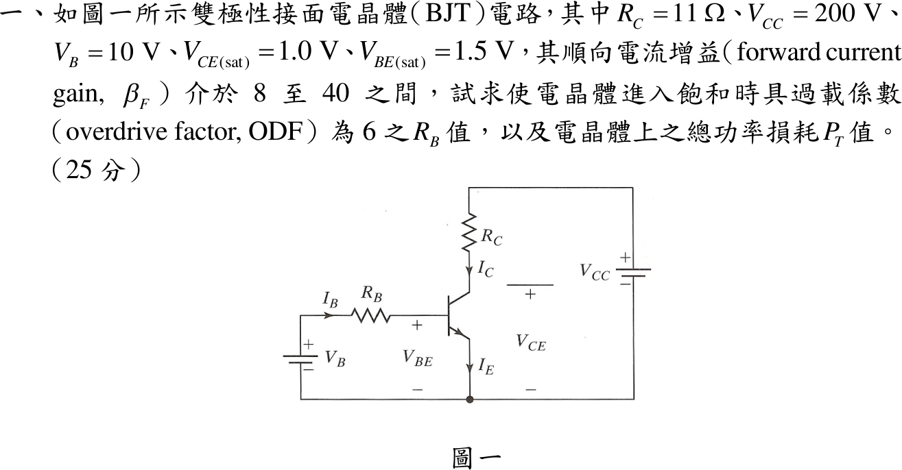
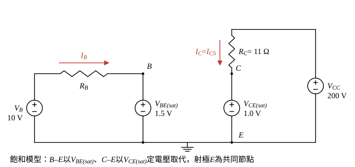

# 109 年電子學第 1 題｜BJT 開關過載係數

## 已知與所求

共射開關：$V_B$ 經 $R_B$ 驅動基極，$R_C=11\,\Omega$ 接 $V_{CC}=200\,\mathrm V$；$V_B=10\,\mathrm V$、$V_{CE(sat)}=1.0\,\mathrm V$、$V_{BE(sat)}=1.5\,\mathrm V$，$\beta_F=8\sim40$。求 $\mathrm{ODF}=6$ 時的 $R_B$ 與電晶體總損耗 $P_T$（共 25 分）。

## 考場標準作答

**解題邏輯**：電晶體工作於**飽和區**：以定電壓模型把 B–E 換成 $V_{BE(sat)}$、C–E 換成 $V_{CE(sat)}$（圖 1），集極電流由外電路決定為 $I_{CS}$。過載係數 $\mathrm{ODF}=I_B/I_{BS}$，$I_{BS}=I_{CS}/\beta_F$ 是剛好飽和所需的基極電流；$\beta_F$ 有 $8\sim40$ 的分散，要保證每顆都飽和須以**最小** $\beta_{F,\min}=8$ 計算。依序 $I_{CS}\to I_{BS}\to I_B\to R_B$（基極迴路 KVL），損耗 $P_T$ 為兩接面 $V\cdot I$ 之和。

### 步驟 1：飽和等效電路與集極電流

集極迴路 KVL（$V_{CC}\to R_C\to V_{CE(sat)}$）：
\[
V_{CC}=I_{CS}R_C+V_{CE(sat)}
\]
\[
I_{CS}=\frac{V_{CC}-V_{CE(sat)}}{R_C}=\frac{200-1.0}{11}=\frac{199}{11}\ \mathrm A=18.091\ \mathrm A
\]

### 基極電阻 $R_B$

**邏輯**：以最差 $\beta_{F,\min}$ 求臨界基極電流 $I_{BS}$，乘 ODF 得實際 $I_B$；基極迴路中 $R_B$ 承受 $V_B-V_{BE(sat)}$，歐姆定律解 $R_B$。

臨界基極電流（$\beta_{F,\min}=8$）：
\[
I_{BS}=\frac{I_{CS}}{\beta_{F,\min}}=\frac{199/11}{8}=\frac{199}{88}\ \mathrm A=2.2614\ \mathrm A
\]
實際基極電流：
\[
I_B=\mathrm{ODF}\times I_{BS}=6\times\frac{199}{88}=\frac{597}{44}\ \mathrm A=13.568\ \mathrm A
\]
基極迴路 KVL（$V_B\to R_B\to V_{BE(sat)}$）：
\[
V_B=I_BR_B+V_{BE(sat)}
\]
\[
R_B=\frac{V_B-V_{BE(sat)}}{I_B}=\frac{10-1.5}{597/44}=\frac{8.5\times44}{597}=\frac{374}{597}\ \Omega=0.62647\ \Omega
\]
\[
\boxed{R_B=626.47\ \mathrm{m}\Omega}
\]

### 總功率損耗 $P_T$

**邏輯**：飽和時電晶體內有兩條電流路徑：基極電流流過 B–E（壓降 $V_{BE(sat)}$），集極電流流過 C–E（壓降 $V_{CE(sat)}$）；各段 $P=VI$ 相加即電晶體總損耗。

\[
P_B=V_{BE(sat)}I_B=1.5\times13.568=20.352\ \mathrm W
\]
\[
P_C=V_{CE(sat)}I_{CS}=1.0\times18.091=18.091\ \mathrm W
\]
\[
P_T=P_B+P_C=20.352+18.091=38.443\ \mathrm W
\]
\[
\boxed{P_T=38.44\ \mathrm W}
\]

## 驗算

- 功率平衡：電源供給 $V_{CC}I_{CS}+V_BI_B=3618.18+135.68=3753.86\,\mathrm W$，電阻消耗 $I_{CS}^2R_C+I_B^2R_B=3600.09+115.33=3715.42\,\mathrm W$，差值 $3753.86-3715.42=38.44\,\mathrm W=P_T$。
- 飽和確認：強迫增益 $\beta_{forced}=I_{CS}/I_B=18.091/13.568=1.333<\beta_{F,\min}=8$，任何 $\beta_F\in[8,40]$ 都能飽和。

## 失分點

- 取 $\beta_{\max}=40$ 計算 $I_{BS}$，低增益元件會無法飽和（得 $R_B=3.13\,\Omega$）。
- $P_T$ 漏掉基極損耗 $20.35\,\mathrm W$，只答 $18.09\,\mathrm W$。
