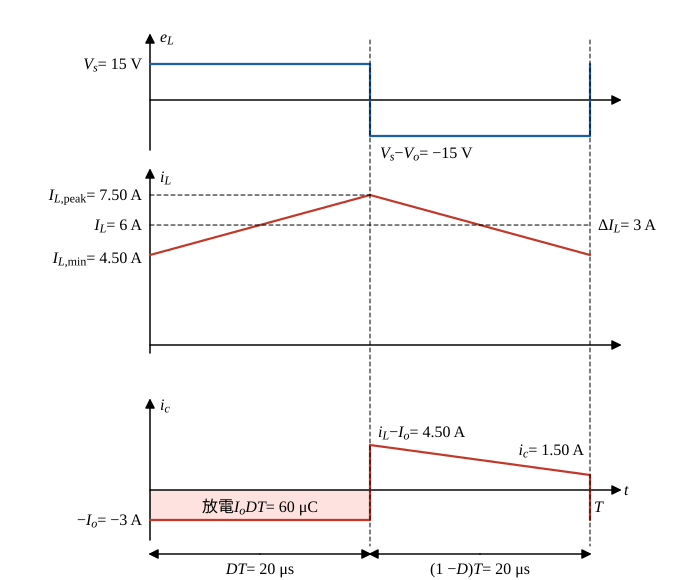

# 109 年電子學第 2 題｜Boost 漣波與臨界值

## 已知與所求

理想 Boost：$V_s=15\,\mathrm V$、$V_o=30\,\mathrm V$、$I_o=3\,\mathrm A$、$f=25\,\mathrm{kHz}$、$L=100\,\mu\mathrm H$、$C=200\,\mu\mathrm F$。題圖參考方向：$i_L$ 向右流過 $L$，$e_L$ 左正右負；$i_c$ 向下流入 $C$。求 $D$、$\Delta I_L$、$I_{L,\mathrm{peak}}$、$\Delta V_C$、臨界 $L_c$ 與 $C_c$。

## 考場標準作答

**解題邏輯**：CCM 穩態一週期分「$M_1$ 導通 $DT$」與「$M_1$ 截止 $(1-D)T$」兩段。導通時 $L$ 跨 $V_s$、二極體逆偏、$C$ 獨自供電；截止時 $L$ 跨 $V_s-V_o$、經二極體送電到輸出。電感伏秒平衡求 $D$；導通段斜率求 $\Delta I_L$；電容電荷平衡求平均電感電流再加半個漣波得峰值；導通段電容放電電荷求 $\Delta V_C$；最後令谷值電流為零得 $L_c$、令放電漣波達 $2V_o$ 得 $C_c$。

### 步驟 1：兩段電路與時間

- **導通（$0<t<DT$）**：$e_L=V_s$；二極體陽極接地、陰極為 $v_o$，逆偏截止；$C$ 獨自供負載，$i_c=-I_o$。
- **截止（$DT<t<T$）**：$i_L$ 不能突變，經二極體流向輸出；$e_L=V_s-V_o$；輸出節點 KCL：$i_c=i_L-I_o$。

\[
T=\frac1f=\frac{1}{25\times10^{3}}=40\ \mu\mathrm s
\]

### 導通率 $D$

**邏輯**：穩態下 $i_L$ 一週期淨變化為零，即 $e_L$ 一週期平均為零（伏秒平衡）。

\[
V_sDT+(V_s-V_o)(1-D)T=0
\]
\[
15D+(15-30)(1-D)=0\ \Rightarrow\ 15D-15+15D=0\ \Rightarrow\ 30D=15
\]
\[
D=1-\frac{V_s}{V_o}=1-\frac{15}{30}=\boxed{0.50}
\]
\[
DT=0.50\times40=20\ \mu\mathrm s
\]

### 電感漣波電流 $\Delta I_L$

**邏輯**：導通段 $e_L=V_s$ 固定，$i_L$ 以斜率 $V_s/L$ 直線上升 $DT$，上升量即峰對峰漣波。

\[
\Delta I_L=\frac{V_s}{L}DT=\frac{15\times20\times10^{-6}}{100\times10^{-6}}=\frac{300}{100}=\boxed{3\ \mathrm A}
\]

### 電感峰值電流 $I_{L,\mathrm{peak}}$

**邏輯**：電容一週期平均電流為零，截止段二極體電流（$=i_L$）的整週期平均等於 $I_o$，得平均電感電流；三角波峰值 = 平均值 + 半個漣波。

\[
(1-D)I_L=I_o\ \Rightarrow\ I_L=\frac{I_o}{1-D}=\frac{3}{1-0.50}=\frac{3}{0.50}=6\ \mathrm A
\]
\[
I_{L,\mathrm{peak}}=I_L+\frac{\Delta I_L}{2}=6+\frac{3}{2}=\boxed{7.50\ \mathrm A}
\]
（谷值 $I_{L,\min}=6-1.50=4.50\ \mathrm A>0$，CCM 成立。）

### 電容漣波電壓 $\Delta V_C$

**邏輯**：導通段二極體截止，電容獨自以 $I_o$ 放電 $DT$（圖 1 陰影），電容電壓由最高降到最低，$\Delta V_C=\Delta Q/C$。

\[
\Delta Q=I_oDT=3\times20\times10^{-6}=60\ \mu\mathrm C
\]
\[
\Delta V_C=\frac{\Delta Q}{C}=\frac{60\times10^{-6}}{200\times10^{-6}}=\boxed{0.30\ \mathrm V}
\]

### 臨界電感 $L_c$

**邏輯**：CCM／DCM 邊界為谷值電流剛好為零，即平均電感電流 $I_L$ 等於半個漣波 $\Delta I_L/2$；$I_L$ 與 $L$ 無關，$\Delta I_L$ 與 $L$ 成反比，解出邊界的 $L$。

負載電阻：
\[
R=\frac{V_o}{I_o}=\frac{30}{3}=10\ \Omega
\]
邊界條件：
\[
I_L=\frac{\Delta I_L}{2}\ \Rightarrow\ \frac{V_o}{R(1-D)}=\frac{V_sDT}{2L_c}
\]
以 $V_s=V_o(1-D)$、$T=1/f$ 代入並解 $L_c$：
\[
L_c=\frac{V_sDT\,R(1-D)}{2V_o}=\frac{D(1-D)^2R}{2f}
\]
\[
L_c=\frac{0.50\times0.50^2\times10}{2\times25\times10^{3}}=\frac{1.25}{5\times10^{4}}=\boxed{25\ \mu\mathrm H}
\]
$L=100\ \mu\mathrm H>L_c$，確為 CCM。

### 臨界電容 $C_c$

**邏輯**：臨界電容取教材「輸出電容電壓剛好連續」的邊界：導通段電容獨自供電，放電漣波達 $\Delta V_C=2V_o$（電容電壓在週期內降到零）；令放電電荷 $I_oDT$ 對應這個漣波。

\[
\frac{I_oDT}{C_c}=2V_o\ \Rightarrow\ C_c=\frac{I_oDT}{2V_o}=\frac{60\times10^{-6}}{2\times30}=\frac{60\times10^{-6}}{60}
\]
以 $I_o/V_o=1/R$、$T=1/f$ 化為公式：
\[
\boxed{C_c=\frac{D}{2fR}=\frac{0.50}{2(25\times10^{3})(10)}=1\ \mu\mathrm F}
\]
已知 $C=200\ \mu\mathrm F\gg C_c$，輸出電壓連續。

## 驗算

伏秒平衡 $15\times0.50+(15-30)\times0.50=0$；電荷平衡：導通段放出 $3\times20\ \mu=60\ \mu\mathrm C$，截止段 $i_c$ 由 $7.50-3=4.50\ \mathrm A$ 直線降到 $4.50-3=1.50\ \mathrm A$，充入 $\frac{4.50+1.50}{2}\times20\ \mu=60\ \mu\mathrm C$；功率 $15\times6=30\times3=90\ \mathrm W$。邊界回代：$L=L_c$ 時 $\dfrac{\Delta I_L}{2}=\dfrac{15\times20\times10^{-6}}{2\times25\times10^{-6}}=6\ \mathrm A=I_L$，谷值為 0；$C=C_c$ 時 $\Delta V_C=\dfrac{60\times10^{-6}}{1\times10^{-6}}=60\ \mathrm V=2V_o$。

## 失分點

- 平均電感電流用 $I_o=3\,\mathrm A$，峰值低估為 $4.50\,\mathrm A$；Boost 的 $I_L=I_s=6\,\mathrm A$。
- 臨界電感漏 $(1-D)^2$ 或 $\frac12$。
- 用自己算出的 $0.30\,\mathrm V$ 倒推出已知的 $200\,\mu\mathrm F$ 當臨界值；臨界值是 $\Delta V_C=2V_o$ 的邊界。

## 條件與疑義

- 題面未明寫臨界電容判準，主解採教材定義 $\Delta V_C=2V_o$；若評分改以容許漣波比 $\varepsilon=\Delta V_{C,\text{允許}}/V_o$ 設計，則 $C_c(\varepsilon)=\frac{D}{Rf\varepsilon}=\frac{2\,\mu\mathrm F}{\varepsilon}$。
