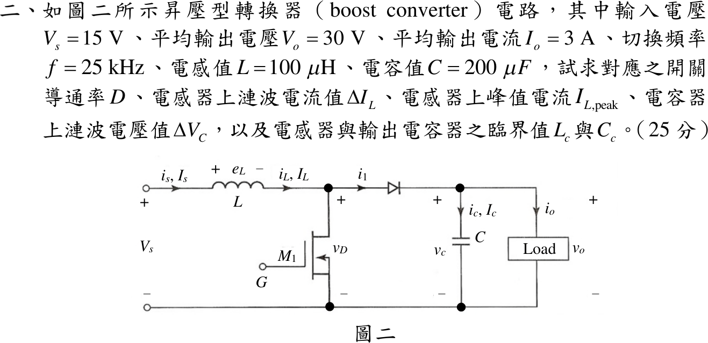

# 109 年電子學第 2 題｜Boost 漣波與臨界值

## 已知與所求

理想 Boost：$V_s=15\,\mathrm V$、$V_o=30\,\mathrm V$、$I_o=3\,\mathrm A$、$f=25\,\mathrm{kHz}$（$T=40\,\mu\mathrm s$）、$L=100\,\mu\mathrm H$、$C=200\,\mu\mathrm F$。求 $D$、$\Delta I_L$、$I_{L,\mathrm{peak}}$、$\Delta V_C$、臨界 $L_c$ 與 $C_c$。

## 考場標準作答

### 導通率與電感電流

理想 Boost 穩態下，電感一週期內伏秒平衡、電容一週期內電荷平衡，由前者得 $D$，由後者得平均電感電流。開關導通時電感跨壓為 $V_s$，截止時為 $V_s-V_o$。

導通率（伏秒平衡 $V_sD+(V_s-V_o)(1-D)=0$）：
\[
D=1-\frac{V_s}{V_o}=1-\frac{15}{30}=\boxed{0.50}
\]
導通期間電感電流上升量即連續模式的漣波電流：
\[
\Delta I_L=\frac{V_sDT}{L}=\frac{15(0.50)(40\times10^{-6})}{100\times10^{-6}}=\boxed{3\ \mathrm A}
\]
電容電荷平衡使二極體導通期間（$1-D$）的平均電流等於 $I_o$，故平均電感電流（亦即輸入電流）：
\[
I_L=\frac{I_o}{1-D}=\frac{3}{1-0.50}=6\ \mathrm A
\]
峰值為平均值加半個漣波：
\[
I_{L,\mathrm{peak}}=I_L+\frac{\Delta I_L}{2}=6+\frac{3}{2}=\boxed{7.50\ \mathrm A}
\]

### 電容漣波

導通期間二極體截止，電容獨自供應負載電流 $I_o$，電荷減少量除以 $C$ 即漣波電壓：
\[
\Delta V_C=\frac{I_oDT}{C}=\frac{3(0.50)(40\times10^{-6})}{200\times10^{-6}}=\frac{60\times10^{-6}}{200\times10^{-6}}=\boxed{0.30\ \mathrm V}
\]

### 臨界電感

CCM／DCM 邊界為最小電感電流剛好為零，即 $I_L=\Delta I_L/2$；負載電阻先求出：
\[
R=\frac{V_o}{I_o}=\frac{30}{3}=10\ \Omega
\]
邊界條件 $\dfrac{V_o}{R(1-D)}=\dfrac{V_sDT}{2L_c}$，並以 $V_s=V_o(1-D)$ 代入化簡：
\[
L_c=\frac{D(1-D)^2R}{2f}=\frac{0.50(0.50)^2(10)}{2(25\times10^{3})}=\frac{1.25}{5\times10^{4}}=\boxed{25\ \mu\mathrm H}
\]
$L=100\ \mu\mathrm H>L_c$，且 $I_{L,\min}=6-1.50=4.50\ \mathrm A>0$，確為 CCM。

### 臨界電容

臨界電容定義為輸出電容電壓剛好連續的邊界：導通期間電容獨自供應負載，漣波達 $\Delta V_C=2V_o$（電容電壓在週期內降到零）。令電荷變化量等於該漣波：
\[
\frac{I_oDT}{C_c}=2V_o\ \Rightarrow\ C_c=\frac{I_oDT}{2V_o}
\]
\[
\boxed{C_c=\frac{D}{2fR}=\frac{0.50}{2(25\times10^{3})(10)}=1\ \mu\mathrm F}
\]
已知 $C=200\ \mu\mathrm F\gg C_c$，輸出電壓連續。

## 驗算

伏秒平衡 $15(0.50)+(15-30)(0.50)=0$；電荷平衡 $3(0.50)(40\times10^{-6})=0.30(200\times10^{-6})=60\ \mu\mathrm C$；功率 $15\times6=30\times3=90\ \mathrm W$。邊界回代：$L=L_c$ 時 $I_{L,\min}=6-\dfrac{15(0.50)(40\times10^{-6})}{2(25\times10^{-6})}=6-6=0$；$C=C_c$ 時 $\Delta V_C=\dfrac{3(0.50)(40\times10^{-6})}{1\times10^{-6}}=60\ \mathrm V=2V_o$。

## 失分點

- 平均電感電流用 $I_o=3\,\mathrm A$，峰值低估為 $4.50\,\mathrm A$；Boost 的 $I_L=I_s=6\,\mathrm A$。
- 臨界電感漏 $(1-D)^2$ 或 $\frac12$。
- 用自己算出的 $0.30\,\mathrm V$ 倒推出已知的 $200\,\mu\mathrm F$ 當臨界值；臨界值是 $\Delta V_C=2V_o$ 的邊界。

## 條件與疑義

- 題面未明寫臨界電容判準，主解採教材定義 $\Delta V_C=2V_o$；若評分改以容許漣波比 $\varepsilon=\Delta V_{C,\text{允許}}/V_o$ 設計，則 $C_c(\varepsilon)=\frac{D}{Rf\varepsilon}=\frac{2\,\mu\mathrm F}{\varepsilon}$。
