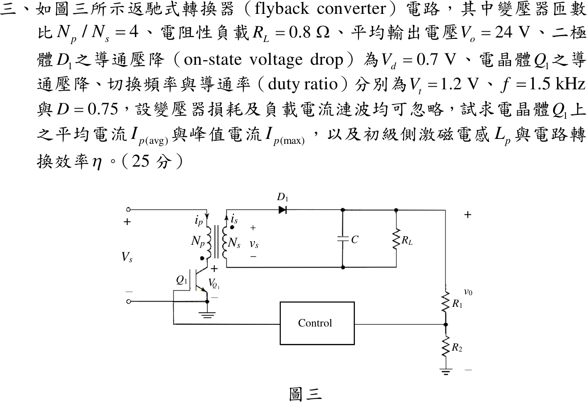
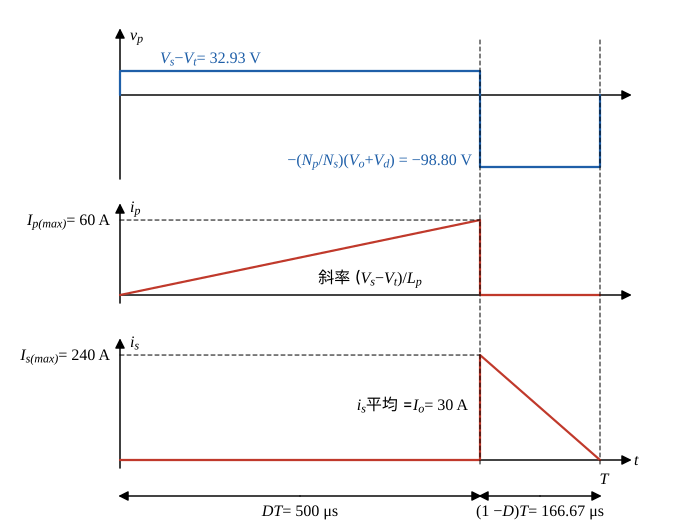

# 109 年電子學第 3 題｜返馳式轉換器

## 已知與所求

返馳式轉換器 $N_p/N_s=4$，$R_L=0.8\,\Omega$、$V_o=24\,\mathrm V$、$V_d=0.7\,\mathrm V$、$V_t=1.2\,\mathrm V$、$f=1.5\,\mathrm{kHz}$、$D=0.75$；忽略變壓器損耗與負載電流漣波，$V_s$ 未給。求 $I_{p(avg)}$、$I_{p(max)}$、$L_p$、$\eta$。題圖中 $R_1$、$R_2$ 與 Control 方塊只是回授取樣與控制，不影響穩態功率級計算。

參考書主解採磁化電流由零開始的 DCM 三角波，且 $I_{p(avg)}$ 指整個週期平均。

## 考場標準作答

**解題邏輯**：一週期分兩段：$Q_1$ 導通 $DT$ 時一次側激磁電感承受 $V_s-V_t$、電流由零線性上升，二次側二極體逆偏；$Q_1$ 截止 $(1-D)T$ 時儲能經 $D_1$ 釋放，一次側反射電壓為 $\frac{N_p}{N_s}(V_o+V_d)$。先以一次側伏秒平衡求未給的 $V_s$；再由「二次側三角波平均 = $I_o$」求 $I_{s(max)}$，換到一次側得 $I_{p(max)}$；三角波面積給 $I_{p(avg)}$；導通段斜率給 $L_p$；最後 $\eta=P_o/(V_sI_{p(avg)})$。

### 步驟 1：負載電流與輸出功率

\[
I_o=\frac{V_o}{R_L}=\frac{24}{0.8}=30\ \mathrm A
\]
\[
P_o=V_oI_o=24\times30=720\ \mathrm W
\]

### 步驟 2：伏秒平衡求 $V_s$

導通段一次側跨壓 $V_s-V_t$；截止段二次側跨壓 $V_o+V_d$，反射到一次側為 $\frac{N_p}{N_s}(V_o+V_d)$。穩態下一次側伏秒平衡：
\[
(V_s-V_t)D=\frac{N_p}{N_s}(V_o+V_d)(1-D)
\]
反射電壓：
\[
\frac{N_p}{N_s}(V_o+V_d)=4\times(24+0.7)=4\times24.7=98.80\ \mathrm V
\]
\[
V_s-V_t=\frac{98.80\times0.25}{0.75}=\frac{98.8}{3}=32.93\ \mathrm V
\]
\[
V_s=\frac{98.8}{3}+1.2=\frac{102.4}{3}=34.13\ \mathrm V
\]
時間：
\[
DT=\frac{D}{f}=\frac{0.75}{1500}=500\ \mu\mathrm s,\qquad (1-D)T=\frac{0.25}{1500}=\frac{500}{3}\ \mu\mathrm s
\]

### 步驟 3：一週期波形

- 導通 $0<t<DT$：$v_p=V_s-V_t=32.93\,\mathrm V$，$i_p$ 由 0 線性升到 $I_{p(max)}$，$i_s=0$。
- 截止 $DT<t<T$：$i_p=0$，$i_s$ 由 $I_{s(max)}=\frac{N_p}{N_s}I_{p(max)}$ 線性降到 0（參考書取恰在週期結束歸零）。

### 峰值電流 $I_{p(max)}$

**邏輯**：負載電流漣波可忽略，電容平均電流為零，所以二次側二極體電流（圖 1 下方三角形）的整週期平均等於 $I_o$；三角形高 $I_{s(max)}$、底 $(1-D)T$。

\[
I_o=\frac{\tfrac12I_{s(max)}(1-D)T}{T}=\tfrac12I_{s(max)}(1-D)
\]
\[
I_{s(max)}=\frac{2I_o}{1-D}=\frac{2\times30}{0.25}=240\ \mathrm A
\]
匝數比換到一次側（安匝相等）：
\[
\boxed{I_{p(max)}=\frac{N_s}{N_p}I_{s(max)}=\frac{240}{4}=60\text{ A}}
\]

### 平均電流 $I_{p(avg)}$

**邏輯**：$i_p$ 只在導通段為 $0\to I_{p(max)}$ 的直線（DCM 三角波），區間平均為峰值一半；乘導通比例 $D$ 得整個週期平均（參考書定義）。

\[
I_{p,\,avg\mid on}=\frac{I_{p(max)}}2=30\,\mathrm A\qquad\left(\frac{60}{2}=30\right)
\]
\[
\boxed{I_{p,\,avg}=D\,I_{p,\,avg\mid on}=0.75\times30=22.50\ \mathrm A}
\]

### 激磁電感 $L_p$

**邏輯**：導通期間一次側電感承受 $V_s-V_t$，電流由零線性上升到 $I_{p(max)}$；斜率 $\dfrac{V_s-V_t}{L_p}$ 乘導通時間 $DT$ 即為 $I_{p(max)}$，反解 $L_p$。

\[
I_{p(max)}=\frac{(V_s-V_t)DT}{L_p}\ \Rightarrow\ L_p=\frac{(V_s-V_t)DT}{I_{p(max)}}
\]
代入（$V_s-V_t$ 用精確值 $98.8/3$）：
\[
L_p=\frac{(98.8/3)\times500\,\mu\mathrm s}{60}=\frac{49400}{180}\ \mu\mathrm H
\]
\[
\boxed{L_p=274.44\ \mu\text{H}}
\]

### 效率 $\eta$

**邏輯**：忽略變壓器損耗，效率 = 輸出功率 ÷ 電源平均輸入功率；輸入功率是 $V_s$ 乘一次側「整個週期」平均電流 $I_{p,\,avg}$（不是導通區間平均 $30\,\mathrm A$）。

\[
P_{in}=V_sI_{p,\,avg}=\frac{102.4}{3}\times22.50=\frac{2304}{3}=768\ \mathrm W
\]
\[
\eta=\frac{P_o}{P_{in}}=\frac{720}{768}=0.9375
\]
\[
\boxed{\eta=93.75\%}
\]

## 驗算

- 能量法：每週期傳送 $\frac12L_pI_{p(max)}^2f=\frac12\times274.44\times10^{-6}\times60^2\times1500=741.0\,\mathrm W$，等於 $(V_o+V_d)I_o=24.7\times30=741\,\mathrm W$。
- 退磁時間 $t_{demag}=\dfrac{L_pI_{p(max)}}{(N_p/N_s)(V_o+V_d)}=\dfrac{(49400/180)\,\mu\times60}{98.80}=\dfrac{500}{3}\,\mu\mathrm s=166.67\,\mu\mathrm s=(1-D)T$，電流恰在週期結束歸零。
- 損耗分帳：$V_tI_{p,avg}+V_dI_o=1.2\times22.5+0.7\times30=27+21=48\,\mathrm W=768-720$。

## 失分點

- 用導通區間平均 $30\,\mathrm A$ 乘 $V_s$，輸入功率多算成 $1024\,\mathrm W$。
- 二次側三角波只在 $(1-D)T=0.25T$ 內導通，誤用 $D$ 會得 $I_{p(max)}=20\,\mathrm A$。
- 反射電壓要含二極體壓降：$4(24+0.7)=98.80\,\mathrm V$。

## 條件與疑義

題圖未明示 CCM/DCM，也未定義 $I_{p(avg)}$ 是導通區間平均或整個週期平均；另須區分 $I_{p,avg\mid on}=I_{p(max)}/2$ 與 $I_{p,avg}=D\,I_{p,avg\mid on}$ 兩種定義。由 $t_{demag}=t_{off}$，參考書數值恰落在 DCM／臨界導通模式（CrCM）邊界。

$V_s$、$I_{p,avg}=22.50\,\mathrm A$ 與 $\eta=93.75\%$ 只由平均功率與伏秒平衡決定，CCM 下也相同；若實為 CCM，初級電流有未給定的谷值 $I_{p,valley}>0$，$I_{p(max)}$ 與 $L_p$ 須另給谷值或波形才能唯一決定。
