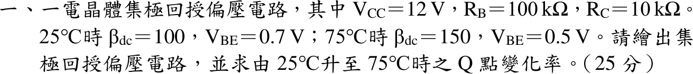
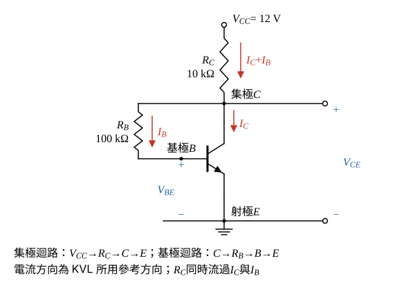

# 110 年電子學第 1 題｜集極回授偏壓的溫度穩定度

## 已知與所求

$V_{CC}=12\,\mathrm V$、$R_B=100\,\mathrm{k}\Omega$、$R_C=10\,\mathrm{k}\Omega$；$25^\circ\mathrm C$：$\beta_{dc}=100$、$V_{BE}=0.7\,\mathrm V$；$75^\circ\mathrm C$：$\beta_{dc}=150$、$V_{BE}=0.5\,\mathrm V$。繪出集極回授偏壓電路，求 $25\to75^\circ\mathrm C$ 的 Q 點變化率（共 25 分）。以下記 $\beta=\beta_{dc}$。

## 考場標準作答

**解題邏輯**：先畫出集極回授偏壓電路（$R_B$ 由集極接回基極）。前提：兩個溫度下 BJT 都在**主動區**（$I_C=\beta I_B$、$V_{BE}$ 取題給值，最後以 $V_{CE}>V_{CE(sat)}=0.2\,\mathrm V$ 驗證），並忽略 $I_{CBO}$ 的溫度變化（題目只給 $\beta$ 與 $V_{BE}$）。對集極迴路、基極迴路各列 KVL，消去 $V_{CE}$ 得 $I_B$ 通式；分別代入 $25^\circ\mathrm C$、$75^\circ\mathrm C$ 參數求 Q 點 $(I_C,V_{CE})$，再以 $25^\circ\mathrm C$ 為基準算兩量的變化率。

### 步驟 1：集極回授偏壓電路

- NPN 射極接地；$R_C$ 由 $V_{CC}$ 接到集極 $C$；$R_B$ 由集極 $C$ 接回基極 $B$，沒有其他基極偏壓源。
- 集極節點 KCL：由 $R_C$ 流下的電流分成進集極的 $I_C$ 與經 $R_B$ 流向基極的 $I_B$，故 $R_C$ 流過 $I_C+I_B$。
- 回授機制：$I_C$ 增加 → $R_C$ 壓降增加 → $V_{CE}$ 下降 → $I_B=(V_{CE}-V_{BE})/R_B$ 減少，抑制 $I_C$ 的增加。

### 步驟 2：工作點通式

集極迴路（$V_{CC}\to R_C\to C\to E$）：
\[
V_{CC}=(I_C+I_B)R_C+V_{CE}
\]
基極迴路（$C\to R_B\to B\to E$）：
\[
V_{CE}=I_BR_B+V_{BE}
\]
將基極迴路的 $V_{CE}$ 代入集極迴路，並以 $I_C=\beta I_B$ 代換：
\[
V_{CC}=(\beta+1)I_BR_C+I_BR_B+V_{BE}
\]
\[
I_B=\frac{V_{CC}-V_{BE}}{R_B+(\beta+1)R_C},\qquad I_C=\beta I_B,\qquad V_{CE}=I_BR_B+V_{BE}
\]

### 步驟 3：$25^\circ\mathrm C$ 的 Q 點（$\beta=100$、$V_{BE}=0.7\,\mathrm V$）

\[
R_B+(\beta+1)R_C=100\,\mathrm{k}\Omega+101\times10\,\mathrm{k}\Omega=1110\,\mathrm{k}\Omega
\]
\[
I_B=\frac{12-0.7}{1110\,\mathrm{k}\Omega}=\frac{11.30\,\mathrm V}{1110\,\mathrm{k}\Omega}=10.180\,\mu\mathrm A
\]
\[
I_C=\beta I_B=100\times10.180\,\mu\mathrm A=1018.0\,\mu\mathrm A=1.0180\,\mathrm{mA}
\]
\[
I_BR_B=10.180\,\mu\mathrm A\times100\,\mathrm{k}\Omega=1.0180\,\mathrm V
\]
\[
V_{CE}=I_BR_B+V_{BE}=1.0180+0.7=1.7180\,\mathrm V
\]
（變化率要相減後再除，4 位有效會使框內末位偏差，故此鏈保留 5 位有效數字。）

### 步驟 4：$75^\circ\mathrm C$ 的 Q 點（$\beta=150$、$V_{BE}=0.5\,\mathrm V$）

\[
R_B+(\beta+1)R_C=100\,\mathrm{k}\Omega+151\times10\,\mathrm{k}\Omega=1610\,\mathrm{k}\Omega
\]
\[
I_B=\frac{12-0.5}{1610\,\mathrm{k}\Omega}=\frac{11.50\,\mathrm V}{1610\,\mathrm{k}\Omega}=7.1429\,\mu\mathrm A
\]
\[
I_C=\beta I_B=150\times7.1429\,\mu\mathrm A=1071.4\,\mu\mathrm A=1.0714\,\mathrm{mA}
\]
\[
I_BR_B=7.1429\,\mu\mathrm A\times100\,\mathrm{k}\Omega=0.71429\,\mathrm V
\]
\[
V_{CE}=I_BR_B+V_{BE}=0.71429+0.5=1.2143\,\mathrm V
\]
主動區檢查：$1.7180\,\mathrm V$ 與 $1.2143\,\mathrm V$ 皆大於 $V_{CE(sat)}=0.2\,\mathrm V$，兩溫度都在主動區，前提成立。

### Q 點變化率（$25\to75^\circ\mathrm C$）

**邏輯**：Q 點是 $(I_C,V_{CE})$ 兩個量，變化率以 $25^\circ\mathrm C$ 為基準：$\dfrac{X_{75}-X_{25}}{X_{25}}\times100\%$。

集極電流：
\[
\Delta I_C=1.0714-1.0180=0.0534\,\mathrm{mA}
\]
\[
\frac{\Delta I_C}{I_C}=\frac{0.0534\,\mathrm{mA}}{1.0180\,\mathrm{mA}}=0.05246
\]
\[
\boxed{\frac{\Delta I_C}{I_C}=+5.25\%}
\]
集射極電壓：
\[
\Delta V_{CE}=1.2143-1.7180=-0.5037\,\mathrm V
\]
\[
\frac{\Delta V_{CE}}{V_{CE}}=\frac{-0.5037\,\mathrm V}{1.7180\,\mathrm V}=-0.2932
\]
\[
\boxed{\frac{\Delta V_{CE}}{V_{CE}}=-29.32\%}
\]
$\beta$ 增加 50% 而 $I_C$ 只增加 5.25%，集極回授有穩定作用；代價是 $V_{CE}$ 下降約三成。

## 驗算

集極迴路回代：$25^\circ\mathrm C$ 時 $(1018.0+10.180)\,\mu\mathrm A\times10\,\mathrm{k}\Omega=10.282\,\mathrm V$，加 $V_{CE}=1.7180\,\mathrm V$ 得 $12.000\,\mathrm V$；$75^\circ\mathrm C$ 時 $(1071.4+7.1429)\,\mu\mathrm A\times10\,\mathrm{k}\Omega=10.785\,\mathrm V$，加 $1.2143\,\mathrm V$ 得 $11.999\,\mathrm V\approx12\,\mathrm V$（末位為四捨五入誤差）。

## 失分點

- $R_C$ 上的電流寫成 $I_C$（漏 $I_B$），分母變 $R_B+\beta R_C$，得 $I_C=1.03\to1.08\,\mathrm{mA}$、變化率 4.95%。
- $V_{CE}$ 由 $V_{CC}-I_CR_C$ 計算而漏掉 $I_BR_C$，$25^\circ\mathrm C$ 會得 $1.82\,\mathrm V$。
- 只算 $I_C$ 變化率而漏了 $V_{CE}$；Q 點是 $(I_C,V_{CE})$ 兩個量。
