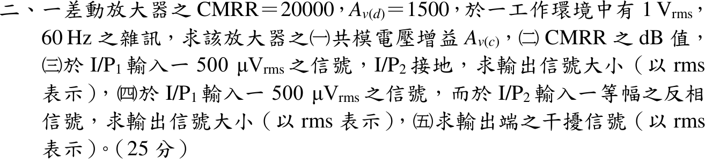

# 110 年電子學第 2 題｜差動放大器與 CMRR

## 已知與所求

$\mathrm{CMRR}=20000$、$A_{v(d)}=1500$，環境有 $1\,\mathrm V_{rms}$、$60\,\mathrm{Hz}$ 雜訊（兩輸入端共模耦合）。求（一）$A_{v(c)}$；（二）CMRR 的 dB 值；（三）$I/P_1$ 加 $500\,\mu\mathrm V_{rms}$、$I/P_2$ 接地的輸出；（四）$I/P_1$、$I/P_2$ 加等幅反相 $500\,\mu\mathrm V_{rms}$ 的輸出；（五）輸出端干擾。

## 考場標準作答

差動放大器的線性模型：輸出為差模分量與共模分量各乘自身增益後相加（疊加原理），其中 $v_d=v_1-v_2$、$v_{cm}=\frac{v_1+v_2}2$。
\[
v_o=A_{v(d)}v_d+A_{v(c)}v_{cm}
\]

### （一）共模增益

依 CMRR 的定義（差模增益與共模增益之比）反求共模增益：
\[
\mathrm{CMRR}=\frac{A_{v(d)}}{A_{v(c)}}\ \Rightarrow\ A_{v(c)}=\frac{A_{v(d)}}{\mathrm{CMRR}}=\frac{1500}{20000}
\]
\[
\boxed{A_{v(c)}=7.50\times10^{-2}}
\]

### （二）CMRR（dB）

CMRR 是電壓增益比，換成分貝用 $20\log_{10}$：
\[
\mathrm{CMRR}_{dB}=20\log_{10}(2\times10^{4})=20\,(4+\log_{10}2)
\]
\[
\boxed{\mathrm{CMRR}_{dB}=86.02\ \mathrm{dB}}
\]

### （三）單端輸入

$I/P_1$ 輸入、$I/P_2$ 接地，先拆成差模與共模分量（模型：兩者分別放大再疊加）：
\[
v_d=500\ \mu\mathrm V-0=500\ \mu\mathrm V,\qquad v_{cm}=\frac{500\ \mu\mathrm V+0}{2}=250\ \mu\mathrm V
\]
差模項與共模項分別為
\[
A_{v(d)}v_d=1500\times500\ \mu\mathrm V=0.75\ \mathrm V,\qquad A_{v(c)}v_{cm}=7.50\times10^{-2}\times250\ \mu\mathrm V=18.75\ \mu\mathrm V
\]
共模項遠小於差模項，疊加後
\[
v_o=0.75\ \mathrm V+18.75\ \mu\mathrm V
\]
\[
\boxed{v_o=0.75\ \mathrm V_{rms}}
\]

### （四）等幅反相輸入

兩端等幅反相，共模分量互相抵消，只剩差模分量（線性疊加）：
\[
v_d=500\ \mu\mathrm V-(-500\ \mu\mathrm V)=1\ \mathrm{mV},\qquad v_{cm}=\frac{500\ \mu\mathrm V-500\ \mu\mathrm V}{2}=0
\]
\[
v_o=1500\times1\ \mathrm{mV}+7.50\times10^{-2}\times0
\]
\[
\boxed{v_o=1.50\ \mathrm V_{rms}}
\]

### （五）輸出干擾

$1\ \mathrm V_{rms}$、$60\ \mathrm{Hz}$ 的雜訊同時耦合到兩輸入端，兩端等大同相，故 $v_d=0$、$v_{cm}=1\ \mathrm V$，雜訊只被共模增益放大：
\[
v_d=1\ \mathrm V-1\ \mathrm V=0,\qquad v_{cm}=\frac{1\ \mathrm V+1\ \mathrm V}{2}=1\ \mathrm V
\]
\[
v_{o,n}=A_{v(d)}\times0+A_{v(c)}\times1\ \mathrm V=7.50\times10^{-2}\times1\ \mathrm V
\]
\[
\boxed{v_{o,n}=75\ \mathrm{mV_{rms}}}
\]
此干擾若換算回輸入端，相當於 $v_{o,n}/A_{v(d)}=75\ \mathrm{mV}/1500=50\ \mu\mathrm V$ 的差模訊號，約為 $500\ \mu\mathrm V$ 輸入訊號的十分之一；輸出端訊號（（三）$0.75\ \mathrm V$）對干擾（$75\ \mathrm{mV}$）比為 $10$ 倍。

## 驗算

以單端增益拆解（四）：只加 $v_1$ 得 $0.75\,\mathrm V$，只加 $-v_1$ 於 $I/P_2$ 又得同相 $0.75\,\mathrm V$，疊加為 $1.50\,\mathrm V$，與 $v_d=1\,\mathrm{mV}$ 一致。訊號對干擾比：（四）$1.50/(7.50\times10^{-2})=20$ 倍，等於 $\mathrm{CMRR}\times\frac{1\,\mathrm{mV}}{1\,\mathrm V}=20$。

## 失分點

- （三）的差模輸入是 $500\,\mu\mathrm V$ 而非 $250\,\mu\mathrm V$；$250\,\mu\mathrm V$ 是共模成分。
- （四）兩端反相，$v_d=1\,\mathrm{mV}$，輸出加倍為 $1.50\,\mathrm V$，不是 $0.75\,\mathrm V$。
- CMRR 換 dB 用 $20\log$（電壓比），用 $10\log$ 會得 43.01 dB。
