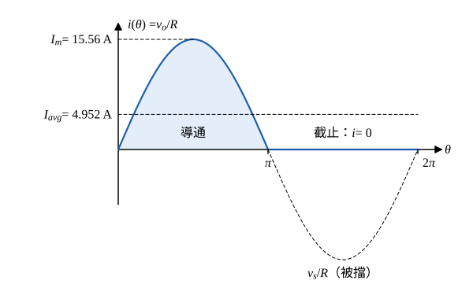

# 110 年電子學第 3 題｜半波整流器

## 已知與所求

單一二極體半波整流，$v_s=V_m\sin\omega t$，$110\,\mathrm V_{rms}$、$60\,\mathrm{Hz}$，純電阻負載 $R=10\,\Omega$；題面未給二極體壓降，取理想二極體。求（一）平均負載電流；（二）負載平均功率；（三）功率因數。

## 考場標準作答

### 步驟 1：峰值與一週期波形

峰值電壓（題給為有效值）：
\[
V_m=\sqrt2\,V_{s,rms}=110\sqrt2=155.6\ \mathrm V
\]
以理想二極體模型：電源正半週導通、負半週截止；純電阻負載無續流路徑，負半週負載與電源電流都為零。令 $\theta=\omega t$：
\[
v_o(\theta)=\begin{cases}V_m\sin\theta,&0<\theta<\pi\\0,&\pi<\theta<2\pi\end{cases},\qquad i_s(\theta)=i_L(\theta)=v_o(\theta)/R
\]
電流峰值：
\[
I_m=\frac{V_m}{R}=\frac{155.6}{10}=15.56\ \mathrm A
\]

### （一）平均負載電流

\[
I_{avg}=\frac1{2\pi}\int_0^{\pi}\frac{V_m\sin\theta}{R}\,d\theta=\frac{V_m}{2\pi R}\Big[-\cos\theta\Big]_0^\pi=\frac{V_m}{\pi R}
\]
代入：
\[
I_{avg}=\frac{155.6}{10\pi}=\frac{155.6}{31.42}=4.952\ \mathrm A
\]
\[
\boxed{I_{avg}=4.95\ \mathrm A}
\]

### （二）負載平均功率

電阻的平均功率由電流方均根值決定（$P=I_{rms}^2R$），不能用平均值代替：

\[
I_{rms}^2=\frac1{2\pi}\int_0^{\pi}\left(\frac{V_m\sin\theta}{R}\right)^2d\theta=\frac{V_m^2}{2\pi R^2}\cdot\frac{\pi}{2}=\frac{V_m^2}{4R^2}
\]
\[
I_{rms}=\frac{V_m}{2R}=\frac{110\sqrt2}{2\times10}=5.5\sqrt2=7.778\ \mathrm A
\]
功率（$V_m^2=(110\sqrt2)^2=24200$ 為精確值）：
\[
P=I_{rms}^2R=\frac{V_m^2}{4R}=\frac{24200}{4\times10}=\frac{24200}{40}
\]
\[
\boxed{P=605\ \mathrm W}
\]

### （三）功率因數

電源、二極體、負載串成單一迴路，故 $I_{s,rms}=I_{rms}$。

\[
I_{s,rms}=I_{rms}=7.778\ \mathrm A,\qquad V_{s,rms}=110\ \mathrm V
\]
視在功率：
\[
S=V_{s,rms}I_{s,rms}=110\times7.778=855.6\ \mathrm{VA}
\]
\[
\mathrm{PF}=\frac{P}{S}=\frac{605}{855.6}=0.7071
\]
\[
\boxed{\mathrm{PF}=0.71}
\]
符號式：$\mathrm{PF}=\dfrac{V_m^2/(4R)}{(V_m/\sqrt2)(V_m/2R)}=\dfrac{1}{\sqrt2}$，與數值相符。此為非正弦電流的總功率因數（含波形失真），不標超前或落後。

## 驗算

傅立葉功率和：$v_o=\frac{V_m}{\pi}+\frac{V_m}{2}\sin\theta-\sum_{n=2,4,\ldots}\frac{2V_m}{\pi(n^2-1)}\cos n\theta$。直流分量功率 $\dfrac{(V_m/\pi)^2}{R}=\dfrac{24200}{10\pi^2}=245.2\ \mathrm W$；基波振幅 $V_m/2=55\sqrt2\ \mathrm V$，功率 $\dfrac{(55\sqrt2)^2}{2\times10}=\dfrac{6050}{20}=302.5\ \mathrm W$；偶次諧波合計 $605-245.2-302.5=57.3\ \mathrm W$，與逐項級數和一致。

## 失分點

- 用 $I_{avg}^2R=4.952^2\times10=245.2\,\mathrm W$ 當功率；非直流波形必須用 rms。
- 純電阻就答 PF $=1$；半波電流的失真使 PF 只有 $0.71$。
- 把 $110\,\mathrm V$ 當峰值，得 $I_{avg}=3.50\,\mathrm A$。
