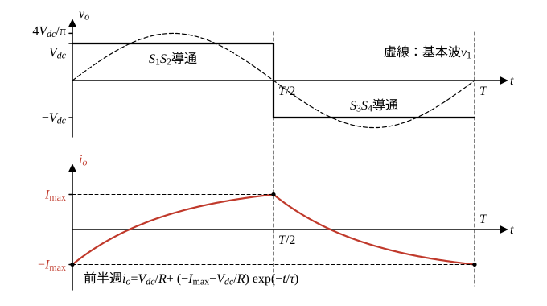

# 110 年電子學第 4 題｜方波逆變器 THD

## 已知與所求

全橋方波逆變器（$S_1S_2$ 與 $S_3S_4$ 交替導通，$v_o=\pm V_{dc}$），RL 負載 $R=12\,\Omega$、$L=10\,\mathrm{mH}$，$f=300\,\mathrm{Hz}$，負載電流基本波有效值 $I_{1}=6\,\mathrm A$。求 $V_{dc}$ 與負載電流 THD。

## 考場標準作答

**解題邏輯**：前提為理想開關、方波（180°）控制：前半週觸發 $S_1S_2$、後半週觸發 $S_3S_4$，電流反向時由反並聯二極體續流，所以不論 $i_o$ 正負都有 $v_o=\pm V_{dc}$；電路已達穩態，RL 為線性負載。直流電源由「方波基本波 × 基本波阻抗 = 基本波電流」反求；THD 需要全部諧波電流，改由時域精確解：穩態 $i_o$ 是兩段指數曲線，積分得總有效值 $I_{rms}$，諧波有效值 $I_h=\sqrt{I_{rms}^2-I_1^2}$，$\mathrm{THD}=I_h/I_1$。

### 步驟 1：方波的基本波與基本波阻抗

$\pm V_{dc}$ 方波的傅立葉級數只有奇次項：
\[
v_o(t)=\sum_{n=1,3,5,\ldots}\frac{4V_{dc}}{n\pi}\sin n\omega t
\]
基本波 $v_1(t)$ 峰值 $4V_{dc}/\pi$，有效值：
\[
V_1=\frac{4V_{dc}}{\sqrt2\,\pi}
\]
角頻率與基本波電抗：
\[
\omega=2\pi f=2\pi\times300=600\pi=1884.956\ \mathrm{rad/s}
\]
\[
X_1=\omega L=1884.956\times0.01=18.84956\ \Omega
\]
（$X_1/R=6\pi/12=\pi/2$，後面 THD 會用到。）基本波阻抗的大小與角度：
\[
|Z_1|=\sqrt{R^2+X_1^2}=\sqrt{12^2+18.84956^2}=\sqrt{144+355.3059}=\sqrt{499.3059}=22.34515\ \Omega
\]
\[
\theta_1=\tan^{-1}\frac{X_1}{R}=\tan^{-1}\frac{18.84956}{12}=\tan^{-1}1.570797=57.52^\circ
\]
（$\theta_1$ 為基本波電流落後電壓的角度，後面不需要。）
（此題 THD 需要多位數連算，故 $|Z_1|$ 保留 7 位有效數字。）

### 所需直流電源 $V_{dc}$

**邏輯**：RL 為線性負載，基本波電壓只產生基本波電流，$V_1=I_1|Z_1|$；再由方波基本波有效值 $V_1=4V_{dc}/(\sqrt2\pi)$ 反解 $V_{dc}$。

\[
V_1=I_1|Z_1|=6\times22.34515=134.0709\ \mathrm V
\]
\[
V_{dc}=\frac{\sqrt2\,\pi}{4}V_1=1.110721\times134.0709=148.9154\ \mathrm V
\]
\[
\boxed{V_{dc}=148.92\ \mathrm V}
\]

### 負載電流 THD

**邏輯**：THD 定義為諧波電流總有效值對基本波電流的比值；諧波有無限多項，用「總有效值平方 = 基本波平方 + 諧波平方」改由時域穩態電流的有效值求，避免無窮級數。

時間常數與半週期的比值：
\[
\tau=\frac{L}{R}=\frac{0.01}{12}=0.8333\ \mathrm{ms},\qquad \frac{T}{2}=\frac{1}{2\times300}=1.667\ \mathrm{ms}
\]
\[
\frac{T/2}{\tau}=\frac{1/600}{1/1200}=2
\]
前半週（$0<t<T/2$，$v_o=+V_{dc}$）一階 RL 響應：
\[
L\frac{di_o}{dt}+Ri_o=V_{dc}\ \Rightarrow\ i_o(t)=\frac{V_{dc}}{R}+\left(i_o(0)-\frac{V_{dc}}{R}\right)e^{-t/\tau}
\]
穩態半波對稱：$i_o(0)=-I_{\max}$、$i_o(T/2)=+I_{\max}$（圖 1）。令 $a=V_{dc}/R$，代入 $t=T/2$（$e^{-2}$）：
\[
I_{\max}=a+(-I_{\max}-a)e^{-2}
\]
\[
I_{\max}(1+e^{-2})=a(1-e^{-2})\ \Rightarrow\ I_{\max}=a\,\frac{1-e^{-2}}{1+e^{-2}}=a\tanh1
\]
數值：
\[
a=\frac{148.9154}{12}=12.40962\ \mathrm A,\qquad \tanh1=0.7615942
\]
\[
I_{\max}=12.40962\times0.7615942=9.451\ \mathrm A
\]

總有效值（半波對稱，取前半週平均）。令 $b=a+I_{\max}=a(1+\tanh1)$，前半週 $i_o=a-be^{-t/\tau}$：
\[
I_{rms}^2=\frac{1}{T/2}\int_0^{T/2}\left(a-be^{-t/\tau}\right)^2dt
=a^2-2ab\,\frac{\tau}{T/2}\left(1-e^{-2}\right)+b^2\,\frac{\tau}{T}\left(1-e^{-4}\right)
\]
代入 $\tau/(T/2)=1/2$、$\tau/T=1/4$：
\[
I_{rms}^2=a^2-ab\left(1-e^{-2}\right)+\frac{b^2}{4}\left(1-e^{-4}\right)
\]
用 $1+\tanh1=\dfrac{2}{1+e^{-2}}$ 化簡兩項：
\[
ab\left(1-e^{-2}\right)=a^2\cdot\frac{2\left(1-e^{-2}\right)}{1+e^{-2}}=2a^2\tanh1
\]
\[
\frac{b^2}{4}\left(1-e^{-4}\right)=\frac{a^2}{4}\cdot\frac{4\left(1-e^{-2}\right)\left(1+e^{-2}\right)}{\left(1+e^{-2}\right)^2}=a^2\tanh1
\]
\[
I_{rms}^2=a^2-2a^2\tanh1+a^2\tanh1=a^2\left(1-\tanh1\right)
\]
THD 只需比值 $I_{rms}^2/I_1^2$。由 $V_{dc}$ 的式子，$a=\dfrac{V_{dc}}{R}=\dfrac{\sqrt2\pi|Z_1|I_1}{4R}$，
\[
\left(\frac{a}{I_1}\right)^2=\frac{\pi^2}{8}\cdot\frac{|Z_1|^2}{R^2}=\frac{\pi^2}{8}\left[1+\left(\frac{X_1}{R}\right)^2\right]=\frac{\pi^2}{8}\left(1+\frac{\pi^2}{4}\right)
\]
\[
\left(\frac{a}{I_1}\right)^2=1.233701\times3.467401=4.277736
\]
\[
\frac{I_{rms}^2}{I_1^2}=4.277736\times(1-0.7615942)=4.277736\times0.2384058=1.019837
\]
諧波總有效值對基本波的比值：
\[
\mathrm{THD}_i=\frac{I_h}{I_1}=\frac{\sqrt{I_{rms}^2-I_1^2}}{I_1}=\sqrt{\frac{I_{rms}^2}{I_1^2}-1}=\sqrt{1.019837-1}=\sqrt{0.019837}=0.14084
\]
\[
\boxed{\mathrm{THD}_i=14.08\%}
\]
對應的電流值：$I_{rms}=6\sqrt{1.019837}=6.059\ \mathrm A$，$I_h=0.14084\times6=0.8450\ \mathrm A$。

## 驗算

- 頻域逐項相加：第 $n$ 次諧波 $I_n=\dfrac{V_1/n}{\sqrt{R^2+(nX_1)^2}}$。$n=3$：$\dfrac{44.6903}{57.8079}=773.08\,\mathrm{mA}$；$n=5$：$\dfrac{26.8142}{95.0087}=282.23\,\mathrm{mA}$；$n=7$：$\dfrac{19.1530}{132.4914}=144.56\,\mathrm{mA}$。只取 $3,5,7$ 次得 $\sqrt{773.08^2+282.23^2+144.56^2}=835.59\,\mathrm{mA}$（13.93%）；加到 19 次得 $844.44\,\mathrm{mA}$（14.07%），逐步收斂到時域值 $845.06\,\mathrm{mA}$（14.08%），兩法一致。
- 由 $a$ 直接算：$I_{rms}^2=a^2(1-\tanh1)=12.40962^2\times0.2384058=36.714\,\mathrm{A^2}$，$I_{rms}=6.059\,\mathrm A$，與比值法相同。
- 半波對稱：以 $I_{\max}=a\tanh1=9.45109\,\mathrm A$（多保留位數）代入：$i_o(T/2)=a-(a+I_{\max})e^{-2}=12.40962-21.86071\times0.1353353=12.40962-2.95853=9.451\,\mathrm A=I_{\max}$。

## 失分點

- 基本波有效值是 $\frac{4V_{dc}}{\sqrt2\pi}=0.90V_{dc}$，漏 $\sqrt2$ 會得 $V_{dc}=105.30\,\mathrm V$。
- 諧波阻抗要用 $nX_1$，不能沿用 $|Z_1|$；否則 $I_n=I_1/n$，THD 變成電壓的 48.34%。
- THD 分母是基本波 $6\,\mathrm A$，不是總有效值；只取到 7 次諧波會低估成 13.93%。
