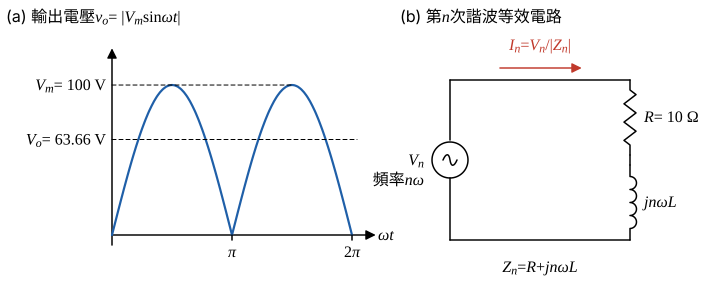

# 111 年電子學第 1 題｜橋式全波整流 RL 負載

## 已知與所求

理想二極體橋式整流，$v_s=V_m\sin\omega t$，$V_m=100\,\mathrm V$、$f=60\,\mathrm{Hz}$，負載串聯 $R=10\,\Omega$、$L=12\,\mathrm{mH}$。題給 $v_o=V_o+\sum_{n=2,4,\ldots}V_n\cos(n\omega t+\pi)$，$V_n=V_o\left(\frac1{n-1}-\frac1{n+1}\right)=\frac{2V_o}{n^2-1}$。求（一）$V_o$；（二）最初兩個交流項電流 $I_2,I_4$；（三）負載消耗功率；（四）功率因數。

## 考場標準作答

**解題邏輯**：理想橋式整流使 $v_o=|v_s|$（電流連續、驗算段確認），$v_o$ 依題給傅立葉級數拆成直流項加偶次諧波。負載 $R$–$L$ 為線性，可逐項疊加：直流項只看 $R$，第 $n$ 次諧波以阻抗 $Z_n=R+jn\omega L$ 求電流振幅。依序求 $V_o$ → $I_0$、$I_2$、$I_4$ → 以各分量方均值相加得 $I_{rms}^2$ 與 $P$ → $\mathrm{PF}=P/(V_{s,rms}I_{s,rms})$。

### 步驟 1：輸出波形與逐項等效電路

- 圖 1(a)：$v_o=|V_m\sin\omega t|$，週期為 $\pi$（角度），平均值即直流項 $V_o$。
- 圖 1(b)：疊加原理下每一項單獨作用；直流時電感短路，只剩 $R$；第 $n$ 次諧波時電感阻抗 $jn\omega L$。

角頻率：
\[
\omega=2\pi f=2\pi\times60=377.0\ \mathrm{rad/s}
\]

### （一）直流輸出電壓

**邏輯**：傅立葉級數的常數項就是 $v_o$ 的平均值；$v_o$ 每半週重複，只需在 $0\sim\pi$ 積分再除以 $\pi$。

\[
V_o=\frac1\pi\int_0^\pi V_m\sin\theta\,d\theta=\frac{V_m}{\pi}\Big[-\cos\theta\Big]_0^\pi=\frac{2V_m}{\pi}
\]
代入 $V_m=100\ \mathrm V$：
\[
V_o=\frac{2\times100}{\pi}=\frac{200}{\pi}
\]
\[
\boxed{V_o=63.66\ \mathrm V}
\]

### 步驟 2：直流項電流

直流時電感視為短路（圖 1(b) 取 $n=0$），只剩 $R$：
\[
I_0=\frac{V_o}{R}=\frac{63.66}{10}=6.366\ \mathrm A
\]

### （二）最初兩個交流項電流（振幅）

**邏輯**：每個交流項是頻率 $n\omega$ 的弦波電源，套圖 1(b)：電流振幅 $I_n=V_n/|Z_n|$，$|Z_n|=\sqrt{R^2+(n\omega L)^2}$；最初兩項為 $n=2,4$。

$n=2$ 諧波電壓：
\[
V_2=\frac{2V_o}{2^2-1}=\frac23V_o=\frac23\times63.66=42.44\ \mathrm V
\]
電抗：
\[
2\omega L=2\times377.0\times12\times10^{-3}=9.048\ \Omega
\]
阻抗大小與角度：
\[
|Z_2|=\sqrt{10^2+9.048^2}=\sqrt{100+81.87}=\sqrt{181.9}=13.49\ \Omega
\]
\[
\angle Z_2=\tan^{-1}\frac{9.048}{10}=42.14^\circ
\]
電流振幅：
\[
I_2=\frac{V_2}{|Z_2|}=\frac{42.44}{13.49}=3.146\ \mathrm A
\]
\[
\boxed{I_2=3.15\ \mathrm A}
\]

$n=4$ 諧波電壓：
\[
V_4=\frac{2V_o}{4^2-1}=\frac2{15}V_o=\frac2{15}\times63.66=8.488\ \mathrm V
\]
電抗：
\[
4\omega L=4\times377.0\times12\times10^{-3}=18.10\ \Omega
\]
阻抗大小與角度：
\[
|Z_4|=\sqrt{10^2+18.10^2}=\sqrt{100+327.6}=\sqrt{427.6}=20.68\ \Omega
\]
\[
\angle Z_4=\tan^{-1}\frac{18.10}{10}=61.08^\circ
\]
電流振幅：
\[
I_4=\frac{V_4}{|Z_4|}=\frac{8.488}{20.68}=0.4104\ \mathrm A
\]
\[
\boxed{I_4=0.41\ \mathrm A}
\]

### （三）負載消耗功率

**邏輯**：電感不耗實功，功率只在 $R$；不同頻率分量一週期內正交，$I_{rms}^2$ 等於各分量方均值相加（直流項取全值，交流項取振幅平方的一半），再乘 $R$。

\[
I_{rms}^2=I_0^2+\frac{I_2^2}{2}+\frac{I_4^2}{2}+\sum_{n\ge6}\frac{I_n^2}{2}
\]
逐項：
\[
I_0^2=6.366^2=40.53\ \mathrm{A^2}
\]
\[
\frac{I_2^2}{2}=\frac{3.146^2}{2}=\frac{9.897}{2}=4.949\ \mathrm{A^2}
\]
\[
\frac{I_4^2}{2}=\frac{0.4104^2}{2}=\frac{0.1684}{2}=0.08422\ \mathrm{A^2}
\]
$n\ge6$ 各項同法計算（$n=6$ 時 $I_6=0.1258\,\mathrm A$，其後迅速變小），合計：
\[
\sum_{n\ge6}\frac{I_n^2}{2}=0.009974\ \mathrm{A^2}
\]
相加：
\[
I_{rms}^2=40.53+4.949+0.08422+0.009974=45.57\ \mathrm{A^2}
\]
\[
P=I_{rms}^2R=45.57\times10=455.7\ \mathrm W
\]
\[
\boxed{P\approx455.7\ \mathrm W}
\]
（中間值不經四捨五入時為 $455.75\ \mathrm W$；只取 $n=0,2,4$ 三項得 $45.56\times10=455.6\ \mathrm W$，差 0.02%，考場可用。）

### （四）功率因數

**邏輯**：功率因數 = 實功率 ÷ 電源視在功率。橋式整流只改變電流方向，電源電流有效值等於負載電流有效值；電源電壓為純弦波，視在功率直接用兩個有效值相乘。

\[
I_{s,rms}=I_{rms}=\sqrt{45.57}=6.751\ \mathrm A
\]
\[
V_{s,rms}=\frac{V_m}{\sqrt2}=\frac{100}{\sqrt2}=70.71\ \mathrm V
\]
視在功率：
\[
S=V_{s,rms}I_{s,rms}=70.71\times6.751=477.4\ \mathrm{VA}
\]
\[
\mathrm{PF}=\frac{P}{S}=\frac{455.7}{477.4}=0.9545
\]
\[
\boxed{\mathrm{PF}=0.95}
\]
電流含直流與偶次諧波而失真，此為含失真的總功率因數，不標超前或落後。

## 驗算

時域法：半週期內 $i(\theta)=\frac{V_m}{|Z_1|}\sin(\theta-\phi)+Ke^{-\theta R/(\omega L)}$，以週期條件 $i(0)=i(\pi)$ 定 $K$，得 $i(0)=i_{\min}>0$（連續導通，$v_o$ 確為全波正弦），積分 $\frac1\pi\int_0^\pi i^2d\theta=45.58\ \mathrm{A^2}$（全程不捨入），與傅立葉功率和一致。另 $(10+j9.048)\tilde I_2=-42.44$ 回到題給相位 $\pi$ 的諧波電壓。

## 失分點

- $I_2,I_4$ 是振幅，功率要再除以 2（或先換有效值）；直接 $I_0^2+I_2^2+I_4^2$ 會高估。
- 功率因數分母要用電源電流有效值 $6.751\,\mathrm A$，不是 $I_0=6.366\,\mathrm A$。
- 阻抗要用 $n\omega L$，誤用基頻 $\omega L=4.524\,\Omega$ 會使 $I_2$ 偏大。
