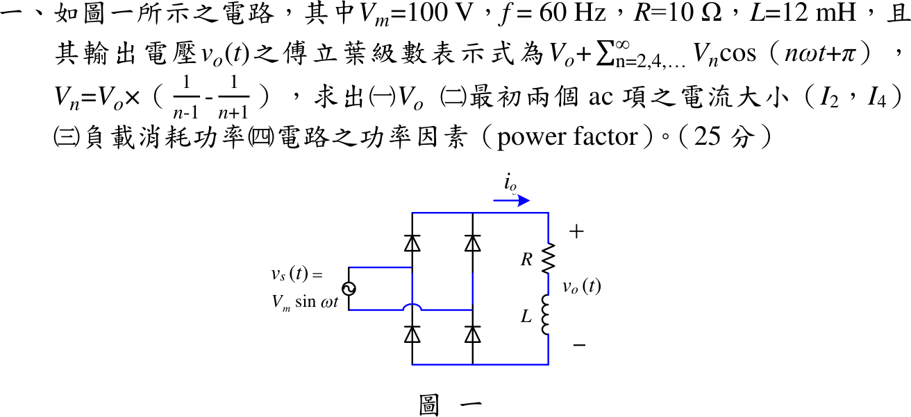

# 111 年電子學第 1 題｜橋式全波整流 RL 負載

## 已知與所求

理想二極體橋式整流，$v_s=V_m\sin\omega t$，$V_m=100\,\mathrm V$、$f=60\,\mathrm{Hz}$（$\omega=376.991\,\mathrm{rad/s}$），負載串聯 $R=10\,\Omega$、$L=12\,\mathrm{mH}$。題給 $v_o=V_o+\sum_{n=2,4,\ldots}V_n\cos(n\omega t+\pi)$，$V_n=V_o\left(\frac1{n-1}-\frac1{n+1}\right)=\frac{2V_o}{n^2-1}$。求（一）$V_o$；（二）$I_2,I_4$；（三）負載功率；（四）功率因數。

## 考場標準作答

理想橋式整流使 $v_o=|v_s|$，$v_o$ 是週期函數，可用傅立葉級數拆成直流項加偶次諧波；因負載為線性 RL，各次諧波依疊加原理分別以相量求電流，再合成功率。

### （一）直流輸出電壓

傅立葉級數的常數項 $V_o$ 就是 $v_o$ 的平均值，全波整流只需積分半週期：
\[
V_o=\frac1\pi\int_0^\pi V_m\sin\theta\,d\theta=\frac{2V_m}{\pi}
\]
代入 $V_m=100\ \mathrm V$：
\[
V_o=\frac{2\times100}{\pi}
\]
\[
\boxed{V_o=63.66\ \mathrm V}
\]
直流項電流（電感對直流視為短路，只剩 $R$）：
\[
I_0=\frac{V_o}{R}=\frac{63.66}{10}=6.37\ \mathrm A
\]

### （二）最初兩個交流項電流（振幅）

每個交流項視為頻率 $n\omega$ 的弦波電源，用相量阻抗 $Z_n=R+jn\omega L$ 求電流振幅 $I_n=V_n/|Z_n|$，題給 $V_n=\dfrac{2V_o}{n^2-1}$。

$n=2$：
\[
V_2=\frac{2V_o}{2^2-1}=\frac23V_o=42.44\ \mathrm V,\qquad 2\omega L=2(376.99)(12\times10^{-3})=9.05\ \Omega
\]
\[
|Z_2|=\sqrt{10^2+9.05^2}=13.49\ \Omega,\qquad I_2=\frac{V_2}{|Z_2|}=\frac{42.44}{13.49}
\]
\[
\boxed{I_2=3.15\ \mathrm A}
\]
$n=4$：
\[
V_4=\frac{2V_o}{4^2-1}=\frac2{15}V_o=8.49\ \mathrm V,\qquad 4\omega L=4(376.99)(12\times10^{-3})=18.10\ \Omega
\]
\[
|Z_4|=\sqrt{10^2+18.10^2}=20.67\ \Omega,\qquad I_4=\frac{8.49}{20.67}
\]
\[
\boxed{I_4=0.41\ \mathrm A}
\]

### （三）負載消耗功率

電感不耗實功，功率只發生在 $R$；不同頻率的諧波互相正交，$I_{rms}^2$ 等於各分量方均值相加（直流項全值、交流項振幅平方除以 2）：
\[
I_{rms}^2=I_0^2+\frac{I_2^2}{2}+\frac{I_4^2}{2}+\cdots
\]
\[
I_0^2=6.37^2=40.53,\qquad \frac{I_2^2}{2}=\frac{3.15^2}{2}=4.95,\qquad \frac{I_4^2}{2}=\frac{0.41^2}{2}=0.08
\]
\[
I_{rms}^2=40.53+4.95+0.08+\cdots=45.58\ \mathrm{A^2}
\]
\[
\boxed{P=I_{rms}^2R=45.58\times10=455.75\ \mathrm W}
\]
只取 $n=0,2,4$ 得 $455.65\ \mathrm W$，與完整級數相差 0.02%，考場可用。（以上各值以完整精度計算後再四捨五入顯示。）

### （四）功率因數

功率因數為實功率除以電源視在功率；橋式整流只改變電流方向，電源電流有效值等於負載電流有效值；電源電壓為純弦波，視在功率只需乘上兩個有效值，分母不必再拆諧波：
\[
I_{s,rms}=I_{rms}=\sqrt{45.58}=6.75\ \mathrm A,\qquad V_{s,rms}=\frac{V_m}{\sqrt2}=70.71\ \mathrm V
\]
視在功率：
\[
S=V_{s,rms}I_{s,rms}=70.71\times6.75=477.36\ \mathrm{VA}
\]
\[
\mathrm{PF}=\frac{P}{S}=\frac{455.75}{477.36}
\]
\[
\boxed{\mathrm{PF}=0.95}
\]
電流含直流與偶次諧波而失真，故此為含失真的總功率因數，不標超前或落後。

## 驗算

時域法：半週期內 $i(\theta)=\frac{V_m}{|Z_1|}\sin(\theta-\phi)+Ke^{-\theta R/(\omega L)}$，以週期條件 $i(0)=i(\pi)$ 定 $K$，得 $i(0)=i_{\min}>0$（連續導通，$v_o$ 確為全波正弦），積分 $\frac1\pi\int_0^\pi i^2d\theta=45.58\ \mathrm{A^2}$，與傅立葉功率和一致。另 $(10+j9.05)\tilde I_2=-42.44$ 回到題給相位 $\pi$ 的諧波電壓。

## 失分點

- $I_2,I_4$ 是振幅，功率要再除以 2（或先換有效值）；直接 $I_0^2+I_2^2+I_4^2$ 會高估。
- 功率因數分母要用電源電流有效值 $6.75\,\mathrm A$，不是 $I_0=6.37\,\mathrm A$。
- 阻抗要用 $n\omega L$，誤用基頻 $\omega L=4.52\,\Omega$ 會使 $I_2$ 偏大。
