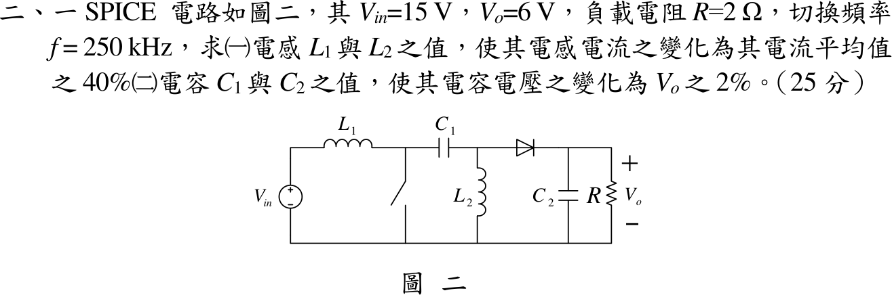

# 111 年電子學第 2 題｜SEPIC 轉換器元件設計

## 已知與所求

SEPIC：$V_{in}=15\,\mathrm V$、$V_o=6\,\mathrm V$、$R=2\,\Omega$、$f=250\,\mathrm{kHz}$（$T=4\,\mu\mathrm s$）。求（一）$L_1,L_2$ 使各自電感電流峰對峰變化為其平均值的 40%；（二）$C_1,C_2$ 使電容電壓變化為 $V_o$ 的 2%（$0.12\,\mathrm V$）。

## 考場標準作答

### 工作點

SEPIC 在 CCM 穩態：電感伏秒平衡得電壓轉換比 $V_o/V_{in}=D/(1-D)$ 與 $V_{C1}=V_{in}$；輸出功率等於輸入功率（功率守恆）求電感平均電流。
\[
\frac{V_o}{V_{in}}=\frac{D}{1-D}\ \Rightarrow\ D=\frac{V_o}{V_o+V_{in}}=\frac{6}{21}=\frac27=2.86\times10^{-1},\qquad V_{C1}=V_{in}=15\ \mathrm V
\]
\[
I_o=\frac{V_o}{R}=\frac62=3\ \mathrm A,\qquad I_{L2}=I_o=3\ \mathrm A
\]
\[
I_{L1}=I_{in}=\frac{V_oI_o}{V_{in}}=\frac{6\times3}{15}=1.20\ \mathrm A
\]

### （一）電感

電感的電壓電流關係 $v_L=L\,di/dt$：開關導通時 $L_1$ 承受 $V_{in}$、$L_2$ 承受 $V_{C1}=V_{in}$，電流線性上升 $\Delta i_L=\dfrac{V_{in}DT}{L}$。先算導通期間的伏秒，再由漣波要求（峰對峰為平均值的 $40\%$）求各電感的 $\Delta i_L$：
\[
V_{in}DT=15\times\frac27\times4\ \mu\mathrm s=17.14\ \mu\mathrm{V\cdot s}
\]
\[
\Delta i_{L1}=0.40\times1.20=0.48\ \mathrm A,\qquad \Delta i_{L2}=0.40\times3=1.20\ \mathrm A
\]
\[
L=\frac{V_{in}DT}{\Delta i_L}\ \Rightarrow\ L_1=\frac{17.14\ \mu\mathrm{V\cdot s}}{0.48\ \mathrm A},\qquad L_2=\frac{17.14\ \mu\mathrm{V\cdot s}}{1.20\ \mathrm A}
\]
\[
\boxed{L_1=35.71\ \mu\mathrm H},\qquad \boxed{L_2=14.29\ \mu\mathrm H}
\]

### （二）電容

電容的電荷關係 $\Delta V_C=\Delta Q/C$：導通期間 $C_1$ 放出 $L_2$ 的電流 $I_{L2}$，$C_2$ 獨自供應負載電流 $I_o$，兩者都是 $3\ \mathrm A$ 持續 $DT$，所以放出的電荷相同。電壓變化要求為 $V_o$ 的 $2\%$：
\[
\Delta V_C=0.02\times6=0.12\ \mathrm V
\]
導通期間放出的電荷：
\[
\Delta Q=I\,DT=3\times\frac27\times4\ \mu\mathrm s=3.43\ \mu\mathrm C
\]
\[
C=\frac{\Delta Q}{\Delta V_C}\ \Rightarrow\ C_1=\frac{3.43\ \mu\mathrm C}{0.12\ \mathrm V},\qquad C_2=\frac{3.43\ \mu\mathrm C}{0.12\ \mathrm V}
\]
\[
\boxed{C_1=28.57\ \mu\mathrm F},\qquad \boxed{C_2=28.57\ \mu\mathrm F}
\]

## 驗算

截止期間核對電荷平衡：$C_1$ 吸收 $I_{L1}(1-D)T=1.20\times\frac57\times4\,\mu=3.43\,\mu\mathrm C$，等於導通期間放出的 $I_{L2}DT=3\times\frac27\times4\,\mu=3.43\,\mu\mathrm C$，故 $\Delta V_{C1}=3.43\,\mu/28.57\,\mu=0.12\,\mathrm V$。功率守恆 $15\times1.20=6\times3=18\,\mathrm W$。

## 失分點

- $C_1$ 的轉移電荷用 $I_{L2}=3\,\mathrm A$（或截止期間的 $I_{L1}$ 配 $1-D$）；用 $I_{in}=1.2\,\mathrm A$ 配 $D$ 會得 $11.43\,\mu\mathrm F$。
- $L_2$ 的平均電流是 $I_o=3\,\mathrm A$，不是 $I_{in}$。
- SEPIC 增益為 $D/(1-D)$，誤用 Boost 的 $1/(1-D)$ 會得負的 $D$。
